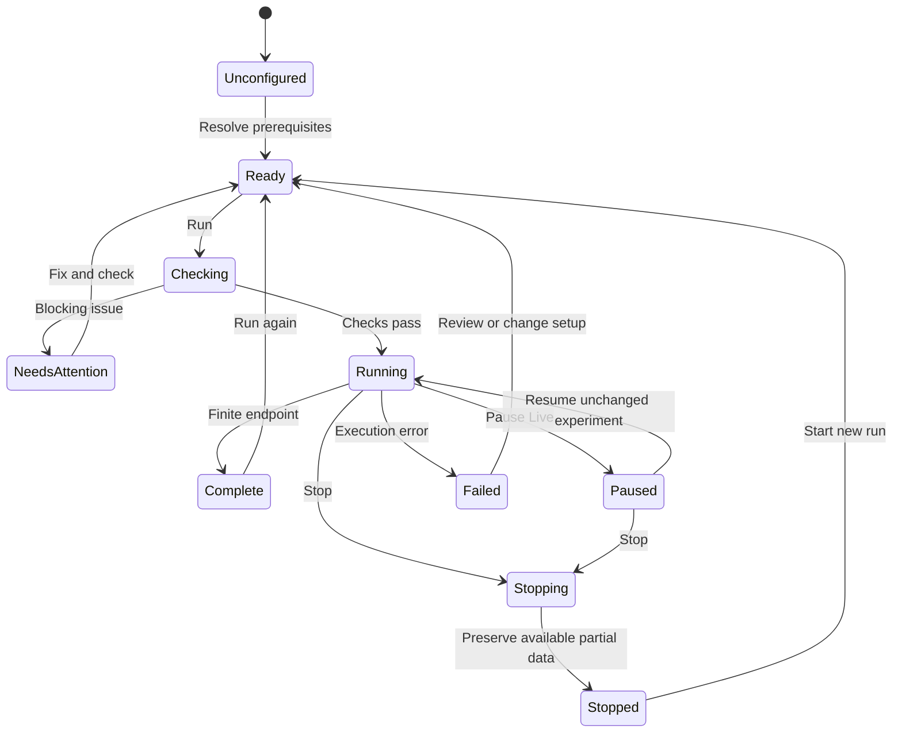

# UI design

This design serves the [user stories](01-user-stories.md). All screens below are proposals. The central choice is **one TinyCAD drawing file with schematic and non-drawing Simulation sheets**. Setup, instruments, and results live within that document and use its existing sheet navigation. No project support or multi-file hierarchy is added in this version.

SPICE symbol sourcing and selection belong to a separate branch. Assume symbols are already available through the editor and start these workflows with placed components. Existing library UI shown in workspace sketches is context; this work adds no symbol providers, search filters, import flow, or selection/placement interface.

## 1. Interaction principles

| Principle | UI consequence |
| --- | --- |
| Begin with a question | Offer **Measure DC**, **Over time**, **Frequency response**, and **More analyses**. Show the technical name alongside the plain label. |
| Make the first result easy | Provide configured examples and sensible, visible defaults. Explain only the missing prerequisites for the current task. |
| Reveal depth where it is needed | Keep common fields visible; place specialized solver, model, and acquisition settings under named expandable sections. |
| Keep cause and result together | Selecting a trace, reading, model issue, or terminal can locate its circuit target. |
| Make electrical assumptions visible | Show measurement reference, direction, units, excitation, and ideal-device assumptions. |
| Preserve trust | Label partial, stale, trial, and sample results. Never silently substitute a model or change a numerical setting to force success. |
| Make actions recoverable | Preserve previous results; allow cancel, undo, duplicate analysis, and discard trial values. |

Use **ngspice** in capability details and diagnostics. Everyday controls describe the task, such as **Run** and **Measure voltage**, without requiring knowledge of the engine.

## 2. Workspace and information architecture

Retain TinyCAD's drawing toolbar, left side panel, sheet tabs, and bottom panel. Extend the existing sheet bar's **+** action with **Schematic** and **Simulation** choices. Add a visible **Simulate** entry in the drawing toolbar and a **Simulation** menu with the same commands in browser and desktop layouts. Symbol-library editing does not display a circuit Run command.

### Two sheet types in one document

| Sheet type | Contents | Contribution to simulation |
| --- | --- | --- |
| Schematic | Existing circuit drawing, components, wires, labels, and annotations | All schematic sheets contribute to the shared circuit using TinyCAD's existing connectivity rules. |
| Simulation | One named analysis setup, analysis parameters, short lesson instructions, selected signals/measurements, instrument views, and run results | Controls and displays an analysis of the shared circuit. Forms, notes, and plots are not circuit elements. |

For example, `RC lesson.dsn` can contain `[Circuit] [Power] [DC checks] [Charging experiment]`. Icons and accessible labels distinguish the two sheet types; every tab belongs to the same drawing file. **Simulation sheet** is the everyday organizing concept. An **analysis** is the question configured on that sheet, and a **run** is one execution of it.

Use one Simulation sheet per saved analysis. Different analyses or parameter setups use additional Simulation sheets, while their circuit stays shared. Ordinary component/source values belong to the schematic; analysis settings and explicitly labeled trial/sweep overrides belong to the Simulation sheet. An override never silently changes the shared circuit. Notes can explain a lesson without requiring a separate document or another sheet type.

### Sheet behavior

- **Simulate** opens the most recently used Simulation sheet, or offers the common task choices and creates the first one. It does not open another file or a project wizard.
- **New analysis** and **+ → Simulation** are two routes to the same sheet-creation action. Default names describe the task and can be renamed.
- Rename and reorder use the ordinary sheet controls and preserve references. Duplicate copies the setup, notes, and instrument/measurement configuration; it starts with no new run data. The duplicated setup still uses the same shared circuit.
- Closing or hiding a view does not delete its sheet. Deleting a Simulation sheet explicitly removes its setup and retained results, with a reviewable warning when data would be lost and an undo path. If it owns the running analysis, stop that run explicitly before deleting the sheet.
- Deleting or changing a schematic sheet uses normal drawing actions and marks affected simulation results out of date. Unresolved probes remain visible.
- Switching tabs never starts or stops a run. One active run per drawing remains visible with its owning Simulation sheet's name. A selected setup cannot relabel another sheet's running acquisition.

### Main view and optional docked view

A Simulation sheet uses the main editing area for setup and results, rather than presenting an empty drawing canvas:

- A compact simulation strip with active analysis, Run, state-dependent controls, and run status.
- A common-parameter form and optional instruction text, with advanced settings collapsed.
- **Results**, **Measurements**, **Data**, **Instruments**, **Problems**, and **Output** views within that sheet as applicable.

When a user returns to a schematic sheet to probe or edit, its Simulation sheet can remain visible as a compact setup panel and docked result view. These are views of the same sheet's settings and results, not a second simulation document. The strip says, for example, **Probe for: Frequency response**. **Return to simulation sheet** restores its main view.

Do not require an additional permanent right sidebar or a project tree. **Inspect selection** opens contextual properties; simply selecting a part while probing does not replace the visible plot with a properties editor.

### Schematic with a docked simulation view

```text
+--------------------------------------------------------------------------------+
| TinyCAD  Low-pass.dsn *              existing file / drawing tools   [Simulate] |
| Analysis: Low-pass response v      [Run] [Probe v] [Instruments]  Ready          |
+----------------------+---------------------------------------------------------+
| Libraries | Simulation|                                                         |
|                      |                SCHEMATIC                                |
| Low-pass response    |   IN o---R1 1k---o OUT                                  |
| Frequency response   |                  |                                      |
|                      |                 C1 100n                                 |
| Setup                |                  |                                      |
| Input      IN        |                Ground                                   |
| Output     OUT       |                                                         |
| Range 10Hz..100kHz    |  [Circuit] [Power] [DC checks] [Frequency response] [+]    |
| [Advanced...]        +---------------------------------------------------------+
|                      | Results | Problems (0) | Output | Properties            |
| Sections:            | Run 12: complete    [Pin baseline] [Compare] [Export]    |
| Setup                | Gain (dB) / Phase (deg)                                 |
| Instruments          |   labeled, synchronized plots                           |
| Signals              |                                                         |
| Runs                 | [Add signal] [Fit] [Cursors] [Measurements] [Data]      |
+----------------------+---------------------------------------------------------+
```

This is an information hierarchy, not a pixel specification. Start reviews at 1440 × 900 and 1366 × 768. At 1366 × 768, aim for at least 600 × 300 CSS pixels of usable schematic when results are docked. Resize or collapse panels before squeezing controls. The top toolbar and active run status remain reachable independently of panel scrolling.

### Simulation sheet in the main area

```text
+----------------------------------------------------------------------------+
| TinyCAD  RC lesson.dsn *                       [Run] [Probe circuit] Ready  |
+----------------------------------------------------------------------------+
| Frequency response — Simulation sheet                                      |
| Instructions: Find the cutoff, then change R1 and compare.                  |
| Setup: IN / OUT     10 Hz .. 100 kHz     100 points/decade   [Advanced...]  |
|                                                                            |
| Results | Measurements | Data | Instruments | Problems | Output             |
| Run 12: complete             [Pin baseline] [Compare] [Export plot/data]     |
|                  Gain and phase plots                                      |
|                                                                            |
| [Circuit] [Power] [DC checks] [Frequency response] [+]                       |
+----------------------------------------------------------------------------+
```

### Left panel sections

| Section | Contents |
| --- | --- |
| Setup | Compact view of the selected Simulation sheet's setup while viewing a schematic; Open sheet returns to the full form. |
| Instruments | Connected instruments as compact cards; Add instrument opens the catalogue. |
| Signals | Searchable nets, device currents, powers, and expressions, grouped by sheet or device. |
| Runs | Run history with analysis, status, revision, parameters, time, and pinned baseline. |

Show one section's detail at a time. Sheet tabs are the primary navigation between circuit and saved analyses; do not add a separate project or workbook navigator. The target Simulation sheet stays named in the simulation strip whichever section is open. Re-running creates a new result on that sheet rather than renaming the old result as current.

### Simulation menu

**Open simulation sheet**, **New simulation sheet**, **Run selected analysis**, **Check readiness**, **Probe circuit**, **Instruments**, **Compare runs**, **Export**, and **Advanced** are the main groups. **Advanced** contains generated circuit text, custom analyses, model inventory, and numerical settings. Pause, Resume, Stop, and Restart appear only in their applicable states.

Use a searchable **Find simulation command** entry in the workspace to reach less common features. Every shortcut and context-menu action also has a visible menu or button route. Proposed shortcuts require a collision review against existing TinyCAD and browser commands before assignment; do not appropriate browser refresh or existing drawing keys.

## 3. Entry, onboarding, and readiness

### Empty drawing

The welcome state has two primary routes: **Open an example** and **Set up this drawing**. Examples initially cover a divider, RC charging, and an RC low-pass filter. P1 adds a transistor amplifier and a logic circuit. Each includes a question, configured setup, expected qualitative behavior, and a **Run** action.

Opening an example creates a new drawing containing its schematic and configured Simulation sheets, or offers a new drawing copy if the current drawing has unsaved changes. It must not replace work silently. Provide a short, dismissible explanation of sheet tabs, Run, Probe, and Results; no mandatory onboarding tour.

### Existing drawing

The readiness view groups **Models**, **Reference and sources**, **Connections**, and **Analysis setup**. Its summary shows `Ready`, `3 things to fix`, or `Ready with 2 warnings`. It distinguishes a detected problem from a suggestion and lists explicit exclusions.

```text
Set up this drawing                         [Check again]

Needs attention
  U1: No simulation model                   [Choose model]
  Reference ground is not set               [Choose ground]

Warnings
  J1: Excluded from simulation              [Review]

Models: 12 ready, 1 missing     Circuit: all 3 schematic sheets
Question: [Measure DC v]                    [Run: fix 2 issues]
```

The Run action remains discoverable when blocked and opens the specific issues; do not leave an unexplained disabled icon. A missing model is a blocker for an included electrical component. A connector or decorative symbol can be excluded explicitly, with an explanation of its connection effect. No readiness badge promises that a model is physically accurate or a circuit will converge.

The simulation uses the circuit across all schematic sheets in the drawing. Non-drawing Simulation sheets supply setup and views, not netlist elements. Selecting a schematic or Simulation tab does not select a circuit subset or change connectivity. **Simulate selection**, linked schematic documents, and multi-file testbenches are outside this version's scope.

## 4. Configure an analysis

Choose **+ → Simulation** or **New analysis**, then select a task card to create a Simulation sheet in the current drawing. The card shows its plain label, technical term, short explanation, and prerequisites. The four common entries are Measure DC, Over time, Frequency response, and DC sweep. Other analyses are searchable under **More analyses**.

The Simulation sheet is the primary setup view; the side panel offers a compact view of those same settings while a schematic is active. Defaults are actual values, not placeholders. Every form has the sheet's **Name**, optional **Instructions**, common parameters, **Signals and measurements**, a collapsed **Advanced** section, and a compact run summary. DC sweep joins the common task cards at P1; the first P0 surface contains the first three tasks. Setup and instructions are non-drawing content saved in the drawing.

| Analysis | Visible common setup | Contextual or advanced setup |
| --- | --- | --- |
| Measure DC / Operating Point | Whole drawing; optional voltage/current overlays | Temperature; model-specific options; numerical settings |
| Over time / Transient | Duration; starting-state choice; selected signals | Maximum time step; output sampling; save-from time; explicit initial conditions |
| Frequency response / AC small-signal | Input and reference; output and reference; excitation source; frequency range; points per decade | Linear/octave sampling; complex views; phase display |
| DC sweep | Eligible source; start, stop, increment; output signal | A second sweep; other supported swept quantities |

**Over time:** Default starting state is **Use DC operating point**. Explain that **Use specified initial conditions** is a different experiment. **Save results from** controls retained data, not a delayed physical start. Distinguish a solver's maximum step from display sampling. Do not label one ambiguous field “Accuracy.”

**Frequency response:** Explain **Small changes around the DC operating point**. A transient sine waveform does not automatically establish the selected small-signal AC excitation. Offer **Set AC excitation** and show the change before applying it. If other AC sources are active, list them; a gain measurement can otherwise be misleading.

### Units and input

Fields include their quantity and a normalized preview, for example **Resistance: 1 kΩ**, **Duration: 5 ms**, **Peak amplitude: 1 V**, **Offset: 2.5 V**. Accept helpful engineering entry conventions through a documented, consistent UI policy; retain the original text until committed.

Guided fields use case-sensitive SI intent: `1 MΩ` means one megaohm, normalized to an unambiguous engine representation. Bare uppercase `M` is ambiguous across SI and SPICE: require the user to choose **mega** or **milli** before commit. `m`, `meg`, `u`, `µ`, `μ`, scientific notation, and explicit units have a visible normalized result. Raw SPICE uses engine conventions. Never silently reinterpret legacy model text. See [numeric requirements](04-requirements.md#numeric-and-electrical-meaning).

Use locale-aware presentation and a declared decimal-input policy. Expressions and circuit text retain their documented syntax. Unit mistakes produce a field error such as **Enter a time, for example 5 ms**. Validate ranges and display a sample/run count before a large request.

## 5. Components, models, and sources

### Simulation settings for placed components

For a component already in the drawing, the simulation inspector shows **Built-in model**, **Model assigned**, **Needs model**, **Excluded**, or **Unverified custom model**. “Assigned” means an assignment is present; a successfully tested example can earn a separate **Example tested** note, never a universal accuracy guarantee. These statuses describe simulation readiness and do not prescribe changes to symbol browsing or selection.

Placed component properties gain a **Simulation** section with model, principal value, pin map, and **Open model editor**. Assigning or overriding a model here is a drawing-level change. Symbol-library editing and reusable library-assignment workflows belong to the separate branch.

### Model assignment sketch

```text
U1 — Simulation model
[Built-in] [From file] [Existing assignment] [Advanced template]

File: amplifier.lib [Choose...]     Model: [AMP_MODEL v]
Status: assignment needs pin review

Symbol pin                 Model terminal             Review
1  OUT                     [OUT v]                    mapped
2  -IN                     [IN- v]                    mapped
3  +IN                     [IN+ v]                    mapped
4  V-                      [VEE v]                    mapped
8  V+                      [VCC v]                    mapped

[Symbol preview]  [Model details]  [Generated circuit text]
Applies to: U1 in this drawing
                                         [Cancel] [Apply]
```

This editor configures the simulation model of the already placed U1; its model-file choice does not select or replace U1's graphical symbol. Show the model's declared terminal order alongside names; pin numbers alone are insufficient. Highlight unused or duplicated mappings, hidden supply pins, multi-unit symbols, model dependencies, and missing files. Uncertain auto-matches require review. Show model origin, descriptive notes, compatibility status, and dependency availability.

Keep geometry, electrical symbol pins, and simulation terminals distinct. Imported graphics never establish pin correctness. Multi-unit symbols map one physical device consistently and do not create duplicate simulated packages.

### Source editor

Voltage and current sources have clear **DC**, **Sine**, **Pulse**, and **Piecewise linear** choices with a waveform preview. Show amplitude convention explicitly. Pulse setup includes delay, rise, fall, width, and period; inconsistent timings are field errors. Piecewise linear entry uses a time/value table and supports adding or importing points at P1.

**AC small-signal excitation** is a separate named section with magnitude and phase. A bench signal generator is another view of a source with visible output terminals and impedance. Changing that source through either view updates the same experiment setting.

### Existing SPICE templates and RUN symbols

On first simulation setup, inventory existing RUN and analysis directives. Offer **Keep as Custom analysis** or **Create guided analysis** when conversion is supported, with a preview of interpreted fields. Unsupported text stays visible and is never discarded.

A guided analysis owns its analysis settings. A custom analysis owns its explicit commands. Model definitions and circuit declarations remain applicable in either case. If legacy templates introduce conflicting run or analysis commands, block with **Two analysis control sources found** and let the user resolve them. Returning to legacy export does not silently modify old templates.

## 6. Probe and result interactions

Probe mode is explicit: choose **Probe → Voltage**, **Differential voltage**, **Current**, **Power**, or later **Logic**. Highlight the target before placement. An optional smart probe can suggest a measurement, but the current type remains labeled and changeable.

| Action | Behavior |
| --- | --- |
| Select a wire for Voltage | Add that net's voltage relative to the visible selected reference; default is simulation ground. |
| Select two nodes for Differential voltage | Show `V(positive) − V(negative)`, with polarity markers and a Swap action. |
| Select a device or terminal for Current | Show the available branch or terminal currents with an arrow and named positive direction. |
| Select a device for Power | Add supported absorbed/delivered power with its sign convention; otherwise explain why unavailable. |
| Select an existing probe | Focus its trace or reading; do not add duplicates. |
| Select a trace or issue | Highlight and optionally locate the circuit object on the correct sheet. |
| Press Escape | Cancel a pending probe step or leave probe mode. It does not stop a run. |

Do not claim a unique current exists for an arbitrary ideal wire. If device current is unavailable, offer a supported current measurement or an explicitly inserted sensing element, explaining its circuit effect. Do not invent zero readings.

If a new probe's data was retained, show it immediately. Otherwise offer **Run again to record this signal**. A removed target leaves an **Unresolved probe** entry; it must not reconnect to an unrelated renumbered net.

### Result area

Results belong to their Simulation sheet and can be viewed there or docked beside a schematic. The header identifies sheet, analysis, run, circuit revision, state, and timestamp. Views are **Plot**, **Measurements**, and **Data**. Operating Point opens a readable table and optional schematic overlays; it does not require the engine output log to find the answer.

Provide Add signal, hide/show, rename display label, remove, Fit, zoom history, exact axis limits, linear/log axes, cursors, and export. Group unlike dimensions into separate panes by default. AC magnitude and phase share frequency navigation. Users may deliberately overlay compatible quantities and choose a secondary axis with a visible unit label.

Trace labels include quantity and target. Use distinct line styles or markers as well as color, including a strong selected-trace outline. Cursors allow dragging and exact numeric placement. A keyboard-accessible data table and measurement list offer access to the same information.

Named measurements initially include minimum, maximum, mean, RMS, peak-to-peak, value at a point, and cursor deltas where applicable. Later add rise/fall time, frequency, duty cycle, gain, bandwidth, and phase at a frequency. Every measurement shows its run, signal, interval, method, and units. The default interval is the full retained record, explicitly labeled; panning or zooming never silently changes it. Offer **Use visible interval** as an action.

### Compare and history

Choose **Pin baseline**, then **Compare**. A run picker shows runs from Simulation sheets within this drawing, with sheet name, revision, setup differences, parameter values, model changes, and state. Compatible axes can overlay; incompatible analyses open side by side within the result view. Interpolation or resampling is declared. Labels distinguish a previous valid result, a trial result, and the current completed run. This version does not add a browser for runs in other drawing files.

History is bounded, with visible retention controls. Pinned runs are protected from automatic removal. A deleted plot view does not silently delete its analysis or result data. Removed data leaves a setup record marked **Results not retained**.

## 7. Instruments without clutter

**Instruments** opens a searchable shelf grouped as **Measure**, **Generate**, and **Analyze**. Initially feature Meter and, at P1, Scope and Signal Generator. Expand the catalogue through **More instruments**. An unopened instrument is a compact connection/status card; opening it docks its panel in the result area. Full-screen instrument view is optional, and closing a panel preserves its connections.

Connection has two equivalent routes: draw a measurement lead from an instrument terminal, or choose a net/device in a searchable connection picker. Temporary colored leads can be hidden separately from electrical wires. Each terminal has a name, polarity, connection label, and **Locate** action. Probe leads used only for viewing do not alter topology.

| Instrument | Main face | More controls |
| --- | --- | --- |
| Meter | Quantity/mode, terminals, reading, units, reference, reading state | Measurement interval, AC convention, explicit loading model when supported |
| Scope | Channel connections, volts/div, time/div, position, Run/Pause/Single, trigger status, Fit | Trigger source/edge/level; coupling; pretrigger; acquisition window; cursors; channel math |
| Signal generator | Waveform, frequency, offset, peak or peak-to-peak amplitude, Output enable | Duty cycle; phase; rise/fall; burst/arbitrary signal; output impedance |
| DC supply | Output voltage, enable, positive/negative terminals, measured current | Output resistance; current limit and constant-voltage/current state only with a supporting supply model |
| Bode instrument | Input/output references, excitation, range, gain/phase plots | Sampling; cursor measurements; export |
| Logic analyzer | Channel/bus connections, timing view, trigger, state legend | Threshold/bridge setup, radix, timing measurements |

The meter starts with **DC voltage** in P0, reading the selected Operating Point result. At P1, a DC reading from a time record is the mean over the labeled acquisition interval; an instantaneous sample is a separate explicitly selected reading. P1 also adds supported current, AC RMS, resistance, and continuity modes. Resistance/continuity requires an explicit unpowered test setup; it cannot be a passive reading of an energized circuit. AC RMS must state whether the DC component is removed. An open terminal displays **Not connected**, not `0 V`.

### Operating the circuit

P1 adds **Operate controls** within Live mode for supported switches, momentary buttons, and adjustable sources. The pointer and a persistent label distinguish operating a control from moving its symbol. Keyboard and touch actions expose the same switch state or press/release behavior. Opening a switch changes a modeled device state; it is not a schematic rewiring edit. A change is applied at an identified simulated time or visibly queued for the next acquisition, according to the available capability.

Potentiometer adjustment follows the explicit trial-tuning contract unless continuous operation is supported and recorded. Pausing freezes the acquisition; a user can stage a control change with its pending status visible, then resume or restart as required. LED/lamp indicators are optional overlays tied to modeled current or power and a disclosed display rule. They cannot stand in for a physical brightness, thermal, or damage model. Selecting an indicator opens its measured quantity and time; stale or unavailable data has a distinct appearance. Reduced motion can turn animation off without losing readings.

Default measurement instruments are clearly labeled **Ideal measurement**. A later realistic instrument model must show impedance, burden, bandwidth, or loading in a named configuration. Generator output impedance is visible; it is a circuit stimulus, not an ideal observation. Channel coupling affects the instrument view and must not silently change the source or circuit.

One active experiment can drive multiple views. Opening a scope during AC results offers **Switch to Live / Over time** or **Open existing time result**; it does not imply that an AC analysis has a live time waveform.

## 8. Run controls and state

Finite analyses and Live mode use the same result identity rules, but different controls. A finite run executes once to its configured endpoint. Live mode repeatedly acquires supported time-domain behavior until stopped. Playback of recorded data is labeled **Playback** and cannot modify a past acquisition.



**Freshness is a separate result property**, not another execution state: a running snapshot can finish successfully after the drawing has changed, while remaining out of date relative to that drawing.

| State | Main controls and message |
| --- | --- |
| Unconfigured / Needs attention | Set up / Fix issues; Run reveals requirements. |
| Ready / Complete / Stopped / Failed | Run or Run again; previous results remain inspectable. |
| Checking | Checking readiness; Cancel. |
| Running finite analysis | Stop; elapsed time and meaningful progress where available. No speculative completion percentage. |
| Running Live | Pause, Stop, Single acquisition where configured; simulated time and acquisition status. |
| Paused Live | Resume, Stop; changing the experiment requires Restart. |
| Stopping | Stopping…; after a timeout, offer Abort with the partial-data consequence explained. |
| Out-of-date result | Persistent result badge, changed-setting summary, and Run again. |

Only one experiment runs per drawing in this design. Selecting another analysis while one is running can inspect its setup and results but does not start it. Running it requires stopping the current experiment through a clear action.

Finite runs use a fixed circuit/setup snapshot. Users can edit the drawing during a run; edits affect the next run and mark the completed snapshot accordingly. Live mode allows only explicitly supported stimulus/control adjustments at recorded simulated times. Trial component tuning creates a new acquisition. Rewiring, changing a model, or changing an unsupported setting stops and restarts Live after a clear prompt. Never splice incompatible time histories into a continuous trace.

Stop preserves available partial data and the original requested endpoint. Starting again creates a new run; it does not pretend to resume a stopped solver. Pause/Resume is offered only when the capability actually preserves the same experiment. Reset requires an explicit **Restart from initial state** action with the resulting acquisition boundary visible.

## 9. Problems and recovery

Problems carry severity, subject, plain explanation, a Locate/Fix action, and **Technical details**. Group repeats under one cause. Keep the previous successful run available after a failure.

| Problem | User-facing response |
| --- | --- |
| Missing reference | **Choose a simulation ground. Voltages need a reference.** Offer Choose ground. |
| Missing model | **U1 has no simulation model.** Offer Choose model or review exclusion. |
| Invalid pin map | **Model terminal VCC is not assigned.** Open the map at that terminal. |
| Missing AC excitation | **Choose an AC input source for this frequency analysis.** Open source settings. |
| Suspected floating node | **OUT may have no DC path to reference.** Locate it; explain capacitive isolation and model context. |
| Nonconvergence | **The solver could not find a consistent solution.** Show failed stage, available location, and suggested investigations. |
| Empty plot | **Run complete. Choose a signal to plot.** Offer Add signal; distinguish no retained data. |
| Unsupported model or feature | Name the dependency/capability and offer alternatives only as explicit user choices. |

Recovery suggestions can explain smaller steps, initial conditions, or model checks. Applying a suggested numerical change previews it, creates a new run, and records it. Do not automatically insert resistors, ignore devices, or loosen tolerances.

## 10. Save, reopen, and export

**Save**, **Save as**, and **Open** operate on one TinyCAD `.dsn` drawing containing all schematic and Simulation sheets. Saving preserves sheet names/types/order, analysis definitions, parameters, instructions, model assignments, dependency references, probes, instrument connections, measurements, and notes. Result data has an explicit retention choice; retained results are saved within that same drawing. Setup-only saving leaves a clear Results not retained state on reopen. The [implementation architecture](07-implementation.md#single-file-serialization) proposes versioned records within the existing XML document; the single-document user experience is fixed for this version.

For education, **Save a copy** shares the lesson drawing with its circuit, setup, and instructions. There is no separate experiment package, simulation workbook, project folder, or required setup/results sidecar. Existing external model references can still be reported as dependencies; this work does not turn them into managed project assets or imply that unavailable models are included.

### Export and remove stored results

P0 adds **Export results…**, **Remove stored results…**, and **Save a copy without results…** in the Results header and Simulation menu. Export supports recorded numerical data as CSV or a self-describing JSON dataset, measurements as CSV, and plots as SVG. Choose selected runs, this Simulation sheet, or the whole drawing, plus signals and interval. Export includes units, run/sheet identity, provenance, and partial/stale/trial status; it uses retained numerical samples rather than plot decimation. **Export SPICE netlist** remains a separate circuit output.

The removal dialogue shows affected runs, including pinned baselines, and an estimated size reduction. **Export first…** is available, but removal still requires its own explicit action. Export failure or an unverified browser download never removes data automatically. Removal clears selected recorded samples, derived values/caches, previews, and generated logs while keeping the circuit, analysis parameters, instructions, instrument/probe configuration, measurement definitions, and compact run metadata. Display **Results removed**; a pinned baseline without data cannot supply a comparison.

Removal marks the drawing dirty and is undoable within the documented memory budget; the file becomes smaller after a successful save rewrites it without those payloads. Stop any active run in scope first. **Save a copy without results** writes a compact setup-only drawing and leaves the open original intact. These optional outputs are not required to reopen or run a drawing. Details are in [DSN format and result management](09-dsn-format-and-results.md).

### Compressed drawing format

New drawings default to XML `.dsn` files. Automatic saves use ZIP `.dzn` when retained numerical buffers and solver logs total at least 1 MiB; omitted or removed results do not count. The Open command auto-detects compressed versus XML drawings from their headers and validates the detected format. Both extensions use the same sheet workflow; the user does not unzip anything. The archive internally holds document XML and optional binary result payloads.

Ordinary Save uses the automatic policy unless an explicit format is selected. **Save as** can explicitly choose **Compressed drawing (.dzn)** or **XML DSN (.dsn)**. Compression is distinct from retention: a compressed file can include results or be setup-only. It is also distinct from compatibility: XML containing new Simulation records is not automatically safe to round-trip through older TinyCAD.

If a legacy-compatible drawing export omits non-drawing sheets or setup, explain that loss before exporting and retain the original complete drawing. Compatibility with older TinyCAD versions needs an explicit preservation check before release.

## 11. Smaller displays and accessibility

At narrower widths, collapse the side panel and use the same sheet tabs to switch between schematic and Simulation sheets. Within a Simulation sheet, switch between Setup, Results, and Instruments rather than compressing every pane. Maintain the owning sheet's name and run/stop control in a persistent compact strip. At phone widths, prioritize inspection, parameter changes, and running configured experiments; do not promise a comfortable full bench in the first UI milestone.

Instrument knobs always have an equivalent numeric field. Probe targets can be chosen from signal lists; differential selection also supports two explicit pickers. Touch uses the existing loupe and visible actions, with no hover-only requirement. Table navigation, cursor placement, panel resizing, and terminal selection must be possible with a keyboard. Use accessible names, visible focus, non-color state cues, clear announcements, and reduced-motion behavior.

Continue to [Feature sets](03-feature-sets.md).
