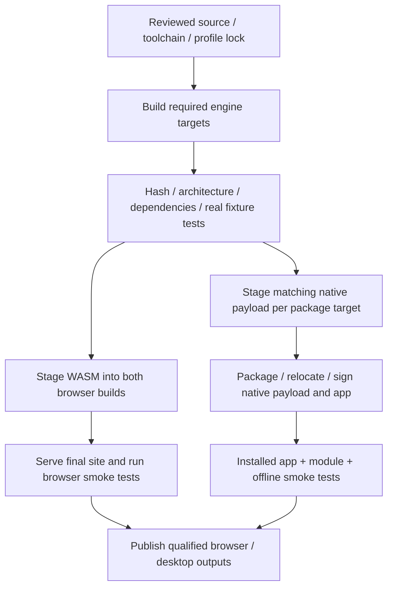

# Engine builds, bundling, and release verification

Implementation update: see [Running the simulation integration](10-implementation-status.md) for the code now present, build commands, verification and outstanding work. The design below also describes later capabilities.


Status: proposed build implementation, researched on 7 November 2026. This describes work to implement; no workflow, dependency lock, native binary, or WASM artifact has been created or qualified by this documentation change. Read alongside the [runtime architecture](07-implementation.md).

## 1. Recommended supply strategy

**Build both engines in TinyCAD-controlled GitHub Actions from one pinned upstream ngspice release.** Bundle qualified outputs into the browser site or Electron installer. Users do not install ngspice, choose a binary repository, or download executable modules on first run.

Use ngspice 47 as the initial qualification candidate. The official download page identifies it as a stable release and provides its source archive. Lock the exact archive digest before implementation builds; do not resolve “latest” during a release. [Upstream downloads](https://ngspice.sourceforge.io/download.html), [ngspice 47 release source](https://sourceforge.net/projects/ngspice/files/ng-spice-rework/47/ngspice-47.tar.gz/download).

Build from a source release rather than mixing a browser npm binary, a system Linux package, a Homebrew dylib, and an unrelated Windows ZIP. A single source revision plus explicit target profiles makes differences visible and testable. It does not imply that all platform features will be identical.

### WASM repositories considered

| Source | Evidence inspected | Decision |
| --- | --- | --- |
| [eelab-dev/EEcircuit-engine](https://github.com/eelab-dev/EEcircuit-engine) | Maintained application-facing package with a build recipe and Node/browser/consumer test scripts. The repository was unarchived and recently updated when inspected. | Best reference candidate for the WASM port and tests. Evaluate code reuse at a pinned commit, with attribution; do not assume its API meets the full TinyCAD contract. |
| [EEcircuit build recipe](https://github.com/eelab-dev/EEcircuit-engine/blob/main/Docker/run.sh) | Selects Emscripten `latest`, discovers upstream releases, and disables XSPICE/OSDI in the inspected recipe. Its exported build metadata is narrower than the lock required here. | Replace moving inputs with a TinyCAD lock and declare the resulting capabilities. Review any source patches rather than inheriting them implicitly. |
| [EEcircuit simulation wrapper](https://github.com/eelab-dev/EEcircuit-engine/blob/main/src/simulationLink.ts) | Runs a command sequence and reads a resulting raw file. | Useful reference for model staging and output parsing; not evidence of streamed partial vectors or in-solve Pause/Resume. Qualify the callback bridge separately. |
| [wokwi/ngspice-wasm](https://github.com/wokwi/ngspice-wasm) | A minimal Docker-based port; inspected repository history showed one commit and an older update. | Reference only; insufficient evidence for choosing it as the maintained release supplier. |
| [z-wasm/ngspice-wasm](https://github.com/z-wasm/ngspice-wasm) | Build script and module interface, with a very small inspected history. | Additional port reference; no maintenance/support guarantee assumed. |

This is a maintenance assessment from the inspected primary repositories, not a support commitment from their authors. Star counts are not a qualification test. Copying a wrapper's licence label does not establish the licences of the compiled ngspice sources, modules, or bundled models.

If implementation adopts EEcircuit's packaged interface for an early spike, pin its exact version and npm integrity in `package-lock.json`, record the embedded engine revision, self-host its assets, and keep it behind the same backend interface. It does not replace the release strategy until same-source builds, streamed results, Stop behavior, limits, and fixtures pass. Do not automatically switch suppliers when one build fails.

## 2. Source lock and build identity

Add a proposed `build-support/ngspice/engine.lock.json` and checked-in recipes/patches. It must describe all executable inputs, not just an npm package version:

| Locked input | Required contents |
| --- | --- |
| Engine source | Upstream release/version, immutable source URL or commit, verified SHA-256 of downloaded archive, source provenance, included source notices. |
| Port patches | Ordered patch files, each digest, reason, upstream issue/reference where available, and the source revision it applies to. A failed or offset/ambiguous patch application fails the build. |
| WASM toolchain | Exact emsdk/compiler version, container image digest, SDK downloads/digests, linker settings, exported bridge ABI, memory model, feature profile. |
| Native toolchains | OS/architecture, compiler/linker and runtime versions, SDK/sysroot/deployment minimum, dependency source versions/digests, configure/build settings. |
| TinyCAD bridge/helper | Source-tree digest, protocol version, compiler options, enabled features. |
| Build environment | Runner OS/image information; for reproducible dependencies, pinned toolchain/container/sysroot inputs rather than reliance on a moving runner's preinstalled tools. |
| Test corpus | Fixture revision, expected supported profiles, tolerances, and mandatory acceptance tests. |

The first engine PR must populate real, reviewed digests. This documentation intentionally does not invent source hashes or an untested emsdk version. Build scripts must reject missing digests, placeholders, floating branches, `latest` SDK/container tags, and an unexpected toolchain. Version 47 is a qualification starting point, not a claim of a successful TinyCAD build.

Define `buildId` from a canonical hash of source identity, patches, bridge/helper source, protocol, target triple, compiler/toolchain inputs, feature flags, and dependency locks. Keep this separate from the final archive checksum, which identifies the bytes of one output. Include minimum OS/ABI and relevant compiler-runtime dependencies in the target metadata.

A generated manifest accompanying every payload must contain:

```text
manifestVersion, buildId, protocolVersion
ngspiceVersion, sourceArchiveSha256, patchDigests
backend, targetOS, targetArch, minimumOS, ABI
toolchains, dependencyVersions, configureAndLinkFlags
capabilities, bridgeExports, runtimeLimits
files[{relativePath, byteSize, sha256, role}]
licenceInventory, sourceRevision, workflowRun, testReportDigest
```

Reject an artifact whose manifest does not match the requested build ID/profile/target or whose files fail hashing. A directory named `arm64` is not proof that its machine code is ARM64; inspect ELF/PE/Mach-O headers and run it on the intended target.

## 3. Target matrix

These targets come from the current [package configuration](../package.json), including the architectures requested by the [store workflow](../.github/workflows/publish-store.yml). Engine coverage must match the application architecture explicitly.

| Engine target | Intended build route | Required execution test |
| --- | --- | --- |
| Browser `wasm32` | Locked Linux container and emsdk; baseline single-threaded module | Chromium, Firefox, and WebKit browser tests from the built site; no cross-origin-isolation prerequisite. |
| Windows `x64` | Locked Windows/MSYS2 MinGW-w64 toolchain using the qualified upstream shared-library build; helper built for the same runtime profile | x64 Windows helper and packaged app, including DLL/module resolution without an installed ngspice. |
| Windows `arm64` | Qualify a pinned ARM64 compiler/sysroot route for ngspice and helper, such as LLVM-MinGW; cross-compilation is allowed only with a real target test | ARM64 Windows helper and installed app. An x64 test under emulation is not this gate. |
| macOS `arm64` | Locked Xcode/Clang/SDK selection and explicit deployment minimum; native ARM64 shared library and helper | ARM64 macOS app after relocation, signing, and notarization as appropriate to distribution. |
| Linux `x64` | Locked build container/sysroot targeting the oldest supported application ABI | x64 Linux helper and supported `.deb`/Snap packaging environments. |
| Linux `arm64` | Qualified ARM64 native runner or pinned cross-toolchain/sysroot | ARM64 helper and `.deb`; test any additional package type before advertising it. |

The current macOS app target is ARM64; do not introduce universal/x64 macOS packaging as part of this task. Each declared Windows and Linux ARM64 app build needs an ARM64 engine payload. If qualification fails, block that release target and report the unsupported combination; do not silently ship a package with simulation missing or an engine for a different architecture.

Resolve actual GitHub runner labels and availability when implementing the matrix. Native ARM64 execution may require an appropriate hosted or self-hosted runner; a cross-link success alone is insufficient. Keep the selected runner/toolchain environment in the lock and build report. Compiler qualification for Windows ARM64 is an explicit M0 task, not a claim that the upstream recipe already supports every combination unchanged.

## 4. Build recipes and artifact contents

Proposed source layout; these files are not present yet:

```text
build-support/ngspice/
  engine.lock.json
  profiles/                  # common analog and qualified optional features
  patches/                   # minimal reviewed WASM/port fixes
  toolchains/                # target compiler/container definitions
scripts/engines/
  build.mjs                  # locked source acquisition and target dispatch
  verify.mjs                 # manifest, architecture, dependency closure
  stage.mjs                  # exact browser/native payload for an app build
  smoke.mjs                  # real numerical/protocol fixtures
  check-package.mjs          # inspection and launch of packaged products
.github/workflows/ngspice.yml # reusable engine build/test workflow
.generated/engines/           # ignored outputs, outside dist/release cleanup
```

Each build starts from the exact verified source and applies only its locked patches. Use upstream configure/build procedures for the selected release and target. Native profiles build the shared library and required code models without GUI/X11/readline dependencies unless explicitly justified. The helper uses the same upstream headers and runtime ABI. WASM builds produce a static link of engine/bridge objects into an ES-module loader and `.wasm`; a native `.so` is not a WASM library input.

The WASM recipe must explicitly select compilation/link settings such as modular ES output, worker environment, memory growth with a hard maximum, float64 behavior, and actual bridge exports. Set threading, Asyncify, XSPICE, OSDI, and optional dependencies deliberately. Disable unsafe floating-point transformations such as fast-math in the initial numerical profile. Port changes cannot silently remove device models; an unavoidable omission changes the capability profile and fails unsupported-model fixtures clearly.

Prefer small text patches with applicability tests over broad `sed` substitutions into generated Makefiles. Exercise a clean build on dependency changes. Build static compiler/support libraries where appropriate to reduce runtime dependencies, but retain every required licence/source notice and record the resulting closure. Do not package an entire compiler installation to avoid understanding dependencies.

Output payloads:

| Payload | Required contents |
| --- | --- |
| WASM | Matching ES loader, `.wasm`, any declared runtime data, manifest, licence inventory, build/test report. Additional worker/side-module assets only if the profile requires them. |
| Native | Helper executable, ngspice shared library, all required non-system runtime libraries, enabled code-model modules, controlled initialization files, manifest, licences, dependency report, build/test report. |
| Source/provenance | Exact source identification, source archives or durable source retrieval, patches, build recipes/lock, and third-party notices needed to reproduce and distribute the built components. |

Ship only the payload needed by the application target. Browser deployments do not include native libraries; Electron packages do not include a dormant WASM fallback. Keep debug symbols in a separate CI/release debugging artifact so a crash can be investigated without enlarging the installed runtime.

## 5. GitHub Actions structure

Use a reusable engine workflow so browser, desktop, and store builds cannot develop different acquisition rules. Integrate it into the existing workflows rather than creating a second release pipeline that bypasses them.



### Required job sequence

1. **Plan:** Read the committed lock, enumerate expected targets and profiles, and calculate build IDs. Use explicit OS/arch inputs; do not infer target architecture from the machine running electron-builder.
2. **Acquire:** Download exact sources/toolchains, verify digests, and fail on mismatch. Preserve upstream references and patch logs.
3. **Compile:** Build each required payload in its qualified environment. Record compiler and build settings. Create a complete dependency inventory.
4. **Test engine:** Launch that artifact on its target, run handshake and analytical/numerical fixtures, load all advertised modules, and test failure/stop behavior.
5. **Publish workflow artifacts:** Upload each target under a unique build-ID name with manifest, test results, and hashes. Application jobs consume artifact IDs/build IDs from their dependency jobs and reverify them after download.
6. **Package application:** Stage only matching artifacts, build the app, inspect the package, sign as required, and run the installed-app tests.
7. **Release gate:** Require every expected target and manifest. Release assets are enumerated explicitly; a warning about a missing ngspice payload must fail the release.

An optional long-lived engine artifact release can speed unchanged builds later. It must be immutable, checksum-verified, identified by the complete build ID, and linked to a trusted build/provenance record. Ordinary expiring Actions artifacts or a dependency cache must not be the only retained source of a released engine.

Caches are an optimization. A cold-cache build must work; cache restore must never select a nearest/fallback engine whose identity differs. Trusted release jobs must not promote arbitrary PR-produced executable artifacts or accept a supplied manifest as proof of trust. PRs run unprivileged builds/tests; signing and publication run only in the existing trusted release context. Pin third-party Actions to reviewed commit SHAs and grant only the permissions each job requires.

### Changes to current workflows

| Current file | Required addition |
| --- | --- |
| [Browser workflow](../.github/workflows/browser.yml) | Acquire/qualify the locked WASM artifact once; stage it into each independently cleaned `build:ga` / `build:fs` output; smoke-test the combined final `ga/` and `fs/` site before Pages publication. |
| [Desktop workflow](../.github/workflows/electron.yml) | Explicit target matrix plus matching native engine dependency; verify binaries/modules before packaging; test packages after packaging/signing; require complete expected artifacts rather than `if-no-files-found: warn` for engine-bearing outputs. |
| [Store workflow](../.github/workflows/publish-store.yml) | Use the same engine inputs for Snap and both Windows AppX architectures; verify installed-package runtime loading and fail if either architecture lacks its qualified payload. |
| [Distribution script](../scripts/dist.mjs) | Perform per-target engine staging/verification before electron-builder, so local packaging and store entry points cannot bypass engine checks. |
| [Electron asset checker](../scripts/check-electron-build.mjs) | Keep renderer checks; add a separate native-package verifier rather than assuming JS resource checks validate DLL loading. |
| [Pages finalization](../scripts/finalize-pages-build.mjs) | Preserve all referenced WASM/loader assets and verify their final relative URLs after each build's cleanup/rename step. |

Because the current scripts delete `dist` and `release`, reusable verified engine inputs must live in a separate generated staging root and be copied into each final build after cleanup. Do not rely on a manually downloaded file left in `dist` from an earlier run. Local development uses the same build/stage/verify entry points; a prebuilt artifact is acceptable only when locked and verified identically to CI.

## 6. Native bundle layout and loading

Use `extraResources` with the currently used electron-builder 26 configuration shape to place native payloads outside ASAR. electron-builder documents this mechanism and access through `process.resourcesPath`. [electron-builder application contents](https://www.electron.build/v26/docs/contents/).

Proposed installed layout:

```text
resources/ngspice/
  manifest.json
  bin/tinycad-ngspice-host[.exe]
  lib/<ngspice shared library and qualified runtime dependencies>
  modules/<qualified XSPICE code-model modules>
  share/spinit
  licences/<component notices>
```

Stage one target per packaging invocation and generate its `extraResources` mapping explicitly. For example, the mapping concept is `from: .generated/engines/<buildId>/<os>-<arch>/runtime`, `to: ngspice`. A multi-architecture AppX command must stage and validate each architecture's payload through the packager's target-aware hook/configuration; a single shared `runtime` directory overwritten by concurrent jobs is unacceptable.

Read actual filenames from the manifest/install output. Do not assume every Windows toolchain names its shared library `ngspice.dll`, or rename ELF/Mach-O libraries without updating their dependency identities. Preserve symlink/SONAME relationships or materialize verified equivalent files where the packager requires it.

| Platform | Loader/dependency requirements |
| --- | --- |
| Windows | Build the helper with self-contained support runtimes where qualified, or bundle its startup DLL dependencies beside the executable. Dynamically open ngspice from an absolute trusted path with restricted DLL search directories; place library/module dependencies in the qualified bundle. Inspect PE machine type and imported DLL closure, including code-model modules. No current-directory or PATH lookup for engine modules. |
| macOS | Relocate every non-system dylib reference before signing. Use qualified `@loader_path` / `@rpath` relationships within the bundle, not Homebrew or build-machine absolute paths. Inspect each Mach-O architecture/deployment target and every bundled code-model module. |
| Linux | Build against the selected supported ABI baseline. Resolve bundled libraries with qualified `$ORIGIN`-relative RUNPATHs; inspect ELF interpreter, architecture, required symbol versions, and recursive dependencies. Preserve a documented system-library allowlist. Test inside the supported `.deb` and confined Snap environment. |

Generate dependency closure from the installed helper, shared library, and every enabled module using target tooling: PE import inspection, `otool`/Mach-O tooling, or `readelf`/ELF tooling. A test on the build machine can accidentally succeed through installed development libraries; run a clean environment with no ngspice installation and inspect resolution paths.

Use a packaged initialization file with deterministic module locations. Suppress user-global startup files and arbitrary model-selected executable modules. Missing module/dependency, unknown build ID, or wrong architecture fails the engine startup handshake. It must never trigger a fallback to a system ngspice.

## 7. Code signing and shipping manifests

The payload must be in its final bundle layout before signing. Extend the existing macOS signing/notarization path and Windows signing/store process; do not invent a separate unsigned download path for helpers. Configure explicit treatment of custom binaries and modules rather than assuming a signer will discover nonstandard `.cm` extensions. [Electron code-signing documentation](https://www.electronjs.org/docs/latest/tutorial/code-signing).

Use this order:

1. Verify the unsigned engine artifact and its original checksums.
2. Copy it to the final application resource layout; complete any native library relocation.
3. Sign nested executable payloads as required, including the helper, shared libraries, and executable modules.
4. Generate a **shipping manifest** with the resulting file hashes and a mapping to the original build ID/artifact. Signing/relocation can change bytes, so original pre-sign hashes cannot be used as final file checksums.
5. Sign the outer application/package and perform notarization/stapling where required by the existing distribution route. Verify that those steps have not altered the manifested engine files.
6. Verify signatures and run the installed app. Never modify resource paths, initialization files, or manifests inside an already sealed macOS bundle.

AppX Store signing and local test signing follow their existing distinct paths. Validate the engine payload on target architectures even when Store signing occurs later. PR builds may remain unsigned according to the existing workflow, but cannot count as evidence that a signed/notarized release loads its modules.

On macOS, prefer a helper and bundled libraries signed consistently with the app rather than weakening library validation to load unknown binaries. On Windows, app/installer signature checks do not replace payload dependency checks. Preserve original and shipping manifests with the final release record.

## 8. Browser asset packaging

Build a matching set of application worker, engine loader, `.wasm`, optional runtime data, and manifest. Publish from the same origin under versioned/content-addressed paths. Pass final asset URLs explicitly to the loader; do not hard-code `/spice.wasm`, guess a sibling filename after hashing, or reference a development path.

Staging must survive both Parcel builds independently. Test `ga/`, `fs/`, and a nested Pages base path from the final artifact, not just the dev server. Inspect requests to ensure no CDN, localhost, Node module, or native file path is used. Use the manifest to reject mixed old/new loader-WASM pairs. Preserve versioned engine assets during an atomic site deployment or give already-open tabs a clear reload path if their engine version has been removed.

The default asset set has no pthread worker or SharedArrayBuffer requirement. If a threaded optional profile is introduced later, treat its additional scripts and COOP/COEP hosting requirements as a separately tested deployment profile. The base app must continue to work with the single-threaded qualified artifact.

## 9. Verification and release gates

Each supported target must pass meaningful tests against the actual engine, not fixture-backed UI screens. Proposed fixtures and analytical reference values are in [UI validation](06-ui-validation.md); the numerical tests must now exercise compiled artifacts.

| Check | Required evidence |
| --- | --- |
| Source reproducibility | A cold build from the committed lock; verified downloads; applied-patch report; complete toolchain/dependency manifest. A second clean build compares numerical fixtures and reports any byte-level nondeterminism. Do not claim bit-for-bit reproducibility without measuring it. |
| Startup/handshake | Correct platform/architecture/build/profile/protocol; vector callbacks working; bounded diagnostic output; no global user initialization file. |
| Operating Point | Divider output and signed currents compared with analytic values. For the ideal fixture, initial tolerance proposal is 1 µV for voltage and 1 nA for current; tune only with a documented numerical justification. |
| Transient | RC charging compared at declared sample/interpolated times with a timestep chosen for the fixture; verify actual complete/partial extent. Initial voltage error target is 1 mV for the 5 V fixture, with the interpolation method declared. |
| AC | RC cutoff/gain/phase at specified frequencies; complex data interpreted consistently. Initial targets: 0.01 dB gain and 0.1° phase for the ideal fixture. |
| Cross-backend parity | Same supported deck, models, options, and sample comparison policy across WASM and every native target. No bitwise-equality assumption; document analysis-specific absolute/relative tolerances. |
| Modules | Load and run an example for every advertised optional module/profile. A missing enabled module fails packaging; unsupported browser XSPICE is reported honestly. |
| Repeated runs and cleanup | Change parameters, rerun, stop, restart, and open/close documents repeatedly; no previous circuit/model state leakage, orphan helper, or unbounded buffer growth. |
| Stop and failure | Cancel a deliberately long solve; retain accepted chunks; restart successfully. Simulate helper crash, WASM abort, malformed output, resource-limit exhaustion, missing DLL, and corrupt asset. Preserve the drawing and preceding results. |
| Single-document persistence | Round-trip schematic and Simulation sheets, instructions, overrides, probes, and optional results in header-detected ZIP/XML `.dsn` representations. Verify result exports, fresh-archive stripping, compact copies, binary-safe I/O, malformed-archive limits, legacy input, and forward-schema preservation. No required workbook/setup sidecar. |
| Browser deployment | Run from the final served `ga/` and `fs/` outputs in supported engines, including nested base paths, MIME behavior, stale assets, missing files, and offline-after-load engine execution. |
| Native installed package | Launch the packaged app with no external ngspice installed and networking disabled; run real fixtures and advertised modules. Verify paths, runtime dependency closure, spaces/non-ASCII install/user paths, read-only resources, and writable temp staging. |
| Distribution | Check Windows x64/ARM64 AppX and direct installer paths, macOS ARM64 signed/notarized DMG app, Linux x64 Snap/DEB, and Linux ARM64 DEB according to declared release targets. Inspect and launch installed/unpacked payloads as appropriate, not just the build-tree helper. |

Fixtures may use explicit built-in primitive models; symbol sourcing is not part of these tests. Include an external text-model dependency fixture to exercise staging and diagnostics without introducing project or library-management features.

Release fails if any expected target lacks a verified artifact, a manifest advertises an untested feature, a dependency resolves outside the bundle/system allowlist, a signature is invalid, or a packaged app cannot run its fixtures. A small integration test is worth more than an archive that merely contains a file called `ngspice.dll`.

## 10. Updates, notices, and rollback

Update engine source, toolchains, patches, or feature profiles through a reviewed lock change. Rebuild the complete affected target matrix, compare fixtures and package tests, and keep the prior accepted payload/source recipe available. Pin the application release to specific engine build IDs; roll back application and engine payload together. Do not make independent runtime engine upgrades or floating remote plugin updates part of this version.

Inventory licences from the actual source release and enabled dependencies/modules, retain their notices, and include the corresponding source/patch/build information required for the selected components. Avoid copying optional model collections from a WASM reference package into TinyCAD automatically: symbol/model sourcing remains separate work. Record source provenance and bundled-component notices in the application's third-party information and the release manifest.

The remaining qualification work is concrete: populate audited lock digests, compile the WASM callback bridge, establish safe optional cooperative controls, prove each ARM64 route, and verify signed/installed module loading. Until those tests exist and pass, this is a documented robust build strategy, not a claim of delivered binaries.
