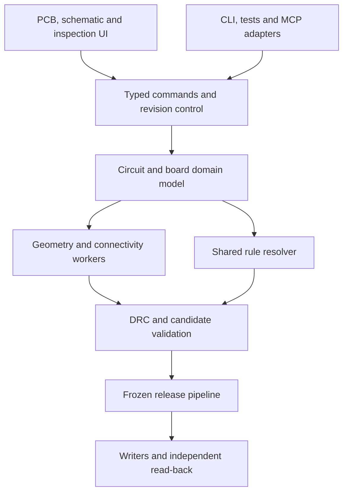

# TinyCAD PCB Layout — Complete Product and Engineering Specification

**Version:** 1.0  
**Prepared for:** TinyCAD / TinyCAD.net  
**Research date:** 15 November 2026  
**Status:** Proposed specification for implementation and review  
**Scope:** Integrated PCB design in TinyCAD for browser and desktop, from schematic to verified manufacturing deliverables.

## Contents

1. [Recommended product direction](#1-recommended-product-direction)
2. [Scope, terminology and release definitions](#2-scope-terminology-and-release-definitions)
3. [Research method and limitations](#3-research-method-and-limitations)
4. [Comparative research](#4-comparative-research)
5. [Lessons translated into TinyCAD requirements](#5-lessons-translated-into-tinycad-requirements)
6. [Users and complete workflows](#6-users-and-complete-workflows)
7. [Project model and document lifecycle](#7-project-model-and-document-lifecycle)
8. [Schematic integration and change management](#8-schematic-integration-and-change-management)
9. [Component, package and footprint system](#9-component-package-and-footprint-system)
10. [Footprint editor, generators and supplied libraries](#10-footprint-editor-generators-and-supplied-libraries)
11. [Board geometry, coordinates and mechanical features](#11-board-geometry-coordinates-and-mechanical-features)
12. [Layers, stackup, padstacks and vias](#12-layers-stackup-padstacks-and-vias)
13. [Editor interface and interaction contract](#13-editor-interface-and-interaction-contract)
14. [Placement and layout reuse](#14-placement-and-layout-reuse)
15. [Routing and route editing](#15-routing-and-route-editing)
16. [Copper zones and derived geometry](#16-copper-zones-and-derived-geometry)
17. [Design constraints and manufacturing profiles](#17-design-constraints-and-manufacturing-profiles)
18. [Connectivity, DRC and release validation](#18-connectivity-drc-and-release-validation)
19. [High-speed, power and engineering analysis](#19-high-speed-power-and-engineering-analysis)
20. [3D, mechanical exchange and inspection](#20-3d-mechanical-exchange-and-inspection)
21. [Manufacturing and assembly outputs](#21-manufacturing-and-assembly-outputs)
22. [Interoperability and migration](#22-interoperability-and-migration)
23. [Education and distinctive TinyCAD capabilities](#23-education-and-distinctive-tinycad-capabilities)
24. [Automation, AI and MCP integration](#24-automation-ai-and-mcp-integration)
25. [Software architecture and reuse strategy](#25-software-architecture-and-reuse-strategy)
26. [Native format and API contracts](#26-native-format-and-api-contracts)
27. [Performance, resilience, privacy and accessibility](#27-performance-resilience-privacy-and-accessibility)
28. [Verification and acceptance programme](#28-verification-and-acceptance-programme)
29. [Implementation roadmap and release gates](#29-implementation-roadmap-and-release-gates)
30. [Risks, decisions and definition of done](#30-risks-decisions-and-definition-of-done)
31. [Research references](#31-research-references)

## 1. Recommended product direction

Build **an integrated, rule-aware PCB editor that makes a first board approachable and keeps more advanced designs verifiable**. The main user journey is: draw and simulate a circuit; resolve physical components and pin mappings; create a board; place parts; route; check; inspect the actual fabrication files; export.

TinyCAD should own its project model, editor experience and validation pipeline. Use established file formats and selected libraries to reduce implementation risk. Treat KiCad as the principal interoperability target and an advanced-workflow reference. Learn library identity and mapping from LibrePCB and Horizon EDA; routing and constraint interaction from KiCad, Altium, OrCAD X, DipTrace and Proteus; accessible workflows from Fritzing and EasyEDA; and programmable design from Flux and tscircuit. These are design recommendations, not a claim that any competing tool can be embedded unchanged.

The first public manufacturing release must support genuinely usable one- and two-layer rigid boards, including SMD and through-hole footprints, plated and non-plated holes, basic plated slots, copper zones, physical connectivity checking, schematic parity, Gerber and drill output, BOM, placement data and an export preview. Interactive routing may initially stop at obstacles or walk around them. **Push-and-shove is a subsequent quality milestone, not a reason to delay the first trustworthy board.**

Five product commitments govern implementation:

1. Logical connectivity, physical copper and the displayed image are different representations. Validate their agreement explicitly.
2. A footprint name is insufficient evidence of a correct physical part. Store explicit pin-to-pad mapping and package provenance.
3. Manual editing, automation and AI use the same commands, rules and validation.
4. Production output comes from one frozen, fully rebuilt revision. A green canvas indicator is insufficient.
5. Basic editing and local fabrication export work without an AI provider, hosted autorouter or mandatory manufacturer account.

This document specifies the complete target product and distinguishes the first release from later capabilities. It does not claim an implementation exists, that benchmark targets have been measured, or that a DRC pass certifies circuit performance or safety.

## 2. Scope, terminology and release definitions

### 2.1 Assumptions and confirmed context

TinyCAD's public v4 manual describes browser and desktop editions and a netlist-based handoff to other PCB tools. It documents a per-instance `Package` attribute. These are the migration starting points [S01–S02]. The project context also includes ngspice/XSPICE and an AI circuit-design direction; PCB work should share entity identity and analysis references with those facilities.

Education from approximately age 14 through undergraduate projects is a primary design assumption, alongside hobbyists and small engineering projects. It should guide defaults and discoverability, not reduce electrical checking. Implementation language recommendations assume the current JavaScript application context supplied by the project owner; **no repository code audit was performed**. Actual modules and dependencies must be inspected before assigning file-level changes.

### 2.2 Normative language

- **Must / shall:** required for the assigned milestone.
- **Should:** expected unless a documented technical reason justifies another solution.
- **May:** optional capability.
- **Proposed:** a TinyCAD design decision, not a statement about a competitor.
- Requirement IDs are stable backlog and acceptance-test references; detailed paragraphs form part of the requirement.

| Milestone | Meaning | Scope boundary |
|---|---|---|
| G0 | Engineering validation gate | Geometry, pin mapping, connectivity and export prototypes; no public manufacturing claim |
| M1 | First manufacturing release | One- and two-layer rigid PCBs; complete manual workflow and verified outputs |
| M2 | Advanced everyday layout | Push-and-shove, multilayer rigid boards, richer mechanical exchange and design reuse |
| M3 | Engineering and automation | High-speed constraints, advanced placement/routing assistance, panelisation, variants and reviewed AI edits |
| R | Research / separate programme | Flex/rigid-flex, HDI manufacturing, full SI/PI/EM solvers, production-scale collaborative editing |

“M1” includes all G0 foundations; later milestones inherit earlier requirements. A feature marked R is specified sufficiently to protect the data model, but is not a committed deliverable.

### 2.3 Target limits

Proposed M1 supported board envelope: **1,000 × 1,000 mm**, within a coordinate range of ±500 mm from the document origin. These are engineering bounds, not a pricing tier. M1 supports one or two physical copper layers. The format reserves ordered layer IDs for at least 32 copper layers; M2 initially qualifies 4-, 6-, 8- and 16-layer rigid boards. Other stacks require explicit capability qualification rather than an untested layer-count claim.

Initially support standard rigid FR-4 fabrication and hand or conventional SMT assembly. Preserve metadata for other materials. Flex, rigid-flex, embedded components, RF structures requiring field solving, backdrilling, sequential lamination and laser microvias remain R until process-aware validation and output support exist.

### 2.4 Key terms

| Term | Meaning in TinyCAD |
|---|---|
| Component | Logical circuit function and signals, independent of drawing style |
| Symbol | Schematic representation of one or more component units |
| Device | A physical part choice linking component signals to a package and footprint |
| Package | Physical body/terminal arrangement, preferably tied to a manufacturer drawing |
| Footprint | Board land pattern, courtyard, assembly information and optional model placement |
| Pad | A logical terminal or physical land; use explicit separate IDs when one terminal has several lands |
| Padstack | Layer-dependent copper, mask, paste and hole definition |
| Net | Intended logical electrical connectivity |
| Copper connected set | Physical region connected through copper and plated barrels |
| Airwire / ratsnest | A guide to remaining connectivity, not a route and not proof of manufacturability |
| ECO | Reviewed engineering change set between schematic and board |
| Derived geometry | Regenerable fill, triangulation, connectivity and inspection results |
| Release snapshot | Frozen project, assets, rules, analysis status and generated output manifest |

## 3. Research method and limitations

Research used official manuals, vendor documentation, project repositories, format-owner documentation and manufacturer capability pages. The main survey covers **14 product/editor contexts**: KiCad, LibrePCB, Horizon EDA, Altium Designer, OrCAD X Presto, Autodesk Fusion Electronics, EasyEDA Standard, EasyEDA Pro, DipTrace, Proteus, DesignSpark PCB, Fritzing, Flux and tscircuit. Freerouting, KiCanvas, Clipper2 and tracespace were investigated as complementary implementation candidates.

Comparison dimensions were: schematic integration; component identity and libraries; placement; interactive routing; constraints and checks; copper handling; mechanical/3D; manufacturing; extensibility; and beginner suitability. The findings below identify documented mechanisms and then state TinyCAD implications separately. They are **documentation research, not hands-on speed, usability or manufacturing benchmarks**. No unsupported numerical ranking or price comparison is presented.

Important interpretation limits:

- KiCad 9.0 is a deliberately version-pinned reference manual, not an assertion that it is the latest release. Other pages may be rolling documentation.
- EasyEDA Standard and Pro are distinct documentation sets. Standard's stated copper-refill behaviour must not be attributed automatically to Pro [S13–S16].
- Flux's older Copilot page describes limited PCB understanding, whereas its current routing documentation describes broader routing operations. Use the current page as evidence of the advertised workflow; validate actual behaviour before depending on it [S25–S28].
- Fritzing's tutorial includes historical single-sided language. It is used as evidence of the learning workflow, not as a reliable current maximum-layer specification [S24].
- Autodesk states EAGLE sale/support ended on 7 June 2026. Fusion is the active workflow reference; EAGLE remains a legacy import target [S12].
- Vendor editions can gate features. Documented availability is not evidence that every subscription includes them.
- pcb-rnd was considered, but its official site could not be retrieved reliably during this research. It is excluded from the verified feature matrix rather than relying on a mirror.
- Prices, live component stock, fabrication promises and tool feature counts are intentionally excluded: they change and are unnecessary to this specification.

## 4. Comparative research

### 4.1 KiCad: principal baseline and interchange target

**Documented:** The PCB editor provides interactive routing, differential-pair and length-tuning tools, zones, rule areas, footprint editing, schematic updates, cross-probing, DRC, 3D inspection and fabrication outputs. Shove and walk-around modes differ in whether existing movable tracks are displaced. Schematic updates provide an integrated alternative to exchanging netlist files. Custom-rule resolution can explain which constraints apply [S03]. Its board format is published separately [S04].

**TinyCAD implication:** Establish a similarly coherent editing/checking loop, but expose a smaller initial surface. Make “why is this blocked?” and “show the source pin” first-class actions. Prioritise `.kicad_mod` footprints and a defined `.kicad_pcb` export subset. Do not treat a published file format as a reusable board engine, or a router port as a small integration task.

### 4.2 LibrePCB: identity, devices and reproducible output

**Documented:** LibrePCB uses stable identifiers and explicit signal-to-pad assignments, distinguishes packages from alternative footprints, and supports symbol variants [S05]. It supports board duplication with continued schematic synchronisation, device/footprint switching and live 3D [S06]. Output jobs store configuration in the project, can run headlessly, and bundle production, BOM, placement and documentation outputs [S07].

**TinyCAD implication:** Give names and UUIDs separate roles. Model physical device choice explicitly. Cache the exact footprint revision used by a board. Support repeatable release recipes and eventual alternative board layouts without duplicating circuit intent.

### 4.3 Horizon EDA: part abstraction and project-local dependencies

**Documented:** Its part model links entities, units, symbols and packages, and stores pin-to-pad mapping in the part [S08]. Its project pool retains dependency copies until explicitly updated [S09]. Rules are ordered, first-match constraints used by checking and tools [S10]. Its feature overview describes package generators, KiCad footprint import and an interactive router originating in KiCad [S11].

**TinyCAD implication:** Separate reusable library definitions from per-project resolved copies. Allow users to inspect upstream changes before replacing geometry. Keep rule evaluation deterministic and visible. Sharing source ancestry does not establish an easy browser port or licence compatibility.

### 4.4 Altium Designer: routing behaviour and constraint clarity

**Documented:** Interactive routing uses rules for widths and clearances and exposes different obstacle-response modes, including walking, pushing and stopping [S17]. Altium's constraint documentation explains scoped requirements, priority and online/batch checking; project workflows can use a Constraint Manager or rule interface [S18–S19].

**TinyCAD implication:** Present width, via style, obstacle mode and the active constraints while routing. Use one underlying constraints model with a simple form editor and an advanced table. A routing cursor must not silently change global rules to complete a connection. Defer the breadth of enterprise constraint management until users need it.

### 4.5 OrCAD X Presto: guided setup and assembly constraints

**Documented:** Cadence's guide covers netlist transfer, cross-probing, board outlines, stackup, component grouping, physical/spacing constraint sets, design-for-assembly spacing, fanout, hug/shove editing, silkscreen and manufacturing handoff [S20]. Its DRC material emphasises active constraints and navigable on-canvas feedback [S21].

**TinyCAD implication:** Include setup as a visible workflow rather than an obscure preferences task. Treat component-body spacing separately from copper clearance. Provide searchable, clickable checks that explain which rule is active. Do not infer complete advanced Allegro capabilities from the Presto guide.

### 4.6 Autodesk Fusion Electronics / legacy EAGLE

**Documented:** Fusion's tutorials link schematic creation, PCB shape, placement, manual routing, synchronisation and enclosure workflows [S22]. Its electronics workflow describes CAM outputs including Gerber, placement and other manufacturing data [S23]. Autodesk directs EAGLE users to Fusion and documents the June 2026 EAGLE transition [S12].

**TinyCAD implication:** Keep board outline and mounting geometry tied to mechanical intent. Establish one coordinate/transform contract across 2D, 3D, drill and placement outputs. Preserve a path for EAGLE XML migration, but prioritise present-day open interchange and editable local projects.

### 4.7 EasyEDA Standard: browser workflow and explicit copper rebuild

**Documented:** Standard exposes PCB design, footprint management, cross-probing, fabrication export and real-time DRC [S13–S14]. Its copper documentation requires a closed board outline and describes manual refill because of browser performance considerations [S15].

**TinyCAD implication:** A browser can offer an approachable complete workflow, but fill computation needs explicit scheduling. Store zone intent separately from computed fill; expose a stale-fill indicator. Manufacturer convenience should be optional and output should remain usable at other fabs.

### 4.8 EasyEDA Pro: reviewed conversion and broader PCB workflow

**Documented:** The Pro quick start describes converting/updating the PCB through a confirmation of changes and applying the chosen set. Its documentation covers PCB/panel workflows and output categories [S16]. A dedicated page describes full DRC, interactive DRC and selectable error locations [S14P].

**TinyCAD implication:** Show an ECO preview before changing existing copper-connected objects. Keep novice operations discoverable in the same editor used for advanced work. Do not combine Pro and Standard capabilities into an imaginary single product or assume a warning-free view replaces a final check.

### 4.9 DipTrace: connected manual and automatic workflows

**Documented:** DipTrace describes push-and-shove, differential routing, length tools, shape-based autorouting, DSN/SES exchange, schematic comparison, net-connectivity verification and 3D/STEP output [S29]. Its help lists manufacturing and exchange formats [S30].

**TinyCAD implication:** Make manual routing complete before depending on automatic routing. Keep physical connectivity checks separate from clearance checks. Offer an external-router adapter with a safe re-import path; imported routes must undergo TinyCAD's own validation. Single-layer designs should have explicit jumper support.

### 4.10 Proteus: simulation-to-layout continuity

**Documented:** Proteus combines schematic/simulation and PCB workflows [S31]. Its routing documentation describes rule-aware follow-me and push/shove modes [S32]. Its verification page describes a hierarchy of board constraints [S33].

**TinyCAD implication:** Make it easy to trace a simulated device or net into its board location. Use simulation findings as engineering annotations, not as automatic claims about manufactured performance. The board editor must preserve the physical constraints that a schematic simulator cannot assess.

### 4.11 DesignSpark PCB: accessible engineering and migration discipline

**Documented:** DesignSpark's product and edition guidance covers libraries, DRC, 3D, production outputs and advanced features that vary by plan [S34–S35]. Its release notes include output/view consistency and saved configuration fixes [S36].

**TinyCAD implication:** Complete everyday editing, output portability and predictable saved settings matter as much as headline features. Test actual fabrication output independently of the editor image. Avoid building a feature comparison around edition limits or assuming all listed features belong to a free tier.

### 4.12 Fritzing: learning through a connected representation

**Documented:** The PCB tutorial explains moving from a recognisable circuit representation to footprints, ratsnest, placement, manual or automatic routing and export. Its project-view documentation connects breadboard, schematic and PCB representations [S24, S24B].

**TinyCAD implication:** Teach the distinction between a symbol, a part and a footprint. Give learners a visible sequence and meaningful unrouted indicators. TinyCAD can achieve this through explanatory overlays and examples without adding a full breadboard editor to the PCB programme.

### 4.13 Flux: contextual assistance and scoped routing requests

**Documented:** Flux's PCB documentation describes synchronised PCB, schematic and 3D views and layout rules [S25–S26]. Current routing documentation describes routing selected connections, preserving existing work, using stackup/rules and running checks after routing [S27]. Its older Copilot limitations page differs in scope [S28].

**TinyCAD implication:** Natural-language requests should resolve to exact selected entities and explicit constraints. Display proposed changes and machine-derived results. Evaluate advertised AI workflows on TinyCAD benchmarks; no autonomous quality claim is inferred from vendor documentation.

### 4.14 tscircuit: structured, programmable design

**Documented:** tscircuit uses a structured Circuit JSON representation across schematic and PCB-related tooling [S37]. Its autorouting API distinguishes input representations, synchronous versus job-style operations, and scoped routing [S38].

**TinyCAD implication:** Keep a headless semantic board API and cancellable routing jobs. Evaluate individual libraries or adapters on supported geometry, licensing and regression tests. A circuit-generation toolkit is not automatically a drop-in interactive editor, complete DRC engine or manufacturing authority.

### 4.15 Cross-product comparison

This table summarises the documented mechanisms most relevant to TinyCAD. It deliberately avoids unsupported “best” scores or claims that an unlisted feature is absent.

| Product | Integration / libraries | Placement / routing emphasis | Validation / production emphasis | Main TinyCAD lesson |
|---|---|---|---|---|
| KiCad | Integrated schematic updates; footprint libraries | Shove, walk-around, pairs, tuning | DRC, custom rules, 3D, fabrication | Complete local engineering loop |
| LibrePCB | UUIDs, device maps, package/footprint distinction | Alternative board layouts and footprint choices | Project output jobs, headless generation | Stable identity and portable releases |
| Horizon | Entity/unit/part/package pools | Interactive routing and generated packages | Ordered constraints; dependency snapshots | Explicit mapping and controlled updates |
| Altium | Scoped project constraints and ECO workflow | Rich obstacle modes and route control | Online/batch rules | Visible rule ownership and resolution |
| OrCAD X | Capture/Presto transfer and cross-probing | Constraint sets, fanout, hug/shove | Assembly spacing, checks, output workflow | Setup and DFA belong in normal workflow |
| Fusion | Schematic/PCB/mechanical synchronisation | Outline, placement and manual routing | CAM and enclosure handoff | One mechanical coordinate contract |
| EasyEDA Std | Browser schematic/PCB flow | Accessible editing, explicit zone refill | Real-time DRC and fab exports | Browser computation needs clear state |
| EasyEDA Pro | Reviewed conversion/update | PCB and panel workflow | Full and interactive checks | Preview engineering changes |
| DipTrace | Schematic comparison and net checks | Manual, shove, autorouter and DSN/SES | Physical connectivity and varied outputs | Validate external automatic work |
| Proteus | Simulation and PCB workflow | Follow-me and shove modes | Hierarchical board constraints | Link analysis to physical design |
| DesignSpark | Libraries and edition-dependent features | Everyday PCB tools | DRC, 3D and manufacture | Reliability and saved settings |
| Fritzing | Connected learning representations | Guided arrangement and routing | PCB export | Teach physical concepts in context |
| Flux | Project-aware views, rules and agent context | Scoped natural-language routing | Post-operation checks described | Give AI exact scope and evidence |
| tscircuit | Structured circuit representation | Programmatic routing interfaces | Tooling around circuit data | Semantic APIs, jobs and adapters |

## 5. Lessons translated into TinyCAD requirements

| Research finding | Proposed TinyCAD requirement | Release |
|---|---|---|
| Stable identity survives renaming | UUIDs for components, pins, nets, pads and board objects; references are labels | G0 |
| Device mapping is independent of symbol drawing | Explicit component-signal-to-package-pad map | G0/M1 |
| Library changes can alter finished boards | Embedded dependency snapshots and reviewed updates | M1 |
| Rules guide routing as well as checking | Shared rule resolver used by router and DRC | G0/M1 |
| Browser fills may be delayed | Dirty-state tracking and mandatory release rebuild | M1 |
| Synchronisation can disturb existing layouts | Atomic ECO with retained placement and route-impact report | M1 |
| Attractive previews can disagree with outputs | Re-read generated manufacturing bytes and compare geometry | G0/M1 |
| Assembly has constraints beyond copper | Courtyards, body/height metadata and assembly checks | M1/M2 |
| Automatic tools need bounded scope | Selected-net jobs, locked geometry and reversible proposals | M2/M3 |
| Expert workflows have substantial setup | Board wizard plus persistent, inspectable rules | M1 |
| Learning requires meaningful feedback | Plain-language rule explanations and cross-probing | M1 |
| Manufacturing limits depend on process | Versioned profiles with applicability and source | M1 |

## 6. Users and complete workflows

### 6.1 First classroom board

A learner draws a low-voltage LED circuit, simulates it, chooses through-hole resistor/LED/header devices, confirms polarity and creates a two-layer board. The wizard supplies a sensible board outline and rule profile. The learner places parts, follows airwires, fills ground, fixes checks, prints a 1:1 footprint check and exports a reviewed fabrication ZIP. Teacher guidance can explain a problem without completing the routing.

Success means the actual exported copper connects the intended pins, the holes fit the selected physical parts within declared assumptions, and no unresolved release blocker remains. Finishing quickly is a usability goal; it never substitutes for this result.

### 6.2 Mixed through-hole / SMT prototype

An experienced user chooses SMD packages, fixes connector positions to enclosure dimensions, routes selected signals, pours ground, changes a resistor network in the schematic and reviews the ECO. Only affected items change. The user exports fabrication and assembly data from the same revision and checks bottom-side rotation using a known reference footprint.

### 6.3 Undergraduate controller board

At M2/M3, the user creates a four-layer stack, defines power and signal constraints, places decouplers with device relationships, sets antenna and height keepouts and routes a differential pair. Checks distinguish geometric matching from impedance estimates and unverified return paths. An optional assistant proposes improvements with before/after evidence.

### 6.4 Legacy TinyCAD schematic

The import path retains existing symbol geometry, connectivity and `Package` strings. A resolution table maps each string to a specific device, footprint revision and pin map. Unresolved or ambiguous mappings stay unresolved; the application never chooses solely by text similarity. The original drawing remains recoverable.

### 6.5 Revision after fabrication

A released board is immutable. “Create revision” copies its design state and retains release provenance. A design comparison highlights changed components, pads, nets, copper, rules and outputs. Releasing the revision creates a new bundle and manifest, leaving the earlier package identifiable.

## 7. Project model and document lifecycle

See the [TinyCAD project specification](project-specification.md) for the project browser, file tabs, settings and document lifecycle requirements (PRJ-01–09).

## 8. Schematic integration and change management

### 8.1 Connectivity contract

The schematic owns logical circuit intent. A compiled connectivity snapshot shall start from the selected root and resolve project child instances, named ports, bus members, global/local labels, hidden power pins and multipart devices before board generation. Store stable logical signal and terminal IDs. Simulator terminals and package pads have independent mappings. See the [v3 behavior and implementation contract](project-specification.md#hierarchical-project-schematics).

Each board records its source circuit revision and a connectivity digest. Net renaming without changed membership does not break copper associations. Net splits and merges are explicit changes; the engine shall not guess identity from names alone. Unplaced parts may remain during editing, but must be resolved before production release unless excluded from the PCB by an explicit component role.

| ID | Requirement | Acceptance condition | Release |
|---|---|---|---|
| SYN-01 | Create and update the PCB directly from compiled schematic connectivity using the [project transfer workflow](project-specification.md#creating-and-updating-a-linked-pcb) | Multipart and hierarchical test schematics produce the expected unique physical devices. AT-33 verifies initial transfer and later updates | M1 |
| SYN-02 | Provide component, signal, pin and net cross-probing in both directions | Selecting a pad identifies its exact source instance/unit/pin | M1 |
| SYN-03 | Show a previewed ECO for additions, deletions, values, mappings, footprint revisions and nets | Preview counts and affected IDs equal the applied change set | M1 |
| SYN-04 | Preserve unaffected placement, IDs, locks, routes and annotations | A value-only change leaves copper and placement hashes unchanged | M1 |
| SYN-05 | Flag copper affected by a net split, merge or changed pad map | No stale route silently acquires a different intended connection | M1 |
| SYN-06 | Review removals and footprint replacement before applying | User can inspect lost pads, routes, holes and geometry differences | M1 |
| SYN-07 | Apply ECO atomically against an expected source and board revision | A concurrent edit causes a conflict instead of a partial update | G0/M1 |
| SYN-08 | Distinguish virtual, off-board, not-fitted and PCB-only objects | Each role follows its defined release/BOM behaviour | M1 |
| SYN-10 | Permit pin/gate swapping only from declared equivalence groups | Disallowed swap is rejected; allowed swap updates circuit and board mapping together | M3 |

See the [project synchronisation contract](project-specification.md#schematic-and-pcb-synchronisation) for reference designators and component values (SYN-09, SYN-12), and the [project hierarchy requirement](project-specification.md#hierarchical-project-schematics) (SYN-11).

### 8.2 Handling physical copper during an ECO

For a changed net, preserve geometry as a candidate and recompute physical connected sets. Any existing connected set now touching terminals of different intended nets is a short, not an invitation to relabel everything. Orphaned segments remain visible with unresolved assignment or are removed through an explicit cleanup action. Footprint replacement maps by verified terminal identity, not pad position.

A schematic deletion initially previews the footprint and associated copper that will be affected. Users may retain an object as an explicitly PCB-only mechanical object, but cannot retain an electrically active component while reporting schematic parity as passed.

### 8.3 Physical-role semantics

| Role | Footprint required? | Connectivity requirement | Assembly output |
|---|---|---|---|
| Normal electrical part | Yes | Pins mapped and required terminals routed | Included when fitted |
| Not fitted / DNP | Yes | Copper and pad map remain valid | Excluded from fitted placement/BOM; identified on DNP documentation |
| Schematic-only simulation/test element | No | Explicitly excluded from board intent | Excluded |
| Off-board item | Only its board interface | Cable/interface termination represented explicitly | Board connector included |
| PCB-only mechanical item | Geometry required as appropriate | No invented circuit net | Included as mechanical BOM item if requested |
| Net tie / physical jumper | Yes | Explicit permitted local joining or bridging semantics | Included according to assembly type |

## 9. Component, package and footprint system

### 9.1 Required data separation

A single logical component can have several symbols, physical devices and footprints. IEC and IEEE symbol styles should share electrical identity. A resistor symbol must not imply a particular land pattern. “SOT-23” identifies a package family, not a universal transistor pinout.

A device definition binds a manufacturer/part option or explicitly generic buildable part to:

- Its logical component and signals.
- Package drawing and revision or documented dimensional assumptions.
- Footprint revision and variant, such as hand-solder versus reflow.
- Complete terminal/pad mapping, including exposed pads, shields and mechanical tabs.
- Electrical ratings and procurement metadata where available.
- Provenance, licence, review state and optional 3D assets.

Generic devices are permitted for education: for example, an axial resistor with declared lead spacing and hole assumptions. They must be labelled generic, not presented as verified for every resistor body.

### 9.2 Mapping rules

| ID | Requirement | Acceptance condition | Release |
|---|---|---|---|
| LIB-01 | Store explicit mappings using terminal/pad IDs; pad labels are strings | Pins `A1`, `EP`, `01` and duplicate numbered lands retain their meanings | G0 |
| LIB-02 | Support one signal connected to several physical lands | A split thermal land maps correctly without requiring a trace between internally equivalent terminals unless specified | M1 |
| LIB-03 | Validate every electrically relevant pad and required schematic signal | Missing, conflicting and ambiguous maps are shown before layout generation | M1 |
| LIB-04 | Support multipart symbols that represent one physical package | Dual op-amp and logic-gate fixtures produce one device and correct power pins | M1 |
| LIB-05 | Distinguish NC, internally connected, reserved and mechanical terminals | Only explicitly allowed equivalence bypasses normal connectivity checks | M1 |
| LIB-06 | Show a side-by-side pin/signal/pad review with graphical highlighting | Selecting mapping row highlights both source pin and target pad | M1 |
| LIB-07 | Embed resolved footprints and maps, retaining source IDs and hashes | Board reopens unchanged after a remote library is modified/deleted | M1 |
| LIB-08 | Review library updates with geometric and mapping differences | Update cannot silently relocate pads or alter drill sizes | M1 |
| LIB-09 | Search by package dimensions, pitch, pad count, mount style and review status | Filters return geometry-compatible candidates without implying pinout equivalence | M1 |
| LIB-10 | Support project-local device overrides and reusable library publishing | Board-local edits remain explicit and do not mutate the global library | M1/M2 |

Every physical pad object has a unique ID even when several pads share an electrical terminal number. An electrical terminal may map to several copper shapes. A single conductive land cannot serve conflicting logical nets except through an explicitly modelled, checked net tie. Internally connected terminals require device evidence; the engine must not infer internal shorts from similar names.

## 10. Footprint editor, generators and supplied libraries

### 10.1 Footprint editor

Provide pads, holes, plated slots, lines, arcs, polygons, dimensions, text, courtyard, fabrication outline, pin-1/polarity indicators, paste apertures, mask openings and 3D attachment transforms. Support arrays, alignment, numerical coordinates, duplication, pad numbering and origin adjustment. Electrical pad geometry must be distinct from decorative copper drawings.

| ID | Requirement | Acceptance condition | Release |
|---|---|---|---|
| FPT-01 | Create/edit supported footprints within TinyCAD | A custom connector can be built, mapped, placed and exported without another application | M1 |
| FPT-02 | Provide round, rectangular, oval, rounded-rectangle and supported polygon pads | Renderer, DRC and exported copper agree within the geometry tolerance | M1 |
| FPT-03 | Edit plated/non-plated holes and plated slot dimensions independently of copper | Drill/rout output reproduces slot path and plating classification | M1 |
| FPT-04 | Check duplicate labels, unmapped pads, holes, annular rings, mask and courtyards | Invalid footprint fixture reports specific actionable findings | M1 |
| FPT-05 | Provide 1:1 print and dimension inspection | A calibration ruler and footprint distances export at exact nominal scale | M1 |
| FPT-06 | Import supported KiCad footprint features into editable native definitions with a loss report | Save and reopen preserves supported geometry and pad semantics. Unsupported electrical primitives block a verified import | M1 |
| FPT-07 | Generate common packages parametrically with reproducible source parameters | Editing pitch regenerates identical equivalent geometry on browser and desktop | M1/M2 |
| FPT-08 | Provide 3D origin, rotation and body-height alignment | Known asymmetric model aligns to pad 1 on both board sides | M2 |
| FPT-09 | Generate bundled native footprints and matching STEP models from a versioned package catalogue using Python | Rebuilding preserves asset identities and geometry. Offline placement and native save/reopen preserve the footprint and model pairing | M1 starter / M2 expansion |

M1 generators: axial resistor/diode, radial two-lead component, DIP, single/double-row 2.54 mm headers, simple terminal blocks, SOIC and standard two-pad chip passives. M2: TSSOP, QFP, QFN with exposed pad, BGA/LGA and configurable paste-window patterns. Package presets must state the dimensional source and intended assembly process. Do not label a generator “IPC compliant” without an identified standard edition, implemented rules and validation evidence.

### 10.2 Curated supplied library

Ship a reviewed starter core for educational circuits. Target at least 100 useful footprint definitions/device mappings. Keep representative connectors, test points, mounting holes and MCU/development-board headers in the starter core. Use this package list to seed the versioned catalogue and prioritise variants against the existing TinyCAD symbols.

| Component family | Surface-mount packages | Through-hole packages |
|---|---|---|
| ICs | SOIC in multiple pin counts and widths. Add TSSOP, QFP, QFN and BGA/LGA variants in M2 | DIP in multiple pin counts and row spacings |
| Resistors | Rectangular chips in 0402, 0603, 0805 and 1206 | Cylindrical axial bodies with multiple lead pitches and body sizes |
| Capacitors | Rectangular ceramic chips and cylindrical aluminium cans in multiple sizes | Radial discs, rectangular film bodies and cylindrical electrolytics with multiple diameters and lead spacings |
| Diodes | Flat SOD and SMA/SMB body variants | Cylindrical axial DO-35 and DO-41 variants |
| Inductors | Chip and shielded power-inductor bodies in multiple sizes | Axial and radial packages with multiple lead spacings |
| Transformers | Low-profile gull-wing packages in multiple body sizes and pin layouts | Bobbin and encapsulated packages in multiple sizes and pin layouts |
| LEDs | Rectangular chip packages in multiple sizes | Round 3 mm and 5 mm radial packages |
| Transistors and regulators | SOT-23 and SOT-223 variants | TO-92 and TO-220 variants |

Use one dimensional record per package variant for the Python build scripts. Record the body and lead dimensions, pitch, terminal arrangement, datum, pin-1 or polarity marks, tolerances and source. Generate native pad, drill, mask/paste, silkscreen, fabrication and courtyard geometry as applicable, plus a matching STEP solid in millimetres anchored to the footprint datum. Package the generated assets with stable IDs, catalogue metadata and provenance so the PCB engine can select them offline. Automate pad/lead alignment, dimensions, drill and courtyard checks, and independent STEP read-back. Use representative actual part numbers to review fit and pin mapping, especially for transformers, connectors and package variants with different pinouts.

USB connectors, modules and development boards require model-specific footprints. Their shield pads, mounting features, overhang and antenna keepouts must be reviewed. Do not bundle a plausible generic USB footprint as if it fits every connector.

Each curated item needs a dimensional reference, explicit pad map, declared manufacturing assumptions, polarity review, automated geometric checks and a human review record. Use KiCad library conventions as an editorial reference, not as permission to copy assets without retaining their provenance [S39, S43]. Imported assets start as **imported/unreviewed** until qualified. A review badge identifies the reviewed revision and scope, not a permanent guarantee.

## 11. Board geometry, coordinates and mechanical features

### 11.1 Canonical coordinate contract

Use integer nanometres for persisted lengths and coordinates, degrees in integer microdegrees for persisted orientation, and explicit unit-bearing UI/API inputs. Convert `1 mil` exactly to `25,400 nm`. Floating point may be used for rendering and bounded numerical calculations, but not as the sole authority for topological predicates.

Proposed canonical board frame: origin in the board plane, +X to the right and +Y upwards when viewed from the top, angles counter-clockwise. The canvas transform may invert Y for screen coordinates. Define the top-side body direction as +Z. Document separate, tested transforms for bottom components, mirrored inspection, model coordinates and each interchange format.

Bottom-side placement is a physical transform, not a boolean that reverses pad labels arbitrarily. Store footprint-local pad geometry once and derive its board transform. Every output adapter states its axis, origin, side and rotation convention.

### 11.2 Outline and mechanical tools

| ID | Requirement | Acceptance condition | Release |
|---|---|---|---|
| GEO-01 | Draw closed board outlines from segments and circular arcs | Topology check detects self-intersection, gaps, duplicate edges and zero-length features | M1 |
| GEO-02 | Provide rectangle, rounded rectangle and circular templates with numerical dimensions | Declared width/radius matches exported edge geometry | M1 |
| GEO-03 | Support internal cutouts and non-plated routed slots | Cutouts appear consistently in DRC, 3D and fabrication output | M1 |
| GEO-04 | Add mounting holes with copper, screw-head, body and routing clearances | Copper entering a configured screw-head keepout is flagged | M1 |
| GEO-05 | Distinguish closed cutouts, drill holes, plated slots and route paths | Each is emitted once using its correct manufacturing representation | M1 |
| GEO-06 | Provide measurement, dimensions, datum/origin and object snapping | Unit conversion and coordinate-entry fixtures are exact within specified resolution | M1 |
| GEO-07 | Import a declared DXF mechanical subset with unit/scale preview | Ambiguous units require resolution and imported geometry is checked before adoption | M2 |
| GEO-08 | Model connector overhang and height/volume restrictions | An intentional overhang is allowed by object rule while accidental body overlap is detected | M2 |
| GEO-09 | Preserve board-definition constraints separately from dimensions used only as annotations | Editing a dimension label cannot silently resize the board | M1 |

One board document initially contains one connected outer board region plus cutouts. Multiple separate finished boards belong in the panelisation workflow. The edge checker shall use a documented closure tolerance and offer explicit endpoint repair; it must never silently heal a gap large enough to change the intended shape.

## 12. Layers, stackup, padstacks and vias

| ID | Requirement | Acceptance condition | Release |
|---|---|---|---|
| LAY-01 | Represent ordered physical copper layers separately from graphic/documentation layers | A drawing layer cannot accidentally become a manufacturing copper layer | G0/M1 |
| LAY-02 | Support top/bottom mask, paste, silk, fabrication, courtyard and assembly layers | Bottom-side transforms and output file roles match the declared stack | M1 |
| LAY-03 | Store stack thickness, material, dielectric and copper properties with unknown states | An incomplete stack cannot produce a claimed impedance result | M1/M2 |
| LAY-04 | Through-hole padstacks connect only declared physical layers through a plated barrel | Non-plated holes do not electrically connect top and bottom | G0/M1 |
| LAY-05 | Support through-vias, via presets, tenting and hole/annulus checks | Via dimensions and connectivity match drill and copper outputs | M1 |
| LAY-06 | Edit multilayer stacks with a reviewed layer-remapping operation | Removing a used layer previews affected copper and cannot silently discard it | M2 |
| LAY-07 | Preserve blind/buried/microvia metadata on unsupported import | Required unsupported process is flagged and production export is blocked | M1 |
| LAY-08 | Qualify blind/buried vias only with layer-span and manufacturing support | Impossible spans and invalid stacks are rejected by process-aware checks | M3/R |

Use stable semantic layer IDs and a separate physical order; user-visible names and colours are editable. M1 must include positive copper zones only; power-plane layers in M2 can be implemented using the same explicit positive copper engine. Do not add a second negative-plane representation without equivalent checking and export tests.

Padstack definitions must independently control drill, land shape, solder-mask opening and paste aperture. A positive mask expansion means a larger opening; the writer handles Gerber layer polarity correctly. Through-hole parts normally have no solder-paste aperture unless explicitly configured. Tenting and filled/capped via processing are different properties.

Store nominal finished-hole size, tolerance and process classification separately from any tool-diameter or plating-compensation instruction. The output profile must state whether the receiving fab interprets the drill value as finished-hole intent or a tooling value; do not apply an assumed plating allowance twice. For slots, define width and centreline length separately from total end-to-end length. Press-fit holes, controlled-depth drilling, backdrilling and countersinks require additional qualified process support and must otherwise be reported as unsupported.

## 13. Editor interface and interaction contract

### 13.1 Workspace layout

PCB Design is a workspace in the existing TinyCAD application in Electron and supported browser mode. Use the same application window for **Schematic**, **PCB**, **3D**, **Simulation** and **Manufacturing preview**. Follow the [project file tab contract](project-specification.md#file-tabs-and-save-all) for opening and switching files. Support side-by-side schematic and PCB inspection within that shell. Reuse and extend the common menus, toolbar, panels, dialogues, commands and shortcuts, along with project navigation, open/save, unsaved changes and undo integration. Register PCB-specific views, tools and commands through the same shell components and services. Preserve familiar control locations for equivalent actions.

Implement the [TinyCAD editor design contract](tinycad-ui-design.md#shared-editor-contract) using the v4.1.0 shell as the visual and interaction baseline. The contract defines the shared toolbar, browser dropdowns, Electron native menus, panel roles, contextual commands, zoom and ruler behavior.

| Region | Required content |
|---|---|
| Existing top toolbar and menus | Shared file, edit and view controls. Add primary PCB tools such as place and route through the existing icon groups and command system. |
| Existing collapsible left panel | Projects in Project mode, searchable footprint libraries, previews and unplaced components. Start placement by dragging a preview onto the drawing. |
| Existing central drawing area and sheet tab strip | SVG board drawing, horizontal and vertical scrollbars, route preview, selective airwires and contextual overlays. |
| Existing resizable bottom panel | Separate placed-component and netlist views. Selecting an object opens that object's editor. Active tools and routing controls also use the bottom panel. |
| Menus and Fluent dialogues | Board setup, routing rules, ECO review, 3D inspection and manufacturing. Keep each dialogue's bounds stable through changes to its content. |
| Status bar | Units, cursor position, active tool/layer, snapping, outstanding connections and stale-state indicators |

Avoid permanently filling both sides with dense panels on a small laptop. Docks must collapse, and command search must reach every normal action. Display tool mode and next expected action in plain text. Include a quick “reset workspace” action.

### 13.2 Interaction requirements

| ID | Requirement | Acceptance condition | Release |
|---|---|---|---|
| UX-01 | Pan/zoom around pointer; fit board, selection and issue | No geometry moves during navigation, including touchpad gestures | M1 |
| UX-02 | Provide numerical editing with explicit units and snapping controls | Mixed `mm`, `mil` and `in` entries resolve consistently | M1 |
| UX-03 | Filter selection by type, layer, visibility and lock state | Hidden/locked objects are not accidentally edited through visible geometry | M1 |
| UX-04 | Resolve overlapping hit targets with a selectable candidate list | Pad, track, zone boundary and silk can each be selected deterministically | M1 |
| UX-05 | Distinguish active, visible, selectable and locked layers | Switching the visible layer does not silently change routing layer | M1 |
| UX-06 | Provide net highlighting, layer visibility and locking, and clearance overlays | Nets remain identifiable without relying on colour alone | M1 |
| UX-07 | All editing tools support cancel, predictable commit and undo | Escape cancels an uncommitted operation without discarding earlier commits | M1 |
| UX-08 | Provide command search, remappable shortcuts and contextual help | Every essential tool is accessible without memorising a shortcut | M1 |
| UX-09 | Support keyboard property editing and accessible issue navigation | User can reach, inspect and zoom to each issue via keyboard | M1 |
| UX-10 | Provide touch/pen selection, pan/zoom and enlarged handles | Tablet users can place and edit supported geometry without hover-only controls | M2 |
| UX-11 | Host PCB Design inside the existing TinyCAD application shell and share its components and services | Switch between schematic and PCB in the same window and project context. Verify shared navigation, open/save, unsaved changes, keyboard actions, property dialogues and issue navigation | M1 |
| UX-12 | Match Circuit Design selection conventions | Preview the pointer target, show a distinct selection outline, and select enclosed objects by dragging a rectangle on empty drawing. Drag an unlocked footprint and release to commit its snapped destination as one undoable edit. | M1 |

Suggested shortcut actions are route, via, rotate, flip side, move, drag, properties, highlight net, refill zones and full check. Bindings must be checked against existing TinyCAD and browser shortcuts before being assigned. “Flip side” must not share an ambiguous action with “mirror drawing.” Placement and movement commit to the document's undo history. File writes belong to Save, Save As and Save All. See the [shared placement contract](tinycad-ui-design.md#placement-and-persistence).

### 13.3 Routing interaction state

1. Start on a pad, via or conductive segment. Display the inferred net and layer.
2. Move pointer to preview a route with a clearance envelope and obstacle feedback.
3. Click to commit a corner or complete at a valid destination. Backspace removes the last uncommitted corner.
4. Changing layer offers valid via presets and previews the via before placement.
5. Escape first abandons the current uncommitted preview; a second escape exits the tool. Undo reverses the last committed route transaction.
6. A blocked move shows the measured gap, required gap and applicable rule, with zoom/highlight actions.

Do not prompt repeatedly for routine legal moves. Review is reserved for consequential changes such as replacing a footprint, changing rules, deleting connected objects or applying an automated candidate.

## 14. Placement and layout reuse

| ID | Requirement | Acceptance condition | Release |
|---|---|---|---|
| PLC-01 | Show unplaced components in a searchable tray with footprint previews | Placing a component removes its tray entry and preserves logical identity | M1 |
| PLC-02 | Rotate, flip, align, distribute, group and numerically position footprints | All pad, model and text transforms remain consistent | M1 |
| PLC-03 | Lock location, rotation or complete objects independently | Router and placement assistance obey the relevant lock | M1 |
| PLC-04 | Support component courtyards and board/region keep-ins and keepouts | Overlap and misplaced-component fixtures produce the correct findings | M1 |
| PLC-05 | Cross-select a schematic group and place it sequentially | Selected logical group resolves to the right physical packages | M1 |
| PLC-06 | Show local ratsnest and optional connection-length estimates while moving | Airwires update without being mistaken for final route geometry | M1 |
| PLC-07 | Provide connectivity-preserving drag and ordinary move as distinct actions | Move reports disconnections; qualified drag preserves copper or reports failure | M2 |
| PLC-08 | Copy layout blocks with explicit component mapping | Repeated channel uses new IDs/nets and cannot inherit the source channel's net IDs | M2 |
| PLC-09 | Provide constrained placement suggestions | Fixed connector positions, group relations and keepouts remain invariant | M3 |
| PLC-10 | Support alternative candidate layouts with comparison metrics | Rejecting a candidate restores the original design without side effects | M2/M3 |

Place fixed connectors, mounting holes and mechanical interfaces first. Offer grouping for functional blocks, decouplers, analogue front ends, crystals and power conversion. These relations should be explicit optional constraints or hints rather than inferred obligations based on names.

A placement assistant may optimise wire-length estimates, congestion and defined component relationships. Show hard failures separately from soft scores. Never use a low estimated wire length as evidence of electrical performance, good analogue grounding or thermal adequacy.

## 15. Routing and route editing

### 15.1 Mandatory M1 router

The first router shall provide manual H/V/45° routing, width presets, snapping, through-via placement, branch routing, route replacement and connected-segment editing. It must use the shared rule resolver. A stop-at-obstacle mode is the minimum reliable interaction. Walk-around is desirable for M1 and becomes required for M2 if not qualified in M1.

| ID | Requirement | Acceptance condition | Release |
|---|---|---|---|
| RTE-01 | Route only on valid copper layers with an assigned net | Graphic lines cannot satisfy required electrical connections | M1 |
| RTE-02 | Prevent illegal different-net contact in normal routing | Near-pad and obstacle fixtures cannot commit an unintended short | M1 |
| RTE-03 | Expose width, preferred/minimum values and permitted via styles | Width change is checked against the active net and region rules | M1 |
| RTE-04 | Insert a through-via during a valid layer change | New segments and barrel form one correct physical connected set | M1 |
| RTE-05 | Provide segment drag, corner edit, split, branch and reroute operations | Legal edits preserve connectivity; incomplete edits remain visibly unrouted | M1 |
| RTE-06 | Provide delete segment, connection, selected net and selected region with preview | Deletion scope is explicit and fully undoable | M1 |
| RTE-07 | Snap to true conductive geometry, including rotated and off-grid pads | Exact endpoint connectivity is independent of display zoom | M1 |
| RTE-08 | Support explicit obstacle modes: stop, walk-around and shove | Each mode respects locks and reports inability to find a legal path | Stop: M1; others: M2 |
| RTE-09 | Push/shove tracks and optional vias transactionally | Failed shove restores every displaced object; successful shove passes local checks | M2 |
| RTE-10 | Offer local cleanup for redundant vertices, zero-length pieces and unnecessary loops | Cleanup preserves required connectivity and locked geometry | M1/M2 |
| RTE-11 | Add intentional jumpers for single-sided boards as physical parts | Jumper is represented in BOM/assembly and its endpoints are checked | M1 |
| RTE-12 | Support arcs, controlled neck-downs and teardrops | Derived copper and manufacturability checks include these geometries | M2 |
| RTE-13 | Route/tune differential pairs with defined coupling and skew constraints | Both members and uncoupled sections are measured and checked | M3 |
| RTE-14 | Provide bounded selected-net and board autorouting jobs | Result imports as a candidate and is checked before commit | M2/M3 |

“Allow violations” may exist as an explicit expert editing mode. It must display persistent mode indication and log resulting checks. It cannot disable final release validation or turn failed constraints into passed results.

### 15.2 Route replacement and connectivity semantics

Starting on an existing route inherits the net only if that copper has an unambiguous assignment. Connecting to a different net is blocked unless the operation is an approved circuit/ECO edit or occurs inside the permitted geometry of an explicit net tie. A temporary route preview never changes the authoritative connected graph.

A loop-removal tool must distinguish accidental redundant routing from deliberate loops, copper structures and engineering exceptions. Cleanup can propose deletion but must not silently alter a user-preserved structure. Teardrops are either persisted design objects or deterministic derived geometry; their dependency state participates in release hashes and DRC.

### 15.3 Autorouter adapter contract

Freerouting's maintained repository and command-line documentation describe DSN/SES workflows and show why rule transfer must be checked, including limits on what an exported interchange file carries [S40, S48]. Similar product names and forks exist; pin an exact repository, version and executable hash.

The adapter shall:

- Advertise supported layers, pads, vias, locks, keepouts, width rules and route styles before a job begins.
- Export the frozen board and a list of constraints not representable in the target format.
- Refuse jobs with unsupported hard constraints unless the job explicitly excludes affected areas/nets.
- Preserve fixed components and protected copper, and limit the mutation scope to the selected nets/region.
- Return a candidate delta, engine identity, run settings, seed where available, progress and termination status.
- Reject a stale result when its base revision no longer matches.
- Refill zones and run full native connectivity/DRC on the candidate.
- Report completion, added length/vias, violations and remaining connections without calling the result “optimised” unless an objective and baseline are supplied.

An external router is optional. M1 cannot depend on a hosted service. M2 may offer a local desktop adapter or manual DSN/SES exchange before a browser-local engine is feasible. Hosted routing requires explicit project-data sharing and must not be silently selected as a fallback.

## 16. Copper zones and derived geometry

Zones are editable source intent: net, layer, boundary, holes, priorities, clearance, thermal style and island policy. Filled polygons are generated results. This distinction is necessary both for browser responsiveness and reproducible output; EasyEDA Standard explicitly documents manual refill behaviour [S15].

The routing, placement and copper area toolbar tools offer rectangles, polygons and ellipses. Draw rectangles and ellipses by dragging their bounds. Draw polygons by clicking vertices and completing the outline. A selected shape exposes handles for resizing or moving its vertices. Rectangles keep an editable corner radius, and rectangles and ellipses retain their bounds and type on save. The same tools draw board cutouts. Round holes and slots use the existing drill geometry and expose handles for position and diameter or width.

| ID | Requirement | Acceptance condition | Release |
|---|---|---|---|
| ZON-01 | Create solid net-connected zones with polygon cutouts | Copper is clipped to the valid board and respects applicable clearances | M1 |
| ZON-02 | Provide direct, thermal-relief and no-connect pad/via modes | Exported spokes/clearances match configured dimensions | M1 |
| ZON-03 | Define deterministic precedence for overlapping zones | Different-net conflicts are resolved by documented priority or flagged; never silently shorted | M1 |
| ZON-04 | Remove, retain or flag islands using explicit policy | Required connections are recomputed after island removal | M1 |
| ZON-05 | Mark fills stale whenever a dependency changes | Moving a pad or editing a rule immediately invalidates affected fill and check status | G0/M1 |
| ZON-06 | Rebuild/cancel fills in workers without freezing editing | Cancelled job cannot overwrite newer geometry or clear dirty status | M1 |
| ZON-07 | Detect missing/narrow thermal spokes and isolated islands | A visually plausible but disconnected thermal fails connectivity checks | M1 |
| ZON-08 | Support hatched pours, copper balancing and stitching-via assistance | Added copper/vias obey net, region and manufacturing rules | M2 |

Specify minimum copper width, thermal spoke count/width, gap and minimum island area. Define equal-priority overlaps as a diagnosable conflict; do not rely on nondeterministic array ordering. Same-net zone merges must retain enough provenance to explain local connection behaviour.

Use source-hash and engine-version keys for fill caching. A read-only stale fill may be displayed in a visibly different style, but cannot be counted as verified connectivity. Export regenerates source-derived copper from the release snapshot rather than trusting a previously displayed fill.

## 17. Design constraints and manufacturing profiles

### 17.1 One rule engine

Use one typed rule model for routing, placement hints, DRC and release checks. Provide beginner forms, an advanced constraint table and an optional validated expression syntax. Avoid executable JavaScript in ordinary project rules. Imported scripts are never required to interpret a board.

The following precedence is a **proposed TinyCAD policy**, not a copy of any vendor's exact rule system:

1. Structural invariants and required manufacturing-process capability cannot be overridden.
2. Aggregate applicable hard limits: minimum constraints use the most restrictive minimum; maximum constraints use the most restrictive maximum. Pairwise rules are symmetric unless a rule type explicitly says otherwise.
3. Explicit project exceptions may replace named soft/default limits, but cannot erase an invariant or an unacknowledged fabrication-profile violation.
4. For preferences such as default width, use explicit rule priority, then specificity, then stable rule ID as the documented tie-breaker. Equal-priority conflicting values raise a configuration finding.
5. A rule-resolution view lists all matched rules, effective values and the reason each value won.

If aggregated minimum exceeds maximum, mark the constraint unsatisfiable. Do not silently select a value or disable a rule. Defaults are not manufacturing certificates.

### 17.2 Constraint inventory

| Group | Required constraints | Release |
|---|---|---|
| Copper | Track minimum/preferred/maximum width; inter-net clearance; copper-to-edge; copper-to-hole/slot | M1 |
| Holes | Tool/hole minima, hole-to-hole, drill-to-copper, annular ring and plating class | M1 |
| Mask/paste | Expansion, minimum mask web, paste aperture dimensions and permitted reductions | M1 |
| Placement | Board/region keep-ins, courtyard spacing, object locks and layer restrictions | M1 |
| Fabrication | Minimum outline feature, slot/tool limits, supported layer count and board thickness | M1 |
| Silkscreen | Minimum stroke/text height, mask-opening and edge clearance | M1 |
| Regions | Track/via/zone/component exclusions by layer and scope | M1 |
| Assembly | Body spacing by class, overhang exceptions, tooling/fiducial/height requirements | M2 |
| Routing topology | Via count, layer changes, neck-down lengths, preferred routing layers | M2 |
| High-speed | Pair gap/skew, total length/delay, uncoupled length and reference-plane requirements | M3 |
| Electrical spacing | User-defined voltage/region clearance; separately qualified surface-creepage checks with material/environment assumptions | Clearance: M1; creepage: M3/R |
| Advanced processes | Via-in-pad process, blind/buried spans, sequential lamination and flex rules | M3/R |

For the generic routed FR-4 profiles, apply the non-plated slot minimum
to closed cutouts and channels between opposing outline edges. Apply a
separate screening limit to narrow retained board material, including webs
between cutouts and the board edge. Report clearance checks on copper
separately. A width violation or incomplete outline check blocks production
release. Diagnostic output retains the authored contour. The routed opening
limit follows the published non-plated slot width. The material web limit is
a TinyCAD screening rule. [Fabrication capability reference](https://jlcpcb.com/capabilities/Capabilities)

### 17.3 Requirements and profiles

| ID | Requirement | Acceptance condition | Release |
|---|---|---|---|
| RUL-01 | Define board defaults, net classes, net-specific and region-specific constraints | Router and full DRC resolve the same effective rule on the same geometry | G0/M1 |
| RUL-02 | Support class-to-class and object-type clearance rules | Ordering objects A/B does not change a symmetric clearance result | M1 |
| RUL-03 | Validate rule syntax, references, units and contradictory limits | Invalid rule set blocks a passed check/release status | M1 |
| RUL-04 | Explain effective rules for any object or object pair | Inspector shows matched rule IDs, required value and measured result | M1 |
| RUL-05 | Package manufacturer profiles with revision, source, date and process applicability | Profile can be reproduced after upstream capability values change | M1 |
| RUL-06 | Show overrides and out-of-profile decisions in release reports | Changing profile exposes newly failing constraints without mutating copper | M1 |
| RUL-07 | Separate minimum process limits from recommended teaching/assembly defaults | Beginner width preference cannot disguise a fabrication minimum failure | M1 |

Profiles must be conditional on layer count, copper thickness, board material, thickness, mask colour where relevant, assembly process and special options. Manufacturer capability pages demonstrate that limits vary by process [S46]. Store authoritative links and the reviewed date. Never silently update a project's profile when a website changes. Once shipped, preserve the limits of each stored profile ID and assign a new ID to revised limits.

Electrical clearance and creepage are distinct constraints. A normal copper-to-copper spacing check does not evaluate a surface path around slots or account for material, environment and insulation requirements. Store explicit user requirements where supplied and report creepage coverage as unknown until an appropriate model is implemented; do not infer an applicable safety-standard spacing from voltage alone.

Proposed bundled profiles: **Generic classroom prototype**, **Generic two-layer SMT**, and individually maintained named-manufacturer profiles after validation. Generic profiles must say they are design starting points requiring confirmation against the selected fab. Do not invent a universal “safe” clearance, track width or current rating.

## 18. Connectivity, DRC and release validation

### 18.1 Distinct validation layers

| Check | Question answered | Inputs |
|---|---|---|
| Schematic ERC | Is logical circuit intent internally plausible? | Components, signal roles, source connectivity |
| Mapping validation | Do the physical pads represent the intended device pins? | Device definition, package map, resolved footprint |
| Schematic/PCB parity | Are required parts, signals and mappings consistent? | Compiled circuit and board source revision |
| Physical connectivity | Does actual copper connect the required terminals without unintended joins? | Filled copper, padstacks, plated barrels, explicit internal links |
| Geometric DRC | Do shapes and dimensions satisfy the active constraints? | Resolved shapes and rules |
| Assembly/mechanical checks | Can the declared assembly fit the board and specified envelope? | Courtyards, body/height/model data, assembly process |
| Fabrication validation | Do generated files describe the checked board? | Re-parsed Gerber/drill/placement output and manifest |

A zero-airwire count is not a replacement for these checks. Airwire generation may use efficient graph approximations for display; the release connectivity engine must evaluate real conductive geometry. Only pads on overlapping conductive layers, and valid plated barrels, form physical contacts. A non-plated hole is not a via. A zone island touching no required terminal cannot satisfy a missing connection elsewhere.

### 18.2 Required checks

| ID | Requirement | Acceptance condition | Release |
|---|---|---|---|
| DRC-01 | Run local interactive checks plus a full authoritative batch check | Full batch detects all seeded faults in the M1 fixture corpus | M1 |
| DRC-02 | Extract physical connected sets and compare with intended terminal membership | Shorts, opens, floating routes and split-zone failures are independently detected | G0/M1 |
| DRC-03 | Check final filled copper, including thermals and padstack spans | Fill change that disconnects ground invalidates a previous pass | M1 |
| DRC-04 | Detect unplaced parts, unmapped pads, duplicate refs and stale schematic source | Each blocks a normal production release when relevant | M1 |
| DRC-05 | Check holes, slots, edges, copper, mask, silk and courtyard geometry | Each advertised check has positive, negative and boundary fixtures | M1 |
| DRC-06 | Store structured issue records with measured/required values and object references | Issue selection identifies the exact geometry and source pin where applicable | M1 |
| DRC-07 | Record check coverage and unknown/unsupported checks | Missing coverage is never reported as passed | M1 |
| DRC-08 | Support scoped, reasoned waivers tied to geometry/rule fingerprints | Relevant edits invalidate the waiver and re-open the issue | M1 |
| DRC-09 | Preserve final reports with engine version, hashes and timestamp | A report from an old revision is visibly stale and cannot approve a new release | M1 |
| DRC-10 | Revalidate imported/autorouted geometry with native checks | External tool's “success” cannot skip full native checking | M1/M2 |

Issue records need: stable issue type; severity; board/revision; affected IDs and layers; position/bounding box; measured and required values with units; rule IDs; explanatory text; evidence; waiver state; coverage limitations; and optional validated fix proposals. Fixing one issue can create another, so any fix updates derived-state hashes and relevant checks.

### 18.3 Severity, waivers and export status

Use `blocker`, `error`, `warning`, `info` and `unknown` for findings, plus `passed`, `failed`, `waived`, `not-run`, `stale` and `not-applicable` for check results. Status types must not collapse into a single green/red count.

Structural corruption, unsupported required fabrication features, invalid pin maps, incomplete output, invalid rule compilation and stale source/fill cannot be waived into a normal production release. Ordinary engineering exceptions may be waived individually with reason and affected-geometry fingerprint. Shorts require an explicit circuit/net-tie model; a waiver is not a substitute for representing intentional connectivity.

Provide **diagnostic export** for expert inspection of an unfinished board. Mark it clearly `NOT RELEASED`, include all failures and exclude any “production verified” label. Normal production release requires current checks, complete coverage of required features and no unresolved blockers/errors; accepted warnings and waivers remain visible in its manifest.

### 18.4 Logical no-connects

An intentionally unused pin is not an unrouted connection. A no-connect declaration applies to a particular terminal and source revision. If the terminal later joins a net, its old no-connect declaration must not suppress physical checking. Reserved device pins and exposed pads follow their device definition rather than a generic assumption that unlabelled pins are optional.

## 19. High-speed, power and engineering analysis

M1 records engineering constraints and allows explicit width selection. M2/M3 add calculations and advanced checks as independent qualified capabilities. The product must separate **calculated estimate**, **geometric rule pass**, **simulated result** and **not checked**.

| Capability | Required behaviour | Release |
|---|---|---|
| Trace resistance/voltage drop | Use length, cross-section, material and temperature assumptions; show input uncertainty | M2 |
| Current/temperature guidance | State model/method and thermal environment; avoid a universal current rating | M2 |
| Differential routing | Pair IDs, width/gap, coupled/uncoupled length and skew; controlled fanout | M3 |
| Length/delay tuning | Endpoint-defined paths; branches handled explicitly; include/exclude via lengths by stated method | M3 |
| Impedance estimate | Require layer geometry, copper and dielectric inputs; report method and assumptions | M3 |
| Return-path review | Detect selected geometric plane interruptions and missing reference transitions; label heuristic coverage | M3 |
| Decoupling review | Compare declared IC/power-pin relationships and path constraints | M3 |
| Thermal awareness | Body losses and copper context as estimates; unknown device loss remains unknown | M3 |
| Parasitic extraction | Optional separate model linked to layout revision; preserve original schematic intent | R |
| Full SI/PI/EM/thermal solving | External qualified solver integration with scenario/model provenance | R |

Manufacturer impedance guidance illustrates the need for stackup-specific geometry and material inputs [S47]. TinyCAD must not present a nominal “90 ohm USB” label as measured impedance or a guarantee of interface compliance. Check whether a requested tolerance can be evaluated with available data.

For route lengths, define a path from named terminal to named terminal. A total net-length sum is inadequate for branched high-speed nets. Distinguish copper geometry, estimated signal flight time, package/internal length assumptions and tuning targets. Identify the reference plane and layer changes rather than treating equal lengths alone as sufficient.

Store pair membership explicitly; a `_P`/`_N` naming pattern can suggest a pair but cannot establish one. For a pair, measure each endpoint-defined path, coupled segments, uncoupled escape sections and skew using the declared method. Tuning must respect minimum feature spacing and must not improve a length score by introducing unreported reference-plane or coupling violations.

Simulation integration shall cross-highlight schematic operating-point currents/voltages on board nets with the scenario and revision displayed. It must not infer worst-case current from an unrelated single simulation run. Any board-derived parasitic model is an explicit alternative analysis view, not a silent rewrite of the source circuit.

## 20. 3D, mechanical exchange and inspection

| ID | Requirement | Acceptance condition | Release |
|---|---|---|---|
| MEC-01 | Show board thickness, cutouts, holes, copper/mask/silk and simple component bodies | Geometry follows the same frozen board revision as the 2D view | Basic: M1 |
| MEC-02 | Distinguish exact supplied models from generated placeholders | Missing 3D assets remain visibly identifiable and do not imply verified fit | M1 |
| MEC-03 | Inspect top/bottom and cross-probe selected components | Asymmetric reference fixtures remain correctly oriented from every view | M1 |
| MEC-04 | Attach model scale, offset and rotation with unit validation | Known connector envelope aligns with its footprint terminals | M2 |
| MEC-05 | Export a qualified STEP assembly including board and available component models | Independent MCAD import reproduces datum, board dimensions and component placement | M2 |
| MEC-06 | Import/compare mechanical outline and enclosure revisions | Changed holes/edges produce a reviewed delta, not an automatic reroute | M2 |
| MEC-07 | Perform declared 2.5D/3D envelope checks | Height/collision reports state which parts lack reliable geometry | M2/M3 |
| MEC-08 | Export an STL mesh of the bare board or populated assembly for enclosure modelling and fit prototypes | An independent mesh import in millimetres reproduces the board datum, thickness, mounting holes, cutouts and selected component envelopes within the declared tessellation tolerance | M2 |
| MEC-09 | Import STEP models from KiCad libraries and attach them to native footprints, including attachments read during footprint import | A model with a known offset, rotation and scale aligns on both board sides and reopens offline from a portable project. Missing models are reported | M1 testing and inspection |

M1 inspection uses extruded board geometry and can display body placeholders for unavailable models. Qualify KiCad STEP import and generated STEP placement through a supported conversion path for testing and inspection. Document platform availability if conversion requires a desktop helper or an evaluated WASM kernel. Full solid-model operations and qualified STEP assembly export remain M2 work.

Use [Three.js with its WebGL 2 renderer](https://threejs.org/docs/pages/WebGLRenderer) for the interactive 3D inspection view in both browser and Electron. Open it within the TinyCAD shell and load the viewer and model assets only when requested. Build display meshes from the shared board snapshot and placement transforms. Release viewer-owned graphics resources when the view closes. If WebGL 2 is unavailable, show that state in the 3D view and keep the SVG editor usable. STEP and STL export consume board geometry and placement data independently of the interactive viewer.

Use the same board revision, origin and placement transforms for STEP and STL. STL carries no unit metadata, so write coordinates in millimetres and show that convention in the export dialog. For a populated export, list components represented by approximate bodies or omitted because their dimensions are unavailable.

## 21. Manufacturing and assembly outputs

### 21.1 Required output set

| Output | Content and convention | Release |
|---|---|---|
| Gerber RS-274X with X2 attributes | Each copper layer, top/bottom mask, silk, paste where present, board profile; role metadata | M1 |
| NC drill | Explicit units/format; separated PTH/NPTH; hole/tool report | M1 |
| Slots / routed features | Qualified drill/rout commands or separate route file with unambiguous plating notes | Basic slots: M1 |
| Fabrication drawing | Dimensions, layer order, thickness, finishes/options, holes/slots, tolerances and notes | M1 |
| Assembly drawing | Top/bottom references, polarity, DNP indications and assembly notes | M1 |
| BOM CSV | Reference list, quantity, value, device/package, MPN when known, DNP/variant, procurement fields | M1 |
| Placement CSV | Reference, X/Y, side, rotation, units and declared origin/rotation convention | M1 |
| Board documentation | SVG/PDF and calibrated 1:1 output | M1 |
| Release ZIP and manifest | Exact output files, hashes, board/circuit revisions, settings, checks, waivers and coverage | M1 |
| Interactive assembly aid | Clickable BOM and board highlight tied to release snapshot | M2 |
| IPC-D-356A | Electrical test netlist checked against board intent | M2 |
| STEP | Qualified mechanical board/component model exchange | M2 |
| STL | Bare board or populated assembly mesh for import into a 3D model or fit-prototype printing | M2 |
| DSN/SES | Controlled external-router interchange | M2 |
| IPC-2581 / ODB++ | Separately qualified rich manufacturing interchange | M3/R |
| Panel outputs | Panel geometry, repeated boards, tooling and panel-specific manifest | M3 |

Ucamco is the format authority for Gerber and its X2 role/attribute semantics [S45]. Implement against a pinned specification and declare the supported subset. Support standard flashes, strokes, regions, apertures and polarity operations needed by the qualified footprint/board features. A correct screenshot exported as SVG is not a Gerber implementation.

### 21.2 Output generation contract

| ID | Requirement | Acceptance condition | Release |
|---|---|---|---|
| OUT-01 | Generate all selected outputs from one immutable snapshot | Every file manifest refers to the same content/rules/source revision | G0/M1 |
| OUT-02 | Rebuild fills and derived copper before final validation | Old cached fill cannot enter a released ZIP | M1 |
| OUT-03 | Re-parse actual generated fabrication bytes for preview and geometry checks | An intentionally corrupted writer output is detected even when the editor looks correct | G0/M1 |
| OUT-04 | Define origins, axes, side and rotations per output adapter | Asymmetric top/bottom test parts land correctly in independent viewers | M1 |
| OUT-05 | Separate drill plating and handle slots without duplication | Independent CAM viewer reproduces tool sizes, centres, paths and board profile | M1 |
| OUT-06 | Keep BOM, placement and assembly views consistent | DNP, quantity and reference grouping agree for the selected revision/variant | M1 |
| OUT-08 | Never mix new output with stale files from an earlier release | ZIP includes only the recipe's expected current files | M1 |
| OUT-09 | Keep production export independent of a selected manufacturer | A generic release package can be inspected and submitted to another supported fab | M1 |
| OUT-10 | Provide a final review of generated layers/drills and unresolved warnings | Release record identifies what was reviewed and which checks passed | M1 |

See [project output recipes and destinations](project-specification.md#generated-project-files) (OUT-07).

### 21.3 Release sequence

1. Freeze board, source circuit, rules, profile, footprint snapshots, output recipe and assembly selection.
2. Validate schema, mapping, schematic parity, process support and outline topology.
3. Rebuild zones and all derived copper, then recompute physical connectivity and full DRC.
4. Validate release policy and accepted warnings/waivers.
5. Generate fabrication, assembly and documentation files into a fresh output set.
6. Re-read Gerber/drill data using an independent parser path; compare geometric bounds, layers, apertures, holes and copper against the snapshot within declared tolerances.
7. Show the output-derived preview with explicit side/layer labels. Preserve any verification limits.
8. Package only the verified files with the report and manifest; compute content hashes.
9. Save an immutable release record. Subsequent edits create a different working revision.

M1 additionally requires cross-checks in a separately implemented CAM viewer as part of product qualification. A second view using the exact same writer-generated geometry is not an independent output check. Exhaustive independent net extraction from manufacturing output is a desirable M2 capability; M1 must at least qualify copper geometry comparison and native physical connectivity across the supported feature set.

### 21.4 Placement and assembly conventions

Keep a canonical centroid and orientation in the device/footprint definition. Export adapters may apply manufacturer-specific rotation/side conventions; record every offset and do not modify the board itself. Show a sample asymmetric component on each side in the export preview. CSV column names alone do not establish a universal rotation convention.

BOM grouping must include meaningful procurement distinctions: equal value/package does not imply interchangeable voltage ratings, tolerances or MPNs. Preserve reference lists deterministically. Sanitize spreadsheet-formula prefixes on spreadsheet-targeted CSV exports without altering the original project fields; offer explicit raw machine-data output when needed.

### 21.5 Panelisation

M3 panels reference immutable board releases rather than copying editable board objects silently. Support repeated boards, separate child net namespaces, rails, tooling holes, fiducials, routed tabs, mouse-bites and V-score metadata for qualified processes. Validate tab/rout/edge spacing and declared assembly constraints. Child board identity and output origins remain traceable. Unsupported fabrication operations prevent a verified panel release.

## 22. Interoperability and migration

| Format / workflow | Required direction and limitation | Release |
|---|---|---|
| Existing TinyCAD schematics/netlists | Read existing attributes and compiled connectivity; resolve package strings explicitly | M1 |
| KiCad `.kicad_sym` | Extend symbol import to retain PCB-relevant fields, footprint references and pin labels. Resolve available footprint references and review device mappings | M1 |
| KiCad `.kicad_mod` / `.pretty` | Import supported footprints, padstacks, graphics and model attachments into native definitions. Report unsupported primitives | M1 |
| KiCad library STEP models | Import selected STEP assets directly or resolve them from footprint model references. Preserve the local attachment transform and embed resolved assets for offline use | M1 |
| KiCad `.kicad_pcb` | Export the qualified subset for continuation in KiCad. Import the supported subset as editable native board objects | Export M1, import M2 |
| Gerber/NC drill | Output plus read-back preview; import as manufacturing artwork, not a reconstructed editable circuit | M1 |
| CSV | BOM/placement import or mapping where applicable; units and columns previewed | M1/M2 |
| DXF | Board/keepout mechanical exchange; declared entity subset and units | M2 |
| EAGLE XML | Migration for legacy libraries/boards where practical; loss report | M2/M3 |
| EasyEDA | Optional importer of a pinned documented format; Std and Pro handled separately | M3 |
| DSN/SES | Supported geometry/constraints subset, frozen-revision routing exchange | M2 |
| Altium/PADS/OrCAD proprietary files | Evaluate documented/legal interchange paths; no blanket native compatibility promise | R |
| IPC-2581 / ODB++ | Manufacturing interchange, not automatically full original design recovery | M3/R |

KiCad's published board format makes it a useful exchange target [S04]. Use a pinned target file-version and a TinyCAD generator identifier. Do not impersonate KiCad's own generator. Export net identity, pads, supported copper, outline, holes, fields and any supported rules. Produce a machine-readable loss report for TinyCAD features with no target equivalent.

An import report shall list source format/version; imported counts; layer and unit mappings; missing assets; unsupported objects; ignored or translated rules; altered text; connectivity differences; and required follow-up. Unsupported critical geometry must not be silently flattened into pictures. Where lossless preservation is possible, retain opaque source metadata without claiming TinyCAD can edit or validate it.

For each new PCB capability, update the versioned native format and the applicable KiCad import path when the qualified KiCad source format represents it. M1 covers the symbol, footprint and model library paths. M2 adds board import, including supported stackup, outlines/cutouts, placements, tracks, vias, zones and rules. Preserve PCB-relevant symbol fields in native symbol libraries and schematic files, physical definitions and layout entities in native boards, and resolved dependencies in portable projects. Qualify each mapping with a native save/reopen fixture that checks geometry, placement and connectivity as applicable. Record source features outside the supported mapping in the import report.

Gerber artwork lacks sufficient complete logical intent to promise exact schematic or editable-board reconstruction. A Gerber viewer and a native PCB importer are distinct features.

## 23. Education and distinctive TinyCAD capabilities

### 23.1 Education requirements

| ID | Requirement | Acceptance condition | Release |
|---|---|---|---|
| EDU-01 | Guided flow: parts, board, placement, routing, checking and output | A new learner can complete the reference exercise using built-in guidance | M1 |
| EDU-02 | Explain symbols, devices, footprints, pads, vias, layers and airwires in context | Help highlights the selected real object and its source relationship | M1 |
| EDU-03 | Provide teaching presets and curated starter projects | Each starter project regenerates known-good manufacturing output | M1 |
| EDU-04 | Explain DRC numerically and visually | “0.12 mm gap; requires 0.20 mm” links to the two objects and active rule | M1 |
| EDU-05 | Provide hints, partial assistance and teacher-defined limits | A lesson may allow explanations while disabling automatic completion | M2 |
| EDU-06 | Export an assessment/evidence report | Connectivity, rule results and revision evidence are reproducible without chat history | M2 |
| EDU-07 | Support home-etch output as a separate process | Mirror state, scale and limitations are printed clearly; wire jumpers are explicit | M1 |

PCB Design uses one workspace with detailed rules, measurements, and an optional first-board guide. Recommended dimensions and manufacturing limits use the same board rules.

Home-etch workflows need larger process-specific feature assumptions, drill templates, mirrored/unmirrored labels, 1:1 scale marks and explicit single-layer jumpers. Do not describe printed artwork as equivalent to plated-via factory fabrication. Stripboard/breadboard design can be a future separate document type; it is not required for PCB release.

### 23.2 Distinctive features worth prioritising

| Feature | User value | Technical prerequisite | Release |
|---|---|---|---|
| Explain this connection | Trace symbol signal → device terminal → land → copper route | Stable mapping and cross-probing | M1 |
| Explain this blockage | Show obstacle, measured gap and resolved rule | Shared geometry/rule engine | M1 |
| Footprint confidence view | Show datasheet dimension, selected package and reviewed pin map | Device provenance and library QA | M1/M2 |
| Circuit-to-board live lesson | Relate simulation measurements to selected board nets | Revision-aware analysis overlays | M2 |
| Assembly walkthrough | Highlight placement and polarity one part at a time | Release BOM/placement consistency | M2 |
| Repair preview | Compare a proposed fix, changed objects and check results | Transactional candidates and native validators | M2/M3 |
| Design alternatives | Compare two layouts with fixed assumptions | Board branches and metric provenance | M2/M3 |
| Explain unverified areas | Highlight missing models, unsupported checks and unknown assumptions | Coverage model | M1 |

These are proposed differentiators, not verified claims of market uniqueness. They use TinyCAD's strengths in education, schematics, simulation and structured AI tooling without requiring full autonomous board design.

## 24. Automation, AI and MCP integration

### 24.1 Shared semantic API

The native board engine is authoritative. An integrated chat assistant, external MCP server, CLI and test runner call the same typed operations. The LLM can interpret intent and plan; deterministic code resolves pads, builds geometry, applies rules, routes and checks.

Expose compact structured data plus bounded visual previews. JSON carries IDs, connectivity, coordinates, rule values and findings. SVG/PNG supplements the structure for spatial review; images do not become the source of electrical truth. Avoid serialising every vertex of a large ground pour into model context unless a tool specifically requests it.

| API group | Proposed operations |
|---|---|
| Inspection | `get_board_overview`, `query_board_objects`, `get_device_mapping`, `get_connectivity`, `inspect_route` |
| Constraints | `get_rules`, `explain_constraint`, `get_manufacturing_profile` |
| Preview | `render_board_region`, `render_manufacturing_layer`, `compare_revisions` |
| Candidate editing | `create_candidate`, `propose_placement`, `propose_route`, `apply_board_patch` |
| Jobs | `start_routing_job`, `refill_zones`, `run_board_checks`, `get_job`, `cancel_job` |
| Review | `get_candidate_diff`, `validate_candidate`, `commit_candidate`, `discard_candidate` |
| Export | `prepare_release`, `get_release_report`, `export_release` |

Names are proposed API contracts. They are not claims about TinyCAD's current MCP endpoint.

### 24.2 Required controls

| ID | Requirement | Acceptance condition | Release |
|---|---|---|---|
| AI-01 | Read-only queries return revision, units, scope and completeness | Assistant cannot mistake a selected-region view for the entire board | API: M1; assistant: M3 |
| AI-02 | Mutations require base revision and constrained entity scope | Stale or out-of-scope patch is rejected before modification | G0/M1 |
| AI-03 | Automated edits operate on candidates and show a semantic diff | User sees moved parts, changed copper, mapping/rule changes and validation | M3 |
| AI-04 | Route/placement tools obey locks, region constraints and budgets | A bounded request cannot reroute unrelated power or move fixed connectors | M2/M3 |
| AI-05 | Quantitative claims reference actual measurements and assumptions | “Shorter route” includes before/after metric and input revision | M3 |
| AI-06 | Separate read, propose, commit, hosted-job and manufacturer-upload capabilities | External client cannot infer permission to publish/upload/order from read access | M3 |
| AI-07 | Provide cancellation and rollback for all uncommitted automation | Interrupted job leaves the working board unchanged | M2/M3 |
| AI-08 | Treat project text and retrieved documents as data | Embedded instructions in a datasheet cannot grant tool permissions | M3 |

### 24.3 Example: improve a decoupling layout

1. User selects an IC and asks to improve its decoupling arrangement.
2. Assistant queries device pins, intended power nets, related capacitors, existing copper and placement constraints.
3. Native tools compute the current endpoint-defined path metrics; unknown package/return-path assumptions are shown.
4. A candidate moves only the allowed capacitors and reroutes the selected connections while preserving connector and IC locks.
5. Native refill, connectivity and DRC validate the candidate. The assistant compares measurements and identifies any trade-offs.
6. User reviews and commits the diff. A failed or inconclusive candidate remains labelled as such.

Do not enable the assistant to “solve” routing by weakening clearances, inventing a footprint pinout or declaring unchecked hardware performance. AI use is optional and provider-neutral; reuse TinyCAD's existing provider/authentication design after verifying its actual supported capabilities.

## 25. Software architecture and reuse strategy

### 25.1 Recommended module boundaries



Module names below are conceptual boundaries, not a proposed rewrite of TinyCAD's repository structure.

| Module | Responsibilities | Must not own |
|---|---|---|
| Circuit compiler | Stable instance/signal IDs, hierarchy, logical connectivity, roles | Copper geometry |
| Board domain | Footprints, transforms, copper source objects, stack, rules references | Widget state or AI conversation |
| Device resolver | Package/device choice, pin maps, project dependency snapshots | Guessing pinouts from names |
| Geometry kernel | Exact/robust predicates, offsets, intersections, polygon operations and topology | UI interaction state |
| Connectivity engine | Physical conductive sets, terminal membership and intended-graph comparison | Airwire-only approximation as final truth |
| Rule resolver | Typed scope matching, aggregation, precedence and explanation | Hidden per-tool constraint copies |
| Router | Candidate paths and obstacle handling under resolved rules | Changing intended connectivity or relaxing rules |
| Fill engine | Deterministic zone geometry and thermal generation | Persisted circuit intent |
| Check engine | DRC, parity, coverage, waivers and evidence | Manufacturing-file generation |
| Renderers | Efficient 2D scene, hit testing and 3D views | Authoritative electrical connectivity |
| Exchange adapters | Parsed import/export with feature/loss reports | Silent conversion of unsupported features |
| Release service | Snapshot, jobs, checks, output set, manifest and archive | Mutating a working board during export |

### 25.2 Browser and desktop implementation

Reuse the current application stack and shared model where appropriate. Use workers for geometry, refill, checks, import and routing. Workers receive immutable revision-scoped inputs and return results tagged with input hash and engine version. Only the command/revision layer may apply a result to working state.

Prototype a robust geometry kernel in WASM if the JavaScript implementation cannot meet correctness/performance targets. Clipper2 is a concrete candidate for polygon clipping and offsets; it does not provide a complete PCB router or connectivity checker [S41]. Keep geometry behind a typed interface so the choice can change after G0 tests.

**REN-01 (M1).** The interactive 2D PCB and footprint editors shall use TinyCAD's existing React/SVG drawing techniques in browser and Electron. Reuse or extend the SVG sheet infrastructure for view transforms, pan/zoom, pointer interaction, selection feedback and overlays. Render board-specific layers, copper, pads and previews as SVG. Optimise SVG performance through layer batching, viewport culling and bounded overlays as needed. Qualify the classroom corpus with this renderer. The WebGL 2 renderer is scoped to the separate 3D inspection view. Display simplification leaves authoritative geometry, connectivity and manufacturing output independent of view settings.

Desktop-only capabilities may include local external routing, native STEP conversion or large-board acceleration. Clearly advertise these differences while retaining editing, checking and normal fabrication export in the browser. A desktop helper must use a versioned protocol and must not expose arbitrary file or shell execution to project files or AI clients.

#### Browser workspace modules

**WEB-01 (M1).** The browser entry point shall load the shared TinyCAD application shell for navigation, document identification and project access. Use native browser ES modules and dynamic `import()` boundaries to register and load the selected workspace within that shell. Keep feature code, worker entry points, WebAssembly and large workspace assets behind those boundaries. Share shell components, commands, document metadata and file codecs across workspaces where applicable.

The filesystem-only browser build loads PCB Design on demand for standalone `.dpn` editing in Single File mode. Project navigation and linked schematic transfer are available in Project mode. See [Single File and Project modes](project-specification.md#single-file-and-project-modes).

| Workspace | Modules loaded when needed |
|---|---|
| Circuit Design | Schematic editor, schematic libraries and electrical connectivity checks. PCB editing and the simulation runtime stay unloaded. |
| PCB Design | Board editor and the PCB workers and assets needed for the current operation. A linked schematic may be read or compiled for cross-probing and updates. Load the full schematic editor on entry to Circuit Design and the simulator on entry to Circuit Design + Simulation. |
| Circuit Design + Simulation | Circuit Design plus simulation tools and plots. Start the solver worker and load its engine and model assets when a simulation operation needs them. PCB editing stays unloaded. |

Opening a file or direct link shall select the requested workspace using lightweight document metadata. Switching workspaces shall preserve edits and undo history. On exit, release workspace-owned workers, caches, and graphics resources. If reclaiming an already loaded ES module graph requires a new browser document, save pending PCB edits explicitly before restoring the workspace in that document.

Acceptance requires a cold-start module and worker trace for each workspace in the production browser builds. Circuit Design must leave PCB and simulation assets unfetched, PCB Design must leave the simulation assets unfetched, and Circuit Design + Simulation must leave PCB assets unfetched. Verify direct links, file opens and repeated workspace switches, including preservation of edits and undo history. Inspect the shipped dependency graph for static imports or preload requests that bypass these boundaries.

### 25.3 Geometry correctness requirements

| ID | Requirement | Acceptance condition | Release |
|---|---|---|---|
| ARC-01 | Use integer persisted coordinates and robust topological predicates | Exact-touch, near-touch, rotated-pad and large-coordinate fixtures are deterministic | G0 |
| ARC-02 | Bound valid coordinates, widths, counts and intermediate arithmetic | Extreme/malicious inputs fail clearly without overflow or silent clipping | G0/M1 |
| ARC-03 | Retain analytic circles/arcs where supported; use bounded approximation elsewhere | Tessellation tolerance is below the stated fabrication comparison tolerance | G0/M1 |
| ARC-04 | Share geometry semantics across router, fills, DRC and outputs | Same source objects produce equivalent conductive regions in each subsystem | G0 |
| ARC-05 | Invalidate derived data by dependencies, not UI refresh events | Headless edit invalidates the same fills/checks as a UI edit | G0 |
| ARC-06 | Separate physical topology from visual picking and display tolerances | Zoom or display precision cannot change electrical connectivity | G0 |
| ARC-07 | Use spatial indexing and incremental local checks | Local edit does not require a full-board blocking rebuild | M1 |
| ARC-08 | Keep cancellation/revision checks at job-result application | Worker result from an old revision cannot replace current caches | G0/M1 |

JavaScript can store the proposed coordinate range exactly as integers, but geometry cross-products and intermediate operations may exceed exact floating-point precision. Require checked widened arithmetic, robust predicates or suitable integer/WASM algorithms; converting a 64-bit result to a floating-point `Number` can lose exactness. Choose tolerances once and apply them consistently.

Define electrical contact using robust geometric intersection and process semantics. Distinguish zero clearance from a positive contact area; isolated point contacts or negligible-width necks should be reported as fragile/invalid under the active minimum-feature rule even if a graph operation considers them touching. Precision must not create phantom shorts or phantom gaps.

### 25.4 Candidate reuse assessment

| Candidate | Verified relevance | Recommendation / due diligence |
|---|---|---|
| Clipper2 | Polygon clipping, offsets and triangulation; published C++/C#/Delphi implementations and WASM pointers [S41] | G0 prototype for fills/clearance geometry. Qualify offset behaviour, tolerance, memory use and chosen wrapper separately |
| KiCad code | Mature routing/EDA implementation reference; project licence documentation distinguishes code and libraries [S43] | Study architecture; only port a specific module after dependency, browser and licence review. Not a default embedding decision |
| KiCad footprints | Established open format and library conventions [S04, S39, S43] | Prioritise import and curated, provenance-preserving reuse where permitted; footprint correctness still needs device mapping |
| Freerouting maintained repository | External autorouting and current DSN/SES/CLI interfaces [S40, S48–S49] | Optional adapter first; pin repository/version and audit constraint/lock transfer and telemetry settings |
| tscircuit modules | Circuit representation and routing API patterns [S37–S38] | Evaluate individual packages for geometry coverage and integration. Benchmark rather than assuming a complete engine |
| KiCanvas | Browser viewer for KiCad boards and schematics; published MIT licence [S42, S42L] | Useful parser/rendering reference or bounded preview candidate; it is a viewer, not the complete editable/checked domain model |
| tracespace | JavaScript Gerber/drill visualisation; repository reports an indefinite hiatus for v5 [S44] | Possible pinned reference/fixture source. Do not make an unmaintained development branch the sole production verifier |
| LibrePCB / Horizon | Strong domain and dependency-management precedents [S05, S08–S10] | Borrow concepts; their existing applications are not automatically browser-native embeddable components |

Licence identification is recorded as research evidence, not a substitute for checking the exact revision, transitive dependencies, bundled fonts/models and distribution arrangement. Preserve authorship and asset provenance. Do not assume that a library asset's licence is identical to the application-code licence, or that a wrapper inherits only the underlying geometry library's terms.

### 25.5 G0 build-versus-reuse experiment

Before committing to a router/geometry architecture, implement the same small fixture through candidate approaches:

1. Import and place an asymmetric mixed SMD/PTH footprint.
2. Route around an obstacle and insert a via.
3. Fill a zone with a thermal, slot and polygon pad.
4. Extract connectivity and detect a seeded short/open.
5. Export copper/drill/profile and independently reconstruct the geometry.
6. Repeat in browser and desktop and measure cancellation, memory and latency.

Record actual feature coverage, defects, licence/dependency inventory, integration effort and measured performance. Choose the simplest solution that meets the gate; keep an adapter boundary for features it lacks. G0 may validate a native TypeScript implementation for some operations and WASM for others. No architecture is selected solely because a demo renders an attractive board.

## 26. Native format and API contracts

### 26.1 Format goals

Standalone PCB layouts use a single versioned UTF-8 XML `.dpn` file with deterministic serialisation. Follow the existing TinyCAD `.dsn` naming and embedding conventions, including a TinyCAD-prefixed root, uppercase domain elements, lowercase attributes and local ID references to embedded definitions. Store each used component, device, footprint and padstack definition once per revision, and embed resolved model assets. A standalone copy must support offline editing, inspection and supported outputs using its own definitions, geometry, connectivity and rules. See the [native PCB file contract](pcb-format.md#standalone-board-format).

See the [project folder and settings file contract](project-specification.md#project-folder-and-settings-file) for project persistence.

### 26.2 Entity inventory

| Entity | Required fields / relationships |
|---|---|
| Project | See the [project settings schema](project-specification.md#project-folder-and-settings-file) |
| Board | UUID, source circuit/revision, physical layer order, outline, constraints, object collections |
| Component instance | UUID, logical component ID, references, units, role and device choice |
| Device binding | Definition hash, package/footprint choice, explicit signal/pad map, source/review metadata |
| Footprint instance | UUID, device binding, embedded definition, position/orientation/side, locks, field placements |
| Terminal / pad | Unique IDs, visible label, electrical terminal membership, padstack and local geometry |
| Net | UUID, canonical signal membership, names/aliases and class assignments |
| Track / arc | UUID, net ID, layer ID, geometry, width, source/lock metadata |
| Via | UUID, net ID, position, style/padstack, start/end layers and process metadata |
| Zone | UUID, net/layer, boundary/cutouts, precedence, connection policy and dependency state |
| Rule / area | UUID, type, selectors, unit-aware constraints, priority and provenance |
| Mechanical object | UUID, type, analytic geometry, process classification and clearance rules |
| Model attachment | Asset hash, units, local transform and source/licence metadata |
| Check / waiver | Type, rule/object IDs, hashes, measurements, coverage, scope and reason |
| Output recipe | UUID, formats, layer mapping, origins, precision, filename template and variant |
| Release | UUID, frozen input hashes, engine versions, reports, output hashes and release status |

Preserve unknown optional fields where possible. Unknown required features trigger an explicit compatibility error. User-visible pad labels are strings; references and net names may contain Unicode but must be normalised/preserved predictably for each export format.

### 26.3 Board XML example

This excerpt shows the version 1 header and the definition-to-placement reference pattern. See the [native PCB file contract](pcb-format.md#standalone-board-format) for the field map and compatibility rules.

```xml
<?xml version="1.0" encoding="UTF-8"?>
<TinyCADPCB version="1">
  <DPNIDENTITY id="253e5864-eeda-4dc5-96a8-e7bfac848506" revision="42"/>
  <COORDINATES length_unit="nm" angle_unit="microdegree" frame="top-view-x-right-y-up-ccw"/>
  <TITLE>Classroom amplifier</TITLE>
  <REQUIREDFEATURES>
    <REQUIREDFEATURE id="embedded-devices"/>
    <REQUIREDFEATURE id="straight-outline"/>
  </REQUIREDFEATURES>
  <COPPERLAYERS>
    <COPPERLAYER id="top" order="0"/>
    <COPPERLAYER id="bottom" order="1"/>
  </COPPERLAYERS>
  <!-- Board outline and referenced definitions omitted from this excerpt -->
  <FOOTPRINTS>
    <FOOTPRINT id="53f8ce3e-5a4b-4f74-b70b-cdb1fc5fcc86"
               component_id="36a93569-d781-42a5-a72f-4071ffe031fe"
               device_id="18ea760d-e5de-497b-af11-27793b4df943"
               side="top" locked="false" rotation="0">
      <POSITION x="18000000" y="12000000"/>
    </FOOTPRINT>
  </FOOTPRINTS>
</TinyCADPCB>
```

### 26.4 Command contract

Each mutation needs: command ID, API/schema version, expected board revision, optional expected source revision, explicit units/geometry, selected entity IDs, scope, preconditions and request origin. Return new revision or a structured conflict/error, affected IDs, invalidated caches and validation status. Use idempotency keys for retried commands where duplicate application would otherwise be possible.

Illustrative request:

```json
{
  "apiVersion": 1,
  "commandId": "5d89e0fb-9f72-4a63-a0df-5415ea0eeac4",
  "boardId": "253e5864-eeda-4dc5-96a8-e7bfac848506",
  "expectedRevision": 42,
  "target": "candidate",
  "operations": [
    {
      "type": "moveFootprint",
      "footprintId": "a6db7392-f5da-4d3a-92e4-dba132492409",
      "positionNm": {"x": 25000000, "y": 12000000},
      "rotationMicrodegree": 90000000,
      "preserveConnections": false
    }
  ],
  "scope": {
    "allowedFootprintIds": ["a6db7392-f5da-4d3a-92e4-dba132492409"],
    "allowRuleChanges": false
  }
}
```

Deleting a footprint with connected copper requires a typed deletion strategy. Do not rely on ambiguous implicit cascade behaviour. Undo should be command-level and include all automatic geometry changes made by the command.

### 26.5 Job contract

Jobs progress through `queued`, `running`, `cancelling`, `cancelled`, `succeeded` or `failed`. A successful computation does not mean design checks passed. Job results include input revision/hash, capabilities used, engine/build version, settings, seed where relevant, elapsed/resource measures, warnings, candidate reference and validation report.

Expose progress by phase rather than a fabricated percentage where work size is unknown. Cancellation stops further work promptly, cleans temporary resources and leaves the working document intact. Completed stale results may remain inspectable, but require rebase/revalidation before application.

### 26.6 Release manifest minimum

Include project/board/release IDs; source circuit revision and connectivity digest; native file hash; footprint/device hashes; rule/profile revisions; stack/process assumptions; assembly variant; engine and writer versions; output recipe; checks with scope and coverage; waivers; format/coordinate conventions; generated filenames, roles, byte lengths and hashes; and timestamp.

Hashes use canonical content and include all manufacturing-relevant inputs. Equivalent outputs should compare reproducibly even if metadata timestamps differ. Support a deterministic-build mode that normalises timestamps and archive ordering. Do not include API credentials, chat history or private procurement tokens in release files.

## 27. Performance, resilience, privacy and accessibility

### 27.1 Proposed measurable performance targets

These are **acceptance targets to benchmark**, not measured TinyCAD capabilities. For WP1, use the current development machine as the interim G0 baseline and record browser and desktop CPU and memory usage along with exact hardware and runtime versions. For M1 release qualification, use a published reference school laptop with 4 CPU cores, 8 GB RAM, integrated GPU, a 1920 × 1080 display and a current stable browser. Desktop benchmarks record equivalent details. Test cold and warm runs and report median/P95, not only best runs.

| Workload | Proposed target | Milestone |
|---|---|---|
| Selection/property response | P95 under 100 ms when no heavy job is blocking input | M1 |
| Route preview on classroom board | P95 under 50 ms; no interaction-blocking long task over 100 ms | M1 |
| Pan/zoom on classroom board | Aim for 60 fps; at least 30 fps under qualified stress view | M1 |
| Local check after simple edit | Relevant feedback within 250 ms, or explicit pending state | M1 |
| Open classroom board with cached dependencies | Under 3 seconds after application code is loaded | M1 |
| Full refill + connectivity + DRC, classroom corpus | P95 under 10 seconds; UI remains responsive | M1 |
| Cancel worker job | Acknowledge within 250 ms; stop/checkpoint within 1 second where algorithm permits | M1 |
| Engineering stress board | Open under 10 seconds; full checks under 60 seconds; cancellable | M2 |

Define the classroom corpus around 100 components, 500 pads, 2,000 segments, 50 vias and several zones. Define the engineering stress corpus around 1,000 components, 5,000 pads, 20,000 segments, 1,000 vias and 8 copper layers. These are benchmark sizes, not enforced product limits. Include an adversarial many-vertex zone to expose nonlinear failure modes.

Establish a browser memory budget during G0; a proposed M1 peak target is under 500 MB for the classroom corpus, including assets but excluding unrelated browser tabs. Do not keep duplicate full-board polygon copies in the renderer, worker and history without accounting for their cost. Reconsider numerical targets if G0 shows the need, but publish the revised target and actual evidence.

For WEB-01, report memory at idle after cold entry, at peak during a representative task, and after repeated transitions between the three workspaces. Account for renderer heaps, workers, WASM memory and graphics resources where the browser exposes them. Record any measurement gaps and identify retained resources by workspace.

### 27.2 Resilience and concurrency

- See [project save, recovery and concurrency requirements](project-specification.md#document-lifecycle-and-recovery).
- Worker failure must report an error and retain the editable source document. Cached green check badges are invalid after a failed rebuild.
- Imported models/assets are bounded by size, vertex count and parser limits. Reject archive traversal and decompression bombs.
- Real-time multi-user copper editing is R. M2 may support comments and reviewed revision exchange without promising conflict-free geometry merging.

### 27.3 Privacy and parser boundaries

Local editing and export remain usable without external transmission. Distinguish asset download, hosted AI requests, hosted routing, manufacturer upload and actual ordering. Request user authority appropriate to each action; exporting a ZIP does not imply authority to place an order.

Avoid transmitting complete board files, proprietary device models or datasheets unless the user selects the relevant service/scope. Store credentials outside project documents. Sanitize embedded SVG/HTML and disable executable content in imported assets. Dependency/asset URLs must not turn project opening into unrestricted file or network access.

These are engineering requirements for an application that handles user and third-party files, not an extra approval workflow for normal local editing.

### 27.4 Accessibility and internationalisation

Support high contrast, colour-vision-safe themes, scalable text, keyboard navigation and an accessible structured issue/object table. Supplement coloured nets with names, outlines and selection states. Tooltips must not be the only route to meaning. Maintain accurate hit targets on high-DPI screens.

Localise UI messages and unit labels while keeping file numeric syntax locale-independent. Accept locale-appropriate decimal entry through a validated parser, then serialise canonically. Imperial/metric switching cannot change physical dimensions. Support named hotkey profiles without relying on a particular keyboard layout.

## 28. Verification and acceptance programme

### 28.1 Test strategy

Use independent oracles and invariants, not tests that merely repeat the writer's implementation. Combine unit-level geometry fixtures, property-based checks, domain/integration tests, UI workflows, cross-tool interchange, output re-parsing and physical prototype inspection.

Important invariants:

- Save/load, undo/redo and equivalent unit conversion preserve topology and dimensions.
- Translating/rotating a complete board preserves connectivity and applicable relative clearances.
- Rendering zoom, layer visibility and theme never affect electrical results.
- A full DRC pass applies to the same content hash used for output generation.
- Every required logical terminal is accounted for by an implemented, explicit physical role.
- An unsupported check cannot appear passed; an invalid or cancelled job cannot authorise release.
- Rules and object-scope permissions are enforced equally through UI, API and MCP.

### 28.2 Reference boards

| Fixture | Purpose | Required evidence |
|---|---|---|
| A: LED and resistor board | Learner path, polarity, through-hole fit, single/two-layer output | Complete guided workflow, 1:1 print, manufacturing re-read and physical sample |
| B: Timer/logic board | DIP mapping, multi-unit gates, power pins and jumper | Expected unique packages, explicit hidden-power mapping and correct physical connectivity |
| C: Op-amp filter | Analogue grouping, simulation/board correlation | Signal cross-probing; no claim of analogue performance from geometry alone |
| D: SMD regulator | SOT-23/SOIC variants, exposed pad, power routes and thermals | Device-specific map, output copper comparison, thermal spoke checks |
| E: Connector board | Bottom placement, asymmetric geometry, plated slots and mounting holes | Verified rotation/side, drills/routs, courtyard and mechanical transforms |
| F: MCU/sensor board | Dense placement, zones, functional groups and an antenna keepout | Rule-area checking, footprint update/ECO and library snapshot portability |
| G: Four-layer controller | Layer stack, via spans and plane connectivity | M2 full-stack geometry and connectivity tests |
| H: Differential interface | Pair routing, path endpoints, skew and impedance assumptions | M3 measured geometry and explicit calculation coverage |
| I: Panel and DNP variant | Output variants, child-board namespaces and panel tooling | M3 consistent BOM/placement/panel files |
| J: Adversarial geometry | Tiny gaps, tangencies, polygon holes, near-overlaps, slivers, large coordinates | Deterministic results and bounded resource use |

Reference circuits are test fixtures, not pre-certified products. Choose actual part numbers for physical sample builds and retain the datasheet/package evidence.

### 28.3 Mandatory M1 acceptance cases

| Test ID | Scenario | Pass criterion | Main requirement groups |
|---|---|---|---|
| AT-01 | Create a board from a multipart/hierarchical schematic | Required logical pins resolve to exactly the expected physical devices/pads | SYN, LIB |
| AT-02 | Rename references and nets without changing membership | Layout identities, positions and copper remain unchanged | PRJ, SYN |
| AT-03 | Swap two incompatible SOT-23 device options | Pin-map differences are visible and cannot be accepted as unchanged | LIB, FPT |
| AT-04 | Replace a footprint with different hole size/pad positions | Geometry delta and route impact appear; unaffected objects stay unchanged | SYN, LIB |
| AT-05 | Move/rotate/flip an asymmetric connector | 2D, 3D, drill and placement output agree on side and orientation | GEO, LAY, MEC, OUT |
| AT-06 | Route across another net on the same layer | Normal router blocks a short; imported equivalent fails full checking | RTE, DRC |
| AT-07 | Cross a net on another layer without a via | No physical connection is inferred | LAY, DRC |
| AT-08 | Compare PTH, NPTH and a graphic circle | Only the valid plated structure joins copper layers | LAY, GEO, DRC |
| AT-09 | Create a narrow or missing zone thermal | Final connectivity/feature checks identify the defect | ZON, DRC |
| AT-10 | Edit clearance/outline after a zone is filled | Fill/check state becomes stale; release recomputes before approval | ZON, RUL, OUT |
| AT-11 | Create a net split/merge in the schematic | ECO identifies affected copper and reports unintended joins/opens | SYN, DRC |
| AT-12 | Try an invalid outline, overlapping cutout or duplicate edge | Release is blocked with a located topology finding | GEO, DRC |
| AT-13 | Import a footprint with an unsupported electrical primitive | Loss report blocks a verified import/release rather than hiding the object | FPT, OUT |
| AT-14 | Retry and cancel editing/geometry jobs | No duplicate mutations or late-result overwrite; original state is recoverable | PRJ, ARC |
| AT-15 | Export an intentionally faulty writer result | Read-back or independent CAM comparison detects the discrepancy | OUT |
| AT-16 | Reopen offline after deleting the source library | Embedded assets and pin maps reproduce the board | PRJ, LIB |
| AT-17 | Mark an electrical part DNP | Copper remains checked; fitted BOM/placement excludes it consistently | SYN, OUT |
| AT-18 | Add a wire jumper to a single-sided board | Physical assembly bridge is explicit; bare copper and assembled intent are distinguished | RTE, DRC, OUT |
| AT-19 | Change geometry covered by an issue waiver | Waiver invalidates and the relevant finding reappears | DRC |
| AT-20 | Use malformed rules, mismatched units or conflicting limits | Clear errors; no passed DRC/release status | RUL, ARC |
| AT-22 | Save a supported KiCad export and open it independently | No unexplained supported-object or connectivity loss; declared losses are reported | OUT, interoperability |
| AT-23 | Re-run a deterministic output recipe | Geometric outputs/hashes match after declared metadata normalisation | OUT, PRJ |
| AT-24 | Follow the classroom exercise on a clean browser | Complete edit/check/export without AI, hosted routing or manufacturer login | UX, EDU, OUT |
| AT-25 | Switch from the schematic sheet to PCB and use equivalent tools and property dialogues | Both editors use the same window, project browser, shell components and document services. Edits and undo survive switching. The 2D board and editing overlays render through SVG | UX-11, REN-01, WEB-01 |
| Shared editor interaction | Open the populated PCB alongside a v4.1.0 reference drawing in comparable browser and Electron windows | Verify common toolbar, menus, panel roles, context menus, zoom, rulers and an undoable drag-to-place workflow with explicit save. Follow the [editor acceptance evidence](tinycad-ui-design.md#acceptance-evidence) | UX-01, UX-07, UX-09, UX-11, REN-01 |
| AT-26 | Rebuild and place generated SMT and through-hole package variants on a clean installation | Footprint and STEP geometry agree on datum, lead positions and orientation. The bundled catalogue works offline and native save/reopen preserves each pairing | FPT-09, PRJ |
| AT-27 | Import a KiCad symbol and footprint with an asymmetric STEP attachment, then rotate and flip the placement | The native round trip preserves PCB metadata, supported footprint geometry and model alignment. The project opens offline and reports unresolved models during import | FPT-06, MEC-09, interoperability |
| AT-28 | Copy a standalone XML `.dpn` with repeated component placements and a STEP model to a clean installation | Open in Single File mode in Electron and the filesystem-only browser build. Verify editable geometry, connectivity, rules, model placement and supported output using only the board file. Repeated placements resolve to shared embedded definitions. Re-saving unchanged content is deterministic | PRJ, LIB, WEB-01, §26 |

See the [project acceptance cases](project-specification.md#project-acceptance-cases) for AT-21 and AT-29–34.

### 28.4 Copper and assembled connectivity

Maintain separate **bare-board copper connectivity** and **assembled connection intent** where an explicit wire jumper or approved internal terminal bridge is used. Ordinary components such as resistors, diodes and IC functional paths do not short nets for PCB checking. An internal link is usable only when explicitly modelled for that device, with known same-signal terminals or an approved bridge role.

A board may therefore have two bare-copper islands intentionally joined after assembly by a wire jumper. Report that distinction, include the jumper in assembly outputs, and never show the bare board as fully copper-connected. Electrical test output must represent its declared bare-board test partition and retain mapping to logical intent. Missing jumper assembly must not be hidden by assigning identical net names.

Net ties are another explicit case: permit contact only within the defined tie geometry between the named nets. DRC outside the tie retains full inter-net checking. No global “ignore short between these nets” exemption is permitted.

### 28.5 Output and physical qualification

Before M1:

1. Inspect every reference output in at least one independent CAM implementation.
2. Compare dimensions, plated/non-plated holes, slots, mask openings, silk and bottom-side transformations.
3. Fabricate representative mixed-technology boards using generic Gerber/drill packages at two independent fabs or obtain equivalent independent CAM acceptance evidence plus at least one physical fabrication route.
4. Assemble through-hole and SMT examples, inspect polarity, connector fit, hole sizes, exposed pads and readability.
5. Electrically check the physical samples against the intended net graph and record deviations.
6. Fix software/library defects and rerun affected qualification cases before tagging the release.

Physical samples supplement deterministic tests; they cannot prove the absence of every export or process defect. Keep qualification scoped to supported features and profiles.

### 28.6 Usability qualification

Observe a small group of novice learners and experienced users completing the same fixtures. Record task completion, mapping mistakes, unrecovered editing errors, misunderstood checks and time to first valid release. Proposed initial target: at least four of five novices complete fixture A after a short introduction with built-in help and no intervention that fixes their circuit for them. Treat this as a product acceptance experiment with recorded participants/context, not a statistically general market claim.

## 29. Implementation roadmap and release gates

### 29.1 Dependency order

Complete the [WP3 PCB editor recovery checklist](TODO.md#editor-interface-redesign) before continuing work on the remaining WP3–WP6 milestones. Use the v4.1.0 [editor design contract](tinycad-ui-design.md) for shared controls and interaction. Verify rule and finding interactions in WP4, manufacturing and 3D access in WP5, and the offline classroom, project browser and workspace workflows in WP6 through the restored editor.

| Work package | Deliverables | Exit gate |
|---|---|---|
| WP0: Audit and schema | Existing TinyCAD graph/undo/persistence audit; stable IDs; terminology; exact capability matrix | Can explain how every existing pin/package attribute migrates |
| WP1: G0 engine spike | Geometry, mapping, connectivity, simple router/fill, export/read-back prototypes | Seeded short/open and output-corruption tests pass in browser/desktop |
| WP2: Project, hierarchy and libraries | Native XML board codec, [project lifecycle and hierarchy](project-specification.md), instance-aware connectivity, embedded assets, device resolver, KiCad symbol and footprint import, footprint editor, and Python-generated starter footprint/STEP bundles | Board codec and project folder round trips pass offline. Hierarchical connectivity, native imports and the starter catalogue pass their component tests |
| WP3: Board editing | Outline/layers, placement, selection, snapping, manual routing/vias, undo, XML board open/save and project browser integration within the existing TinyCAD shell (UX-11, WEB-01) | Fixtures A/B/E are editable in the shared shell. The [editor recovery checklist](TODO.md#editor-interface-redesign) passes in browser and Electron. Each supported workspace loads its required modules and assets |
| WP4: Zones and validation | Zone engine, rule resolver, physical graph, batch/local checks, coverage and waivers | M1 geometry/connectivity acceptance suite passes. Routing, design checks, finding location and waivers pass in the restored editor |
| WP5: Manufacturing and 3D | Writers, output-derived preview, [project output folders and recipes](project-specification.md#generated-project-files), BOM/netlist/placement, manifest, diagnostic export, KiCad subset export, and 3D inspection with generated and imported KiCad STEP models | Manufacturing review and 3D inspection open from the restored editor and return to an editable board. Independent read-back passes. Recipes reproduce project outputs and models pass datum and placement checks |
| WP6: M1 productisation | Guided workflow, accessibility, documentation, reference-board and physical qualification, offline project and hierarchy acceptance, and performance qualification | All M1 release conditions below met, including the §28 and [project acceptance cases](project-specification.md#project-acceptance-cases) and browser workspace memory and switch tests. Offline classroom, project tabs and explicit saving pass in the shared editor |
| WP7: M2 advanced workflows | Walk-around/shove, connected drag, qualified multilayer, block reuse, manual model alignment, STEP/STL/DXF exchange, expanded generated libraries, KiCad board import, assembly aids, IPC-D-356A and router exchange | Stress corpus, multilayer and mechanical exchange acceptance pass. Supported KiCad boards round-trip in native files |
| WP8: M3 assistance | Pair/length tools, engineering calculations, variants, panelisation, reviewed AI | Each capability qualified separately with declared coverage |

WP2/WP3 can overlap after the shared schema is stable; WP4 depends on WP1 geometry/rule contracts. Manufacturing read-back begins in G0, not after UI completion. Do not schedule a manufacturing beta based only on placement/routing screenshots.

### 29.2 G0 stop/go decisions

G0 must settle:

- Whether current TinyCAD identities and undo semantics can be extended or require a compatibility layer.
- Which geometry kernel meets robustness, memory and browser requirements.
- Whether an existing router module is feasible to reuse, or M1 begins with a simpler native router.
- The supported footprint/import subset and how unsupported objects are represented.
- The exact authoritative connectivity semantics, including jumpers, internal equivalent terminals and net ties.
- Whether one code path can provide faithful browser/desktop output.
- The independent parser/CAM qualification route.
- What the monitored development-host baseline establishes and which performance targets need reference-laptop qualification before M1.

A failed gate triggers a revised design or narrower declared feature scope. It must not be bypassed by relabelling unverified features as completed.

### 29.3 M1 scope freeze

M1 requires standalone XML board files, [portable project folders](project-specification.md#project-folder-and-settings-file) with [hierarchical schematic authoring](project-specification.md#hierarchical-project-schematics), schematic/ECO integration with [bidirectional reference annotation](project-specification.md#schematic-and-pcb-synchronisation), explicit device mapping, a reviewed starter footprint/STEP bundle, native footprint editing and supported KiCad symbol and footprint import. It includes one/two layers, outlines/cutouts, PTH/NPTH/basic plated slots, placement, manual rule-aware routing and vias, zones/thermals and full supported-feature DRC/connectivity/parity. Qualify basic 3D inspection with bundled and imported KiCad STEP models, fabrication/assembly output with read-back, KiCad subset export, explicit saving and the complete teaching workflow. Verify the shared TinyCAD shell, on-demand browser workspace loading and memory behaviour under UX-11 and WEB-01.

**Permitted simplifications:** no push/shove; no full autorouter; no multilayer editing; no exact STEP assembly export; no PCB import from proprietary tools; no differential-pair solver; no automatic placement; no real-time collaboration. Each simplification is explicit in UI/documentation and does not compromise the qualified two-layer manufacturing workflow.

**M1 release cannot omit** proper drill/slot handling, pad mapping, physical connectivity, stale-state handling or independent output verification. If a listed basic geometry cannot be qualified, narrow and communicate the supported geometry before release rather than exporting it approximately.

### 29.4 M2 priorities

M2 requires walk-around/shove, safe connected drag, qualified 4/6/8/16-layer stacks, expanded footprint/STEP generators, supported KiCad board import, manual model alignment, STEP assembly and STL export, DXF mechanical exchange, block reuse, assembly aids, IPC-D-356A and external router exchange. Extend native persistence and KiCad mappings as additional PCB capabilities qualify. Feature flags can allow independent release of completed items without falsely presenting all M2 work as finished.

### 29.5 M3 and research boundaries

M3 targets: qualified pair/length constraints, bounded automatic placement/routing, explicit calculation coverage, reviewed AI design candidates, assembly variants and panelisation. Rich manufacturing formats are separate qualification projects. Flex/rigid-flex, HDI/sequential lamination, full electromagnetic/thermal solving and large-team simultaneous copper editing remain separate programmes until there is funded demand and adequate engineering support.

Calendar/effort estimates should follow the repository audit and G0 measurements. This is a substantial EDA subsystem involving geometry, library curation, manufacturing and UX; a schedule based on drawing tools alone would omit the main risk. Estimate work packages separately and reserve explicit time for fabrication feedback and defect repair.

## 30. Risks, decisions and definition of done

### 30.1 Principal risks

| Risk | Consequence | Mitigation / gate |
|---|---|---|
| Wrong device pin map | A plausible-looking board implements the wrong circuit | Explicit map, package evidence and asymmetric mapping fixtures |
| Floating-point topology errors | Phantom shorts/opens or inconsistent output | Robust kernel, bounded arithmetic and adversarial geometry suite |
| Stale derived state | Export differs from recent edits | Dependency hashes, frozen release and mandatory rebuild |
| Coordinate/rotation mismatch | Bottom parts/slots placed incorrectly | One transform contract and independent asymmetric fixtures |
| Unqualified library reuse | Incorrect dimensions or incompatible assets | Provenance, revision pinning, review and licence/dependency audit |
| Router reuse complexity | Browser port consumes disproportionate effort | G0 spike; M1 stop/walk manual path |
| Autorouter constraint loss | Result appears complete but violates intent | Capability declaration, loss report and native candidate validation |
| Manufacturing writer bugs | Fabrication does not match editor | Actual-byte read-back, independent CAM and sample boards |
| Scope expansion | First usable release never arrives | M1 freeze and separate advanced milestones |
| Misleading analysis/AI | Users trust unsupported engineering claims | Coverage/unknown states and evidence-linked measurements |
| Browser memory/worker limits | Frozen editor or lost work | Spatial/incremental processing, cancellation and recovery |
| Format evolution | Old projects cannot be reproduced | Published schemas, assets in project and migration fixtures |

### 30.2 Proposed decisions and evidence needed

| Decision | Default recommendation | Evidence required before locking |
|---|---|---|
| Core implementation | Extend existing TinyCAD stack; typed engine interfaces | Repository audit and G0 browser/desktop spike |
| Geometry | Integer nm persistence; robust kernel selected by tests | Boundary/overflow/property test corpus |
| Native interchange | Open schemas and the [project folder format](project-specification.md#project-folder-and-settings-file) | Save/load and offline folder-copy tests |
| Footprint source | Curated core plus KiCad import | Pin-map coverage, asset provenance and import loss tests |
| Routing | Native manual M1; evaluate shove reuse and external adapters | Correctness and interaction benchmarks |
| Layer scope | One/two M1; qualified rigid multilayer M2 | Layer-span and output qualification |
| Interactive rendering | Shared TinyCAD React/SVG techniques for 2D editing. On-demand Three.js/WebGL 2 for 3D inspection | Editor continuity, transform consistency and laptop performance |
| AI | Same typed commands as UI, optional candidate workflow | Scope, rollback and false-success benchmarks |
| Manufacturer integrations | Optional export adapters, generic files always available | Profile/source review and actual output acceptance |
| Collaboration | Single-writer reliable files first | Conflict/recovery tests before multi-user work |

### 30.3 Definition of done for the first production-capable version

A feature is not done merely because it draws correctly. M1 is complete when:

- Every M1 requirement has a traceable acceptance result and all required check categories report real coverage.
- The complete reference workflow works in supported browser and desktop environments, including offline reopening after dependency caching.
- Logical pin mapping, physical copper and generated manufacturing geometry agree for the qualified feature set.
- All mandatory acceptance cases pass; unresolved exceptions are explicit, scoped and accepted as release limitations rather than hidden failures.
- Independent CAM inspection and the declared physical manufacturing/assembly qualification have completed.
- Explicit save, undo, migration, cancellation and stale-revision behaviour are verified.
- Performance is measured against the published corpus and reference hardware.
- Curated library revisions, third-party dependencies and supported format versions are recorded.
- User documentation explains the complete workflow, supported capabilities, unverified areas and how to recover/migrate work.
- A learner can finish a real simple board, while an experienced user can inspect the exact physical and manufacturing evidence behind the result.

## 31. Research references

All sources below were consulted through official vendor/project/format-owner material during this research on **15 November 2026**. A versioned URL identifies the reviewed reference; rolling pages may change. Source summaries in this specification are paraphrased. Numbered references support observed features; proposed TinyCAD requirements and targets are original engineering recommendations.

### TinyCAD baseline

- **[S01] TinyCAD v4 manual — product/platform context:** <https://docs.tinycad.net/v4/>
- **[S02] TinyCAD Generate Netlist — current handoff and `Package` attribute:** <https://docs.tinycad.net/v4/Generate-Netlist/>

### Core PCB editor comparisons

- **[S03] KiCad 9.0 PCB Editor manual — version-pinned editing, routing, rules and production reference:** <https://docs.kicad.org/9.0/en/pcbnew/pcbnew.html>
- **[S04] KiCad developer documentation — board file format:** <https://dev-docs.kicad.org/en/file-formats/sexpr-pcb/>
- **[S05] LibrePCB — library concept:** <https://librepcb.org/features/library-concept/>
- **[S06] LibrePCB — board editor, branches and device switching:** <https://librepcb.org/features/board-editor/>
- **[S07] LibrePCB — output jobs:** <https://librepcb.org/features/output-jobs/>
- **[S08] Horizon EDA — elements of a part:** <https://docs.horizon-eda.org/en/latest/pool-elements.html>
- **[S09] Horizon EDA — project pool:** <https://docs.horizon-eda.org/en/latest/project-pool.html>
- **[S10] Horizon EDA — rules:** <https://docs.horizon-eda.org/en/latest/rules.html>
- **[S11] Horizon EDA — feature overview:** <https://docs.horizon-eda.org/en/latest/feature-overview.html>
- **[S12] Autodesk — EAGLE transition announcement:** <https://www.autodesk.com/support/technical/article/caas/sfdcarticles/sfdcarticles/Autodesk-EAGLE-Announcement-Next-steps-and-FAQ.html>
- **[S13] EasyEDA Standard — design-rule checking:** <https://docs.easyeda.com/en/PCB/Design-Rule-Check/>
- **[S14] EasyEDA Standard — PCB tools:** <https://docs.easyeda.com/en/PCB/PCB-Tools/index.html>
- **[S14P] EasyEDA Pro — full and real-time DRC:** <https://prodocs.easyeda.com/en/pcb/design-check-drc/>
- **[S15] EasyEDA Standard — copper area/refill:** <https://docs.easyeda.com/en/PCB/Copper-Pour/>
- **[S16] EasyEDA Pro — quick start and reviewed schematic conversion:** <https://prodocs.easyeda.com/en/quick-start.html>
- **[S17] Altium Designer — interactive routing:** <https://www.altium.com/documentation/altium-designer/pcb/routing/interactive>
- **[S18] Altium Designer — defining, scoping and managing design rules:** <https://www.altium.com/documentation/altium-designer/pcb/defining-scoping-managing-design-rules>
- **[S19] Altium Designer — routing and constraint workflow:** <https://www.altium.com/documentation/altium-designer/pcb/routing>
- **[S20] Cadence — getting started with OrCAD X Presto:** <https://resources.academic.cadence.com/pcb-design-and-analysis-resources/2025-getting-started-with-orcad-x>
- **[S21] Cadence — PCB design-rule checks in OrCAD X:** <https://resources.academic.cadence.com/pcb-design-and-analysis-resources/2024-pcb-design-rule-checks-in-orcad-x>
- **[S22] Autodesk Fusion Electronics — workflow tutorials:** <https://help.autodesk.com/cloudhelp/ENU/Fusion-ECAD/files/ECD-TUTORIALS-CPT.htm>
- **[S23] Autodesk Fusion Electronics — workflow and CAM handoff:** <https://help.autodesk.com/view/fusion360/ENU/?contextId=ECD-PROJECTS>
- **[S24] Fritzing — designing a PCB tutorial:** <https://fritzing.org/learning/tutorials/designing-pcb>
- **[S24B] Fritzing — project views:** <https://fritzing.org/learning/get-started/project-view>
- **[S25] Flux — PCB editor:** <https://docs.flux.ai/reference/reference-pcb-editor>
- **[S26] Flux — layout rules:** <https://docs.flux.ai/reference/pcb-rules>
- **[S27] Flux — current routing workflow, redirected from auto-layout tutorial:** <https://docs.flux.ai/reference/route-with-flux?redirect_from=/tutorials/auto-layout>
- **[S28] Flux — older Copilot documentation, used to identify changed/contradictory scope:** <https://docs.flux.ai/flux/reference/copilot>
- **[S29] DipTrace — PCB layout, routing and verification:** <https://www.diptrace.com/diptrace-software/pcb-layout/>
- **[S30] DipTrace — help/reference and exchange outputs:** <https://www.diptrace.com/support/tutorials/help_html/>
- **[S31] Labcenter Proteus — PCB layout:** <https://www.labcenter.com/pcb-layout/>
- **[S32] Labcenter Proteus — manual routing:** <https://www.labcenter.com/manualrouting/>
- **[S33] Labcenter Proteus — verification and board constraints:** <https://www.labcenter.com/verification/>
- **[S34] RS DesignSpark — PCB overview:** <https://www.rs-online.com/designspark/pcb-software>
- **[S35] RS DesignSpark — engineer edition feature guidance:** <https://www.rs-online.com/designspark/engineer-support-faqs>
- **[S36] RS DesignSpark — version 13 release notes and fixes:** <https://www.rs-online.com/designspark/designspark-pcb-version-13-0-release-notes-and-changelog>
- **[S37] tscircuit — Circuit JSON project:** <https://github.com/tscircuit/circuit-json>
- **[S38] tscircuit — autorouting API:** <https://docs.tscircuit.com/web-apis/autorouting-api>

### Reuse, conventions and output authorities

- **[S39] KiCad Library Conventions — footprint/library guidance:** <https://klc.kicad.org/>
- **[S40] Freerouting — maintained repository and integration guidance:** <https://github.com/freerouting/freerouting>
- **[S41] Clipper2 — polygon operations, implementation languages and integration references:** <https://github.com/AngusJohnson/Clipper2>
- **[S42] KiCanvas — browser viewer repository:** <https://github.com/theacodes/kicanvas>
- **[S42L] KiCanvas — licence and bundled notices:** <https://github.com/theacodes/kicanvas/blob/main/LICENSE.md>
- **[S43] KiCad — application, documentation and library licences:** <https://www.kicad.org/about/licenses/>
- **[S44] tracespace — repository, capabilities and maintenance-status notice:** <https://github.com/tracespace/tracespace>
- **[S45] Ucamco — official Gerber format downloads/specifications:** <https://www.ucamco.com/en/guest/downloads/gerber-format>
- **[S45X] Ucamco — X2 attribute explanation:** <https://www.ucamco.com/en/gerber/demo-1>
- **[S46] JLCPCB — manufacturing/assembly capabilities; values require process-specific interpretation:** <https://jlcpcb.com/capabilities/Capabilities>
- **[S47] JLCPCB — impedance calculator input assumptions:** <https://jlcpcb.com/help/article/user-guide-to-the-jlcpcb-impedance-calculator>
- **[S48] Freerouting — command-line arguments and rule-transfer limitations:** <https://github.com/freerouting/freerouting/blob/master/docs/command_line_arguments.md>
- **[S49] Freerouting — repository licence:** <https://github.com/freerouting/freerouting/blob/master/LICENSE>

### Research coverage note

The product comparison is intentionally not an exhaustive catalogue of every EDA product. It combines established professional constraint/routing tools, open-source integrated tools, education-oriented workflows and browser/programmatic systems. Primary pages were used for the feature claims above. No feature absence was inferred merely from a missing marketing-page entry. The inaccessible pcb-rnd official pages and an inaccessible Altium output-job URL were not used to substantiate implementation claims.
