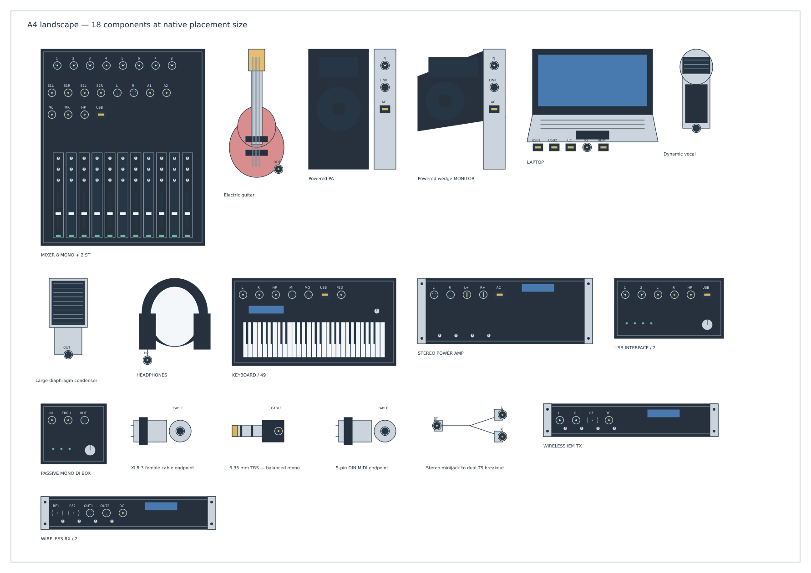
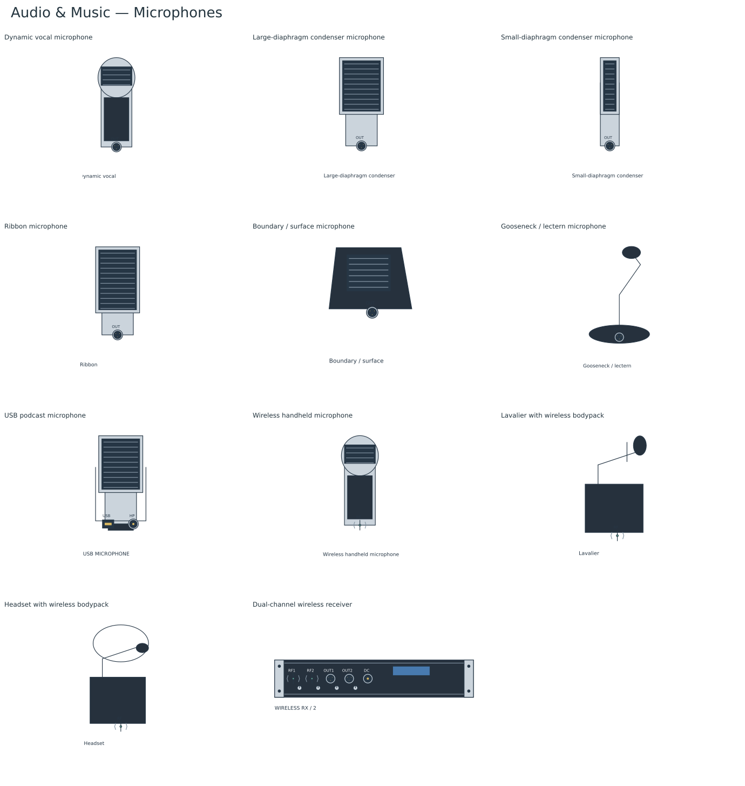
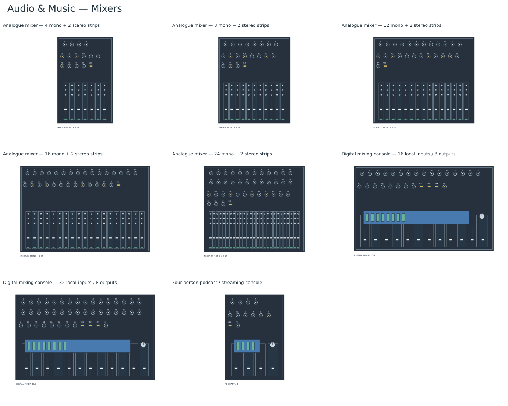

# Audio & Music

Select **Standard → Audio & Music** for 99 editable resources for gigs, recording studios, podcasts, home recording, churches and schools. The [native library](../bundled-libraries/audio-music/audio-music.tclib) is bundled in desktop and browser builds.

All artwork is original TinyCAD vector geometry: equipment silhouettes, grilles, faders, keys, knobs and socket faces. There are no copied product photos, logos, traced illustrations or imported icon sets. Manufacturer guides informed the equipment selection and connector conventions. These are generic equipment layouts with the listed sockets, rather than replicas of particular products.

## Size and connections

Connection points sit in the centres of the sockets and snap to the normal drawing grid. Each point represents **one complete cable**, not an individual XLR contact, jack tip/ring/sleeve, speaker conductor or mains terminal. Hover/connection names and the component's hidden **Ports** attribute identify the full socket name, connector family and signal domain. Small artwork labels abbreviate these names. RF marks represent logical wireless links to compatible receivers.

Bodies use compact drawing sizes: a vocal microphone is 24 × 36 mm, an eight-mono-input analogue mixer 60 × 72 mm, and audio rack units share a 64 mm width with 12 mm per rack unit of body height. These are layout proportions, not scale equipment drawings. Speaker symbols show the front silhouette beside a rear connection panel; mixer inputs/outputs are grouped above their control surfaces. Digital mixer faders represent a bank of channels. Analogue mixers show their mono strips, two stereo strips and master fader. Rack captions sit below the body; the 24-pair patchbay uses the same 64 × 12 mm body as other 1U audio equipment. Connector symbols show a plug silhouette beside its cable connection face; adapter leads show the individual cable ends.

The [A4 placement preview](audio-music-a4.png) shows 18 mixed items at their native placement sizes. It is a size/contact-sheet review, with no connected or operational circuit implied.

Use matching signal types: microphone, instrument, line, headphones and amplified speaker feeds differ. Balanced mono TRS, stereo TRS, CTIA headset TRRS and MIDI mini-TRS are separately named. MIDI Type A and Type B are distinct; MIDI carries performance/control data rather than audio. ADAT and S/PDIF are distinct digital formats. The generic digital stage-link and Dante stageboxes are separate resources; an Ethernet-shaped socket does not establish protocol compatibility.

The drawing does not automatically route mixer channels, join patchbay normals, split stereo signals, connect duplicated links, enforce levels, enable phantom power or simulate audio. Breakout/insert adapters provide individually named endpoints for a cable plan; internal routing is descriptive. Check the actual equipment's socket assignment and configuration when implementing a layout.

## Included equipment

### Microphones (11)

| Resource | Cable connections |
| --- | ---: |
| Dynamic vocal microphone | 1 |
| Large-diaphragm condenser microphone | 1 |
| Small-diaphragm condenser microphone | 1 |
| Ribbon microphone | 1 |
| Boundary / surface microphone | 1 |
| Gooseneck / lectern microphone | 1 |
| USB podcast microphone | 2 |
| Wireless handheld microphone | 1 |
| Lavalier with wireless bodypack | 1 |
| Headset with wireless bodypack | 1 |
| Dual-channel wireless receiver | 5 |

### Mixers (8)

| Resource | Cable connections |
| --- | ---: |
| Analogue mixer — 4 mono + 2 stereo strips | 15 |
| Analogue mixer — 8 mono + 2 stereo strips | 20 |
| Analogue mixer — 12 mono + 2 stereo strips | 26 |
| Analogue mixer — 16 mono + 2 stereo strips | 30 |
| Analogue mixer — 24 mono + 2 stereo strips | 40 |
| Digital mixing console — 16 local inputs / 8 outputs | 28 |
| Digital mixing console — 32 local inputs / 8 outputs | 44 |
| Four-person podcast / streaming console | 12 |

### Recording and computers (10)

| Resource | Cable connections |
| --- | ---: |
| USB audio interface — 2 analogue inputs | 6 |
| USB audio interface — 4 analogue inputs | 10 |
| USB audio interface — 8 analogue inputs | 16 |
| Desktop recording PC | 6 |
| Recording / playback laptop | 5 |
| Phone / tablet — USB-C and headset | 2 |
| Portable stereo field recorder | 5 |
| Eight-input multitrack recorder | 12 |
| Streaming camera | 3 |
| HDMI to USB capture interface | 2 |

### Speakers and amplifiers (16)

| Resource | Cable connections |
| --- | ---: |
| Powered PA loudspeaker | 3 |
| Passive PA loudspeaker | 2 |
| Powered wedge stage monitor | 3 |
| Passive wedge stage monitor | 2 |
| Powered subwoofer | 3 |
| Passive subwoofer | 2 |
| Powered studio monitor | 3 |
| Powered column PA | 3 |
| Passive line-array module | 2 |
| Passive installed wall / ceiling speaker | 1 |
| Stereo power amplifier | 5 |
| Four-output headphone amplifier | 7 |
| Studio headphones | 1 |
| Wired in-ear monitor beltpack | 3 |
| Stereo wireless IEM transmitter | 4 |
| Wireless IEM beltpack and earpieces | 2 |

### Instruments and MIDI (11)

| Resource | Cable connections |
| --- | ---: |
| Electric guitar | 1 |
| Electric bass guitar | 1 |
| Electro-acoustic guitar | 1 |
| Guitar combo amplifier | 3 |
| Bass combo amplifier | 3 |
| Stage keyboard / synthesizer — 49 keys | 7 |
| Stage keyboard / synthesizer — 61 keys | 7 |
| Stage keyboard / synthesizer — 88 keys | 7 |
| USB / MIDI keyboard controller | 3 |
| Drum machine / pad sampler | 6 |
| DJ controller / mixer | 5 |

### Patching and routing (18)

| Resource | Cable connections |
| --- | ---: |
| Passive mono DI box | 3 |
| Active mono DI box | 3 |
| Stereo DI box | 6 |
| Reamp box | 2 |
| Microphone splitter — 1 in / 3 out | 4 |
| Analogue stage snake — 8 sends / 4 returns | 13 |
| Analogue stage snake — 16 sends / 4 returns | 21 |
| Analogue stage snake — 24 sends / 8 returns | 33 |
| Digital stagebox — 16 inputs / 8 outputs | 26 |
| Dante stagebox — 16 inputs / 8 outputs | 26 |
| TRS patchbay — 24 top / 24 bottom sockets | 48 |
| MIDI thru box — 1 in / 4 out | 6 |
| Eight-port audio-network switch | 9 |
| Stereo equalizer | 5 |
| Stereo compressor / limiter | 5 |
| Stereo effects processor | 5 |
| Active crossover / speaker processor | 5 |
| Stereo studio monitor controller | 7 |

### Connectors and adapters (20)

| Resource | Cable connections |
| --- | ---: |
| XLR 3 female cable endpoint | 1 |
| XLR 3 male cable endpoint | 1 |
| 6.35 mm TRS — balanced mono | 1 |
| 6.35 mm TRS — stereo headphones | 1 |
| 6.35 mm TS — instrument | 1 |
| 3.5 mm TRS — stereo audio | 1 |
| 3.5 mm TRRS — CTIA headset | 1 |
| RCA / phono cable endpoint | 1 |
| speakON speaker-cable endpoint | 1 |
| 5-pin DIN MIDI endpoint | 1 |
| 3.5 mm TRS MIDI — Type A | 1 |
| 3.5 mm TRS MIDI — Type B | 1 |
| TOSLINK — ADAT endpoint | 1 |
| RCA — coaxial S/PDIF endpoint | 1 |
| USB-C audio/data cable endpoint | 1 |
| EtherCON / RJ45 audio-network endpoint | 1 |
| XLR female-to-male patch lead | 2 |
| Balanced TRS-to-XLR lead | 2 |
| Stereo minijack to dual TS breakout | 3 |
| TRS insert lead — send / return | 3 |

### Room and stage positions (5)

| Resource | Cable connections |
| --- | ---: |
| Boom microphone stand | 0 |
| Microphone pop filter | 0 |
| Acoustic drum kit position | 0 |
| Lectern / pulpit position | 0 |
| Acoustic treatment panel | 0 |

## Artwork galleries

[Microphones](audio-microphones.png) · [Mixers](audio-mixers.png) · [Recording and computers](audio-recording.png) · [Speakers and amplifiers](audio-speakers.png) · [Instruments and MIDI](audio-instruments.png) · [Patching and routing](audio-routing.png) · [Connectors and adapters](audio-connectors.png) · [Room and stage positions](audio-stage.png).

## Online survey and sources

The survey covers common equipment roles and connector families; it does not claim sales rankings. Yamaha's live-sound guides informed the band/PA equipment and cable families. Shure's guides add worship and school uses. Focusrite and Rode cover recording and podcast workflows. The MIDI Association, Neutrik, Allen & Heath, Radial and Audinate inform connector, DI, stagebox and network-audio distinctions. Product-specific examples establish typical arrangements; the drawings remain generic.

- [Yamaha PA beginners: cables and connectors](https://usa.yamaha.com/audio/portable-pa/explore/pa-beginners-guide/equipments/cable.html): XLR, TRS/TS, RCA, USB and speaker-cable connector families; balanced mono and stereo TRS are distinct uses.
- [Yamaha band PA setup](https://ph.yamaha.com/en/audio/portable-pa/explore/pa-beginners-guide/setting/band-pa.html): Microphones, guitars/bass, keyboard, DI boxes, mixers, powered mains and stage monitors.
- [Yamaha MG mixer overview](https://uk.yamaha.com/en/audio/portable-pa/products/mixers/mg/): Mono/stereo input strips and separate main, aux, monitor, group, record and headphone outputs; generic layouts do not reproduce a branded console.
- [Shure house-of-worship audio systems](https://www.shure.com/en-US/docs/education/house-of-worship-audio-systems): Microphone/instrument sources, mixing and processing, loudspeakers, recording/streaming and personal monitoring; mic, line and speaker levels are different.
- [Shure audio systems for music educators](https://www.shure.com/en-US/docs/education/audio-systems-guide-for-music-educators): Recording and reinforcement share microphones/mixing; loudspeaker playback adds power amplification and signal processing.
- [Focusrite recording setup guide](https://support.focusrite.com/hc/en-gb/articles/24232528717970-What-is-the-easiest-way-to-record): Computer, audio interface, DAW, microphones/instruments and headphones or monitor speakers.
- [Focusrite digital interface expansion](https://support.focusrite.com/hc/en-gb/articles/206849939-How-to-use-the-digital-inputs-and-outputs-to-expand-my-interface-using-Mix-Control): ADAT and S/PDIF use different channel/protocol conventions; matching optical shapes do not establish compatibility.
- [MIDI Association TRS adapter specification](https://midi.org/specification-for-trs-adapters-adopted-and-released): MIDI DIN and mini-TRS interfaces; TRS Type A must be distinguished from legacy Type B.
- [MIDI 1.0 transport specification](https://midi.org/midi-1-0-detailed-specification): DIN5 serial MIDI transport; MIDI carries performance/control data, not an analogue audio signal.
- [Neutrik XLR connector FAQ](https://www.neutrik.com/en/neutrik/faq/xlr): Three-pole XLR is widely used for balanced professional audio. Connector-face artwork is not a conductor-level wiring symbol.
- [Allen & Heath AB168 getting-started guide](https://support.allen-heath.com/hc/en-gb/articles/40423042937873-AB168-Getting-Started-Guide): Representative 16-input/8-output remote stagebox, paired input rows and separate return outputs. Stage-link protocols must match.
- [Rode podcast setup guide](https://rode.com/en-pl/about/news-info/how-to-start-a-podcast-in-5-steps-using-rode-connect): USB microphones, computer, headphones and additional phone/music sources in podcast production.
- [Radial direct-box overview](https://www.radialeng.com/product_category/direct-box): Active/passive/stereo DI interfaces, instrument/line sources and balanced mic-level outputs.
- [Audinate Dante Controller overview](https://dev.audinate.com/GA/dante-controller/userguide/webhelp/content/about_dante_controller.htm): Network audio devices/channels routed over a compatible Dante network.
- [Yamaha active and passive speakers](https://usa.yamaha.com/audio/portable-pa/explore/pa-beginners-guide/equipments/speaker.html): Powered speakers accept line-level feeds; passive speakers require power-amplifier outputs. Monitor speakers serve performer monitoring.

## Rebuilding and validation

The [recipe](../library-recipes/audio-music.json) records all resources, socket semantics, research references and the TinyCAD source search. The [artwork generator](../scripts/lib/audio-artwork.mjs) draws the native XML. The [provenance](../bundled-libraries/audio-music/audio-music.provenance.json) records actual dimensions, socket positions and SHA-256 hashes of the exact generated definitions.

- `npm run libraries:audio`: regenerate the SQLite library and provenance.
- `npm run preview:audio`: render every final definition through the application's native renderer; refresh the galleries and `build/audio-music/` XML/SVG/PNG previews.
- `npm run preview:layout-pages`: generate editable A4 review sheets and documentation previews.
- `npm run test:audio`: check the inventory, signal distinctions, socket-centred connections, normal-grid positions, common rack sizes, reproducible SQLite packaging, actual A4 fit, real editor placement/rotation/mirroring, native save/load and connected microphone, mixer, speaker, recording, headphone and MIDI cable paths.

The public TinyCAD service validates and renders the exact final definitions. Review reports are cached by XML hash under `build/audio-music/mcp/`. The library contains no SPICE models and is included in `npm run libraries:all` and normal asset packaging.

## Bundled example

Open **Open Example → Examples → Two-person podcast studio** for a connected, editable setup using this library. The [explanation](../bundled-examples/descriptions/podcast-studio.md) covers the connection table, assumptions and ways to extend the drawing. All component artwork is embedded. [Drawing](../bundled-examples/drawings/podcast-studio.dsn) · [Preview](../bundled-examples/images/podcast-studio.png).
