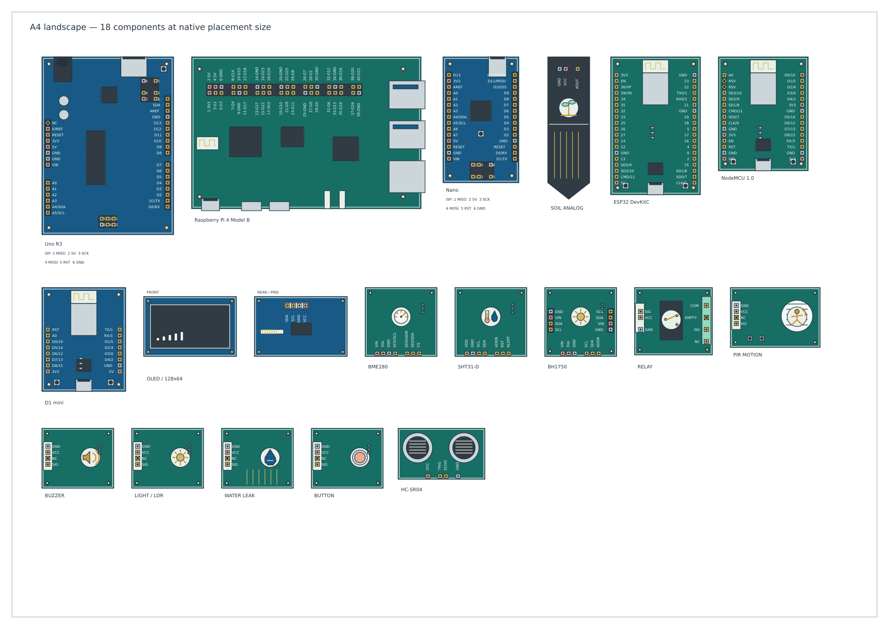
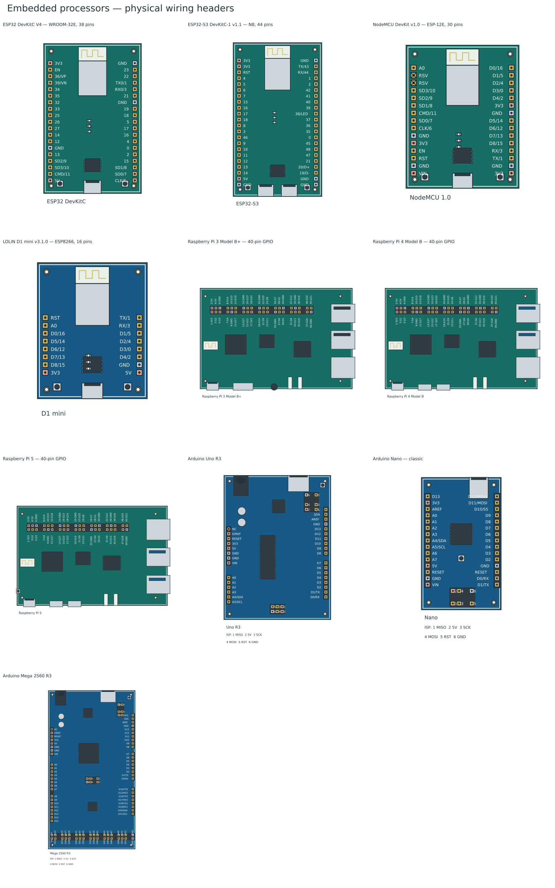
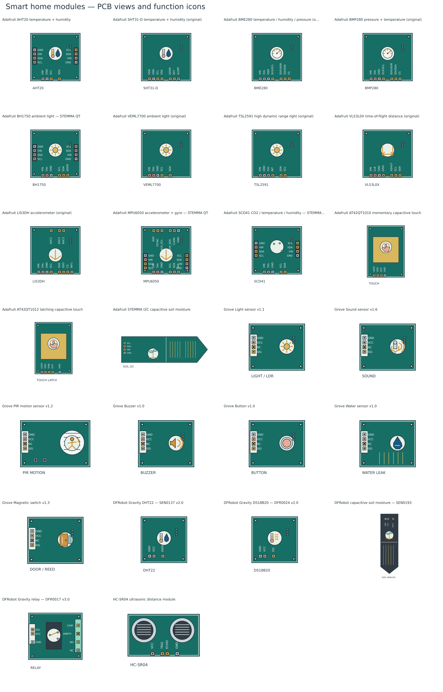
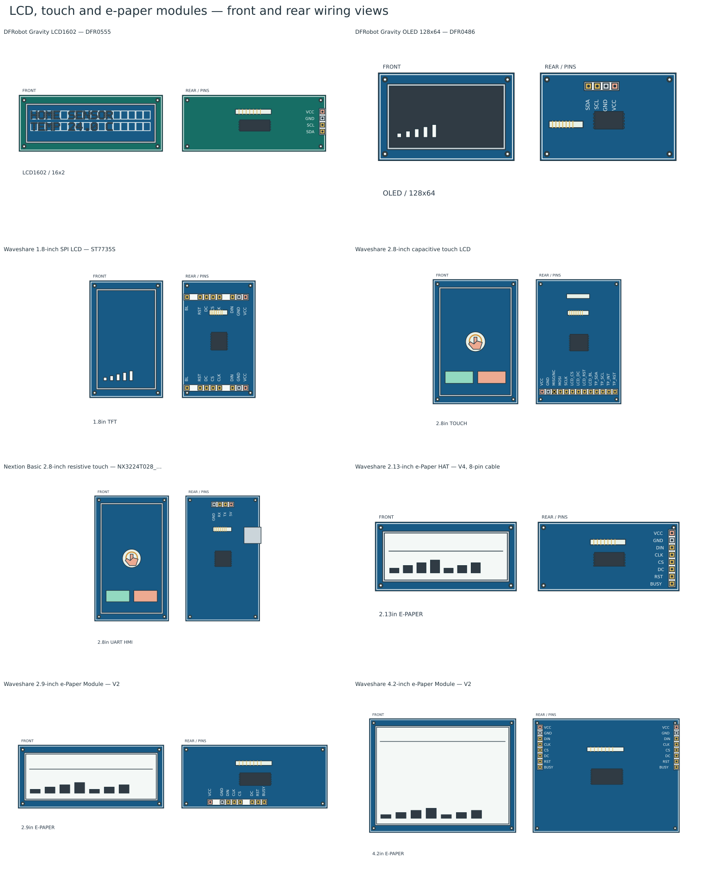

# Embedded processors and smart home

Select **Standard → Embedded processors and smart home** for 44 editable PCB wiring symbols: ten controller boards, 26 sensor/actuator modules and eight display modules. Download the [native library](../bundled-libraries/embedded-smart-home/embedded-smart-home.tclib), or use it directly from the bundled picker in desktop and browser builds.

The artwork consists of original TinyCAD vectors. It contains no bitmaps, product photos, logos, traced PCB artwork or imported icon sets. Manufacturer documents supply terminal facts and board arrangements; the function pictograms are drawn in the generator. Every symbol remains editable native geometry.

## Wiring conventions

These are component-side views, with labelled connection points centred on the copper pads or socket contacts. Headers retain their physical order, including duplicate grounds, documented reserved pins and unconnected contacts. Raspberry Pi labels include physical header numbers and BCM GPIO names. Arduino programming headers show pad numbers and a nearby signal legend. Sensor PCBs use pictograms for temperature, humidity, pressure, light, motion, touch, sound, water, soil and other functions.

The views use compact drawing sizes with contacts snapped to the normal grid; they are not dimensioned PCB footprints. Controller bodies are about one third of the original drawing dimensions and sensor/display bodies about one quarter. Pin labels are rebuilt at a readable size rather than scaled down with the artwork. An ESP32 DevKitC body is 30 × 46 mm on paper; a Raspberry Pi body is about 77 × 51 mm. All terminal IDs, names, electrical types and header orders are preserved.

The [A4 placement preview](embedded-smart-home-a4.png) shows 18 mixed controllers, sensors and a display at native size, with space between them. Generate the editable review sheet with `npm run preview:layout-pages` (`build/layout-pages/embedded-smart-home-a4.dsn`). Existing drawings retain their embedded symbol definitions; replace a placed component from the updated library to use the compact version.

Board revisions are part of the names because similar-looking modules can have different connector orders. In particular, the original and STEMMA QT revisions of TSL2591 and VL53L0X differ. Both QT sockets are wired explicitly on the selected AHT20, BH1750, MPU6050 and SCD41 boards. Grove and STEMMA connectors have different pin orders.

Controller symbols expose the named GPIO/main wiring headers, including fitted Arduino ICSP headers. USB, HDMI, Ethernet and ribbon sockets are visual housings; individual protocol contacts, test pads, solder jumpers and auxiliary/debug headers are outside these wiring views. Raspberry Pi symbols expose the standard 40-pin header. Each physical contact has a unique terminal ID; there are no automatic hidden power nets. Repeated supply/bus contacts are listed in provenance and represent the same hardware signal, but do not automatically join separate wires in a TinyCAD netlist.

These symbols have no SPICE models and do not run firmware. Controller 3V3/5V rails are typed as power outputs for normal USB/barrel-powered use; VIN pins are power inputs. These types do not enforce supply selection, safe alternative power injection or logic-level compatibility. ESP32, ESP8266 and Raspberry Pi GPIO use 3.3 V logic; the selected classic Arduino boards use 5 V logic. HC-SR04 ECHO is a 5 V output and needs an appropriate interface to 3.3 V GPIO. ESP flash/boot pins and Raspberry Pi HAT EEPROM pins are identified in the component descriptions. Arduino Nano A6/A7 and ESP32 input-only pins retain input electrical types. On the relay, **NC** means normally closed; **EMPTY** is the unconnected terminal.

## Controller boards

| Board / revision                        | Wiring contacts | Manufacturer pinout                                                                                                  |
| --------------------------------------- | --------------: | -------------------------------------------------------------------------------------------------------------------- |
| ESP32 DevKitC V4 — WROOM-32E, 38 pins   |              38 | [Source](https://docs.espressif.com/projects/esp-idf/en/v4.4.1/esp32/hw-reference/esp32/get-started-devkitc.html)    |
| ESP32-S3 DevKitC-1 v1.1 — N8, 44 pins   |              44 | [Source](https://docs.espressif.com/projects/esp-dev-kits/en/latest/esp32s3/esp32-s3-devkitc-1/user_guide_v1.1.html) |
| NodeMCU DevKit v1.0 — ESP-12E, 30 pins  |              30 | [Source](https://github.com/nodemcu/nodemcu-devkit-v1.0/blob/master/Documents/NODEMCU_DEVKIT_V1.0_PINMAP.png)        |
| LOLIN D1 mini v3.1.0 — ESP8266, 16 pins |              16 | [Source](https://docs.wemos.cc/en/latest/d1/d1_mini_3.1.0.html)                                                      |
| Raspberry Pi 3 Model B+ — 40-pin GPIO   |              40 | [Source](https://www.raspberrypi.com/documentation/computers/raspberry-pi.html#gpio)                                 |
| Raspberry Pi 4 Model B — 40-pin GPIO    |              40 | [Source](https://www.raspberrypi.com/documentation/computers/raspberry-pi.html#gpio)                                 |
| Raspberry Pi 5 — 40-pin GPIO            |              40 | [Source](https://www.raspberrypi.com/documentation/computers/raspberry-pi.html#gpio)                                 |
| Arduino Uno R3                          |              44 | [Source](https://content.arduino.cc/assets/A000066-full-pinout.pdf)                                                  |
| Arduino Nano — classic                  |              36 | [Source](https://docs.arduino.cc/resources/pinouts/A000005-full-pinout.pdf)                                          |
| Arduino Mega 2560 R3                    |              98 | [Source](https://docs.arduino.cc/resources/pinouts/A000067-full-pinout.pdf)                                          |

The ESP32 choices cover the classic WROOM board and the S3 generation. The ESP8266 choices cover the full NodeMCU board and compact D1 mini. Raspberry Pi 3 B+, 4 B and 5 have distinct connector arrangements. Uno R3, classic Nano and Mega 2560 R3 cover common Arduino starter-kit formats.

## Sensors and actuators

| PCB module / revision                                        | Function    | Wiring contacts | Manufacturer reference                                                                                                  |
| ------------------------------------------------------------ | ----------- | --------------: | ----------------------------------------------------------------------------------------------------------------------- |
| Adafruit AHT20 temperature + humidity                        | climate     |              12 | [Source](https://learn.adafruit.com/adafruit-aht20/downloads)                                                           |
| Adafruit SHT31-D temperature + humidity (original)           | climate     |               7 | [Source](https://learn.adafruit.com/adafruit-sht31-d-temperature-and-humidity-sensor-breakout/downloads)                |
| Adafruit BME280 temperature / humidity / pressure (original) | pressure    |               7 | [Source](https://learn.adafruit.com/adafruit-bme280-humidity-barometric-pressure-temperature-sensor-breakout/downloads) |
| Adafruit BMP280 pressure + temperature (original)            | pressure    |               7 | [Source](https://learn.adafruit.com/adafruit-bmp280-barometric-pressure-plus-temperature-sensor-breakout/downloads)     |
| Adafruit BH1750 ambient light — STEMMA QT                    | light       |              14 | [Source](https://learn.adafruit.com/adafruit-bh1750-ambient-light-sensor/downloads)                                     |
| Adafruit VEML7700 ambient light (original)                   | light       |               5 | [Source](https://learn.adafruit.com/adafruit-veml7700/downloads)                                                        |
| Adafruit TSL2591 high dynamic range light (original)         | light       |               6 | [Source](https://learn.adafruit.com/adafruit-tsl2591/downloads)                                                         |
| Adafruit VL53L0X time-of-flight distance (original)          | distance    |               7 | [Source](https://learn.adafruit.com/adafruit-vl53l0x-micro-lidar-distance-sensor-breakout/downloads)                    |
| Adafruit LIS3DH accelerometer (original)                     | motion      |              11 | [Source](https://learn.adafruit.com/adafruit-lis3dh-triple-axis-accelerometer-breakout/downloads)                       |
| Adafruit MPU6050 accelerometer + gyro — STEMMA QT            | motion      |              20 | [Source](https://learn.adafruit.com/mpu6050-6-dof-accelerometer-and-gyro/downloads)                                     |
| Adafruit SCD41 CO2 / temperature / humidity — STEMMA QT      | air         |              13 | [Source](https://learn.adafruit.com/adafruit-scd-40-and-scd-41/downloads)                                               |
| Adafruit AT42QT1010 momentary capacitive touch               | touch       |               4 | [Source](https://learn.adafruit.com/adafruit-capacitive-touch-sensor-breakouts/downloads)                               |
| Adafruit AT42QT1012 latching capacitive touch                | touch       |               5 | [Source](https://learn.adafruit.com/adafruit-capacitive-touch-sensor-breakouts/downloads)                               |
| Adafruit STEMMA I2C capacitive soil moisture                 | soil        |               4 | [Source](https://learn.adafruit.com/adafruit-stemma-soil-sensor-i2c-capacitive-moisture-sensor/downloads)               |
| Grove Light sensor v1.1                                      | light       |               4 | [Source](https://wiki.seeedstudio.com/Grove-Light_Sensor/)                                                              |
| Grove Sound sensor v1.6                                      | sound       |               4 | [Source](https://wiki.seeedstudio.com/Grove-Sound_Sensor/)                                                              |
| Grove PIR motion sensor v1.2                                 | pir         |               4 | [Source](https://wiki.seeedstudio.com/Grove-PIR_Motion_Sensor/)                                                         |
| Grove Buzzer v1.0                                            | buzzer      |               4 | [Source](https://wiki.seeedstudio.com/Grove-Buzzer/)                                                                    |
| Grove Button v1.0                                            | button      |               4 | [Source](https://wiki.seeedstudio.com/Grove-Button/)                                                                    |
| Grove Water sensor v1.0                                      | water       |               4 | [Source](https://wiki.seeedstudio.com/Grove-Water_Sensor/)                                                              |
| Grove Magnetic switch v1.3                                   | door        |               4 | [Source](https://wiki.seeedstudio.com/Grove-Magnetic_Switch/)                                                           |
| DFRobot Gravity DHT22 — SEN0137 v2.0                         | climate     |               3 | [Source](https://wiki.dfrobot.com/sen0137/)                                                                             |
| DFRobot Gravity DS18B20 — DFR0024 v2.0                       | temperature |               3 | [Source](https://wiki.dfrobot.com/dfr0024/)                                                                             |
| DFRobot capacitive soil moisture — SEN0193                   | soil        |               3 | [Source](https://wiki.dfrobot.com/sen0193/)                                                                             |
| DFRobot Gravity relay — DFR0017 v3.0                         | relay       |               7 | [Source](https://wiki.dfrobot.com/dfr0017/)                                                                             |
| HC-SR04 ultrasonic distance module                           | distance    |               4 | [Source](https://www.handsontec.com/dataspecs/HC-SR04-Ultrasonic.pdf)                                                   |

## LCD, touch and e-paper displays

These eight entries represent purchasable display assemblies with controller PCBs and documented host interfaces. Each symbol shows **two views of one device**: the screen face on the left and rear wiring contacts on the right. Only the rear contacts are electrical connection points. Connector pitch is enlarged onto the normal grid; both views use original vector artwork, including the character LCD's dot-matrix glyphs and illustrative touchscreen controls.

| Module                                                  | Host interface          | Display   | Explicit contacts | Manufacturer documentation                                             |
| ------------------------------------------------------- | ----------------------- | --------- | ----------------: | ---------------------------------------------------------------------- |
| DFRobot Gravity LCD1602 — DFR0555                       | I2C                     | 16 x 2    |                 4 | [Source](https://wiki.dfrobot.com/dfr0555)                             |
| DFRobot Gravity OLED 128x64 — DFR0486                   | I2C                     | 128 x 64  |                 4 | [Source](https://wiki.dfrobot.com/dfr0486)                             |
| Waveshare 1.8-inch SPI LCD — ST7735S                    | SPI                     | 128 x 160 |                16 | [Source](https://www.waveshare.com/wiki/1.8inch_LCD_Module)            |
| Waveshare 2.8-inch capacitive touch LCD                 | SPI display + I2C touch | 240 x 320 |                13 | [Source](https://www.waveshare.com/wiki/2.8inch_Capacitive_Touch_LCD)  |
| Nextion Basic 2.8-inch resistive touch — NX3224T028_011 | TTL UART                | 240 x 320 |                 4 | [Source](https://nextion.tech/datasheets/nx3224t028/)                  |
| Waveshare 2.13-inch e-Paper HAT — V4, 8-pin cable       | SPI                     | 250 x 122 |                 8 | [Source](https://www.waveshare.com/wiki/2.13inch_e-Paper_HAT_Manual)   |
| Waveshare 2.9-inch e-Paper Module — V2                  | SPI                     | 296 x 128 |                 8 | [Source](https://www.waveshare.com/wiki/2.9inch_e-Paper_Module_Manual) |
| Waveshare 4.2-inch e-Paper Module — V2                  | SPI                     | 400 x 300 |                16 | [Source](https://www.waveshare.com/wiki/4.2inch_e-Paper_Module_Manual) |

The 1.8-inch TFT exposes both its eight-contact cable connector and matching solder header. The 4.2-inch e-paper module likewise exposes both eight-contact host interfaces. These are repeated hardware signals on separate physical contacts, rather than sixteen independent control signals. The 2.13-inch e-paper symbol exposes its eight-pin cable interface; the optional Raspberry Pi 40-pin socket is outside that wiring view. The capacitive TFT exposes its thirteen-pin cable interface, including the unavailable **MISO/NC** contact, which retains no-connect electrical semantics. Its alternative host FPC and internal panel/touch ribbons are outside the wiring view.

Use the module's actual supply and logic requirements when choosing a host. The capacitive Waveshare screen requires matching supply and logic levels: 3.3 V on Pi/ESP, or 5 V on classic Arduino. The Nextion uses a 5 V power supply and TTL UART; cross its TX to the host RX and its RX to the host TX. It runs a local HMI design rather than accepting raw SPI framebuffer data. E-paper uses a BUSY output and has much slower refresh than LCD/OLED, making it useful for status panels and infrequently changing readings. All three e-paper entries include driver boards; bare FPC panels are not interchangeable wiring modules.

## Project survey and selection

The selection covers wired projects documented in the [ESPHome DIY examples](https://esphome.io/guides/diy/), [ESPHome component catalogue](https://esphome.io/components/), [DFRobot ESP32/ESP8266 DHT22 guides](https://wiki.dfrobot.com/sen0137/) and [Seeed Grove ecosystem](https://wiki.seeedstudio.com/Grove_System/). This is a practical coverage survey, rather than a measured sales ranking.

| Project pattern                 | Useful included modules                                                                           |
| ------------------------------- | ------------------------------------------------------------------------------------------------- |
| Room climate and occupancy      | BME280 or SHT31-D/AHT20/DHT22, BH1750/VEML7700/TSL2591 and PIR.                                   |
| Indoor air monitoring           | SCD41 for CO2, temperature and humidity; BME280 for pressure.                                     |
| Plant and irrigation monitoring | Capacitive soil probes, DS18B20 temperature, water detection and relay.                           |
| Door and presence detection     | Magnetic reed switch, PIR, ultrasonic or time-of-flight distance.                                 |
| Local controls and alerts       | Momentary/latching touch, button, sound input and buzzer.                                         |
| Local displays and controls     | Character LCD/OLED text, SPI TFT, capacitive or UART touch; e-paper for slowly changing readings. |
| Movement and orientation        | LIS3DH accelerometer or MPU6050 accelerometer/gyro.                                               |

Exact main-header and socket maps, source URLs, board notes and manufacturer-source hashes where CAD was used are frozen in the [recipe](../library-recipes/embedded-smart-home.json). The [provenance](../bundled-libraries/embedded-smart-home/embedded-smart-home.provenance.json) includes a hash of every generated XML definition and is also embedded in SQLite. The generator works offline from this checked-in recipe; it does not fetch manufacturer artwork.

## Build and checks

- `npm run libraries:embedded` rebuilds the SQLite library and provenance.
- `npm run preview:embedded` renders every native definition to XML/SVG/PNG in `build/embedded-smart-home/` and refreshes the three documentation galleries.
- `npm run test:embedded` checks critical pin tables, display connector contracts and electrical types, pad/grid alignment, every controller/module through actual editor placement, rotation/mirroring, save/load, four-wire ESP32/BME280 connectivity, actual A4 placement of 18 mixed components and deterministic SQLite packaging.
- `npm run libraries:all` includes this bundle; `npm run libraries:package` copies the configured library into desktop and browser build assets.

Local validation also checks all generated definitions against TinyCAD's published component XSD. Native editor previews and connectivity tests do not constitute hardware testing or simulation.

## Bundled example

Open **Open Example → Examples → ESP32 climate and display station** for a connected, editable setup using this library. The [explanation](../bundled-examples/descriptions/embedded-climate-station.md) covers the connection table, assumptions and ways to extend the drawing. All component artwork is embedded. [Drawing](../bundled-examples/drawings/embedded-climate-station.dsn) · [Preview](../bundled-examples/images/embedded-climate-station.png).
