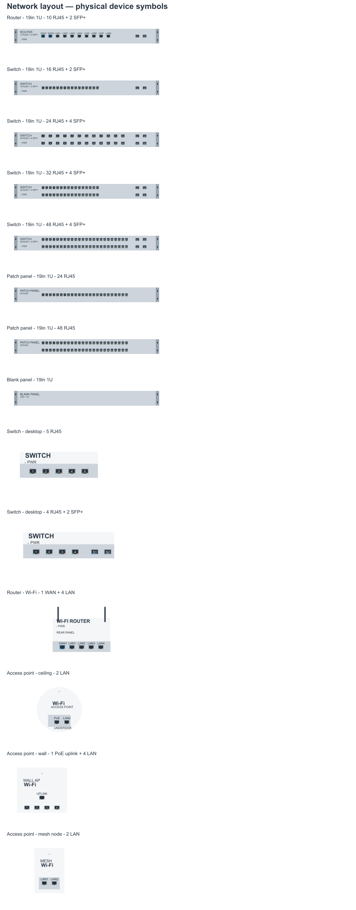

# Libraries and examples

## Standard library catalogue

[bundled-libraries/config.json](../bundled-libraries/config.json) lists the read-only `.tclib` bundles shared by Electron and both browser modes. Its contract is [bundled-libraries.schema.json](../schemas/bundled-libraries.schema.json).

Each entry has a stable unique `id`, display `name`, relative `path` and optional `description`. Paths use forward slashes and stay inside `bundled-libraries/`. Keep IDs stable so saved selections survive updates. Directory paths locate files; the chooser displays a flat symbol list.

Library source tabs appear as **Standard**, **Online**, then **My Libraries**. New users start on Standard; the last selected source is remembered locally for subsequent sessions.

The **Standard Libraries** selector loads one library at a time, on demand, and remembers the selection separately from personal libraries. Failed loads offer Retry or another library selection. Standard libraries support preview, search, placement and replacement; personal libraries also provide editing controls. Newly placed standard symbols show their Name field by default. Use its Show checkbox in the symbol properties to hide or reveal the name.

All three sources use compact result rows. Selecting a symbol shows its description and a draggable artwork preview; long descriptions scroll independently.

Packaged assets live under `dist/bundled-libraries/`. Browser deployment preserves that directory; desktop reads packaged resources through restricted IPC. [package-libraries.mjs](../scripts/package-libraries.mjs) validates the catalogue and referenced files. Tests: `npm run test:libraries`.

The picker browser regression runs with `npm run test:layout:browser -- library-previews.spec.mjs`. It covers compact rows in all three library sources, selected rack-panel previews, filtering, selection and the drag payload used for placement.

## Bundles and electrical conventions

| Bundle | Contents and contracts |
| --- | --- |
| SPICE essentials | 29 entries: passives, transformer, resonators, discrete semiconductors, coloured LEDs, 741, LM358, LM324 and independent sources. European and US resistor variants share connectivity. |
| Digital logic | 21 canonical types / 28 entries: gates, combinational blocks, counters, shift register, flip-flops and latches. Seven clocked types have separate rising/falling entries. |
| Functional blocks | 14 interfaces / 17 entries: ADC/DAC, communications, logger, MCU/FPGA/PLC, sample-and-hold, state machine, PCM/TDM and transducer. ADC, PCM and state machine have both clock-edge variants. |
| Sensors and interfaces | Ten generic types: test point, Hall, piezo, light/pressure/temperature voltage sensors, moisture, pH, analogue switch and AM modulator. |
| Network layout | 47 physical device symbols: consumer and rack switches/routers, firewalls, access points, patch panels, fibre aggregation, ONT, PoE injector and blank rack panel. |
| Embedded processors and smart home | 44 physical PCB views: ESP32/ESP8266 devkits, Raspberry Pi 3/4/5, Arduino Uno/Nano/Mega, 26 sensor/actuator modules and eight LCD/OLED/touch/e-paper displays. Labelled header pads, original function icons and revision-specific pin maps; no simulation models. |
| Audio & Music | 99 compact equipment-layout resources for PA, recording, podcasts, instruments/MIDI, monitoring, routing and connectors. Original vectors with whole-cable connection points inside sockets; no simulation models. |
| Test & Measurement | 78 compact original vector laboratory setup resources: supplies/loads, instruments, probes, acquisition, heaters, thermal equipment, relays, controls, pumps and apparatus. Individual conductor, whole-cable and hose endpoints; no simulation models. |
| Motors & Motion | 66 compact original vector resources for DC/brushless motors, steppers, servos, drivers, encoders, limit sensors, solenoids, electric/pneumatic actuators and mechanical layouts. Three source-checked Pololu carriers; explicit conductor/cable/hose connections and no simulation models. |
| Solar power and batteries | 52 supplied symbols for conceptual home-energy planning: panels, inverters, storage, EV charging, supply/backup, protection, monitoring and loads. Whole-cable or logical-link connections; no simulation models. |

Digital supplies are native hidden **Power** pins named **VCC** and **VSS**. Connect those named nets to actual supplies; VSS is not implicitly node `0`. **Show power pins** exposes them. Native Dot, Clock and DotClock pin shapes convey inversion and edge polarity. Functional and sensor power/reference pins are visible and require explicit wiring.

Generic logical pin numbers are not commercial package pinouts. Preserve each inventory's terminal names, electrical types and polarity. The test point has one real passive pin; it is electrically connected rather than decorative. Six editor/connectivity inventory types use native wire/junction/label/ground/no-connect/annotation operations. Built-in instruments, probes and waveform sources are listed as `existing_tools` dependencies, outside generated symbol requirements.

Digital, functional and sensor components carry configurable educational models. MCU/FPGA/PLC behaviour does not execute firmware or HDL. Supply loading, timing, physical calibration and analogue limits are simplified. [Teaching models](teaching-simulation-models.md) specifies parameters and tested semantics. A symbol or inventory record alone does not establish a simulation model.

## Network layout

Select **Standard → Network layout** for 47 compact, editable device symbols for cable and rack planning. The original native vector artwork includes consumer devices, rack panels, copper and fibre switches, PoE variants, routers, firewalls, access points and patch panels. The [recipe](../library-recipes/network-layout.json) and [provenance](../bundled-libraries/network-layout/network-layout.provenance.json) record configuration sources.

Panel artwork stays compact while lettering retains readable sizes. Port banks use uniform normal-grid spacing, with numbers inside dense socket rows to keep labels clear.

Each RJ45 socket and SFP+ cage has one passive cable endpoint at the centre of its opening. Draw wires between these points. Amber surrounds identify PoE+ outputs; blue surrounds identify WAN sockets. Ceiling access points show their underside socket bay, and wireless routers expose their rear panel. This is a device-level cable map, not an eight-contact Ethernet pinout or a SPICE simulation model. Power sockets, RF links and internal switching are outside this abstraction.

| Family | Included configurations |
| --- | --- |
| Copper switches | Desktop 5/8/16/24-port and rack 8/16/24/48-port layouts. |
| Mixed copper/fibre | 4 or 8 RJ45 + 2 SFP+; 16 + 2; 24 + 2 or 4; 48 + 4. |
| PoE switches | Desktop 4 PoE+ + 1 unpowered uplink and 8 PoE+; rack 16/24/48 PoE+ with uplinks. |
| Fibre aggregation | Rack 8- and 16-slot SFP+ layouts. |
| Additional planning layouts | Four-RJ45 switches, 10 RJ45 + 2 SFP+ and 32 RJ45 + 4 SFP+. |

Names specify actual socket counts rather than marketed port totals. The layouts are generic and unbranded; similar SFP/SFP+ cage artwork does not imply compatibility with a particular product.

Every rack device has the same **80 × 8 XML-unit face (400 × 40 drawing units)**, including rack ears and matching mounting holes. Keep the default scale, align the native bottom-right placement anchors, and step vertically by **40 drawing units** for each 1U panel. Smaller copper switches use single port rows, larger switches use paired odd/even rows, and 24-port patch panels use one row. These are drawing conventions, not mechanical rack dimensions. The Name field is visible by default and the reference is hidden. Front-panel labels remain visible. Existing drawings retain their embedded symbols.

**Open Example → Examples → Small office network** opens an editable four-unit rack with an ISP fibre terminal, ceiling access point and desk switch. The cable map is ONT1 LAN1 → RTR1 WAN1, RTR1 SFP+1 → SW1 SFP+1, SW1 port 4 → PP1 port 1 → AP1, and SW1 port 6 → PP1 port 3 → DS1. Patch-panel sockets join rack leads to office runs. Spare sockets and the external ISP endpoint are intentionally open; checker notices for these endpoints and wires entering panel outlines are expected.



All 47 devices fit on the [A4 placement preview](network-layout-a4.png) at native size. Rebuild with `npm run libraries:network`, generate the gallery and editable A4 preview with `npm run preview:network`, and verify placement, rotation, wiring and save/load with `npm run test:network`. Per-device XML/SVG/PNG previews are written to `build/network-layout/`. The bundle is included in `npm run libraries:all` and standard asset packaging.

## Embedded processors and smart home

Select **Standard → Embedded processors and smart home** for the controller boards and sensor modules. The [library guide](embedded-smart-home.md) lists all 44 entries, physical wiring conventions, the project survey and manufacturer references, with galleries of the [controllers](embedded-controllers.png), [modules](smart-home-modules.png) and [displays](smart-home-displays.png).

The original vector artwork shows component-side PCB views. Individual connection points sit on the labelled header pads. Raspberry Pi headers include physical pin numbers and BCM names; Arduino ICSP headers have pin legends. Sensor chips are represented by small function pictograms. Named revisions distinguish incompatible module layouts. These are compact wiring resources with explicit electrical pin types and no firmware or SPICE models. The [A4 preview](embedded-smart-home-a4.png) fits 18 mixed components at native placement size.

The [recipe](../library-recipes/embedded-smart-home.json), [generator](../scripts/lib/embedded-artwork.mjs) and [provenance](../bundled-libraries/embedded-smart-home/embedded-smart-home.provenance.json) retain all pin maps and source references. Rebuild with `npm run libraries:embedded`, preview with `npm run preview:embedded`, and check with `npm run test:embedded`. The bundle is included in `npm run libraries:all` and standard asset packaging.

## Audio & Music

Select **Standard → Audio & Music** for 99 compact original vector resources for gigs, recording studios, podcasts, home recording, churches and schools. The [library guide](audio-music.md) lists the equipment, connector conventions, online survey and artwork galleries. Each socket has one complete-cable connection point; RF marks are logical wireless links. Balanced mono, stereo, instrument, speaker, MIDI and digital/network audio connections are identified separately.

The [A4 preview](audio-music-a4.png) shows 18 equipment resources at native placement size. Rebuild with `npm run libraries:audio`, preview with `npm run preview:audio`, generate A4 review sheets with `npm run preview:layout-pages`, and check with `npm run test:audio`. Standard asset packaging and `npm run libraries:all` include the bundle.

## Test & Measurement

Select **Standard → Test & Measurement** for 78 original vector laboratory setup resources. The [guide](test-measurement.md) includes the inventory, manufacturer survey, galleries and connection conventions. Individual binding posts, screw terminals and probe/heater leads are separate conductor endpoints; BNC/USB/TC plug ports represent complete cables, and fluid ports represent hoses. Force/sense, RTD lead counts and relay contact roles remain explicit.

The [A4 preview](test-measurement-a4.png) fits 18 mixed lab resources at native placement size. Rebuild with `npm run libraries:test-measurement`, preview with `npm run preview:test-measurement`, generate review sheets with `npm run preview:layout-pages` and check with `npm run test:test-measurement`. The standard packager and `npm run libraries:all` include this bundle.

## Motors & Motion

Select **Standard → Motors & Motion** for 66 original vector resources for robotics and automation. The [guide](motors-motion.md) lists the inventory, surveyed sources, named carrier header maps and wiring conventions. Electrical contacts distinguish winding, motor/servo power, PWM/direction, encoder and limit signals; complete feedback/control cables and pneumatic hoses are labelled separately. Shafts and mounting points are mechanical artwork.

The [A4 preview](motors-motion-a4.png) fits 16 mixed resources at native placement size. Rebuild with `npm run libraries:motion`, preview with `npm run preview:motion` and check with `npm run test:motion`. Standard packaging, `npm run libraries:all` and A4 review generation include the bundle.

## Solar power and batteries

Select **Standard → Solar power and batteries** for the 52 supplied home-energy planning components: solar panels and arrays, inverters and charge controllers, battery storage, EV charging, grid/supply and backup equipment, switches and protection, monitoring/control and household loads.

The [solar library](../bundled-libraries/solar/Solar-Power-and-Batteries.TCLib) uses the visible Name field for the supplied equipment names. Its connection points represent whole cables or logical links rather than individual electrical terminals; component attributes retain the supplied usage notes and reference sources. It has no embedded SPICE models. The [import provenance](../bundled-libraries/solar/solar.provenance.json) records its original filename, entry count, original and bundled file hashes, and caption changes.

The catalogue entry makes it available in Electron and both browser modes. `npm run libraries:package` and `npm run libraries:all` copy the supplied file into the build; no generator rewrites it.

## SPICE essentials

Use **Simulation → Components** for common parts; **More…** opens the full standard library. Placed symbols retain hidden `$$SPICE` attributes. Numeric SPICE suffixes include `1k`, `10u`, `100n` and `1Meg`; `m` means milli. `Model`/`Model Name` selects a device model; an empty `Model File` emits the embedded generic definition. Custom model text must also satisfy the [engine input policy](spice-engine.md#deck-and-model-contract).

| Component | Drawing terminals / model |
| --- | --- |
| BJT | 1 base, 2 emitter, 3 collector; template emits collector/base/emitter order. |
| MOSFET | 2 gate, 3 drain, 4 source; bulk tied to source. |
| Diode, zener, LED | 1 anode, 2 cathode. |
| 741 | 3 IN+, 2 IN−, 7 positive supply, 4 negative supply, 6 output. Offset-null pins omitted. |
| LM358 | Complete eight-pin dual package. Supply pins are 8 (V+) and 4 (V−). |
| LM324 | Complete 14-pin quad package. Supply pins are 4 (V+) and 11 (V−). |
| Potentiometer | Ends 1/2, wiper 3; two resistor segments with a 1 micro-ohm floor. |
| Transformer | Primary 1/2, secondary 3/4; coupled ideal inductors, no saturation/winding resistance. |
| Resonators | Motional series RLC in parallel with shunt capacitance. |

The 741 behavioural model approximates 200,000 open-loop DC gain, 2 Megohm differential input resistance, 5 Hz dominant pole, 0.5 V/µs slew limit, 75 ohm output resistance and rail clipping with 2 V headroom. It omits bias/offset, common-mode validity, temperature, noise, short-circuit current and full stability effects. Generic diode/transistor/LED/resonator models are teaching approximations; LED colour is not calibrated brightness. Electrolytic polarity is graphical and is not enforced by its ideal capacitor model. Core inductors remain linear.

The LM358 and LM324 link to the typical-behaviour OpenJellyBean package models in the bundled catalog. Both can simulate after placement with the supply and signal pins wired. The LM358 and LM324 models omit effects such as input common-mode limits, noise and offset drift. [LM358 datasheet](https://www.ti.com/lit/ds/symlink/lm358.pdf) · [LM324 pinout](https://www.ti.com/lit/ds/symlink/lm324-mil.pdf) · [OpenJellyBean definitions](https://github.com/xdylanm/openjellybean/blob/v0.6.0/jellybean.lib)

## Sources, recipes and provenance

[library-recipes](../library-recipes) records selections and guarded adaptations. Adjacent `*.provenance.json` files in [bundled-libraries](../bundled-libraries) retain attribution, source IDs, hashes and drawing/model changes; generated bundle metadata is also embedded in SQLite `TinyCADBundleInfo`. The supplied solar library has import metadata recorded alongside it.

SPICE artwork comes from **onetransistor** and templates from **aryajur** in the legacy SQL collection. The digital style derives from **matt**'s NAND (SymbolID 160 / NameID 9279), retained as [nand-reference.xml](../library-sources/digital/nand-reference.xml). The digital, functional and sensor generators use checked-in sources without a private SQL dump or selection UI.

Connection points use the 1 mm grid. SPICE resistor variants share their 2 × 5.2 mm envelope; digital family drawings use pale yellow bodies and 4 mm signal leads. Native inversion/clock markers and explicit pin corrections must survive rotations, mirrors, placement and save/load.

[build-library-from-sql.mjs](../scripts/build-library-from-sql.mjs) remains the legacy import boundary. It parses selected literal INSERT records rather than running a database. Recipes select exactly one visible component by source ID or name, optionally merge `spiceFrom`, override attributes, and apply guarded `pins`/`geometry` changes. `requireSpice` validates template macros, not electrical behaviour. Keep SQL dumps outside the repository: unrelated account/application records do not belong in exported content.

See [spice.json](../library-recipes/spice.json), [digital.json](../library-recipes/digital.json), [functional.json](../library-recipes/functional.json) and [sensors-interfaces.json](../library-recipes/sensors-interfaces.json) for full recipe contracts. Model implementations live in [teaching-models.mjs](../scripts/lib/teaching-models.mjs); [selected-artwork.mjs](../scripts/lib/selected-artwork.mjs) owns the frozen selection adaptations. The [symbol inventory guide](symbol-libraries/README.md) describes the shared component contracts.

Regression commands are `test:spice`, `test:digital`, `test:functional`, `test:sensors`, `test:teaching`, `test:network`, `test:embedded` and `test:symbol-artwork` through npm. Coverage includes terminal contracts, actual editor placement, rotated/mirrored geometry, hidden rails, reproducibility, persistence and numerical model cases where an engine is available.

## PCB footprint and model bundles

The PCB engine's M1 starter catalogue pairs native footprints with generated STEP models. The [starter recipes](../scripts/pcb/starter-footprints.json) generate 115 geometry-reviewed footprint variants across surface-mount and through-hole families. The footprint editor loads the bundled drafts offline. Most dimension records describe generic educational envelopes. The LM358DR draft uses TI’s D0008A land pattern and package-specific pinout. The 1N4148-TAP draft uses Vishay’s DO-35 body dimensions and cathode identification with the KiCad land pattern for horizontal assembly at 7.62 mm pitch. The [catalogue requirements](TinyCAD_PCB_Layout_Complete_Specification.md#102-curated-supplied-library) define the fit and pin-mapping review for each curated revision. [D0008A package drawing](https://www.ti.com/lit/ml/msoi002k/msoi002k.pdf) · [LM358DR pinout](https://www.ti.com/lit/ds/symlink/lm358.pdf) · [Vishay 1N4148 datasheet](https://www.vishay.com/docs/81857/1n4148.pdf)

The SN74HC00N draft records TI’s 14-pin PDIP package and pinout. The Phoenix Contact 1715721 draft follows the 5.08 mm pitch, 1.3 mm holes and offset row in its drilling plan. The recipes identify the TinyCAD land dimensions for each variant. [TI SN74HC00N package and pinout](https://www.ti.com/lit/ds/symlink/sn74hc00.pdf) · [Phoenix Contact 1715721 drawings](https://www.phoenixcontact.com/gb/products/1715721/pdf)

The catalogue also includes part-specific pin maps for NPN and PNP BJTs, N-channel and P-channel MOSFETs and JFETs, a through-hole power MOSFET and IGBT, the BAV99 dual switching diode and the TL431 shunt reference. The named variants load their pad-to-terminal names in the footprint editor. The TO-220 lands use TinyCAD drill and copper sizing for straight leads. [Nexperia BC847x](https://assets.nexperia.com/documents/data-sheet/BC847X_SER.pdf) · [Nexperia 2N7002BK](https://assets.nexperia.com/documents/data-sheet/2N7002BK.pdf) · [onsemi MMBFJ113](https://www.onsemi.com/download/data-sheet/pdf/mmbfj113-d.pdf) · [ST STGP10NC60KD](https://www.st.com/resource/en/datasheet/stgp10nc60kd.pdf) · [Nexperia BAV99](https://assets.nexperia.com/documents/data-sheet/BAV99.pdf) · [TI TL431](https://www.ti.com/lit/ds/symlink/tl431.pdf)

The first part-specific connector entries are the Amphenol RJHSE5380 shielded Ethernet jack, Same Sky SJ1-3525N switched stereo jack and PJ-102A switched DC jack, and 2- and 4-position JST XH headers. The audio and DC patterns include plated slots. The audio and Ethernet patterns distinguish non-plated locating holes from signal terminals, and both RJHSE5380 shell tabs map to Shield. Connector body models are generated envelopes for clearance checks. The KiCad audio-jack reference includes a board-edge notch that needs a separate board outline decision. [Amphenol RJHSE5380](https://www.amphenol-cs.com/product/rjhse5380.html) · [Same Sky SJ1-3525N drawing](https://www.sameskydevices.com/product/resource/sj1-352xn.pdf#page=2) · [Same Sky PJ-102A drawing](https://www.sameskydevices.com/product/resource/pj-102a.pdf#page=2) · [JST XH datasheet](https://www.jst-mfg.com/product/pdf/eng/eXH.pdf)

Use **Datasheet URL** in the footprint editor to add, update or clear a link to a manufacturer datasheet or package drawing. The optional `datasheetUrl` is stored in the native footprint definition and travels with exported device definitions and embedded board footprints. The editor and project device picker can open it. Starter entries use a verified manufacturer reference where available. For a generic draft, the link is a representative reference for the package family.

The offline PCB starter library, [starter-v1.tplib](../bundled-footprints/starter-v1.tplib), stores 115 footprints, 21 named device mappings and the matching STEP models in SQLite. TinyCAD's symbol libraries use the `.tclib` extension. Generic footprints open in the footprint editor for part-specific setup. The PCB device resolver loads the mapped devices alongside project-local `.tcdevice.json` files. Datasheet links travel with the native footprint and any board that embeds it.

Generate the native files and a build manifest, then package the database.

```sh
python3 scripts/pcb/generate-starter-footprints.py /tmp/tinycad-footprints --bundle /tmp/tinycad-footprints/manifest.json
node scripts/pcb/build-starter-library.mjs /tmp/tinycad-footprints/manifest.json
```

The packager checks the exact footprint digests and terminal assignments against the [catalogue evidence](../scripts/pcb/starter-footprint-evidence.json). The evidence includes the KiCad 9.0.0 references, manufacturer drawings and the two connector acceptances. The STEP bytes are stored once as binary assets and are embedded in native files when they are opened or used on a board. [KiCad 9.0.0 footprint library](https://gitlab.com/kicad/libraries/kicad-footprints/-/tags/9.0.0) · [KiCad library licence](https://www.kicad.org/libraries/license/)

The starter CHIP 0402, 0603, 0805 and 1206 drafts use the Vishay D/CRCW e3 resistor reflow pattern. Their pad lengths × widths and centre spacing in millimetres are 0.60 × 0.60 at 1.05, 0.75 × 1.00 at 1.50, 0.95 × 1.45 at 1.95 and 1.05 × 1.80 at 2.55, respectively. Component families with the same chip size can specify different patterns. [Vishay D/CRCW e3 datasheet, recommended solder pad dimensions](https://www.vishay.com/docs/20035/dcrcwe3.pdf#page=11)

The SOIC-8, -14 and -16 drafts use TI patterns with 1.55 × 0.60 mm pads and 5.40 mm between the pad columns. The SOIC-20 wide uses TI’s 2.00 × 0.60 mm pads and 9.30 mm between columns. The SOIC-24 wide uses Microchip’s 2.00 × 0.60 mm pads and 9.40 mm between columns. All five use 1.27 mm pitch along each column. The manufacturer drawing is linked from each native footprint. [TI D0008A](https://www.ti.com/lit/ml/msoi002k/msoi002k.pdf#page=2) · [TI D0014A](https://www.ti.com/lit/ds/symlink/sn74lv14a.pdf) · [TI D0016A](https://www.ti.com/lit/ml/mpds432a/mpds432a.pdf) · [TI DW0020A](https://www.ti.com/lit/ds/symlink/tlc2543.pdf) · [Microchip 24-lead wide SOIC](https://ww1.microchip.com/downloads/aemDocuments/documents/package-outline-drawings/c04-00025f.pdf)

Both the native geometry and the KiCad comparison use top-view coordinates. The generic dual-row vertical headers start with pin 1 at the upper left, pin 2 at the upper right, and continue row by row. When viewed from the solder side with the same upper edge, pin 1 appears at the upper right. Through-hole headers have copper on both faces. These top-mounted surface-mount drafts have copper and paste on the top face. [KiCad pin 1 convention](https://klc.kicad.org/footprint/f4/f4.2/) · [KiCad PCB Editor manual](https://docs.kicad.org/9.0/en/pcbnew/pcbnew.html)

### Pad geometry and catalogue sources

Starter footprints need a mapped KiCad equivalent or a manufacturer datasheet or package drawing for the represented package. For through-hole parts, the datasheet can establish the PCB hole pattern or the lead dimensions used to calculate drill clearance. The recipe records any copper dimensions selected by TinyCAD. Generic transformer, inductor and other envelopes without a matching reference were removed from the starter bundle.

Generic rectangular SMT lands use a corner radius of 25% of the shorter edge, capped at 0.25 mm, on copper and matching paste apertures. Published patterns keep their specified contours. Rounded stencil apertures can improve paste release during printing, especially with smooth, tapered walls. Stencil thickness, aperture area ratio and the assembly process also affect the result. Copper rounding by itself is insufficient to predict solder-joint quality. [KiCad SMD pad convention](https://klc.kicad.org/footprint/f6/f6.3/) · [TI SOD-523 stencil example](https://www.ti.com/lit/ml/mpss124c/mpss124c.pdf) · [Analog Devices stencil guidance](https://www.analog.com/en/resources/app-notes/maxim-waferlevel-package-assembly-guide.html)

Non-polar ceramic disc and film capacitors have identical copper, mask and drills on the two leads, with no pin-1 mark. Their numeric pad labels identify the two connections. Polarized radial electrolytic capacitors retain their orientation marker and distinctive pad 1. [KiCad through-hole pad convention](https://klc.kicad.org/footprint/f7/f7.3/) · [KiCad through-hole capacitor library](https://kicad.github.io/footprints/Capacitor_THT.html)

### Manufacturer drawings for KiCad exceptions

The published patterns below apply to the named package and assembly variants. Check the intended part’s pin assignment and stencil requirements when choosing a representative footprint.

| Drafts | Drawing applied to the copper lands |
| --- | --- |
| SOT-23-3, -5 and -6 | 1.10 × 0.60 mm pads, 2.60 mm across columns and 0.95 mm pitch along each three-pad column. The three-pin footprint has 0.95 mm between its two same-side pads. [TI DBV0003A](https://www.ti.com/lit/ml/mpds017p/mpds017p.pdf#page=2) · [TI DBV0005A](https://www.ti.com/lit/ml/mpds018t/mpds018t.pdf#page=2) · [TI DBV0006A](https://www.ti.com/lit/ml/mpds026q/mpds026q.pdf#page=2) |
| SOT-223-4 | 5.80 mm across columns, 2.30 mm along the three small pads and a 2.15 × 3.25 mm pad 4. KiCad’s TabPin2 reference uses label 2 on the tab. Check the intended device’s electrical connection to the tab. [TI DCY0004A](https://www.ti.com/lit/ml/mpds094b/mpds094b.pdf#page=2) |
| SMT electrolytic cans 4, 5, 6.3, 8 and 10 mm | Panasonic FK standard cases B, C, D, E and G. The standard land table gives inner gap `a`, pad length `b` and pad width `c`, so pad centre spacing is `a + b`. The 8 mm draft follows the 6.2 mm-height E case. [Panasonic FK land/pad pattern](https://industrial.panasonic.com/cdbs/www-data/pdf/RDE0000/ABA0000C1181.pdf) |
| SOD-923 | 0.36 × 0.25 mm pads, 0.84 mm centre spacing and case 514AB-01. Pin 1 is cathode for the sourced part. [onsemi 0IMD1-001](https://www.onsemi.com/download/data-sheet/pdf/0imd1-001-d.pdf#page=4) |
| SOD-523, SOD-323 and SOD-123 | In that order, the pads are 0.67 × 0.40 mm at 1.48 mm centres, 0.63 × 0.83 mm at 2.23 mm centres, and 0.90 × 0.95 mm at 3.15 mm centres. The TI SOD-523 has a 0.05 mm corner radius. [TI DYA0002A](https://www.ti.com/lit/ml/mpss124c/mpss124c.pdf#page=2) · [onsemi case 477](https://www.onsemi.com/download/package-drawing/pdf/477-02.pdf) · [Diodes Inc. SOD123](https://www.diodes.com/assets/Package-Files/SOD123.pdf#page=1) |
| SMA, SMB and SMC | Diodes Inc. specifies 2.50 mm pad length throughout, with widths of 1.70, 2.30 and 3.30 mm and centre spacings of 4.00, 4.30 and 6.90 mm, respectively. [SMA](https://www.diodes.com/assets/Package-Files/SMA.pdf#page=1) · [SMB](https://www.diodes.com/assets/Package-Files/SMB.pdf#page=1) · [SMC](https://www.diodes.com/assets/Package-Files/SMC.pdf#page=1) |
| TO-92 straight leads | TI LP0003A uses a 1.27 mm pitch, 0.85 mm finished holes and 1.07 × 1.50 mm lands, leaving a 0.11 mm nominal side annulus for this specific pattern. [TI LM2936, example board layout](https://www.ti.com/lit/ds/symlink/lm2936.pdf#page=39) |
| TO-220-3 | TI KCS0003B uses 2.54 mm pitch, 1.20 mm holes and 1.70 mm copper lands. [TI KCS0003B](https://www.ti.com/lit/ml/mpsf053a/mpsf053a.pdf#page=2) |
| TO-92 formed leads | TI LP0003A uses 2.60 mm hole pitch and 0.90 mm holes with 1.40 mm lands. Pad 1 is square with 0.05 mm corner radii, and pads 2 and 3 are round. [TI LM2936, example board layout](https://www.ti.com/lit/ds/symlink/lm2936.pdf#page=39) |
| Chip LEDs 0603, 0805, 1206 and 3528 | Kingbright APT1608, APT2012, APT3216 and AA3528. These are distinct LED terminal patterns, even when a resistor uses the same size name. [Kingbright recommended soldering patterns](https://www.kingbrightusa.com/webimages/catalog/Technical%20Notes.pdf#page=10) |
| Chip LED 1210 | The two-terminal Kingbright KPD-3224SYCK uses 1.50 × 2.20 mm pads at 3.20 mm centres. Pin 1 is cathode. [Kingbright KPD-3224SYCK](https://www.kingbright.com/attachments/file/psearch/000/00/00/KPD-3224SYCK%28Ver.24B%29.pdf#page=1) |

Radial electrolytics, axial parts, radial LEDs and the TI SN74HC00N use their mapped KiCad copper and drill patterns. The 5–16 mm radial electrolytics also link the Nichicon UPW lead table. Phoenix MKDS and JST XH use the manufacturer hole pitch with KiCad copper. JST specifies 1.00 mm for two circuits and 0.90–1.00 mm for three or more circuits. The starter XH layouts use 1.00 mm for both variants. [Nichicon UPW](https://www.nichicon.co.jp/products/pdfs/upw.pdf) · [Phoenix MKDS drilling plan](https://www.phoenixcontact.com/en-us/products/printed-circuit-board-terminal-mkds-15-3-508-1715734?type=pdf) · [JST XH board layouts](https://www.jst-mfg.com/product/pdf/eng/eXH.pdf#page=2)

The through-hole entries below use manufacturer dimensions with copper, drill or clearance dimensions selected in TinyCAD as needed.

| Footprint | Dimensions used |
| --- | --- |
| Analog Devices 05-08-1421 TO-220-5 | A 1.70 mm straight row with 1.30 mm finished holes and 1.60 × 2.00 mm lands. [Analog Devices package drawing](https://mds.analog.com/api/public/content/TO-220_5_05-08-1421_STRAIGHT_LEAD.pdf) |
| onsemi FQP30N06L and ST STGP10NC60KD | 1.25 mm finished holes give about 0.17 mm and 0.13 mm diametral clearance over the respective maximum lead-tip diagonals. The board sits below the lead shoulders. [onsemi mechanical drawing](https://www.onsemi.com/pdf/datasheet/fqp30n06l-d.pdf#page=8) · [ST Table 13](https://www.st.com/resource/en/datasheet/stgp10nc60kd.pdf#page=21) |
| Phoenix Contact 1709678 | Twenty 1.20 mm holes on 3.50 mm centres. The 2.40 mm lands give a nominal 0.60 mm annulus. [Phoenix Contact PCB design](https://www.phoenixcontact.com/en-pc/products/pcb-terminal-block-pt-15-20-35-h-1709678) |
| Raspberry Pi Pico | Two 20-pin header rows, 2.54 mm pitch and 17.78 mm between rows. The host board uses 1.00 mm holes for 0.64 mm square header tails. [Raspberry Pi Pico datasheet](https://datasheets.raspberrypi.com/pico/pico-datasheet.pdf) |
| Same Sky PJ-102A | Three 1.00 × 1.60 mm plated slots on the manufacturer’s top-view grid, with 0.375 mm of nominal copper at the midpoint of each side. [Same Sky PCB layout](https://www.sameskydevices.com/product/resource/pj-102a.pdf#page=2) |

The user accepted the Same Sky SJ1-3525N audio jack and Amphenol RJHSE5380 Ethernet jack for catalogue geometry. The audio jack’s board cutout remains a board-layout decision. The RJHSE5380’s contact, shield and locating-hole dimensions line up with KiCad, which uses a shared shield label and unlabelled locating holes. [Same Sky audio jack drawing](https://www.sameskydevices.com/product/resource/sj1-352xn.pdf#page=2) · [KiCad RJHSE5380 footprint](https://gitlab.com/kicad/libraries/kicad-footprints/-/blob/9.0.0/Connector_RJ.pretty/RJ45_Amphenol_RJHSE5380.kicad_mod)

With `occt-import-js` 0.0.23 available, run `node scripts/pcb/verify-starter-step.mjs /tmp/tinycad-footprints path/to/occt-import-js.js` to check body dimensions, standoff, lead dimensions and terminal positions with OpenCascade. `npm run test:pcb` rebuilds the catalogue twice, checks each native footprint for copper contact, overlapping mask openings, annular rings and courtyard containment, and verifies that example SMT and through-hole placements reopen with their embedded models after the source files are deleted. [OpenCascade reader](https://github.com/kovacsv/occt-import-js)

## Bundled examples

In a browser, **Open Example** is on the right of the title bar. **Explanation** appears beside it when the current drawing has an example explanation, and toggles that panel. In Electron, use **File → Open Example**, after **Open Recent** and a separator; **View → View Explanation** toggles the panel and is disabled when no explanation is available.

[bundled-examples/config.json](../bundled-examples/config.json) defines two groups. **Electronics** contains the transistor amplifier and ESP32 climate station. **Schematics** contains the small office network, solar and battery plan, podcast studio, laboratory bench and motor-control bench. Equipment-layout examples include a Markdown explanation and matching preview. The bundled SPICE and XSPICE examples are defined in [tutorials/catalog.json](../tutorials/catalog.json), with drawings, descriptions and previews under [tutorials](../tutorials/README.md). The packaging script merges both catalogues into `dist/bundled-examples/config.json` and copies tutorial resources under `dist/bundled-examples/tutorials/`. Both catalogues use [bundled-examples.schema.json](../schemas/bundled-examples.schema.json).

| Example | Editable drawing | Preview |
| --- | --- | --- |
| Transistor amplifier | [AMP.dsn](../bundled-examples/drawings/AMP.dsn), the original TinyCAD example by Matt Pyne. | [Schematic](../bundled-examples/images/AMP.svg) |
| Small office network | [network-layout.dsn](../bundled-examples/drawings/network-layout.dsn), with seven embedded devices from Network layout. | [Cable plan](../bundled-examples/images/network-layout.png) |
| ESP32 climate and display station | [embedded-climate-station.dsn](../bundled-examples/drawings/embedded-climate-station.dsn); [explanation](../bundled-examples/descriptions/embedded-climate-station.md). | [Preview](../bundled-examples/images/embedded-climate-station.png) |
| Home solar and battery plan | [solar-battery-home.dsn](../bundled-examples/drawings/solar-battery-home.dsn); [explanation](../bundled-examples/descriptions/solar-battery-home.md). | [Preview](../bundled-examples/images/solar-battery-home.png) |
| Two-person podcast studio | [podcast-studio.dsn](../bundled-examples/drawings/podcast-studio.dsn); [explanation](../bundled-examples/descriptions/podcast-studio.md). | [Preview](../bundled-examples/images/podcast-studio.png) |
| DC load and waveform bench | [lab-measurement-bench.dsn](../bundled-examples/drawings/lab-measurement-bench.dsn); [explanation](../bundled-examples/descriptions/lab-measurement-bench.md). | [Preview](../bundled-examples/images/lab-measurement-bench.png) |
| DC motor and limit-control bench | [motor-control-bench.dsn](../bundled-examples/drawings/motor-control-bench.dsn); [explanation](../bundled-examples/descriptions/motor-control-bench.md). | [Preview](../bundled-examples/images/motor-control-bench.png) |

Add future general examples to the appropriate group's `examples` array, with a drawing path, preview and description. Keep drawing resources inside `bundled-examples/`. Rerun `npm run examples:package` and `npm run test:examples` after changes. The example tests check rack dimensions, exact port-to-port net topology, embedded library artwork and standalone save/load. Explanations appear in the picker and remain accessible through **Explanation** after opening. The wiring/layout examples use A4 landscape except the supplied solar artwork, which uses A3. They have no SPICE models. Unused ports, physical socket/body envelopes and extended power-type classification can produce checker notices. The explanations describe these limits.

Generate the equipment examples with `node scripts/build-library-examples.mjs`, then validate and render them with `python3 scripts/review-library-examples.py` through `https://www.tinycad.net/mcp`. The build and review tools check socket contacts and net connectivity before saving drawings and previews. [Source provenance](../bundled-examples/library-examples.provenance.json) records library/component IDs, source hashes, expected nets and verification results.

Separate simulation development fixtures remain in [examples/simulation](../examples/simulation/README.md); Electron also carries those under `resources/examples/simulation/`. They are distinct from the tutorial catalogue shown by **Open Example**.

Groups require unique `id`, `title`, `preview`, `examples` and exactly one of inline `description` or UTF-8 `descriptionPath`. Drawing entries add `path` and an ID unique within the group. Paths stay under their source catalogue directory (`bundled-examples/` or `tutorials/`); previews are supplied images. Catalogue `assets` lists additional description images. Relative images resolve beside the Markdown file, or from the source catalogue root for inline text.

**Open Example** loads descriptions/previews on demand and opens a drawing only when requested. Markdown descriptions support links/images/tables and sanitized HTML. An example opens as a new editable drawing with no association to its bundled source. Save creates a user copy. Unsaved-change cancellation preserves the original document; a successful open clears its undo history.

[package-examples.mjs](../scripts/package-examples.mjs) validates and stages only referenced resources into `dist/bundled-examples/`. Desktop reads them through restricted IPC. Tests: `npm run test:examples`.
