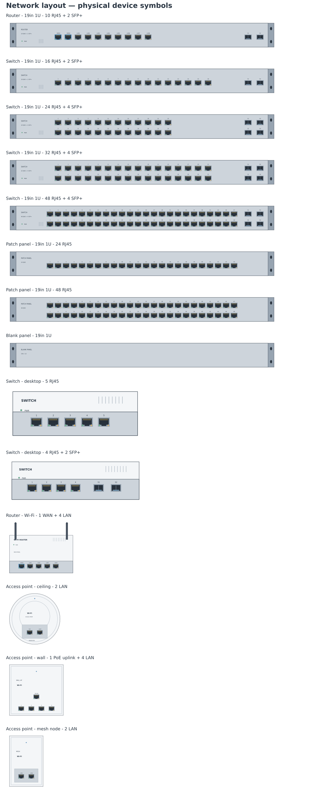

# Libraries and examples

## Standard library catalogue

[bundled-libraries/config.json](../bundled-libraries/config.json) lists the read-only `.tclib` bundles shared by Electron and both browser modes. Its contract is [bundled-libraries.schema.json](../schemas/bundled-libraries.schema.json).

Each entry has a stable unique `id`, display `name`, relative `path` and optional `description`. Paths use forward slashes and stay inside `bundled-libraries/`. Keep IDs stable so saved selections survive updates. Directory paths locate files; the chooser displays a flat symbol list.

Library source tabs appear as **Standard**, **Online**, then **My Libraries**. New users start on Standard; the last selected source is remembered locally for subsequent sessions.

The **Standard Libraries** selector loads one library at a time. Only the catalogue loads initially; unselected libraries are not downloaded or parsed. Choosing another library releases the previous one. The selection persists separately from personal library configuration. Failed loads offer Retry and allow a different selection. Standard libraries support preview, search, placement and replacement; personal libraries retain their editing controls. The list gives symbol names the full row; selecting a symbol shows its description above the preview, with wrapping and scrolling for longer text. The library summary wraps without a line clamp.

Packaged assets live under `dist/bundled-libraries/`. Browser deployment preserves that directory; desktop reads packaged resources through restricted IPC. [package-libraries.mjs](../scripts/package-libraries.mjs) validates the catalogue and referenced files. Tests: `npm run test:libraries`.

## Bundles and electrical conventions

| Bundle | Contents and contracts |
| --- | --- |
| SPICE essentials | 27 entries: passives, transformer, resonators, discrete semiconductors, coloured LEDs, 741 and independent sources. European and US resistor variants share connectivity. |
| Digital logic | 21 canonical types / 28 entries: gates, combinational blocks, counters, shift register, flip-flops and latches. Seven clocked types have separate rising/falling entries. |
| Functional blocks | 14 interfaces / 17 entries: ADC/DAC, communications, logger, MCU/FPGA/PLC, sample-and-hold, state machine, PCM/TDM and transducer. ADC, PCM and state machine have both clock-edge variants. |
| Sensors and interfaces | Ten generic types: test point, Hall, piezo, light/pressure/temperature voltage sensors, moisture, pH, analogue switch and AM modulator. |
| Teaching components | 116 entries covering 96 non-editor inventory types, including artwork/clock variants. The GCSE Physics course library selects from that same set. |
| GCSE Physics — AQA 8463 | Course selection from Teaching components, with the same symbol definitions and educational models. |
| Network layout | 47 physical device symbols: consumer and rack switches/routers, firewalls, access points, patch panels, fibre aggregation, ONT, PoE injector and blank rack panel. |

These are the seven bundled libraries. The nine A-level, BTEC and degree course bundles have been removed from the catalogue and generated library files. Their course inventories remain in [symbol-libraries](symbol-libraries/README.md) as source material. The [teaching generator](../scripts/build-teaching-libraries.mjs) builds the shared Teaching components set and only the course libraries present in the catalogue, so rebuilding does not restore removed bundles.

Digital supplies are native hidden **Power** pins named **VCC** and **VSS**. Connect those named nets to actual supplies; VSS is not implicitly node `0`. **Show power pins** exposes them. Native Dot, Clock and DotClock pin shapes convey inversion and edge polarity. Functional and sensor power/reference pins are visible and require explicit wiring.

Generic logical pin numbers are not commercial package pinouts. Preserve each inventory's terminal names, electrical types and polarity. The test point has one real passive pin; it is electrically connected rather than decorative. Six editor/connectivity inventory types use native wire/junction/label/ground/no-connect/annotation operations. Built-in instruments, probes and waveform sources are listed as `existing_tools` dependencies, outside generated symbol requirements.

All teaching components carry configurable educational models. MCU/FPGA/PLC behaviour does not execute firmware or HDL. Supply loading, timing, physical calibration and analogue limits are simplified. [Teaching models](teaching-simulation-models.md) specifies parameters and tested semantics. A symbol or inventory record alone does not establish a simulation model.

## Network layout

Select **Standard → Network layout** for cable and rack planning. The symbols use original, editable native TinyCAD vector geometry; they contain no bitmaps, product photographs, logos, traced manufacturer artwork or imported icon sets. Manufacturer documentation informs the socket counts and general device families. The reviewed online TinyCAD symbols were not reused; the reason and their source IDs are recorded in the [recipe](../library-recipes/network-layout.json) and [provenance](../bundled-libraries/network-layout/network-layout.provenance.json).

**Open Example → Examples → Small office network** opens a complete editable layout using these panels: a four-unit rack, ISP fibre terminal, ceiling access point and desk switch. The drawing embeds its symbols and demonstrates socket-to-socket patch leads, an SFP+ uplink and office cable runs.

Its cable map is ONT1 LAN1 → RTR1 WAN1, RTR1 SFP+1 → SW1 SFP+1, SW1 port 4 → PP1 port 1 → ceiling AP1, and SW1 port 6 → PP1 port 3 → desk switch DS1. The patch-panel socket joins a short rack lead to its office run. Spare sockets and the external ISP fibre endpoint are intentionally open. Circuit-checker notices for those open endpoints and wires entering physical panel outlines are expected; the example has no SPICE model. Its regression check verifies the exact connected sockets and preserves them through save/load.

Each RJ45 socket and SFP+ cage has one passive cable endpoint at the centre of its opening. Draw wires between these points. Amber socket surrounds identify PoE+ outputs; blue surrounds identify WAN sockets. This is a device-level cable map, not an eight-contact Ethernet pinout or a SPICE simulation model. Fibre cages represent whole transceiver connections. Power sockets, RF links and internal switching are outside this abstraction. Ceiling access points show their underside socket bay; wireless routers expose their rear panel so the cable endpoints remain visible.

Every rack device has the same 264 × 24 XML-unit face (1320 × 120 internal drawing units), including rack ears and matching mounting holes. Keep the default scale, align their native bottom-right placement anchors, and step vertically by **120 drawing units** for each 1U panel. Copper ports use single rows for smaller switches, paired odd/even rows for larger switches, and one row for a 24-port patch panel. The dimensions are a consistent drawing convention, not a dimensioned mechanical rack plan. Name/reference metadata is hidden by default to keep adjacent faces clear; the front-panel labels remain visible.

The manufacturer survey, checked on 13 November 2026, favours these configurations. This is a catalogue survey, not a measurement of sales or market share.

| Family | Included configurations and evidence |
| --- | --- |
| General copper switches | 5, 8, 16, 24 and 48 RJ45 are the core sequence in [NETGEAR's 300-series table](https://www.netgear.com/images/datasheet/switches/300-Series_Gigabit_DS.pdf). Desktop variants cover 5/8/16/24; rack variants cover 8/16/24/48. |
| Mixed copper/fibre | 4 RJ45 + 2 SFP+ ([QNAP](https://www.qnap.com/en/product/qsw-2104-2s)); 8 + 2 SFP+ and 24 + 2 SFP+ ([MikroTik eight-port](https://mikrotik.com/product/crs310_8g_2s_in), [24-port](https://mikrotik.com/product/CRS326-24G-2SplusRM)); 16 + 2, 24 + 4 and 48 + 4 uplink options round out the set. [Ubiquiti's Pro 48](https://techspecs.ui.com/unifi/switching/usw-pro-48-poe) supplies a 48-copper/four-SFP+ example. |
| PoE switches | Desktop 4 PoE+ + 1 unpowered uplink and 8 PoE+; rack 16/24/48 PoE+ with uplinks. [TP-Link's five-port example](https://www.tp-link.com/us/business-networking/poe-switch/tl-sg1005p/) illustrates why four powered ports must still have five actual sockets. |
| Fibre aggregation | Rack 8- and 16-slot SFP+ layouts. [Ubiquiti Aggregation](https://techspecs.ui.com/unifi/switching/usw-aggregation) is an eight-slot example. |
| Additional generic layouts | Four-RJ45 switches, 10 RJ45 + 2 SFP+ and 32 RJ45 + 4 SFP+ are retained as extra planning options. The survey's [32-port Cisco example](https://www.cisco.com/c/en/us/products/collateral/switches/nexus-3000-series-switches/datasheet-c78-740895.html) uses QSFP28; it does not establish 32 copper ports as a mainstream access-switch size. |

Names always specify the actual socket mix. A marketed “10-port” switch can mean **8 RJ45 + 2 SFP**, as in [TP-Link's TL-SG2210P](https://www.tp-link.com/sg/business-networking/smart-switch/t1500g-10ps/v1/). SFP and SFP+ use similar cage artwork here; the generic SFP+ symbols do not assert compatibility with a particular product. Device models and branding are deliberately absent.

Rebuild with `npm run libraries:network`; regenerate the documentation preview and per-device XML/SVG/PNG files under `build/network-layout/` with `npm run preview:network`. Run `npm run test:network` for socket separation, grid alignment, common rack dimensions, real editor placement, cable connectivity, rotation/mirroring, save/load and reproducible SQLite packaging. `npm run libraries:all` includes the network bundle. The standard packaging commands copy its configured `.tclib` into desktop and browser builds.

## SPICE essentials

Use **Simulation → Components** for common parts; **More…** opens the full standard library. Placed symbols retain hidden `$$SPICE` attributes. Numeric SPICE suffixes include `1k`, `10u`, `100n` and `1Meg`; `m` means milli. `Model`/`Model Name` selects a device model; an empty `Model File` emits the embedded generic definition. Custom model text must also satisfy the [engine input policy](spice-engine.md#deck-and-model-contract).

| Component | Drawing terminals / model |
| --- | --- |
| BJT | 1 base, 2 emitter, 3 collector; template emits collector/base/emitter order. |
| MOSFET | 2 gate, 3 drain, 4 source; bulk tied to source. |
| Diode, zener, LED | 1 anode, 2 cathode. |
| 741 | 3 IN+, 2 IN−, 7 positive supply, 4 negative supply, 6 output. Offset-null pins omitted. |
| Potentiometer | Ends 1/2, wiper 3; two resistor segments with a 1 micro-ohm floor. |
| Transformer | Primary 1/2, secondary 3/4; coupled ideal inductors, no saturation/winding resistance. |
| Resonators | Motional series RLC in parallel with shunt capacitance. |

The 741 behavioural model approximates 200,000 open-loop DC gain, 2 Megohm differential input resistance, 5 Hz dominant pole, 0.5 V/µs slew limit, 75 ohm output resistance and rail clipping with 2 V headroom. It omits bias/offset, common-mode validity, temperature, noise, short-circuit current and full stability effects. Generic diode/transistor/LED/resonator models are teaching approximations; LED colour is not calibrated brightness. Electrolytic polarity is graphical and is not enforced by its ideal capacitor model. Core inductors remain linear.

## Sources, recipes and provenance

[library-recipes](../library-recipes) records selections and guarded adaptations. Adjacent `*.provenance.json` files in [bundled-libraries](../bundled-libraries) retain attribution, source IDs, hashes and drawing/model changes; bundle metadata is also embedded in SQLite `TinyCADBundleInfo`.

SPICE artwork comes from **onetransistor** and templates from **aryajur** in the legacy SQL collection. The digital style derives from **matt**'s NAND (SymbolID 160 / NameID 9279), retained as [nand-reference.xml](../library-sources/digital/nand-reference.xml). Selected course artwork is frozen under [library-sources/teaching](../library-sources/teaching), including explicit pin and geometry repairs. The digital/functional/sensor/course generators use checked-in sources without a private SQL dump or selection UI.

Connection points use the 1 mm grid. SPICE resistor variants share their 2 × 5.2 mm envelope; digital family drawings use pale yellow bodies and 4 mm signal leads. Native inversion/clock markers and explicit pin corrections must survive rotations, mirrors, placement and save/load.

[build-library-from-sql.mjs](../scripts/build-library-from-sql.mjs) remains the legacy import boundary. It parses selected literal INSERT records rather than running a database. Recipes select exactly one visible component by source ID or name, optionally merge `spiceFrom`, override attributes, and apply guarded `pins`/`geometry` changes. `requireSpice` validates template macros, not electrical behaviour. Keep SQL dumps outside the repository: unrelated account/application records do not belong in exported content.

See [spice.json](../library-recipes/spice.json), [digital.json](../library-recipes/digital.json), [functional.json](../library-recipes/functional.json) and [sensors-interfaces.json](../library-recipes/sensors-interfaces.json) for full recipe contracts. Model implementations live in [teaching-models.mjs](../scripts/lib/teaching-models.mjs); [selected-artwork.mjs](../scripts/lib/selected-artwork.mjs) owns the frozen selection adaptations. The [symbol inventory guide](symbol-libraries/README.md) describes course coverage data.

Regression commands are `test:spice`, `test:digital`, `test:functional`, `test:sensors`, `test:teaching`, `test:network` and `test:symbol-artwork` through npm. Coverage includes terminal contracts, actual editor placement, rotated/mirrored geometry, hidden rails, reproducibility, persistence and numerical model cases where an engine is available.

## Bundled examples

[bundled-examples/config.json](../bundled-examples/config.json) defines the **Examples** collection, containing the transistor amplifier and small office network drawings. The bundled SPICE and XSPICE examples are defined in [tutorials/catalog.json](../tutorials/catalog.json), with drawings, descriptions and previews under [tutorials](../tutorials/README.md). The packaging script merges both catalogues into `dist/bundled-examples/config.json` and copies tutorial resources under `dist/bundled-examples/tutorials/`. Both catalogues use [bundled-examples.schema.json](../schemas/bundled-examples.schema.json).

| Example | Editable drawing | Preview |
| --- | --- | --- |
| Transistor amplifier | [AMP.dsn](../bundled-examples/drawings/AMP.dsn), the original TinyCAD example by Matt Pyne. | [Schematic](../bundled-examples/images/AMP.svg) |
| Small office network | [network-layout.dsn](../bundled-examples/drawings/network-layout.dsn), with seven embedded devices from Network layout. | [Cable plan](../bundled-examples/images/network-layout.png) |

Add future general examples to this collection's `examples` array, with a drawing path, preview and description. Keep drawing resources inside `bundled-examples/`; rerun `npm run examples:package` and `npm run test:examples` after changes. The office-network test is part of that suite and checks rack dimensions, cable topology and standalone save/load.

Separate simulation development fixtures remain in [examples/simulation](../examples/simulation/README.md); Electron also carries those under `resources/examples/simulation/`. They are distinct from the tutorial catalogue shown by **Open Example**.

Groups require unique `id`, `title`, `preview`, `examples` and exactly one of inline `description` or UTF-8 `descriptionPath`. Drawing entries add `path` and an ID unique within the group. Paths stay under their source catalogue directory (`bundled-examples/` or `tutorials/`); previews are supplied images. Catalogue `assets` lists additional description images. Relative images resolve beside the Markdown file, or from the source catalogue root for inline text.

**Open Example** loads descriptions/previews on demand and opens a drawing only when requested. Markdown descriptions support links/images/tables and sanitized HTML. An example opens as a new editable drawing with no association to its bundled source. Save creates a user copy. Unsaved-change cancellation preserves the original document; a successful open clears its undo history.

[package-examples.mjs](../scripts/package-examples.mjs) validates and stages only referenced resources into `dist/bundled-examples/`. Desktop reads them through restricted IPC. Tests: `npm run test:examples`.
