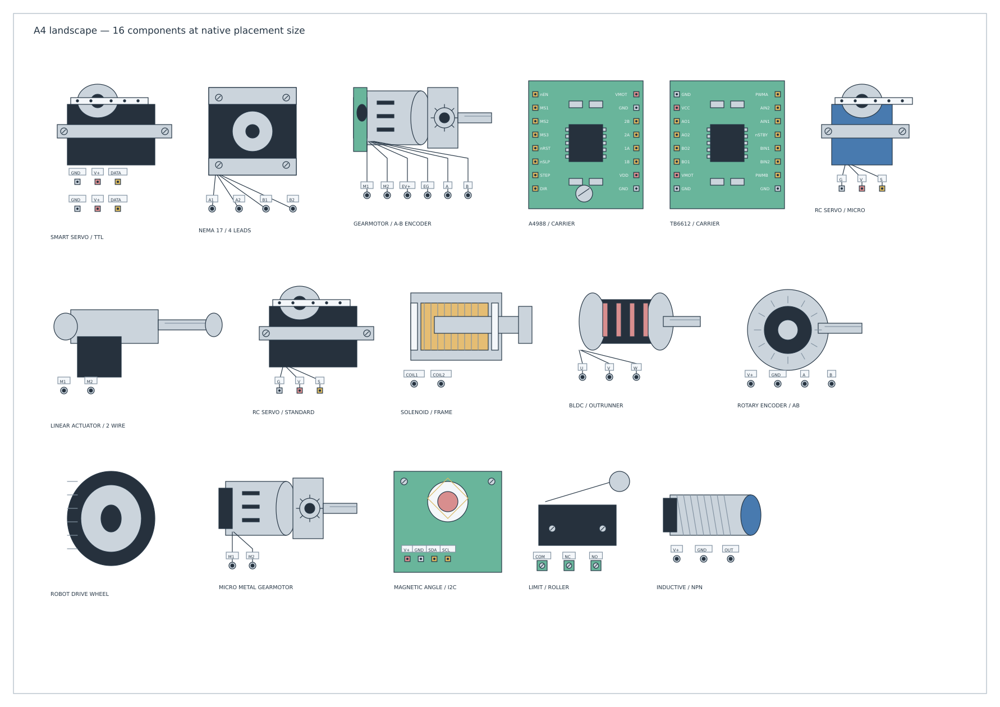
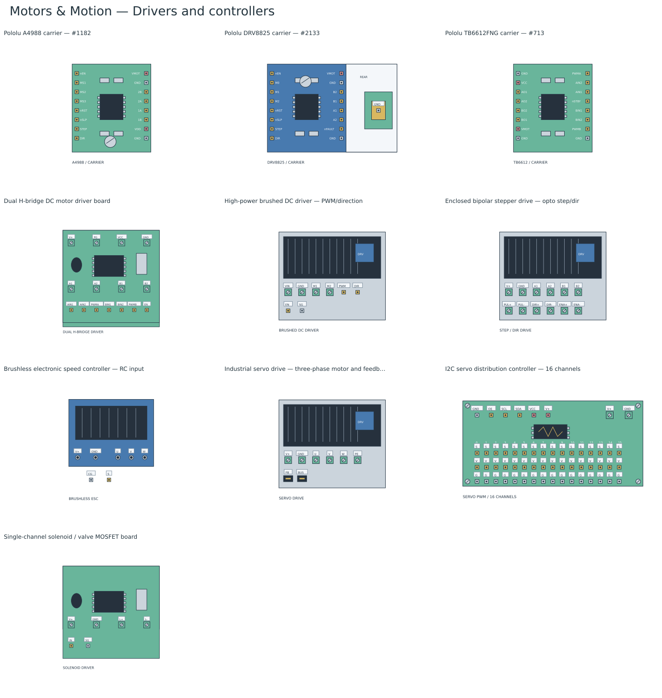
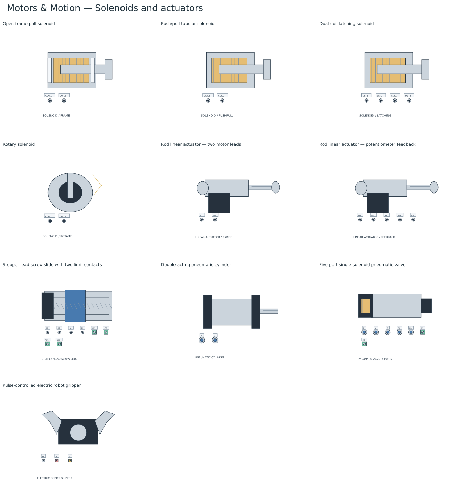

# Motors & Motion

Select **Standard → Motors & Motion** for 66 editable resources for robotics and automation layouts. The [native library](../bundled-libraries/motors-motion/motors-motion.tclib) is bundled for desktop and browser builds. Use it with the controller boards in **Embedded processors and smart home** and the supplies/instruments in **Test & Measurement**.

The artwork consists of original TinyCAD vectors: motor bodies, shafts, gearboxes, servo horns, PCBs, driver modules, encoders, switches, solenoids, actuators and mechanical parts. It contains no product photos, logos, traced artwork or imported icon sets. Manufacturer references establish common hardware roles and the three named carrier header maps. Generic resources describe their listed terminals rather than a particular product's connector pinout or ratings.

## Placement size and wiring

The components use compact drawing dimensions rather than physical manufacturing dimensions. A generic RC servo body is 36 × 34 mm on paper; a NEMA 17-style stepper body/view is 38 × 40 mm; an A4988 carrier view is 34 × 38 mm. Captions and header labels have their own space. The 16-channel servo controller remains 76 × 36 mm while exposing every output contact. NEMA labels describe frame families, not current, torque, voltage or step-angle specifications.

The [A4 preview](motors-motion-a4.png) shows 16 mixed motors, servos, drivers, feedback devices, switches and actuators at native placement size. It is an unconnected size-review sheet, not a working robot or simulated circuit. Generate its editable native drawing with `npm run preview:layout-pages` (`build/layout-pages/motors-motion-a4.dsn`).

Each visible contact/socket has an on-grid connection point. The hidden **Ports** attribute lists its full name, connector kind, endpoint unit, signal domain and electrical type. Small artwork labels abbreviate names; an **n** prefix identifies active-low signals on the named carriers. Header pad/terminal graphics carry the connection points, so native pin stems and duplicate pin text are suppressed deliberately.

| Endpoint unit | Meaning |
| --- | --- |
| **conductor** | One motor/coil lead, PCB header contact, supply terminal, feedback line or switch contact. Motor power, sensor power, direction/PWM, encoder signals and servo control stay separately accessible. |
| **cable** | One complete equipment-specific feedback or control interface. The industrial servo drive's feedback/control ports do not invent multi-pin commercial connector assignments. |
| **hose** | One complete pneumatic connection. Cylinder A/B and valve P/A/B/EA/EB are separate from valve coil terminals. |

Shafts, servo horns, plunger ends, wheels, mounting holes and proximity targets are mechanical artwork, with no electrical connection points. The seven mechanical-only resources have no pins. A flexible coupling or belt axis does not connect electrical nets.

These are wiring/layout resources with no SPICE, firmware or motion/fluid simulation. Native electrical types distinguish power inputs/outputs, control inputs, bidirectional buses, driver outputs, open-collector outputs and passive windings/contacts. Repeated ground/supply/bus contacts, driver internals, motor windings, switch closures and mechanical transmission do not create automatic netlist links. Draw or annotate the intended relationships explicitly. Actual supply levels, current limiting, protection, pulse timing, encoder resolution and travel settings require the selected hardware documentation.

## Motors, servos and feedback conventions

Brushed motors use reversible **M1/M2** leads. The encoder gearmotor adds separately powered **ENC V+ / ENC GND / ENC A / ENC B** feedback. Brushless motors expose **U/V/W**, with separate Hall power and H1/H2/H3 on the sensored variant. Their phase/feedback order is a functional diagram convention, not a commercial cable assignment.

Four-wire steppers expose **A1/A2** and **B1/B2** windings. Six-wire steppers add **ACT/BCT** centre taps. Eight-wire steppers expose **A1-A2/A3-A4** and **B1-B2/B3-B4** half-windings. Series, parallel and unused-tap choices are explicit wiring decisions.

RC servos expose **GND / V+ / PWM** as three separate connector contacts. Positional servos and continuous-rotation servos have separate resources: a continuous servo pulse commands speed/direction rather than an absolute position. Smart serial servos use either half-duplex TTL or RS-485, with two explicit bus headers for chaining. The two protocols and RC pulse control are separate signal domains.

Encoders include A/B, A/B/Z index and differential A+/A−/B+/B−/Z+/Z− variants. Magnetic I2C and SPI breakouts are separate generic resources; the SPI variant is not an AS5600. The linear potentiometer exposes its two ends and wiper. Functional lead names avoid assuming universal wire colours or connector numbering.

SPDT limits expose **COM/NC/NO** by their unactuated state. **NC** means normally closed, with a real passive contact. The NPN proximity sensor has an open-collector output; the PNP version has an open-emitter output. Neither implies direct compatibility with a microcontroller voltage. The emergency-stop resource is a pair of NC contacts, rather than an implemented safety controller.

## Source-checked carrier boards

The following three carrier views retain the manufacturer's labelled **component-side** header order. **L-1…L-8** and **R-1…R-8** are drawing IDs for those header positions, not IC package pin numbers. Board test vias, trim-pot contacts and auxiliary measurement points are outside these wiring views.

| Carrier | Left header, top to bottom | Right header, top to bottom |
| --- | --- | --- |
| Pololu A4988 #1182 | EN, MS1, MS2, MS3, RST, SLP, STEP, DIR | VMOT, GND, 2B, 2A, 1A, 1B, VDD, GND |
| Pololu DRV8825 #2133 | EN, M0, M1, M2, RST, SLP, STEP, DIR | VMOT, GND, B2, B1, A1, A2, FAULT, GND |
| Pololu TB6612FNG #713 | GND, VCC, AO1, AO2, BO2, BO1, VMOT, GND | PWMA, AIN2, AIN1, STBY, BIN1, BIN2, PWMB, GND |

The A4988's VDD is a logic supply input; the corresponding DRV8825 contact is an open-drain **FAULT** output. The DRV8825 requires no separate logic supply. Its separate **REAR** inset exposes the documented bottom ground pad as **EP/GND**, giving 17 explicit contacts; the top view still has the two eight-contact headers. EN/RST/SLP are active-low. TB6612 STBY is active-low standby and must be high for operation; BO2 precedes BO1 in the checked top view. All duplicate grounds remain separate contacts in the drawing.

The 16-channel I2C servo controller is a **generic board**, not an Adafruit revision-specific symbol. It exposes a six-contact control/supply header, two servo-power screw terminals and 48 S/V/G output contacts. Logic VCC and servo V+ remain separate, with all repeated contacts explicit. The other enclosed and PCB drivers use the functional terminals shown in their descriptions, rather than claiming universal product pinouts.

## Included resources

### DC and brushless motors (12)

| Resource | Connection points |
| --- | ---: |
| Small 130-style brushed DC motor | 2 |
| Medium 370-style brushed DC motor | 2 |
| Large 775-style brushed DC motor | 2 |
| Coreless brushed DC motor | 2 |
| Micro metal gearmotor | 2 |
| TT-style right-angle gearmotor | 2 |
| Planetary DC gearmotor | 2 |
| Worm-drive DC gearmotor | 2 |
| DC gearmotor with quadrature encoder | 6 |
| Outrunner brushless DC motor | 3 |
| Inrunner brushless DC motor | 3 |
| Brushless motor with Hall commutation sensors | 8 |

### Stepper motors (6)

| Resource | Connection points |
| --- | ---: |
| NEMA 14-style bipolar stepper — four leads | 4 |
| NEMA 17-style bipolar stepper — four leads | 4 |
| NEMA 23-style bipolar stepper — four leads | 4 |
| NEMA 34-style bipolar stepper — four leads | 4 |
| Centre-tapped stepper — six leads | 6 |
| Split-winding stepper — eight leads | 8 |

### Servos (6)

| Resource | Connection points |
| --- | ---: |
| Micro positional RC servo | 3 |
| Standard positional RC servo | 3 |
| High-torque positional RC servo | 3 |
| Continuous-rotation RC servo | 3 |
| Smart serial servo — half-duplex TTL | 6 |
| Smart serial servo — RS-485 | 8 |

### Drivers and controllers (10)

| Resource | Connection points |
| --- | ---: |
| Pololu A4988 carrier — #1182 | 16 |
| Pololu DRV8825 carrier — #2133 | 17 |
| Pololu TB6612FNG carrier — #713 | 16 |
| Dual H-bridge DC motor driver board | 15 |
| High-power brushed DC driver — PWM/direction | 8 |
| Enclosed bipolar stepper drive — opto step/dir | 12 |
| Brushless electronic speed controller — RC input | 7 |
| Industrial servo drive — three-phase motor and feedback | 8 |
| I2C servo distribution controller — 16 channels | 56 |
| Single-channel solenoid / valve MOSFET board | 6 |

### Encoders and position feedback (6)

| Resource | Connection points |
| --- | ---: |
| Rotary encoder — A/B | 4 |
| Rotary encoder — A/B/Z | 5 |
| Rotary encoder — differential A/B/Z | 8 |
| Magnetic angle sensor breakout — I2C | 4 |
| Magnetic angle sensor breakout — SPI | 6 |
| Linear position potentiometer | 3 |

### Limit switches and sensors (9)

| Resource | Connection points |
| --- | ---: |
| SPDT lever limit microswitch | 3 |
| SPDT roller limit microswitch | 3 |
| SPDT plunger limit microswitch | 3 |
| Lever limit switch on interface PCB | 3 |
| Slotted optical endstop module | 3 |
| Three-wire inductive proximity sensor — NPN NO | 3 |
| Three-wire inductive proximity sensor — PNP NO | 3 |
| Magnetic reed position switch | 2 |
| Mushroom emergency-stop switch — two NC contacts | 4 |

### Solenoids and actuators (10)

| Resource | Connection points |
| --- | ---: |
| Open-frame pull solenoid | 2 |
| Push/pull tubular solenoid | 2 |
| Dual-coil latching solenoid | 4 |
| Rotary solenoid | 2 |
| Rod linear actuator — two motor leads | 2 |
| Rod linear actuator — potentiometer feedback | 5 |
| Stepper lead-screw slide with two limit contacts | 8 |
| Double-acting pneumatic cylinder | 2 |
| Five-port single-solenoid pneumatic valve | 7 |
| Pulse-controlled electric robot gripper | 3 |

### Mechanical layout parts (7)

| Resource | Connection points |
| --- | ---: |
| Robot drive wheel | 0 |
| Swivel caster | 0 |
| Flexible shaft coupling | 0 |
| Lead-screw axis | 0 |
| Timing-belt axis | 0 |
| Pan/tilt mounting assembly | 0 |
| Servo horn and mounting bracket | 0 |

## Artwork galleries

[DC and brushless motors](motion-motors.png) · [Stepper motors](motion-steppers.png) · [Servos](motion-servos.png) · [Drivers and controllers](motion-drivers.png) · [Encoders and feedback](motion-feedback.png) · [Limits and sensors](motion-limits.png) · [Solenoids and actuators](motion-actuators.png) · [Mechanical parts](motion-mechanics.png).

## Online survey and primary sources

The survey covers common robotics/automation hardware roles and interface conventions; it is not a sales ranking or a compatibility claim. The source images were inspected for pin order and retained locally by hash for the named carrier views. The artwork itself is independently drawn.

- [Pololu metal gearmotors with encoder](https://www.pololu.com/product/4802): Brushed DC geared motors can provide motor terminals plus separately powered quadrature feedback.
- [NI four-, six- and eight-wire steppers](https://knowledge.ni.com/KnowledgeArticleDetails?id=kA00Z000000PAkPSAW): Four leads expose two complete windings; six leads add centre taps; eight leads expose individual half-windings.
- [Oriental Motor brushless motor overview](https://www.orientalmotor.com.sg/sg/products/brushless-motors/bl-motor): Brushless motors require a matching driver/commutation system; optional Hall feedback is distinct from phase power.
- [Adafruit servo connections and modes](https://learn.adafruit.com/using-servos-with-circuitpython?view=all): RC servos use supply, ground and pulse-control conductors. Positional and continuous-rotation modes differ.
- [ROBOTIS smart actuator communication](https://emanual.robotis.com/docs/en/faq/faq_dynamixel/): Half-duplex TTL and RS-485 smart-servo buses are different interfaces.
- [Pololu A4988 carrier #1182](https://www.pololu.com/product/1182): Verified component-side header order, separate VDD and VMOT inputs and active-low enable/reset/sleep.
- [Pololu DRV8825 carrier #2133](https://www.pololu.com/product/2133/): Verified header order; FAULT replaces A4988 VDD; no separate logic supply; bottom solderable ground pad.
- [Pololu TB6612FNG carrier #713](https://www.pololu.com/product/713/): Verified labelled top view: left power/motor bank and right PWM/direction/standby bank. STBY must be high to run.
- [Adafruit PCA9685 servo distribution guide](https://learn.adafruit.com/16-channel-pwm-servo-driver/pinouts): Sixteen PWM outputs share a frequency; logic VCC and distributed servo V+ are separate. Generic board artwork is not a specific Adafruit revision.
- [Broadcom encoder questions and answers](https://docs.broadcom.com/doc/5988-5062EN): Quadrature A/B outputs encode relative movement; an optional index gives a reference pulse.
- [ams OSRAM AS5600 magnetic angle evaluation guide](https://look.ams-osram.com/m/4f8342513a447495/original/AS5600_UG000254_2-00.pdf): Contactless magnetic angle measurement and I2C control; the generic breakout is not a package pinout.
- [Omron NPN and PNP proximity output guide](https://www.ia.omron.com/support/faq/answer/41/faq00379/): NPN sensors sink output current; PNP sensors source output current. These are separate resources.
- [Firgelli potentiometer feedback actuators](https://www.firgelliauto.com/blogs/tutorials/potentiometer-feedback-from-a-linear-actuator): A feedback rod actuator combines two motor leads and three potentiometer feedback leads.
- [SMC five-port solenoid valve guide](https://www.smcworld.com/upfiles/etc/international/imm/VFS1000-TFU15.pdf): Pneumatic valve ports and coil terminals serve different roles; working ports feed a double-acting cylinder.
- [Pololu mechanical components](https://www.pololu.com/category/21/mechanical-components): Wheels, casters, mounting parts and shaft couplings support robot motion assemblies.
- [ams AS5048A/AS5048B angle-sensor data sheet](https://look.ams-osram.com/m/287d7ad97d1ca22e/original/AS5048-DS000298.pdf): AS5048A provides SPI absolute-angle readout; SPI and I2C angle-sensor breakouts are distinct interfaces.
- [Omron D2F switch contact forms](https://components.omron.com/us-en/system/files/2023-01/datasheet_pdf/B036-E1.pdf): A basic SPDT limit switch exposes common, normally-open and normally-closed contacts; actuator shapes vary.
- [Johnson Electric Ledex solenoid families](https://www.johnsonelectric.com/en/products/solenoids/open-frame-electric-actuator): Linear/open-frame solenoids and latching variants are available; coil and latch configurations depend on the selected assembly.
- [Johnson Electric rotary solenoids](https://www.johnsonelectric.com/en/products/solenoids/rotary-solenoid): Rotary solenoids move a shaft through a limited angular stroke and differ from continuously rotating motors.

## Rebuilding and validation

The [recipe](../library-recipes/motors-motion.json) stores the inventory, endpoint facts, manufacturer sources and TinyCAD searches. The [generator](../scripts/lib/motors-motion-artwork.mjs) produces native vector XML. The [provenance](../bundled-libraries/motors-motion/motors-motion.provenance.json) retains actual dimensions, connection coordinates, header identities, source-image URLs/hashes and XML SHA-256 hashes.

- `npm run libraries:motion`: regenerate the SQLite library and provenance.
- `npm run preview:motion`: render every final definition through the application and update per-device XML/SVG/PNG files under `build/motors-motion/` and the galleries.
- `npm run preview:layout-pages`: generate editable A4 review sheets and documentation images.
- `npm run test:motion`: check winding/servo/encoder contracts, named header order, electrical types, socket-centred on-grid connections, caption fit, reproducible SQLite, actual A4 placement, real editor rotation/mirroring and save/load, plus motor/driver/servo/feedback/pneumatic connection paths.

The public TinyCAD service validates and renders the exact generated definitions. Hash-keyed validation reports and PNG/SVG previews are cached under `build/motors-motion/mcp/`. The standard asset packager and `npm run libraries:all` include this bundle for all application targets.
