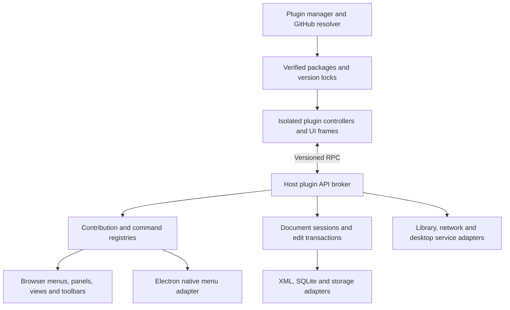

# TinyCAD plugin system proposal

Status: architecture and implementation plan. The plugin runtime and manager are implemented; see the [plugin author guide and SDK](plugin-api.md) for the available API, shipped examples, packaging commands, and verification instructions. Domain-specific engines/services and portable project descriptors can be developed separately on top of these extension points.

## Recommended approach

Introduce a versioned plugin API, declarative UI contribution registries, and an isolated plugin runtime shared by the browser and Electron builds. Users browse a pre-defined list of known-good GitHub repositories or enter another repository URL, then select which plugins from that repository to install. A repository may publish several independently selectable plugins. When releases exist, installation and updates follow published GitHub releases; tag/commit selection is a fallback for repositories without releases or an explicit developer mode.

Enable automatic updates to compatible stable releases by default, with per-plugin controls to use manual updates or pin a version. Keep exact package locks and cached version history so users can roll back, including while offline when the previous package is available.

Plugins can contribute left and bottom panels, symbol editor tabs, menu items, main views, commands, toolbar buttons, toolbars, and component library providers. They can also store namespaced data in designs and libraries. TinyCAD owns document editing, undo, file operations, menu rendering, and access to desktop services.

The main design decisions are:

- A repository publishes a plugin catalog and a separate manifest/package for each plugin. Users choose any subset; adding a repository never installs everything automatically.
- Prefer release catalogs and ready-to-run release assets. Source packages at a release's resolved commit are also supported; installing never runs npm, build scripts, Git hooks, or repository executables.
- Curated repositories give users a useful starting set; custom repositories use the same installation flow. Updates, permissions, disable/uninstall, and rollback remain per plugin.
- Plugin code communicates through a typed, asynchronous message API. It cannot import TinyCAD internals, access Redux, or mount React components into the host DOM.
- All UI actions use the same command registry, including Electron native menu actions.
- Document extension data belongs to the host document model, so normal saving works even when its plugin is unavailable.
- Electron keeps verified plugin packages on disk. Browser `localStorage` records installed versions; IndexedDB can cache package bytes separately.
- Application sessions and main views become explicit concepts, allowing a Project plugin to manage multiple designs without treating them as sheets of one circuit.

## Existing code and integration points

This proposal is based on the current React/Redux application and its three targets: `filesystem`, `google`, and `electron`.

| Area | Current implementation | Proposed integration |
| --- | --- | --- |
| Editor shell | [`designApp.tsx`](../src/components/pages/designApp.tsx), browser/Electron main app components | Add an application view host, document sessions, and contribution providers. Keep login and host dialogs outside plugin views. |
| Left panel | [`SidePanel.tsx`](../src/components/panel/SidePanel.tsx) switches between library browsing/editing components | Wrap the existing behavior as the built-in Libraries contribution and append plugin choices. |
| Bottom panel | [`BottomPanel.tsx`](../src/components/panel/BottomPanel.tsx) chooses content from selection, DRC state, and editor mode | Keep this as a built-in contextual contribution and add explicit plugin panel choices alongside it. |
| Symbol editing | [`PinListPanel.tsx`](../src/components/panel/PinListPanel.tsx) has Symbol, Pins, and SPICE tabs | Append plugin tabs through a symbol editor tab registry. |
| Toolbars and browser menus | [`toolbar.tsx`](../src/components/toolbar/toolbar.tsx) contains fixed buttons and menus | Render contribution groups and shared logical menu descriptors. |
| Desktop menus | [`electron.js`](../electron/electron.js), [`preload.js`](../electron/preload.js), [`nativeMenu.ts`](../src/i18n/nativeMenu.ts) | Translate validated menu descriptors into native menu items and route clicks to the shared command service. |
| Commands | [`menuActions.ts`](../src/state/actions/menuActions.ts), [`AppDispatcher.ts`](../src/state/dispatcher/AppDispatcher.ts), `handleMenuCommand` in [`files.tsx`](../src/io/files.tsx) | Add a command service with adapters for selected existing commands. |
| Main tabs | [`sheetbar.tsx`](../src/components/toolbar/sheetbar.tsx), [`dsnView.ts`](../src/model/dsnView.ts) | Introduce typed main-view references instead of extending the numeric `selected_sheet` convention. |
| Design persistence | [`ioXml.ts`](../src/io/ioXml.ts), [`dsnDrawing.ts`](../src/model/dsnDrawing.ts), [`dsnItem.ts`](../src/model/dsnItem.ts) | Read/write host-owned extension envelopes and persistent entity identities. |
| Library persistence | [`tclib.ts`](../src/io/tclib.ts), [`model/tclib.ts`](../src/model/tclib.ts) | Preserve library/name/definition extension data in SQLite and embedded symbol XML. |
| Library discovery | [`libCache.ts`](../src/io/libCache.ts), [`libraryConfig.ts`](../src/io/libraryConfig.ts), Libraries panel | Add asynchronous library providers alongside existing sources. |

The panel arrangements are currently conditional components rather than general registries. Preserve their existing selections and behavior when adapting them; do not assume every panel already has a common tab framework.

## Architecture



The host should have these responsibilities:

1. **Plugin manager:** curated/custom repository browsing, plugin selection, installation records, permissions, compatibility, activation, automatic/manual update policies, rollback, disable, and uninstall.
2. **Package resolver/storage:** discover release catalogs and their plugin packages, resolve fallback Git refs, retrieve and lock exact bytes, validate paths and sizes, calculate hashes, and commit each complete installation atomically.
3. **Contribution registry:** combine built-in and plugin descriptors, evaluate visibility, and remove all contributions when a plugin stops.
4. **Runtime and RPC broker:** start isolated code, bind each connection to a plugin/version, validate messages, enforce API permissions, and handle cancellation and failures.
5. **Document and workspace services:** expose stable snapshots, transactions, events, file capabilities, and persistence without exposing implementation classes.
6. **Platform adapters:** browser menus/storage and Electron native menus/cache/optional native tools implement the same logical services.

Plugin UI can use React, another framework, or plain DOM within its frame. Bundle dependencies with the plugin. TinyCAD does not expose its React or Fluent UI versions as a plugin ABI. The SDK supplies theme tokens, locale, accessibility guidance, and optional matching controls.

## Repository and manifest contract

Initially support public repositories on `github.com`, with one or more plugins per repository. Accept `https://github.com/owner/repository` and an optional `.git` suffix. Reject other schemes, embedded credentials, and arbitrary download URLs. Select releases and fallback tags/commits inside TinyCAD rather than attempting to parse ambiguous branch names from `/tree/...` URLs.

### Repository catalog and plugin selection

A `tinycad-plugins.json` catalog lists the plugins available in one repository/release. Release publishers attach this catalog as a release asset; a catalog committed at the selected release's source root is also supported for source-packaged distributions. Without releases, read the root catalog at the chosen fallback commit. For example, a release catalog could contain:

```json
{
  "catalogVersion": 1,
  "plugins": [
    {
      "id": "org.example.spice",
      "name": "SPICE Simulator",
      "description": "Simulate circuits and inspect waveforms",
      "readme": "README.md",
      "changelog": "CHANGELOG.md",
      "documentation": "docs/README.md",
      "version": "1.2.0",
      "apiVersion": "^1.0.0",
      "platforms": ["browser", "electron"],
      "package": {
        "type": "releaseAsset",
        "asset": "spice-1.2.0.zip"
      }
    },
    {
      "id": "org.example.project",
      "name": "Project Manager",
      "description": "Organize multiple circuit files",
      "readme": "README.md",
      "changelog": "CHANGELOG.md",
      "documentation": "docs/README.md",
      "version": "2.0.0",
      "apiVersion": "^1.0.0",
      "platforms": ["browser", "electron"],
      "package": {
        "type": "releaseAsset",
        "asset": "project-2.0.0.zip"
      }
    }
  ]
}
```

Asset names resolve only within that exact GitHub release, to asset IDs and expected SHA-256 digests before downloading. Prefer the digest supplied by GitHub; if absent, require the publisher to supply a `sha256` field in the package descriptor. Verify any supplied digests agree. A source-package entry instead uses `"package": { "type": "source", "manifest": "plugins/spice/tinycad-plugin.json" }`; all paths resolve at the selected release/fallback commit, with resources relative to that manifest's directory. One-plugin repositories use the same catalog with a single entry.

The repository detail page presents plugin names, descriptions, versions, platform/API compatibility, installation status, and checkboxes. Each plugin opens a details page with its full description, changelog, and a prominent **Full documentation** link. Users can read these before installation, select one or several plugins, inspect their individual permissions, and install only that selection. New catalog entries are offered as new choices; automatic updates never install previously unselected plugins. Removing an entry or an entire repository from the discovery list does not automatically uninstall existing plugins.

Each plugin has its own ID, semver version, manifest, runtime, permissions, data namespace, enabled state, update policy, and version history. Repository release names need not be semver and need not match every plugin version. Different installed plugins from the same repository may use packages from different releases. Self-contained packages avoid requiring every sibling plugin to update together. Duplicate plugin IDs or conflicting packages for the same ID/version are errors, not alternatives selected by list order.

### Plugin manifest and package

Every release ZIP contains its own root `tinycad-plugin.json` and all declared resources. A source package uses the manifest path in its catalog entry. For example:

```json
{
  "manifestVersion": 1,
  "id": "org.example.spice",
  "name": "SPICE Simulator",
  "version": "1.2.0",
  "description": "Simulate circuits and inspect waveforms",
  "readme": "README.md",
  "changelog": "CHANGELOG.md",
  "documentation": "docs/README.md",
  "apiVersion": "^1.0.0",
  "platforms": ["browser", "electron"],
  "controller": "dist/controller.js",
  "ui": "dist/ui.js",
  "files": [
    "dist/controller.js", "dist/ui.js", "dist/simulator.wasm",
    "README.md", "CHANGELOG.md", "docs/README.md"
  ],
  "permissions": ["document.read", "symbols.read", "netlist.read", "extensionData.write"],
  "activationEvents": [
    "onCommand:org.example.spice.run",
    "onPanel:org.example.spice.results",
    "onView:org.example.spice.waveforms",
    "onSymbolEditorTab:org.example.spice.model"
  ],
  "contributes": {
    "commands": [
      { "id": "org.example.spice.run", "title": "Run simulation" }
    ],
    "panels": [
      {
        "id": "org.example.spice.results",
        "title": "Simulation",
        "location": "bottom",
        "surface": "results",
        "when": "editorKind == 'schematic'"
      }
    ],
    "symbolEditorTabs": [
      { "id": "org.example.spice.model", "title": "Simulation model", "surface": "model" }
    ],
    "mainViews": [
      {
        "id": "org.example.spice.waveforms",
        "title": "Waveforms",
        "surface": "waveforms",
        "scope": "document"
      }
    ],
    "menus": [
      {
        "location": "tools/plugins",
        "command": "org.example.spice.run",
        "group": "simulation",
        "order": 10,
        "when": "editorKind == 'schematic'"
      }
    ],
    "toolbars": [
      { "id": "org.example.spice.toolbar", "title": "Simulation" }
    ],
    "toolbarItems": [
      { "toolbar": "main/plugins", "command": "org.example.spice.run", "icon": "play" },
      { "toolbar": "org.example.spice.toolbar", "command": "org.example.spice.run", "icon": "play" }
    ],
    "dataSchemas": [
      { "scope": "document", "version": 1 },
      { "scope": "symbolDefinition", "version": 1 }
    ]
  }
}
```

`surface` identifies an exported UI route within the bundled UI entry point; it is not a remote URL. One entry can render several different panels/tabs. Registering another left panel uses another descriptor with `location: "left"`. Application-level main pages use `scope: "application"`.

Validate catalog and manifest against published JSON Schemas before executing any code. Catalog metadata must agree with the downloaded manifest's ID, version, description, documentation paths, API range, and platforms. All contribution IDs must start with the plugin ID. Reject duplicate IDs, undeclared resources, invalid references, incompatible API ranges, unknown required permissions, and unsupported catalog/manifest versions. Unknown optional fields can be ignored with diagnostics.

The installed identity is bound to GitHub's repository ID, its canonical URL, and the manifest ID. A second repository claiming that plugin ID cannot replace it automatically. Repository transfers, ID changes, and source changes require an explicit reinstall/source migration. A deleted/recreated repository with the same URL has a different GitHub identity and must not inherit trust. This prevents display names and IDs from serving as publisher authentication.

The controller is a self-contained worker bundle; the UI is a self-contained JavaScript bundle. Publish ready-to-run code/assets in release packages, or commit them for source-packaged distribution. Release-only bundles do not have to be checked into Git. Ship WASM and other data in the declared file list and retrieve them through the resource API. Do not load code from CDNs or run dynamic package installation. Plugin-to-plugin dependencies and private repositories can be added later; the initial contract requires self-contained packages.

### Plugin descriptions, changelogs, and Markdown documentation

Require each plugin to declare these fields in its catalog entry and manifest:

| Field | Content | Plugin manager behavior |
| --- | --- | --- |
| `description` | Short plain-text summary | Show on discovery cards, repository selection lists, and installed-plugin rows. |
| `readme` | Package-relative `.md` path with a detailed description, features, and setup information | Render as the plugin details page's **Overview**. |
| `changelog` | Package-relative `.md` path with versioned change history | Render in **Changelog**, showing which version is installed and which is selected/available. |
| `documentation` | Package-relative `.md` entry point for the complete user documentation | Expose a visible **Full documentation** link opening the host's Markdown documentation viewer. |

Paths are relative to each plugin package root, even when the repository contains several plugins. The README can also serve as the documentation entry point for a small plugin. Full documentation must be authored in Markdown and may span several `.md` files linked from the entry point. Include usage, configuration, commands, contributed panels/views, and any platform-specific behavior. All referenced local Markdown pages and images must be declared package resources and pass the same path/size/hash checks as the rest of the package.

Keep descriptions and change histories specific to the plugin rather than substituting the repository's general README or release notes. Recommend changelog headings such as `## [1.2.0] - YYYY-MM-DD`, with changes, fixes, breaking changes, and migration notes below each version. A repository-wide release announcement may supplement a plugin changelog, but cannot replace it when a release contains several plugins with different versions.

Read documentation as data without activating plugin code or granting plugin permissions. For release assets, download and verify the selected package to preview its documents before installation; for source packages, retrieve those files at the resolved commit. Discovery uses the catalog's short description immediately, then lazily fetches the detailed content when the user opens the details page. Metadata-only preview downloads do not install the plugin. Show loading/retry or an explicit unavailable state when preview retrieval fails, without executing a fallback script or presenting another version's documents as current.

The details page can switch between the installed and selected update/rollback versions. Display the plugin version/release beside the Markdown so users can tell which instructions and changelog they are reading. Update prompts link directly to the candidate plugin's changelog, with the installed-to-candidate version range identified; automatic-update history links to the changelog for the applied version. The full change history remains accessible even if headings cannot be parsed into individual entries. Documentation rolls back with the package, remains available offline from its cache, and must not silently follow the repository's default branch. Where corresponding source documents exist, an additional **Open on GitHub** link can target the resolved commit; the bundled Markdown viewer remains the primary full-documentation link.

Render Markdown using a host-owned renderer with headings, lists, tables, fenced code blocks, images, anchors, and relative page links. Treat raw HTML, embedded frames/scripts, executable Markdown/MDX, and unsafe URL schemes as unsupported; sanitize rendered output and never execute examples. Resolve local links/images within the verified plugin package, and send ordinary external HTTPS links through the host's external-link handler. Remote images require an explicit user action rather than loading automatically. Reading documentation must work with the plugin disabled or in safe-start mode and cannot invoke plugin commands.

## Curated starter repositories

Ship a reviewed, pre-defined repository list with TinyCAD and show it in **Manage plugins → Discover** on first use. Include name, canonical GitHub URL and repository ID, publisher, description, categories, supported platforms, review date, and the specific plugin/release versions reviewed. Adding a custom repository remains available alongside this starter set. Repository listings are discovery metadata, not executable catalogs or permission grants.

TinyCAD maintainers own this list through normal repository review and application releases. Populate it with actual reviewed repositories when plugins exist; the example IDs above are illustrative, not an assertion that those plugins have already been reviewed. An optional remotely refreshed list must be authenticated by a bundled verification key, schema-validated, and cached with the bundled list as an offline fallback. A plugin repository cannot add itself or other repositories to the curated list.

Label reviewed versions accurately: recommending a repository does not imply every future release has been reviewed. Show the publisher and permissions for curated plugins just as for custom plugins. Users can browse the recommended set without installing it, choose only the items they want, and override each installed plugin's update policy. Catalog changes cannot silently change package sources or expand grants.

## Installing, pinning, caching, and updating

### Installation flow

1. User opens **Manage plugins**, chooses a curated repository or enters a custom repository URL. Resolve and record GitHub's repository ID as well as its canonical URL.
2. Discover published releases and their catalogs. Offer stable releases by default, with prereleases opt-in. Prefer the newest compatible version of each plugin across those releases; allow choosing an older release. A repository with published releases stays in release mode even if some releases have missing/invalid catalogs: report the problem instead of silently switching to development code.
3. If the repository has no published releases, offer tags or a full commit, with the current default-branch commit as an explicit development fallback. Resolve the choice to a full SHA and read its catalog. Tag/commit installations default to manual/pinned updates; transitioning them to release tracking requires an explicit choice when releases become available.
4. Show the repository's available plugins and let the user select any subset. Offer each plugin's description, Markdown changelog, and full-documentation link before installation. Show a separate version/release choice, supported platforms, requested permissions, and update policy for each selected plugin. Installation is the user's decision to trust that publisher's code; selecting a repository alone does not grant that trust to every plugin it lists.
5. For a release asset, lock its release ID, asset ID, and expected digest; download and verify the package. For a source package, resolve the release tag to a full commit and retrieve only that plugin's declared files at that SHA. A release's `target_commitish` is not sufficient evidence of its actual tag target. Never fetch a moving branch during execution.
6. Validate manifests, catalog agreement, compatibility, paths, contribution references, sizes, and hashes. Reject absolute/traversing paths, duplicate archive paths, symlinks, submodules, and undeclared executable dependencies. Bound archive expansion and check Git tree file types for source packages. Restrict redirects to approved GitHub infrastructure.
7. Stage each selected complete package and lock record, then commit only successful installations before exposing contributions or allowing activation. Report success/failure per plugin; failure of one independent plugin does not roll back another successful selection. Never leave an incomplete package installed.

GitHub's [releases API](https://docs.github.com/en/rest/releases/releases) distinguishes published releases from ordinary tags. Use the [release asset API](https://docs.github.com/en/rest/releases/assets) for package metadata/downloads, and contents/tree APIs for source packages. Handle pagination, rate limiting, removed releases/assets, missing commits, and interrupted downloads. Cache discovery responses and use conditional requests so several plugins from one repository share one release check.

Browser metadata API CORS support does not by itself prove that every binary-download redirect is fetchable. Validate the full catalog/ZIP/WASM download path in the browser prototype. Support a narrowly scoped TinyCAD-hosted download relay if direct asset retrieval is blocked: accept only GitHub repository/release/asset identities, follow restricted redirects, return bytes with suitable CORS headers, and verify the same locked digest on the client. The relay never executes plugin code or receives diagram data. Source-package distributions can use the [repository contents API](https://docs.github.com/en/rest/repos/contents) with [GitHub's documented CORS support](https://docs.github.com/en/rest/using-the-rest-api/using-cors-and-jsonp-to-make-cross-origin-requests). Do not use opaque `no-cors` responses or silently substitute a different package/version.

### Selecting release updates

Build available versions per plugin ID from published release catalogs; do not assume the repository's single GitHub “latest release” contains the newest version of every plugin. Compare plugin semver versions after filtering by selected channel, target platform, API compatibility, and update policy. Prerelease artifacts require both an opted-in prerelease channel and compatible metadata. An unchanged plugin repeated in a later repository release is not an update. Require new versions for changed packages; conflicting content under the same plugin version is a publishing error that blocks automatic replacement.

For example, one release can publish SPICE `1.3.0` and Project `2.0.0`, while the next publishes only Project `2.1.0`. A user with both installed can automatically update Project and keep SPICE `1.3.0`; a user who selected only SPICE does not acquire Project. A removed plugin remains installed at its locked version, marked as no longer published when appropriate. Never auto-downgrade because a release disappears.

### Lock record

Store a separate versioned installation record per plugin containing:

- Canonical repository URL and GitHub repository ID, plugin ID, catalog entry identity, catalog SHA-256, and package source kind.
- For releases: release ID, displayed name/tag, publication time, channel, and resolved tag commit SHA; for release assets also asset ID/name, expected SHA-256, and size. The asset digest, not just its source commit, identifies built release bytes.
- For source/fallback packages: manifest path, requested ref kind/name, and full resolved commit SHA.
- Catalog/manifest versions, plugin semver, compatible API range, manifest SHA-256, and each package file's SHA-256 and size.
- Enabled state, granted permissions, automatic/manual/pinned update policy, chosen channel/version constraints, install/update time, version history, rejected update identities, and record revision.

Release/tag names and plugin semver are user-facing choices; exact release/asset identities and digests, or source commit/file digests, identify what executes. For source packages, derive a package digest from a canonical sorted list of paths, sizes, and file hashes including the manifest. Editing an existing release, replacing an asset, or moving a tag cannot silently change an installed version. Where publishers use [GitHub immutable releases](https://docs.github.com/en/code-security/concepts/supply-chain-security/immutable-releases), use their protected artifacts and verify available attestations; still keep local locks and hashes. Digests detect corruption and unexpected changes, not publisher trust.

### Platform storage

| Concern | Electron | Browser |
| --- | --- | --- |
| Repository selections and per-plugin version records | Under `app.getPath('userData')`, in a plugin-manager store | Versioned `tinycad.plugins.v1` key in `localStorage` |
| Verified packages | `plugins/<validated-plugin-id>/<package-digest>/` below user data | IndexedDB package cache keyed by repository ID, plugin ID, and package digest |
| Curated list and release discovery cache | Bundled starter list plus host-managed metadata cache | Bundled starter list plus IndexedDB metadata cache |
| Plugin Markdown descriptions, changelogs, and full documentation | Verified package resources retained with their version | Verified package resources retained with their version in IndexedDB |
| Plugin preferences/private working state | Host-managed per-plugin store | Host-managed per-plugin IndexedDB store |
| Offline startup | Load the complete cached package without GitHub | Load cached bytes when present; the `localStorage` lock alone does not provide offline execution |
| Missing/corrupt cache | Re-fetch the locked release asset/source version and verify hashes, or report unavailable | Same; never fetch latest as a substitute |

Keep JavaScript, WASM, large results, credentials, and document data out of `localStorage`. If storage is blocked or full, explain that a persistent installation could not be recorded. An explicitly selected temporary session installation can be supported. Cache eviction does not erase a version pin, and removing a package does not delete document metadata.

### Updates and lifecycle

The manager provides **Check for updates**, **Update now**, **Automatic updates**, **Choose version / Pin**, **Version history / Rollback**, **Disable**, and **Uninstall** per plugin, with optional bulk actions for a repository. Repository-level defaults can initialize a plugin's update policy; individual overrides win. Explain automatic updates during installation and enable them by default for release-tracked plugins. Users can choose stable, opt-in prerelease, manual, or pinned behavior without affecting sibling plugins.

Check at startup and periodically while TinyCAD runs, for example every six hours with jitter, shared per-repository requests, and rate-limit backoff. Browser checks run only while an application tab is active; Electron checks run while the app is running. Neither mode requires a separate operating-system updater. Offline failures preserve working installs and retry later. Disabled plugins can show available updates but are not automatically activated or updated until explicitly enabled/updated.

Automatically download and stage a newer compatible release when its permissions fit the existing grants and it needs no destructive/unsupported data migration. Hold an update for user review if it requests additional permissions, changes source identity, or requires such a migration. An incompatible host/API version is unavailable rather than silently installed. Update notifications identify plugin and old/new versions, with release notes and an Undo/Rollback action. Newly discovered sibling plugins remain unselected.

At a safe point, flush accepted document edits, snapshot plugin-private settings, dispose the old runtime, activate the verified new package, and switch the lock transactionally. Defer activation while a simulation, edit transaction, plugin draft, or save is in progress; use the next safe idle point or application restart. Record a pending update before switching so an interrupted upgrade can recover to a complete old or new package. The first activation, or first relevant lazy activation, must succeed before the new version is marked working. Restore the last working package/lock and compatible private settings if activation fails or a startup crash loop is detected, and block automatic retry of that exact failed artifact until the user retries or a different version is published.

Retain the active package and at least two previous installed versions per plugin when available, with configurable longer history. Disk/browser quota cleanup can remove older unprotected cache entries, but must not evict protected rollback packages silently. Check space before updating; if the next package plus required rollback history will not fit, defer the update and report it. Browser storage can still be evicted externally, so report when an offline rollback package is no longer present rather than promising recovery from a version record alone.

An explicit rollback restores a selected cached package/lock at a safe point, or re-downloads that exact old artifact and verifies its saved hashes. Preserve version history and current valid grants, but never re-grant revoked permissions; request them if the old version requires them. Restore compatible plugin-private settings from its pre-update snapshot, or reset those settings with the user's choice. Document migrations follow the separate backup/read-only rules below and must never be silently reversed by swapping packages.

After manual rollback, pin the chosen version and pause automatic updates for that plugin. Offer **Resume automatic updates** separately, so the rejected release is not immediately reinstalled. Manual version pinning can select any available compatible release; it remains pinned until the user changes that choice. Deleted upstream releases remain usable/rollbackable from verified local cache; if absent locally, show that the exact version cannot be recovered.

Disable/uninstall disposes subscriptions, commands, providers, frames, workers, toolbar groups, and transient results. It does not delete extension data from files. Private preference/cache deletion is a separate manager option. Enable a safe-start mode that skips all third-party activation and leaves files accessible.

For multiple browser tabs or Electron windows, serialize installation changes, use record revisions, and notify other windows. Existing runtimes keep their current package until they can switch safely; a window must never mix old code with new assets.

## Runtime and API contract

### Execution boundary

Run each plugin's controller in a terminable Web Worker created inside a host-controlled isolated frame. Render each visible surface in its own sandboxed iframe. The host creates the frame/bootstrap and supplies verified bundle bytes; do not navigate to repository HTML. The implementation loads verified code as local `data:` ES modules because Chromium's module workers cannot load `blob:` modules from an opaque sandbox origin. Keep the origin opaque rather than relaxing `allow-same-origin` to accommodate loading.

Use `sandbox="allow-scripts"` without `allow-same-origin`, popup, form, download, or top-navigation permissions. Apply a host-controlled CSP before loading plugin code. Allow only the bundled scripts/styles, necessary local blob workers, bundled images, and optionally WASM execution. Default direct `connect-src` to none. Set a restrictive Permissions Policy for unrelated device/browser features. The SDK requests external access from the broker.

Opaque frames cannot rely on normal origin equality. Bootstrap each channel using the expected frame's `contentWindow`, a one-use random token, and a transferred `MessagePort`; thereafter accept messages only on the bound port. The host assigns plugin identity, version, surface, and grants from the installation record, never from claims in an RPC message.

Electron plugin frames must not receive `electronAPI`, Node access, a preload bridge, or unrestricted IPC. Keep context isolation enabled and validate senders for every new main-process service. Preserve host navigation restrictions and deny plugin popup/navigation attempts. These choices follow the [Electron security guidance](https://www.electronjs.org/docs/latest/tutorial/security) and [iframe sandbox semantics](https://developer.mozilla.org/en-US/docs/Web/HTML/Reference/Elements/iframe).

This is an API isolation design, not a promise that arbitrary browser JavaScript cannot leak data. In particular, iframe self-navigation and other browser channels mean `connect-src` alone is not a complete egress control. Treat document-read permission as sharing data with the installed publisher. Electron can add session request/navigation filtering; browser containment and resource loading require a proof of concept before freezing the runtime contract. Avoid claiming stronger browser network permissions than can actually be enforced.

### Messages and activation

Publish `@tinycad/plugin-api` with TypeScript DTOs, an RPC client, manifest schema, and API documentation. Major versions cover breaking contract changes; negotiate supported minor features during startup. Plugin code must use capability discovery for optional features.

RPC envelopes include protocol version, request ID, method, and validated parameters. Responses contain a result or a structured error such as `PermissionDenied`, `DocumentClosed`, `RevisionConflict`, `Unavailable`, or `Cancelled`. Support timeouts, cancellation IDs, bounded payloads, transferable binary buffers, and backpressure for streams. Never pass functions, Redux actions, filesystem paths, or live model objects as capabilities. Public `documentId` values identify open sessions; persistent document/entity UUIDs are separate identities scoped to their containing file. Save As may preserve file identities, while explicit duplication/forking assigns new ones; simultaneous sessions must remain unambiguous in either case.

Declarative contributions are discoverable before activation. Lazily activate the controller for its command, view, symbol tab, library query, or matching document data. `onDocumentData:<plugin-id>` may request activation only for an already installed/enabled plugin; opening a file never installs or runs an unknown plugin. Only explicitly declared startup services activate at startup.

The controller's `activate(context)` registers handlers for its declared commands/providers and returns disposable resources. UI entry points receive a root element, surface ID, contextual document/symbol IDs, theme, locale, and an SDK connection. They send actions to their controller through the broker. `dispose` is best effort; the host can forcibly terminate a failed runtime and revoke its handles.

### Host service surface

| Service | Proposed methods/events | Rules |
| --- | --- | --- |
| Commands | `registerHandler`, `execute`, `listAvailable` | Register declared owned IDs; execute only exported commands allowed by grants and context. |
| Documents | `list`, `getSnapshot`, `applyEdits`, `open`, `create`, `save`, `close` | Use session IDs, revision checks, validated operations, and the host's unsaved-change flow. File operations require file grants. |
| Selection/editor | `getSelection`, `select`, `reveal`, `getContext`, change events | Return stable public DTOs; changes remain under host validation. |
| Symbols | Read definition/instance, edit attributes/pins/geometry, edit own extension data | Distinguish definitions, library name entries, and placed instances. Respect read-only sources. |
| Netlists | `getConnectivity`, `generate` | Reuse core netlist services; return the source document revision. |
| Extension data | `get`, `set`, `delete`, `migrate` | Automatically scope to the calling plugin; document changes participate in undo/save. |
| Views | `open`, `activate`, `close`, `setTitle` | Open only declared view types; restore through safe host descriptors. |
| Libraries | `registerProvider`, search/list/resolve handlers, `placeSymbol` | Providers return validated data, not application objects or executable importers. |
| Resources/settings | `readPackageResource`, plugin-scoped settings and cache | Paths must be declared package resources; apply storage quotas. |
| Network | `request` and cancellable streaming | Granted origins, credentials policy, limits, and browser CORS apply. |
| Desktop tools | `getCapabilities`, `runTool`, cancel/progress/output | Electron-only, separately granted tools; never expose raw shell/IPC. |
| Host UI | Notifications, progress, user prompts, external URL request | Host renders these and identifies the plugin. |

Subscribe to document opened/closed/changed/saved, selection changed, symbol editor changed, active view changed, theme/locale changed, and workspace changed events. Include document/session ID and monotonic revision; coalesce rapid events and require a resnapshot after overflow. Subscribe only to granted data and dispose listeners on unload.

### Permissions and document editing

Separate `document.read`, `document.write`, `netlist.read`, `symbols.read`, `symbols.write`, `extensionData.write`, `libraries.provide`, file read/write, network origin grants, and Electron native-tool grants. Own preference storage and declared UI/command contributions need no access to other plugins' data. Metadata reads still require access to their containing document or symbol. Revocation takes effect at the broker immediately; permission expansion is never implied by an update.

Export only a documented subset of core commands, with argument schemas and required permissions. An edit command requires write permission; a save command requires file-write permission. Commands from another plugin must be explicitly exported and enabled. Do not allow command execution to bypass API permissions or invoke arbitrary reducer actions. Validate again when executing, even if a menu/button was previously enabled. Detect recursion/cycles and bound nested command execution.

Editing uses transactions with `documentId`, `expectedRevision`, a label, and structured operations such as insert symbol, insert wire, set attributes, move/delete items, or set owned extension data. TinyCAD validates geometry, references, permissions, and document state, then applies the whole batch or rejects it. Each successful batch produces one undo step and marks the correct document dirty. Do not expose unrestricted JSON patches into internal state.

Long-running plugins calculate from a snapshot and submit against its revision. If the circuit changes, reject or explicitly recompute/rebase; never silently apply stale edits. AI plugins can use a host-rendered edit preview and accept/cancel before committing. Cancellation or a crash cannot leave half a transaction applied.

## UI contribution behavior

### Left and bottom panels

Each location has a host selector containing built-in choices followed by plugin contributions. A plugin may register several panels in either location. Stable IDs, titles, optional icons, order/group, and visibility conditions describe each one.

Keep the built-in bottom panel's automatic selection behavior inside a **Context** choice. Choosing a plugin panel explicitly pins it; selecting a symbol must not unexpectedly switch away from it. Returning to Context restores automatic symbol/pin/style/DRC/list behavior. The existing left Libraries choice retains library browsing/editing behavior. Plugin panels share the current resizing/collapse layout.

Persist selected panel IDs and user ordering in workspace preferences. If a selected contribution disappears, fall back to its location's built-in choice. Lazy-mount surfaces, send visibility/resize notifications, and preserve private view state through the plugin store when frames are suspended.

### Symbol editor tabs

Append plugin tabs after the built-in Symbol, Pins, and SPICE tabs in `PinListPanel`. A plugin receives the edited library name/definition IDs, current draft revision, and allowed symbol services. It does not receive or mutate the `tclibLibraryEntry` object directly.

Use the host's edit draft/transaction flow so plugin changes follow the same save/discard behavior as other symbol edits. Validate tab drafts before leaving or saving; a failed plugin must not prevent the user from discarding its draft and saving other valid work. This hook is for library symbol definitions; instance properties in a circuit are a separate context, available through bottom panels and symbol APIs.

### Menus and commands

Define platform-independent slots such as `file/import`, `file/export`, `edit/plugins`, `view/panels`, `view/main`, `tools/plugins`, `help/plugins`, and optional editor/symbol context-menu groups. Add a browser Tools/Plugins surface if no existing menu corresponds to a logical slot. Do not force plugins to depend on DOM selectors or Electron menu indexes.

The browser adapter renders Fluent UI menus; Electron builds native templates from the same validated descriptors. Descriptors can declare `platforms` and supported editor modes. Native clicks carry only a validated command ID and context back to the owning host window; the host then activates/executes it. Never send plugin callbacks to the main process.

Use a small parsed expression language for `when`/`enablement`: boolean operators, equality, and published context keys such as `platform`, `editorKind`, `hasSelection`, `documentWritable`, and `activeViewType`. No JavaScript evaluation. Order by slot, group, numeric order, then ID. Keep core groups stable and give each plugin an identifiable group. Rebuild/update native menus on relevant context changes and verify context again at execution.

Support optional keybindings with collision reporting and user overrides. Browser-reserved shortcuts may be unavailable; avoid silently taking core shortcuts or typing shortcuts inside text fields. Localize host chrome; plugin titles may supply translation keys with fallback text and bundled locale resources.

### Main pages and tabbed main views

A plugin may contribute an application page, such as Project Home, or a document-related main view, such as waveforms. Activating either occupies the central area currently used by the circuit editor. Keep the circuit accessible through its own tab; changing the active view does not replace or delete circuit data.

Replace the overloaded `selected_sheet` API with a tagged host model, for example:

```ts
type MainViewRef =
  | { kind: 'schematic'; documentId: string; sheetId: string }
  | { kind: 'bom'; documentId: string }
  | { kind: 'browser'; viewId: string }
  | { kind: 'plugin'; pluginId: string; viewType: string;
      instanceId: string; documentId?: string };
```

Adapt existing numeric selection internally during migration. Plugin views must not allocate negative sheet indexes. Preserve existing BOM/help/browser behavior and keep the sheet selector separate from document/view tabs.

View descriptors define application/document scope, singleton versus multiple instances, title/icon, and whether editor panels/toolbars apply. The user can choose a plugin application page as the startup page. There is one user-selected default; competing plugins cannot claim it automatically. Missing/disabled plugins fall back to the normal editor/home state. Restore only declared view types and validated private view state, never arbitrary URLs or HTML from a file.

### Toolbar buttons and complete toolbars

Expose `main/plugins` and editor-specific insertion groups plus a registry for plugin-owned toolbar rows. Buttons, toggles, and dropdowns reference registered commands, with tooltips, accessible labels, icons, enablement, and checked state. Plugins can provide both individual buttons in the existing toolbar and a complete named toolbar with multiple groups.

The host controls placement, overflow, focus/keyboard navigation, separators, and user hide/reorder preferences. Main-view toolbars can activate with a plugin view; standard editor controls become unavailable where their commands do not apply. Render icons from host icon IDs or validated bundled images; never inject untrusted SVG/HTML into host chrome.

## File data and compatibility

### Data ownership and scopes

Separate portable document data from local preferences, result caches, version locks, and credentials. Only portable data goes into TinyCAD files. Each envelope has an owner plugin ID, integer schema version, and JSON payload, optionally with producer version for diagnostics. A plugin can edit only its namespace. Core code never needs that plugin to preserve or serialize its envelope.

Support document, sheet, symbol-definition, library-name-entry, and placed-symbol-instance scopes. Definition metadata describes the component/model; instance metadata describes one placement or override. Define effective values as definition defaults plus explicit instance overrides, without mutating the library when editing an instance.

### `.dsn` XML

Use an additive, versioned `PLUGIN_DATA` element below `TinyCADSheets` for document metadata, and equivalent elements under their sheet/definition/instance owners. For example, at document scope:

```xml
<PLUGIN_DATA format="1">
  <PLUGIN id="org.example.spice" schema="1" encoding="json">
    {"analysis":{"type":"transient","stop":"10ms"}}
  </PLUGIN>
</PLUGIN_DATA>
```

Write JSON as XML text through the XML builder so escaping is correct. Do not execute payloads or interpret embedded URLs as installation instructions. Size limits apply per envelope and per file; oversized or malformed data must be surfaced, not silently dropped. Keep large waveforms and regenerable results outside `.dsn`, storing only analysis settings or explicit portable references.

Extend `from_dsn`/`to_dsn` and the nested symbol read/write paths together. Keep raw unknown envelopes, including newer schemas/encodings, alongside decoded supported data so unavailable plugins can round-trip them. Preserve unknown XML subtrees semantically; do not promise byte-identical formatting. Detect duplicate owner/scope entries and quarantine conflicts rather than overwriting one silently.

### Persistent identity and copy behavior

Current item `_id` values are generated on load and are not suitable for persistent plugin references. Add host-owned persistent UUIDs for documents, sheets, placed items, and symbol definitions, plus persistent library name identities. Keep runtime IDs as an internal optimization. For XML objects use an additive `tc:uid` attribute with a declared TinyCAD extension namespace; a library identity table maps name/definition database keys to UUIDs.

Generate UUIDs for legacy files, preserve them across save/reload and normal edits, and validate duplicates. Undo restores identity. Copy/paste or duplicate creates new identities and copies attached envelopes; the host remaps explicitly declared typed entity references in the copied set. For JSON fields not declared as entity references, preserve data as opaque values rather than guessing how to rewrite strings. Deleting an owner deletes its attached data in the same undoable transaction. Cross-references to missing owners resolve as missing, never to an unrelated replacement item.

Saving/reading clipboard fragments, importing symbols, replacing components, splitting/copying sheets, and embedding library symbols must all use the same identity and metadata rules. Replacing a symbol retains placement data where valid and makes incompatible definition-specific data visible for review. Do not silently copy old model pin mappings to an incompatible new symbol.

### `.tclib` SQLite

Library files are SQLite databases, not XML files. Add optional host-owned extension and identity tables while leaving core legacy tables intact. An extension row is keyed by `(pluginId, scope, targetId)` and stores schema version, encoding, and opaque payload. Library scope uses a library UUID; name entries and definitions use their persistent identities. Geometry/item data inside `Symbol.Data` uses the XML extension rules above. Definition-level metadata has one authoritative in-memory envelope map: serialize it to the library extension table for `.tclib`, or to embedded definition XML when placing/exporting that definition into `.dsn`, without creating competing copies.

Read optional tables when present and write them on save. The current saver constructs a fresh database, so simply adding columns/tables without extending the in-memory model and writer would lose data. Explicitly cover unknown plugin rows, library duplication, aliases that share a `SymbolID`, name deletion, and definition updates. Name-specific metadata must not leak across aliases unintentionally.

### Loading, saving, migrations, and failures

1. Parse core file data and extension envelopes without activating plugins. Establish identities and retain opaque data.
2. Open a usable document, then notify installed/enabled plugins about supported owned data. Missing plugins leave their envelopes intact and can be listed in document details.
3. A plugin can propose a migration from its supported old schema to a new schema. Validate and apply it atomically through the host; retain a backup before destructive migration. Opening a file alone must not rewrite it.
4. All accepted extension edits live in the host's undoable document/draft state and update dirty tracking. `onWillSave` may prepare a bounded, cancellable edit batch; the host then freezes one revision for serialization. Do not ask plugins to generate the XML or SQLite database.
5. For an opted-in save participant, failure/timeout presents retry, cancel, or save the last accepted data with a clear notice. A plugin cannot indefinitely prevent core saving. Edits arriving after the snapshot keep the document dirty; they must not be falsely marked saved.
6. After a successful platform save, emit `onDidSave` with the persisted revision. Save As, autosave/recovery, library saves, copy/paste, and exported TinyCAD files use the same preservation logic. Exports such as SVG/PDF/netlists need not embed unrelated plugin envelopes.

If an installed plugin cannot read a newer schema, keep that namespace read-only and preserve it. Package rollback does not automatically reverse document migrations; older packages may require a backup or read-only operation. Unknown/corrupt extension data can be removed only through an explicit document repair action.

Older TinyCAD versions may ignore additive XML elements/SQLite tables but may discard them when re-saving. Verify representative legacy readers before calling the format backward compatible. Offer an explicit legacy export that explains removal of extension data; ordinary saves in a plugin-aware TinyCAD must preserve it even with every plugin disabled.

## Supporting the intended plugins

### SPICE simulator

Use core connectivity/SPICE netlist services as input, a symbol-definition tab for model and pin mappings, optional instance overrides, a Run command/menu/button, a simulation toolbar, a bottom diagnostics panel, and waveform main views. Preserve the existing built-in SPICE tab and export feature; a simulator extends them without requiring their removal.

Prefer a bundled WASM engine for browser/Electron parity. Run simulation work in a worker with cancellation and bounded output. Record the source document revision, model versions, and simulation settings so results can be marked stale when the diagram changes. Store settings in `.dsn`; keep large output in the plugin result cache or a user-chosen export.

For native engines in Electron, expose an optional native-tool broker: user selects/approves an executable, the host issues a scoped tool ID, and the plugin calls a validated tool adapter. Use argument arrays with shell execution disabled, an isolated working directory, explicit file inputs/outputs, process cancellation, time/output limits, and no inherited secrets. Do not download and execute arbitrary binaries as part of installing a repository. Browser capability discovery reports native tools unavailable.

### Project page and multiple files

Contribute an application-scoped Project Home/main tab, a left project explorer, commands to add/open files, and a project toolbar. This requires a host document-session manager with one model, dirty state, undo history, saved revision, and file capability per open document. Refactor the current single `docStore.present` usage behind an active-session adapter; a plugin must not invent a separate invisible copy of the core editor state.

Define a `.tcproject` JSON descriptor owned by the Project plugin: project identity, file references, display/grouping information, optional per-project plugin version recommendations, and portable project metadata. Keep each `.dsn` independent. Store relative references for a directory-backed project and provider-specific IDs for Drive-backed projects. Separate these from machine-specific handles and credentials. A project file may recommend a plugin/version, but opening it cannot grant permissions or install code.

Expose host file capabilities for picked files/directories and existing Google Drive access. Permissioned project discovery can enumerate the selected scope; it cannot browse arbitrary paths. Browser directory handles may require renewed user access, and Drive projects need provider-aware references rather than assumed filesystem paths. File pickers/download workflows remain available when a target lacks directory support.

Save one document or Save All through the host, with per-file results. Multi-file saves cannot be assumed atomic across local/Drive backends; report partial failure and leave unsuccessful sessions dirty. Closing a project/window resolves unsaved changes for all affected documents. Disabling the Project plugin leaves open schematic sessions usable.

### AI drawing assistant

Contribute a chat panel, commands and optional toolbar. With explicit document access, read public circuit/selection snapshots and submit validated edit transactions. Give generated insert/move/connect/delete operations a preview and one undo step per accepted change. Maintain pin connectivity and symbol validation in the host rather than trusting model-produced XML or reducer actions.

Declare service origins and disclose remote diagram use. Keep API credentials out of files, manifests, and version records. Electron may use an OS-backed credential service; browser credentials should be session-scoped or supplied through a suitable authenticated service, without embedding a shared secret in shipped JavaScript. Handle streaming cancellation, stale revisions, service errors, and a closed document.

### Additional component library

Register a library provider rather than requiring a replacement library UI. The provider implements source discovery, paginated search/list, symbol preview/metadata, and resolve/import to a validated TinyCAD symbol DTO. It can also contribute its own panel for a specialized catalog.

Use stable provider/source/symbol IDs and an explicit content version. Namespace caches per plugin/provider/source/version and support cancellation/offline errors. On placement, embed the resolved symbol definition and portable model metadata in the design so it remains usable with the provider absent. Store provenance for an optional explicit update; never silently change an already placed component from a moving external library.

## Failure handling and operational limits

Contain activation exceptions and UI rendering failures to the plugin, show its name/error in the affected surface, and leave core editing available. Log plugin ID, release/version and package digest or source SHA, request IDs, and timings without credentials or full design contents by default. Terminate an unresponsive controller; revoke handles and disable repeated crash loops for the session.

Apply limits to package files/total bytes, JSON depth, RPC message size/rate, extension data size, concurrent tasks, result streams, and cached storage. Set concrete defaults during the runtime prototype using realistic SPICE and library packages. Workers are terminable, but arbitrary UI frames can still consume browser resources; API isolation alone is not a hard CPU/memory sandbox.

Permission checks belong in the host services and Electron main-process broker. UI visibility is not authorization. Plugin state must not execute during recovery, safe-start, unknown-data preservation, or file inspection unless the plugin is enabled and its activation conditions match.

## Suggested implementation sequence

1. **Contract/runtime prototype:** catalog/manifest schemas, multi-plugin repository discovery/selection, bundled curated repositories, release/asset resolver and fallback refs, per-plugin package locks/history/update policies, browser/Electron stores, isolated controller/UI proof of concept, RPC validation, permission checks, lifecycle and manager. Demonstrate release ZIP/catalog/WASM retrieval on all targets, including the browser relay if required, and verify isolation limitations, automatic updates, interrupted-update recovery, and rollback before freezing distribution contracts.
2. **Contribution infrastructure:** introduce command and UI registries, adapt built-in panel choices and symbol tabs, unify logical browser/native menu slots, and add toolbar contributions. Validate with a sample plugin contributing multiple panels and a symbol tab.
3. **Portable persistence and edit API:** persistent identities, extension envelopes, XML and SQLite round-tripping, transactions/undo, migrations, recovery and save participants. Complete this before plugins write production file data.
4. **Sessions and main views:** document-session manager, typed main-view tabs and startup pages, then a Project plugin exercising multiple files and platform storage capabilities.
5. **Domain services and examples:** netlist/library APIs, SPICE WASM example, library provider example, AI edit-preview example, and the separately permissioned Electron native-tool adapter where needed.
6. **Stabilize SDK v1:** compatibility fixtures, multi-plugin repository/release author templates including Markdown README/changelog/full-documentation files, catalog/package validators, manager documentation viewer, curated-list review process, SDK documentation, performance limits, update/rollback testing, and release review.

These are implementation stages for the full design, not separate incompatible plugin systems. Freeze the public v1 API only after the four intended plugin types have exercised it. Keep internal adapters changeable without requiring plugin rebuilds.

## Acceptance criteria for implementation

- A user chooses a curated or custom repository, sees several plugins, and installs any subset with independent permissions/settings. No unselected sibling plugin is installed or activated.
- Every plugin has a short description, a rendered Markdown overview/changelog, and a visible full-documentation link in the manager before and after installation. These are plugin-specific, match the selected version, support local Markdown page links, work offline when cached, and can be read with the plugin disabled without executing its code.
- Published releases drive normal installation/update selection in browser and Electron, with tags/commits offered only for no-release repositories or explicit developer mode. Missing release catalogs do not trigger silent branch installation.
- Per-plugin versions are selected correctly across partial repository releases; one plugin can update while a sibling stays on an older release. Catalog metadata must match each package manifest.
- Reload/restart uses the locked asset/source bytes. Replaced assets, moved tags, catalog changes, repository URL reuse, and conflicting content under the same plugin version cannot silently change code.
- Automatic stable updates honor per-plugin channel/pin settings, defer while work is active, hold permission expansions/destructive migrations, and leave working versions installed after network/download failures.
- Manual rollback restores a previous verified package/settings when available and pins it until updates are resumed. Failed activation/crash loops restore the last working version without an automatic retry loop; interrupted updates and externally evicted browser caches have defined recovery behavior.
- Curated repositories are visible on first use and offline; reviewed-version labels are accurate, custom repositories remain available, and discovery updates cannot install plugins or grant permissions.
- A plugin adds multiple left/bottom choices while built-in selections remain usable; explicit plugin selection survives circuit selection changes.
- A symbol tab reads and changes its own data, participates in save/discard/undo, and survives library/design round trips.
- One command appears in browser and native menus and both toolbar types, with correct platform/editor visibility, enablement, and shortcut conflict behavior.
- A plugin application page and several document views coexist with schematic/BOM views; unavailable plugins have a safe fallback.
- A project opens two designs with independent undo/dirty/save state; closing and partial Save All failures work correctly.
- Known and unknown plugin data survive normal save, Save As, disabled plugins, recovery, copy/paste, import, and `.tclib` save. Stable references survive reload; duplicates receive new identities.
- A failed save participant or migration does not corrupt data, falsely mark a revision saved, or indefinitely block the user's recovery path. Rollback handles newer schemas safely.
- Core commands cannot bypass write/file/native permissions; stale edits, invalid RPC, forged identities, and cross-plugin namespace writes are rejected.
- Cancellation, controller crashes, repeated activation failures, missing cache, rate limiting, storage denial, interrupted updates, and multiple-window changes have defined recoverable behavior.
- Legacy-format fixtures verify which readers tolerate the extensions and which re-saves lose them; compatibility claims reflect those results.

The implementation includes focused contract/persistence/transaction tests and browser/Electron integration checks. Run the commands listed in the [plugin author guide](plugin-api.md) when changing the runtime or distribution contracts.
