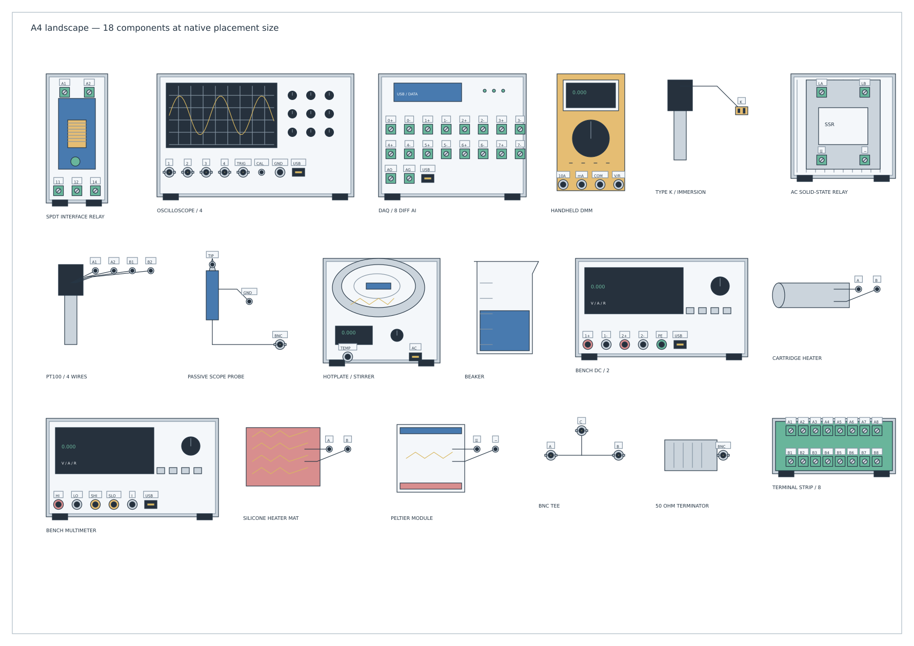
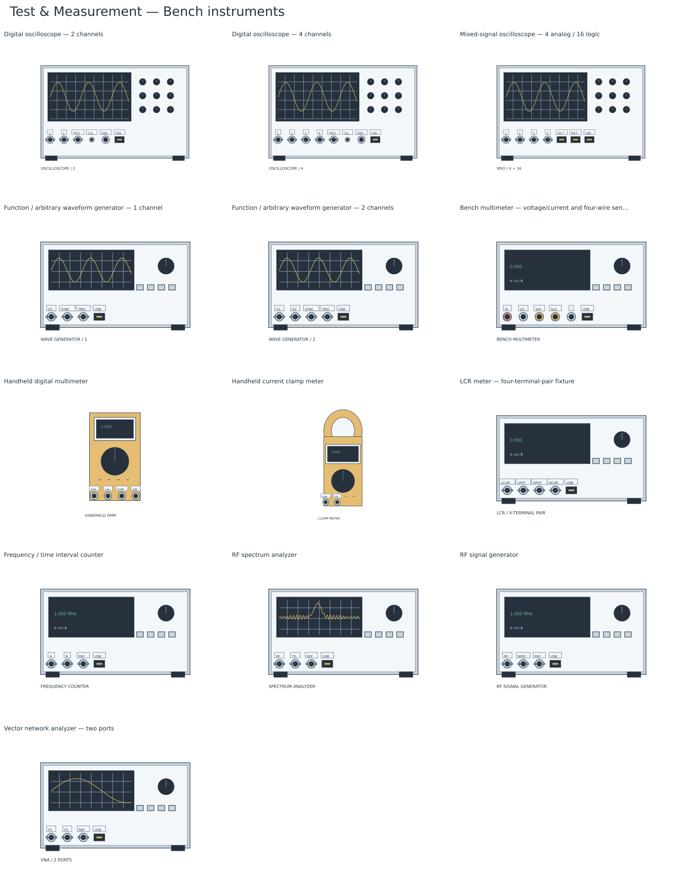
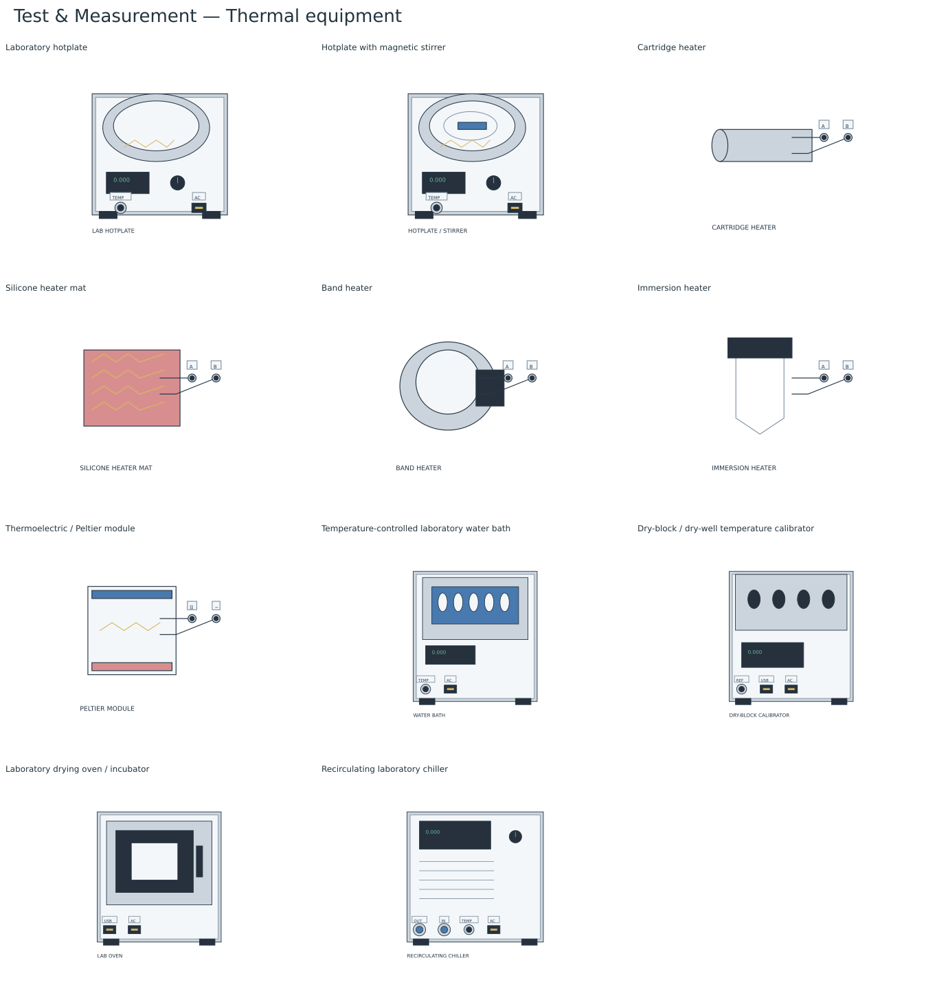

# Test & Measurement

Select **Standard → Test & Measurement** for 78 editable laboratory setup resources. The [native library](../bundled-libraries/test-measurement/test-measurement.tclib) is bundled in desktop and browser builds. It covers electronics benches, instrument connections, temperature experiments, heater/relay control, data acquisition, calibration and general lab apparatus.

The artwork is original TinyCAD vector geometry: front panels, screens, knobs, sockets, terminal screws, probe bodies, heaters, relay modules, pumps and glassware. It contains no product photos, logos, traced illustrations or imported icon sets. Manufacturer references informed typical equipment roles and connection conventions. These are generic resources with the listed connections, not replicas or package pinouts of specific products.

## Compact placement sizes

Bodies use diagram dimensions rather than equipment dimensions: the four-channel scope is 64 × 40 mm on paper, a two-output bench supply 56 × 32 mm, a hotplate 38 × 34 mm and an interface relay 20 × 42 mm. Captions and connection labels have separate space. An invisible native envelope preserves the complete caption when a narrow probe appears in the picker or a preview.

The [A4 preview](test-measurement-a4.png) fits 18 mixed instruments, probes, heaters, relays and accessories at their normal placement sizes, with gaps between them. It is an unconnected size-review sheet, not an operational experiment. Generate the editable drawing with `npm run preview:layout-pages` (`build/layout-pages/test-measurement-a4.dsn`).

## Connections

All connection points sit at visible socket openings, screw terminals or lead tips, on the normal drawing grid. The component's hidden **Ports** attribute records the full name, connector kind, endpoint unit and signal domain. Short artwork labels abbreviate these names.

| Endpoint unit | Meaning and examples |
| --- | --- |
| **conductor** | One binding post, screw terminal, bare lead, probe tip or clip. Supply +/−/earth, force/sense, RTD leads, relay contacts and heater leads are individually accessible. |
| **cable** | One complete BNC/coax, USB, LAN, serial, thermocouple plug, logic-pod or equipment-specific sensor/handpiece connection. A BNC point does not separate its centre contact and shield; use the breakout resource when those need individual wires. |
| **hose** | One complete fluid, gas or vacuum connection. Chiller supply/return, pump inlet/outlet and pressure-transducer fluid connections are distinct from electrical terminals. |

These are setup-diagram resources with passive layout endpoints and no SPICE or instrument models. Wires connect the named endpoints in the drawing; they do not run measurements, control heater power, simulate fluids, or establish operating ratings. Common grounds, force/sense links, relay closures, terminal-strip through connections, tee internals and breakout mappings are not joined automatically. Add the required wiring or describe the intended mapping in the drawing.

The 2-, 3- and 4-wire Pt100 probes expose different lead counts. **A** and **B** identify the two element ends; paired letters identify leads belonging to the same physical end without creating hidden netlist links. The four-wire logger exposes all 16 conductors for four channels. Thermocouple loggers use whole polarized TC plug connections. Thermocouple type, connector alloy and lead colours remain equipment-specific.

The scope probe separates its tip and ground clip. A differential probe exposes both inputs. Current-probe jaws and dry-block wells are measurement/mechanical regions, with no fictitious electrical terminals. Matching connector shapes do not imply matching interfaces: pH, RF, LCR and scope BNC ports have different signal domains; USB, serial and sensor cables also remain distinct.

Relay symbols use functional labels. The generic SPDT convention is **A1/A2** for control, **11** common, **12** normally closed and **14** normally open; DPDT adds **21/22/24**. NC is a real contact, not a no-connect pin. The SSR is an AC-load/DC-control arrangement with functional LOAD A/B and CONTROL +/− labels, rather than commercial package pin numbers. The PID resource is specifically a DC-powered, three-wire RTD controller with an SSR drive pair and alarm contact pair. Verify actual hardware terminal assignments and ratings when implementing a setup. An emergency-stop marker describes contact pairs; it does not implement a safety circuit. A Variac is an autotransformer, not an isolation transformer.

## Included resources

### Power and loads (10)

| Resource | Connection points |
| --- | ---: |
| DC bench supply — 1 output | 4 |
| DC bench supply — 2 outputs | 6 |
| DC bench supply — 3 outputs | 8 |
| DC bench supply — 4 outputs | 10 |
| DC supply — separate remote-sense terminals | 6 |
| Source-measure unit — four-wire | 6 |
| DC electronic load — 1 channel | 3 |
| DC electronic load — 2 channels | 5 |
| Programmable AC bench source | 4 |
| Variable autotransformer / Variac | 4 |

### Bench instruments (13)

| Resource | Connection points |
| --- | ---: |
| Digital oscilloscope — 2 channels | 6 |
| Digital oscilloscope — 4 channels | 8 |
| Mixed-signal oscilloscope — 4 analog / 16 logic | 7 |
| Function / arbitrary waveform generator — 1 channel | 4 |
| Function / arbitrary waveform generator — 2 channels | 5 |
| Bench multimeter — voltage/current and four-wire sense | 6 |
| Handheld digital multimeter | 4 |
| Handheld current clamp meter | 2 |
| LCR meter — four-terminal-pair fixture | 5 |
| Frequency / time interval counter | 4 |
| RF spectrum analyzer | 4 |
| RF signal generator | 4 |
| Vector network analyzer — two ports | 4 |

### Acquisition and calibration (8)

| Resource | Connection points |
| --- | ---: |
| USB logic analyzer — 16 channels | 18 |
| USB DAQ — 8 differential analog inputs | 19 |
| USB digital I/O — 8 lines | 10 |
| Thermocouple data logger — 8 inputs | 9 |
| Four-wire RTD logger — 4 inputs | 17 |
| Thermocouple process calibrator | 1 |
| Current-loop calibrator — source/measure | 2 |
| Resistance decade box | 3 |

### Probes and sensors (13)

| Resource | Connection points |
| --- | ---: |
| Passive oscilloscope probe with ground clip | 3 |
| Active differential voltage probe | 4 |
| Clamp-on current probe / transducer | 2 |
| Type K thermocouple — immersion probe | 1 |
| Type K thermocouple — surface probe | 1 |
| Type K thermocouple — bead-wire probe | 1 |
| Pt100 RTD probe — 2 bare leads | 2 |
| Pt100 RTD probe — 3 bare leads | 3 |
| Pt100 RTD probe — 4 bare leads | 4 |
| NTC thermistor probe — two bare leads | 2 |
| pH electrode with BNC cable | 1 |
| Pressure transducer — fluid port and 4-20 mA loop | 3 |
| Load cell — four-wire bridge | 4 |

### Thermal equipment (11)

| Resource | Connection points |
| --- | ---: |
| Laboratory hotplate | 2 |
| Hotplate with magnetic stirrer | 2 |
| Cartridge heater | 2 |
| Silicone heater mat | 2 |
| Band heater | 2 |
| Immersion heater | 2 |
| Thermoelectric / Peltier module | 2 |
| Temperature-controlled laboratory water bath | 2 |
| Dry-block / dry-well temperature calibrator | 3 |
| Laboratory drying oven / incubator | 2 |
| Recirculating laboratory chiller | 4 |

### Switching and control (10)

| Resource | Connection points |
| --- | ---: |
| DIN-rail SPDT interface relay | 5 |
| DPDT relay in terminal socket | 8 |
| DC-controlled AC solid-state relay on heatsink | 4 |
| Four-channel relay interface board | 18 |
| Panel PID temperature controller — RTD and SSR drive | 9 |
| Adjustable mechanical thermostat | 3 |
| Three-pole contactor with coil terminals | 8 |
| Mushroom emergency stop — two NC contacts | 4 |
| DC solenoid valve — fluid in/out | 4 |
| DC cooling fan — two leads | 2 |

### Bench apparatus and connections (13)

| Resource | Connection points |
| --- | ---: |
| Laboratory peristaltic pump | 3 |
| Laboratory diaphragm vacuum pump | 3 |
| Laboratory precision balance | 2 |
| Inspection microscope with USB camera | 2 |
| Temperature-controlled soldering station | 3 |
| Laboratory control PC / laptop | 4 |
| Laboratory beaker | 0 |
| Conical / Erlenmeyer flask | 0 |
| Retort stand with clamp | 0 |
| Eight-way terminal strip — both sides explicit | 16 |
| BNC to two binding posts breakout | 3 |
| BNC tee adaptor | 3 |
| BNC 50-ohm terminator | 1 |

## Artwork galleries

[Power and loads](lab-power.png) · [Bench instruments](lab-instruments.png) · [Acquisition and calibration](lab-acquisition.png) · [Probes and sensors](lab-probes.png) · [Thermal equipment](lab-thermal.png) · [Switching and control](lab-control.png) · [Bench apparatus and connections](lab-apparatus.png).

## Online survey and primary sources

The survey selects common laboratory equipment roles and wiring arrangements; it does not rank sales or claim product compatibility. Instrument guides informed the source/measure, force/sense and probe distinctions. Temperature, heater, relay, circulation and laboratory apparatus references informed the remaining equipment families. The native artwork is independently drawn.

- [Keysight E36300 supply front-panel and remote-sense guide](https://www.keysight.com/blogs/en/tech/bench/2021/12/12/five-tips-to-get-the-most-from-keysights-e36300-series-bench-power-supply): Separate output binding posts and remote-sense connections; multi-output supply roles.
- [Tektronix ABCs of probes](https://www.tek.com/en/documents/whitepaper/abcs-probes-primer): Passive voltage, differential and current probes are different interfaces; probe reference leads are explicit.
- [NI differential and single-ended signal wiring](https://knowledge.ni.com/KnowledgeArticleDetails?id=kA03q000000YIfVCAW): Differential acquisition uses positive and negative inputs; signal reference and grounding depend on the source.
- [NI USB-6421 overview](https://www.ni.com/docs/en-US/bundle/usb-6421/page/overview.html): Multifunction USB acquisition combines differential analog input, analog output, digital I/O and counters.
- [DwyerOmega RTD wiring guide](https://www.dwyeromega.com/en-us/resources/rtd-2-3-4-wire-connections): Two-, three- and four-wire RTD configurations need distinct explicit lead counts; four-wire separates excitation and sense.
- [Fluke temperature calibration practice](https://media.fluke.com/dc5b752b-b589-4f3e-b9b3-b2e3010879ff_original%20file.pdf): Probe, reference instrument, bath/dry-block source and controller form common temperature-calibration arrangements.
- [IKA hotplate/stirrer technical data](https://www.ika.com/en/Products-LabEq/Magnetic-Stirrers-pg188/IKA-Plate-Package-10003302/Technical-Data-cptd.html): Hotplates combine heating/stirring controls and support an external temperature sensor.
- [Watlow cartridge/insertion heaters](https://www.watlow.com/-/media/documents/catalogs/cartridge-heaters0618.ashx?hash=F29666EA30A3115F6CC044CD5EB5E1C51772862D&la=en): Cartridge/insertion heater assemblies use a metal sheath and separate heater leads.
- [Phoenix Contact PLC-RSC-24DC/21 relay module](https://www.phoenixcontact.com/en-gb/products/relay-module-plc-rsc-24dc21-2966171): DIN-rail SPDT interface relay with A1/A2 control and 11 common, 12 normally closed, 14 normally open conventions; generic drawing is not a footprint.
- [Omron G3NA solid-state relay family](https://www.ia.omron.com/products/family/992/download/catalog.html): Hockey-puck SSR packaging separates control input from load output; load and control variants must be distinguished.
- [Julabo laboratory circulators](https://www.julabo.com/en-us/laboratory-circulators): Heating/cooling baths and external circulating loops use separate fluid supply and return connections.
- [Pfeiffer vacuum for research](https://www.pfeiffervacuum.com/global/en/industries/research-development/): Laboratory vacuum systems include dry diaphragm pumps and vacuum measurement.
- [Watson-Marlow tubing and peristaltic pumps](https://www.wmfts.com/siteassets/catalog/products/corporate/watson-marlow-pumps/pumpheads/7299/literature/b-wmpumps-medical-devices-en.pdf): Rollers drive fluid through tubing; inlet and outlet are hose endpoints rather than electrical contacts.
- [Mettler Toledo laboratory balances](https://www.mt.com/gb/en/home/products/Laboratory_Weighing_Solutions/laboratory-balances.html): Balances serve sample preparation and can transfer data through USB or serial interfaces.
- [Rohde & Schwarz electronics bench instruments](https://www.rohde-schwarz.com/us/products/test-and-measurement/essentials-test-equipment/rs-essentials-dc-power-supplies/5-essential-tools-on-an-electronics-bench_256910.html): Core bench roles include oscilloscope, multimeter, power supply, signal generator and spectrum analyzer.
- [B&K Precision 891 bench LCR meter](https://www.bkprecision.com/products/electrical-battery-testers/891): Bench LCR measurement uses a four-terminal-pair fixture; current and potential coax terminals are distinct.
- [Keithley low-level measurements handbook](https://www.tek.com/vn/documents/product-article/keithley-low-level-measurements-handbook---7th-edition): Source-measure units distinguish force, sense and driven guard connections.

## Rebuilding and checks

The [recipe](../library-recipes/test-measurement.json) records every resource, endpoint convention, primary source and TinyCAD library search. The [generator](../scripts/lib/test-measurement-artwork.mjs) produces original native XML. The [provenance](../bundled-libraries/test-measurement/test-measurement.provenance.json) records final dimensions, connection coordinates, endpoint units and XML SHA-256 hashes.

- `npm run libraries:test-measurement`: regenerate the SQLite library and provenance.
- `npm run preview:test-measurement`: render all final definitions through the application, check label/caption fit and update XML/SVG/PNG previews under `build/test-measurement/` and the documentation galleries.
- `npm run preview:layout-pages`: generate the editable A4 review sheets and documentation images.
- `npm run test:test-measurement`: verify source/port contracts, separate conductor/cable/hose semantics, socket centres and grid alignment, complete native captions, reproducible SQLite, A4 fit, real editor placement/rotation/mirroring, save/load and instrument, four-wire RTD, temperature-control and hose connection paths.

TinyCAD MCP validates and renders the exact final XML definitions; hash-keyed reports and PNG/SVG previews are cached under `build/test-measurement/mcp/`. The bundle is included in `npm run libraries:all` and standard asset packaging for all application targets.
