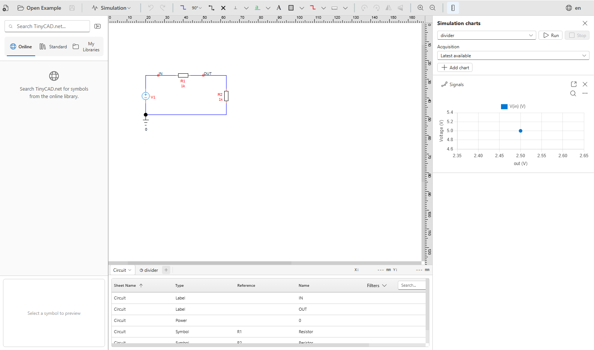

# Start here: how to use these tutorials

[Contents](README.md) · [Next: your first SPICE simulation](spice/01-overview.md)

These tutorials combine explanations with circuits you can run and change in
TinyCAD. **The examples are already bundled with TinyCAD.** You do not need to
download a tutorial ZIP, find a drawing on disk or install a separate SPICE
program to follow the lessons.

Start with the SPICE course if simulation is new to you. It begins with voltage,
current and simple circuits, then progresses to waveforms, filters, amplifiers
and design investigations. The separate XSPICE course covers event-driven logic
and mixed-signal simulation. Use **TinyCAD Desktop** for that course; the browser
engine does not include XSPICE.

## Find and open the bundled examples

1. Open TinyCAD and look for **Open Example** on the drawing toolbar. It has an
   open-folder icon. This opens the example browser.
2. Choose **SPICE tutorial** for the analogue lessons, or **XSPICE and digital
   tutorial** for the digital lessons. The groups also appear in the browser's
   navigation area.
3. In the group's **Drawings** list, select the example named in the lesson.
   For your first experiment, select **divider** in **SPICE tutorial**.
4. Read its description and check the circuit preview. Selecting the example
   shows its details; it does not yet replace your drawing.
5. Choose **Open drawing** at the bottom of the browser. TinyCAD opens an
   editable copy of the example. If you have unsaved work, handle the save
   prompt before continuing.

The short instruction **Open Example → SPICE tutorial → divider → Open drawing**
means these same steps. A name such as **divider**, **rc-ac** or **logic-counter**
is the example's name in this browser, not a filename you need to locate.

Use **Search groups and examples** to find a named example. If a filter hides
what you need, clear the search and use **All groups** to return to the group
list. **Open drawing** becomes available after you select an example.
The **Start here — using the tutorials** entry also displays this guide and
opens the same first divider circuit.

Watch [open, run and change a divider](spice/videos/first-run.mp4) for a captioned
walkthrough of these steps and your first two acquisitions.

## Follow a lesson alongside its circuit

Keep the chapter available in your manual or Markdown viewer while working in
TinyCAD. The example browser also displays the associated lesson description.
Each chapter begins by naming the embedded examples it uses. Some chapters use
several: for instance, the signal-generator chapter provides separate source
examples so you can study one waveform at a time.

Use this routine for each experiment:

1. **Read the question.** Identify what you are investigating: a DC voltage,
   charging time, cutoff frequency, logic state or another quantity.
2. **Inspect the circuit.** Find its source, ground, component values and named
   signals. Labels such as IN and OUT identify electrical nodes; references
   such as R1 and C1 identify components.
3. **Check the saved setup.** Select the **Simulation** sheet and look at
   **Setup**. The examples already contain the analysis settings and models
   needed for the lesson.
4. **Predict the result**, using the explanation or equation in the chapter.
5. **Choose Run**, then compare the new acquisition with the expected values
   and plots. Inspect the numbers as well as the shape of the trace.
6. **Change one thing** as suggested by the lesson, predict its effect and run
   again. Record the setting you changed and what happened.

After opening an example, choose **Explanation** on the toolbar to keep its
instructions beside the drawing. The explanation panel sits alongside the
simulation charts and can be resized or closed independently. Choose
**Explanation** again, or use the collapsed strip on the right, to reopen it.

The toolbar's pulse-shaped icon has the hover text **Simulation**. Whenever a
lesson says **Simulation → Show charts** or **Simulation → Components**, open
that icon's menu. The **Simulation sheet** is a separate tab within the drawing;
it contains the experiment's setup and results views.

This application screenshot shows the divider after opening it, with its sheet
tabs below the circuit and the chart panel on the right. The key starting points
are the circuit, the Simulation sheet and **Run**.

## Understand the expected outputs

Circuit images show the arrangement and connections to look for. Result plots
show reference data computed by the solver. Application screenshots show where
to work in TinyCAD. Your window size, zoom and chart colours may differ; compare
the circuit values, signals, units and analysis settings.

For the unchanged **divider** example, the source is 5 V and both resistors are
1 kΩ. After an operating-point run, expect IN = **5 V**, OUT = **2.5 V** and
source current `v1#branch` = **−2.5 mA**. An operating point has one value per
signal, so it does not produce a time-varying waveform. The first lesson explains
the current sign and the voltage-divider calculation.

The drawings include retained reference acquisitions, so results may already
be visible before you press **Run**. These are stored results from an earlier
run. After editing the circuit or its settings, run again and inspect the new
acquisition. Small numerical differences are normal; a large difference calls
for checking component values, model assumptions, units and measurement windows.

## Keep experiments and return to the original

Embedded examples open as editable copies. Use **Save As** to save your work
under a meaningful name, such as a divider with a different lower resistor.
Saving your copy does not change the bundled original.

To reset an experiment, open the named example again through **Open Example**.
Save any changes you want to keep when prompted. This restores the example's
original circuit, settings and retained reference results. Use the same process
when a chapter moves to another example.

Normal saving can preserve acquired results with the drawing. **Save without
results** keeps the circuit and settings but omits the stored results; run the
simulation again when you next need them.

## Choose your route through the material

| Your aim | Where to begin |
| --- | --- |
| Learn simulation from the beginning | [SPICE chapter 1](spice/01-overview.md), then work through the chapters in order |
| Understand TinyCAD's engines, symbols and controls | [How TinyCAD implements SPICE](spice/11-tinycad-spice.md) |
| Choose an input waveform | [Signal generators](spice/03-signal-generators.md) |
| Investigate the rebuilt AMP.DSN amplifier | [Amplifier bias](spice/07-amplifier-bias.md), followed by gain and power |
| Learn event-driven digital simulation | [XSPICE chapter 1](xspice/01-overview.md), using Desktop |

The links at the top of each chapter return to the contents or move to the next
lesson. You can revisit an earlier example at any time. If an experiment fails,
read its **Diagnostics** view and compare it with a freshly opened embedded
example before making further changes.
