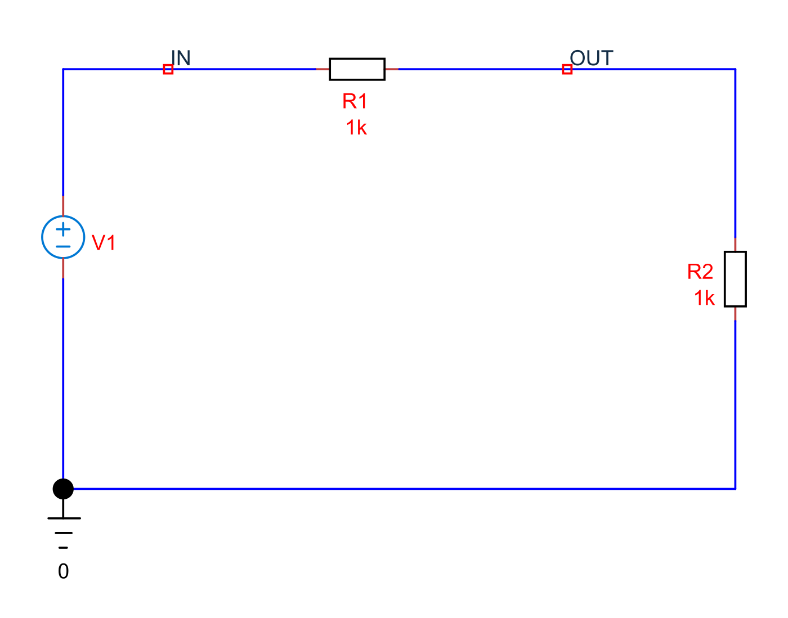
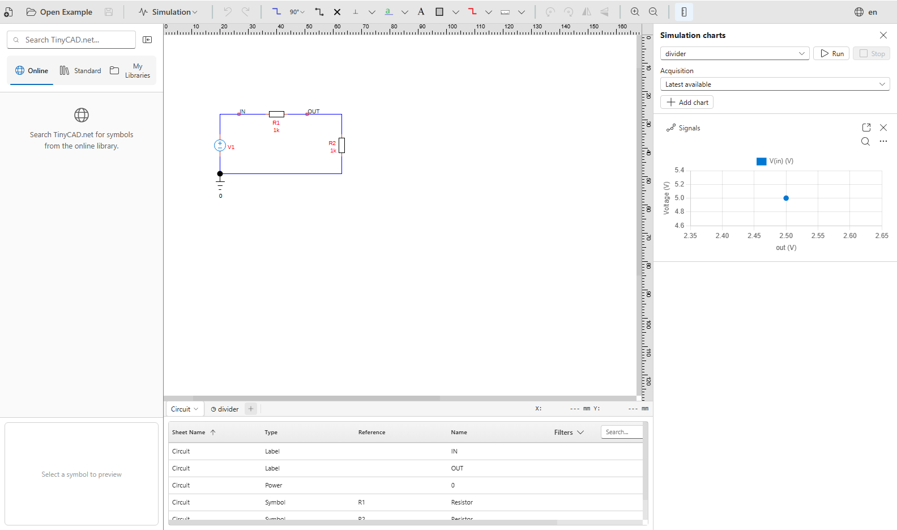
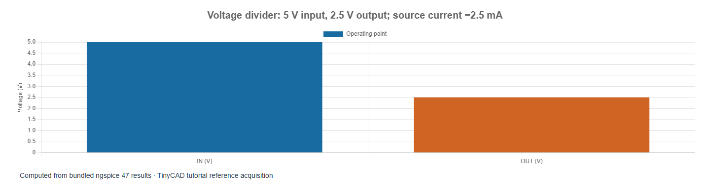

# 1. SPICE: overview and your first simulation

[How to use the tutorials](../00-how-to-use.md) · [Course contents](../README.md) · [Next: DC measurements](02-dc-measurements.md)

The examples in this chapter are bundled with TinyCAD. Choose **Open Example → SPICE tutorial**, select the named example, then choose **Open Drawing**. No download is needed.

SPICE calculates the electrical behaviour of a circuit described by connected
components and their mathematical models. It can find a DC bias point, follow
voltages and currents through time, or calculate small-signal frequency response.
It does not infer an electrical model from a component's drawing. A resistor
symbol needs a resistance and a SPICE template; a transistor additionally needs
parameters describing its behaviour.

This course begins with circuits that can be checked by hand. Later chapters
rebuild TinyCAD's original `AMP.DSN` and investigate its limitations. The purpose
is to learn to ask a precise question, choose the appropriate analysis and judge
whether the answer makes sense.

For a guide to the engine, symbol libraries and controls, see
[How TinyCAD implements SPICE](11-tinycad-spice.md). It explains the distinction
between ngspice and XSPICE and walks through creating your own simulation.

## Open and run the first circuit

Open **divider**. Its 5 V source drives two 1 kΩ
resistors in series. The `OUT` label names their junction; `IN` names the supply.

1. Use **Open Example → SPICE tutorial**, select **divider**, then choose **Open Drawing**.
2. Select its Simulation sheet. The saved analysis is **Operating Point**.
3. Choose **Run**. If charts are hidden, use **Simulation → Show charts**.
4. Inspect `in`, `out` and `v1#branch`. An operating point contains one value
   per signal, so a numeric readout is more useful than a time plot.
5. Select R2 on the Circuit sheet, change **Value** from `1k` to `2k`, and run
   again. Restore `1k` before continuing, or open **divider** again from **Open Example**.

The supplied reference acquisition lets you inspect results immediately. After
editing, run again: retained results describe the circuit at acquisition time.
Saving preserves setup and retained results; **Save without results** makes a
smaller sharing copy while retaining the circuit and simulation settings.

This application screenshot shows the Circuit and Simulation tabs below the
drawing and the Run/acquisition controls in the right-hand panel. Operating-point
charts contain a single point; use the numeric data for precise readings.

## Video: open, run and change a divider

Opening the embedded example, checking the DC numbers, changing R2 and running a new acquisition. This short recording uses TinyCAD Desktop and the native solver.
Instructions are captioned on screen; there is no audio.

<video controls preload="none" src="videos/first-run.mp4" poster="videos/first-run.jpg" aria-label="Open, run and change a divider"></video>

[Watch or download the video](videos/first-run.mp4).

## Predict the answer

The current is `I = 5 / (1000 + 1000) = 2.5 mA`. The lower resistor therefore
has `VOUT = I × 1000 = 2.5 V`. With R2 changed to 2 kΩ, the divider equation gives
`VOUT = 5 × 2000 / (1000 + 2000) = 3.333 V`.

The source current is −2.5 mA. This is not a wiring error: SPICE defines source
current as entering its positive terminal. A source delivering energy has a
negative current under that convention. Chapter 2 uses the sign to calculate
power correctly.

## Four foundations

- **Ground is node `0`.** Voltages are differences; the solver needs a reference.
  A wire labelled `GND` is not a substitute unless it is actually connected to
  the SPICE ground. Use TinyCAD's **Insert Ground** tool.
- **Connectivity is electrical.** A junction dot joins branches. Crossing wires
  without a connection do not necessarily join. Identical net labels connect
  distant points; a nearby text note does not.
- **Units and prefixes matter.** Use `1k`, `10u`, `100n` and `1Meg` in SPICE
  values. In SPICE, `m` means milli, not mega. TinyCAD source controls also accept
  unit-bearing input such as `1kHz` and `5ms`.
- **Models have a scope.** An ideal resistor has no parasitic inductance or
  thermal failure unless those effects are explicitly modelled.

## Choose the analysis that answers the question

| Question | Analysis |
| --- | --- |
| Where do DC voltages and currents settle? | Operating Point |
| What happens after a step or during a waveform? | Transient |
| How does small-signal gain vary with frequency? | AC |
| How does the DC solution change as a source changes? | DC sweep |
| What noise reaches an output over a frequency band? | Noise |
| What are DC small-signal gain and port resistances? | Transfer function |
| Where are the linearised system's poles and zeros? | Pole-zero |

A converged simulation is only the beginning of validation. Check polarity,
units, loading and the analysis type against a simple estimate.

Further reading: the [official ngspice beginner tutorial](https://ngspice.sourceforge.io/ngspice-tutorial.html)
provides a complementary netlist-based introduction.
