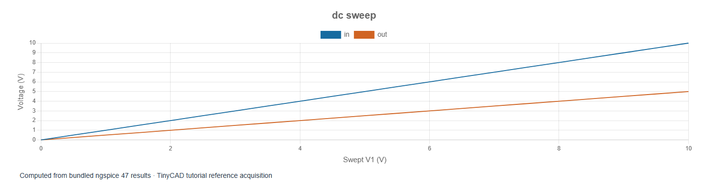

# 2. Measuring DC voltage, current and power

[Previous](01-overview.md) · [Contents](../README.md) · [Next](03-signal-generators.md)

The examples in this chapter are bundled with TinyCAD. Choose **Open Example → SPICE tutorial**, select the named example, then choose **Open Drawing**. No download is needed.

Open **divider**. Keep the nominal 5 V source and two
1 kΩ resistors. The aim is to distinguish node voltage, voltage across a device,
current through it and power absorbed by it.

## Voltage measurements

`out` means the voltage of OUT relative to node 0. The voltage across R1 is
`VIN − VOUT`, which is also 2.5 V here. This equality is accidental: after changing
R2 to 2 kΩ, R1 has 1.667 V while R2 has 3.333 V.

Use **Simulation → SPICE → Insert Probe** for a node voltage. A differential
probe measures its positive terminal minus its negative terminal. Connect its
positive tip to IN and negative tip to OUT to measure R1. Reversing the tips
reverses the result. A differential probe is especially useful when neither
terminal is grounded, such as a coupling capacitor or a bridge output.

## Current measurements

Use a series-current probe by breaking a wire and inserting the probe in the
path. It is modelled as a zero-volt source: current flows through it with no
ideal voltage drop. Connecting it across the supply instead would short the
supply. Positive probe current follows the probe's positive-to-negative terminal
order. Source branch currents, such as `v1#branch`, are also available directly.

For this divider, current flows from V1 through R1 and R2 towards ground. Both
resistor currents are 2.5 mA; V1's branch current is −2.5 mA because it supplies
that current from its positive terminal.

## Power and an energy-balance check

Use the passive sign convention: `P = V × I`, with current entering the terminal
at which voltage is defined positive. Positive power is absorbed; negative power
is delivered.

| Device | Calculation | Nominal result |
| --- | --- | --- |
| R1 | `(2.5 V)² / 1 kΩ` | +6.25 mW |
| R2 | `(2.5 V)² / 1 kΩ` | +6.25 mW |
| V1 | `5 V × (−2.5 mA)` | −12.5 mW |
| Sum | Supply plus loads | 0 W |

This balance is a useful debugging tool. A factor of 1000 often indicates a
prefix mistake. An incorrect sign often indicates reversed probe orientation.
An unexplained extra load may reveal an unintended junction or a meter connection.

TinyCAD's **Measurements** controls can select component voltage, current and
power where the model supports them. A missing supported current vector is
reported as unavailable; it must not be interpreted as zero consumption.

## Sweep the supply

Open **dc-sweep**. The saved **DC sweep** uses V1,
starting at 0 V, stopping at 10 V and incrementing by 0.5 V. Run and plot OUT.

The horizontal axis is the swept source value, not time. Expected values are
0 V, 2.5 V and 5 V at supply values of 0 V, 5 V and 10 V. The slope is 0.5 V/V.
This test is useful for checking bias networks and sensor interfaces before
adding time-dependent stimuli.

## Investigate loading

Add another 1 kΩ resistor from OUT to ground. R2 and the new load are in parallel,
so their equivalent resistance is 500 Ω. The expected output is now
`5 × 500 / (1000 + 500) = 1.667 V`. A voltage divider is not an ideal voltage
source: its output changes when it supplies current.

For a measurement checklist, record the node names, reference direction, units,
source settings and analysis. That information makes a result reproducible and
allows another reader to distinguish a circuit change from a plotting change.
