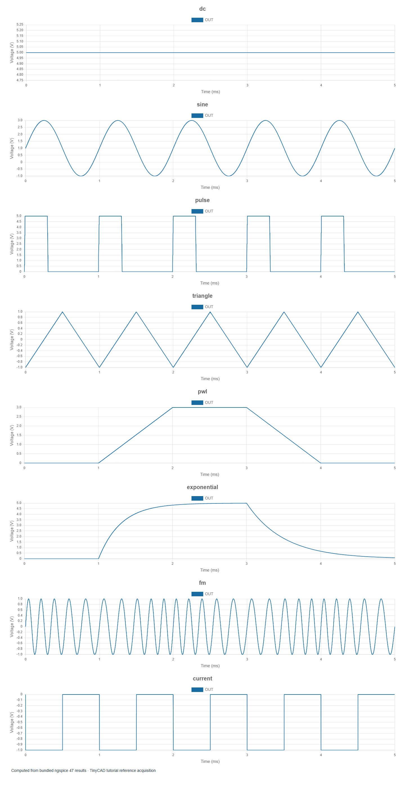

# 3. Choosing and configuring signal generators

[Previous](02-dc-measurements.md) · [Contents](../README.md) · [Next](04-transients.md)

The examples in this chapter are bundled with TinyCAD. Choose **Open Example → SPICE tutorial**, select the named example, then choose **Open Drawing**. No download is needed.

A stimulus describes what drives the circuit. Select a source's body on the
Circuit sheet to open its settings. **Signal type** changes the waveform and
exposes its relevant parameters. The preview shows the programmed waveform;
the simulation calculates what happens after the circuit loads that source.

Every drawing below is ready for a 5 ms transient run. Each voltage source
drives 1 kΩ. Use them to learn one setting at a time before applying a waveform
to a more complicated circuit.

| Drawing | Saved stimulus | Expected behaviour |
| --- | --- | --- |
| **source-dc** (DC) | 5 V | Constant 5 V and 5 mA load current |
| **source-sine** (Sine) | 1 V offset, 2 V peak amplitude, 1 kHz | −1 to +3 V, period 1 ms |
| **source-pulse** (Pulse) | 0–5 V, 10 µs rise/fall, 300 µs high plateau, 1 ms period | Repeating pulses with finite edges |
| **source-triangle** (Triangle) | −1 to +1 V, 1 ms period | Linear rising and falling ramps |
| **source-pwl** (Piecewise linear) | 0 V until 1 ms, ramp to 3 V by 2 ms, hold until 3 ms, fall by 4 ms | A programmed startup-and-shutdown sequence |
| **source-exponential** (Exponential) | 0–5 V, rise begins 1 ms, fall begins 3 ms | Exponential transitions with 300 µs and 500 µs time constants |
| **source-fm** (FM) | 1 V amplitude, 5 kHz carrier, 500 Hz modulation, index 2 | Constant amplitude with changing instantaneous frequency |
| **source-current** (Current pulse) | 0–1 mA into a 1 kΩ return load | Approximately 0 to −1 V with the supplied source orientation |

These are solver plots of the supplied files. The current-source result is
negative because the source draws current from OUT towards ground, and the
resistor supplies its return path. Reverse the source if positive load voltage
is required. An ideal current source imposes current; the network determines
its terminal voltage. It has no automatic compliance-voltage limit.

## Video: source settings and waveform preview

Changing sine offset, peak amplitude and frequency, then rerunning the transient. This short recording uses TinyCAD Desktop and the native solver.
Instructions are captioned on screen; there is no audio.

<video controls preload="none" src="videos/source-settings.mp4" poster="videos/source-settings.jpg" aria-label="Source settings and waveform preview"></video>

[Watch or download the video](videos/source-settings.mp4).

## Amplitude, offset and timing

For a sine, `v(t) = offset + amplitude × sin(2πft + phase)` before optional delay
and damping are considered. Amplitude is a **peak** value, not peak-to-peak or
RMS. A zero-offset 2 V peak sine has 4 V peak-to-peak and 1.414 V RMS. With a 1 V
offset, its total RMS becomes `sqrt(1² + 2²/2) = 1.732 V`.

Pulse width describes the high plateau; finite edges affect the width measured
at a threshold. For the supplied pulse, the duration above 2.5 V is approximately
310 µs, giving about 31% duty cycle. Avoid zero-time edges when studying an
analogue circuit. They introduce unlimited bandwidth and make numerical work
harder without representing a real generator.

Piecewise-linear data uses one increasing time/value pair per line. It is useful
for supply ramps, sensor profiles and non-periodic test sequences. An exponential
source imposes an exponential waveform; it does not add a physical RC network.

## AC excitation is a separate setting

**AC amplitude** and **AC phase** drive AC frequency-response analysis. The sine
frequency field does not set the frequency range of an AC sweep. Likewise, an
AC amplitude of 1 V does not create a 1 V transient sine. Keep these distinctions
in mind when the same input source is used for bias, AC and transient studies.

An ideal independent source has zero output impedance if it is a voltage source,
and infinite output impedance if it is a current source. TinyCAD's **Lab Equipment
→ Function generator** instead includes configurable output resistance (normally
50 Ω). A matched 50 Ω load receives half the generator's open-circuit voltage.

## Controlled sources and practical uses

The SPICE insertion menu also provides a voltage-controlled voltage source and
a voltage-controlled current source. The first implements `Vout = gain × Vcontrol`;
the second implements `Iout = transconductance × Vcontrol`. Their control terminals
and output terminals are separate. Open **controlled-source** for a ready-to-run voltage-controlled voltage source with gain 2. A 1 V peak input produces a 2 V peak output into 1 kΩ. The ideal source has no clipping or supply-power model.

Controlled sources can represent an ideal amplifier,
transducer or dependent load, but do not acquire supply limits or bandwidth
unless the model explicitly includes them.

Try changing only the sine amplitude, then only its offset. Predict the new
minimum, maximum and RMS before rerunning. Next double frequency and halve the
maximum timestep to check that the displayed waveform remains resolved.

Reference: source syntax and waveform definitions are documented in the
[ngspice manual](https://ngspice.sourceforge.io/docs.html).
