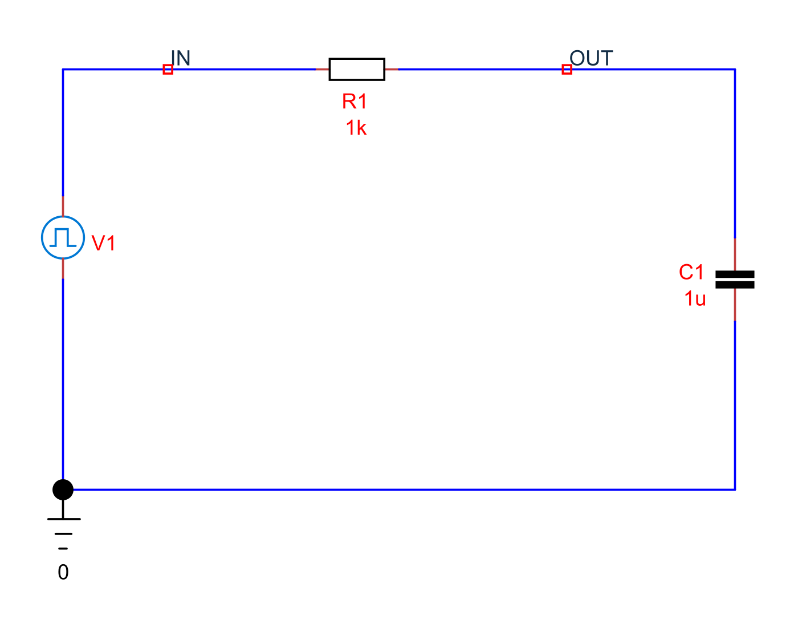
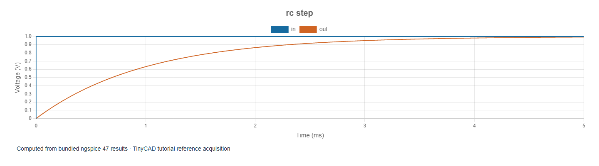

# 4. Transient analysis: charging a capacitor

[Previous](03-signal-generators.md) · [Contents](../README.md) · [Next](05-frequency-response.md)

The examples in this chapter are bundled with TinyCAD. Choose **Open Example → SPICE tutorial**, select the named example, then choose **Open Drawing**. No download is needed.

Open **rc-step**. A source steps from 0 to 1 V through
1 kΩ into a 1 µF capacitor. The saved transient lasts 5 ms with a maximum step
of 5 µs. Plot IN and OUT together.

## Why the output curves rather than jumps

Capacitor current is `i = C × dv/dt`. Immediately after the input changes, the
capacitor is still near 0 V, so almost the full input appears across R1. The
initial current is approximately `1 V / 1 kΩ = 1 mA`. As the capacitor charges,
the resistor voltage and current decrease. The output approaches 1 V rather
than reaching it instantaneously.

The time constant is `τ = R × C = 1 ms`. For an ideal step and an initially
uncharged capacitor, `VOUT(t) = 1 − exp(−t/τ)` volts.

| Time after the step | Expected OUT |
| --- | --- |
| 1 ms = 1τ | 0.632 V |
| 2 ms = 2τ | 0.865 V |
| 3 ms = 3τ | 0.950 V |
| 5 ms = 5τ | 0.993 V |

The supplied source rises over 1 µs, so expect a small difference from the
instantaneous-step equation. Use the chart cursor or a **Value** measurement
at 1 ms. A **Time constant** measurement with initial 0 V and final 1 V should
give about 1 ms. A **Rise time** measurement uses the 10–90% interval: its
expected value is `ln(9) × τ ≈ 2.197 ms`, not 1 ms.

## Duration and maximum step answer different questions

Duration determines how long the experiment runs. Maximum step limits the
solver's spacing between time points. The solver may take smaller steps near
edges or nonlinear events. The number of samples therefore need not equal
duration divided by maximum step.

With too short a duration, settling is invisible. With too coarse a timestep,
edges and peaks can be poorly measured even if the plot looks plausible. Reduce
the maximum step from 5 µs to 2.5 µs and compare the 1 ms reading; a stable result
should change very little. This is a convergence check on the measurement, not
merely a check that the solver reports success.

## Initial conditions and energy

Normally SPICE solves a DC operating point before starting the transient.
Checking **initial conditions** requests the alternative initial-condition
startup path (`uic`). Use it deliberately, with appropriate capacitor/inductor
initial conditions; it is not a universal cure for convergence problems.
This example does not need it because the input's initial value is zero.

At 1 V the capacitor stores `E = ½CV² = 0.5 µJ`. During charging, R1 dissipates
energy and the source supplies both the stored and dissipated energy. Instantaneous
power and accumulated energy are different measurements: integrate power over
the chosen interval to obtain joules.

Try 2.2 kΩ, predict a 2.2 ms time constant, and extend duration to 11 ms. Then
restore R1 and halve C1: the time constant should halve. These changes illustrate
how to design an experiment that distinguishes a component's effect from a
plotting artefact.
