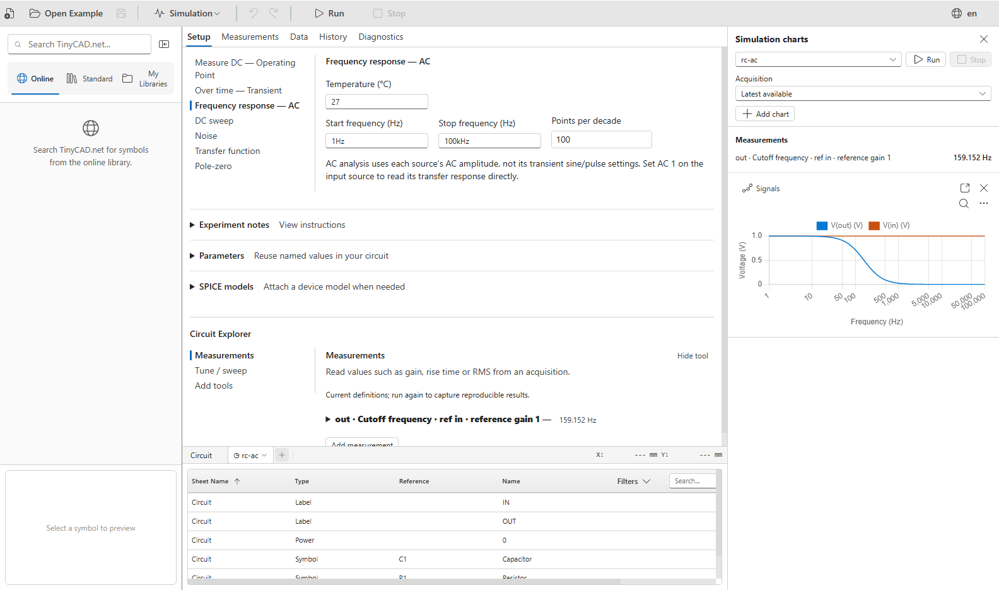
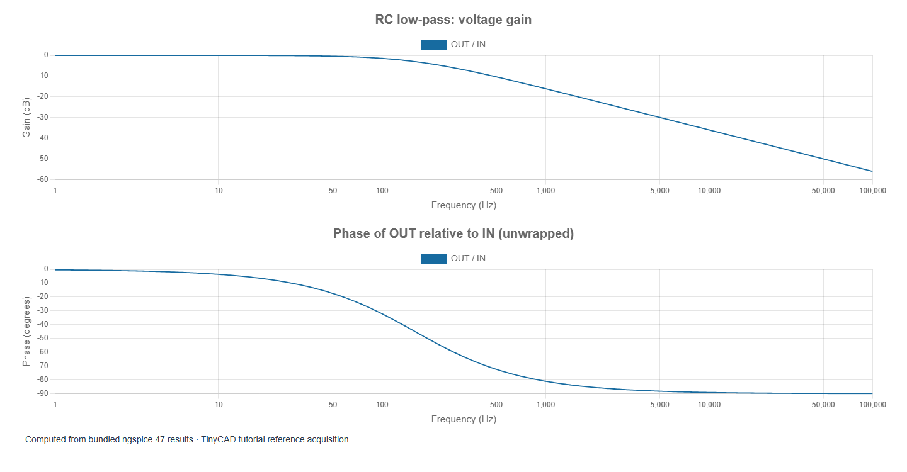

# 5. AC analysis: gain, phase and an RC filter

[Previous](04-transients.md) · [Contents](../README.md) · [Next](06-nonlinear-circuits.md)

The examples in this chapter are bundled with TinyCAD. Choose **Open Example → SPICE tutorial**, select the named example, then choose **Open Drawing**. No download is needed.

Open **rc-ac**. It uses the same 1 kΩ/1 µF network as the
charging lesson, but asks a different question: how much of a small sinusoidal
signal reaches OUT at each frequency?

The source has AC amplitude 1 V. The saved AC sweep runs from 1 Hz to 100 kHz
with 100 points per decade. Run it, select the derived **OUT / IN** trace, and
view magnitude, dB and phase. Use a logarithmic frequency axis.

The screenshot shows the saved setup and the measured 159.152 Hz cutoff. The
expanded figures below present gain and phase separately for easier reading.

## Interpret the complex result

AC analysis linearises the circuit at its DC operating point and solves for
complex amplitudes. It is not a transient simulation in which a sine generator
gradually changes frequency. For this circuit,

`H(jω) = VOUT / VIN = 1 / (1 + jωRC)`.

Magnitude tells you the amplitude ratio; phase tells you the relative timing
within a cycle. Here the output lags the input. The corner is
`fc = 1 / (2πRC) = 159.155 Hz`. At the corner, the magnitude is `1/√2 = 0.7071`
and the phase is −45°. Voltage gain in decibels is `20 log10(|H|)`, giving
−3.0103 dB at the corner.

| Frequency | Approximate gain | Approximate phase |
| --- | --- | --- |
| 10 Hz | 0.9980, −0.017 dB | −3.60° |
| 159.155 Hz | 0.7071, −3.01 dB | −45° |
| 1 kHz | 0.1572, −16.07 dB | −80.96° |

The saved **Cutoff** measurement uses OUT relative to IN and a reference gain
of 1. It should return approximately 159.15 Hz. Sample interpolation can make
the last digits differ from the equation.

## Avoid three common mistakes

First, plotting the real component alone is not plotting amplitude. For a
complex result use magnitude or dB. Second, a gain of −3 dB is not a voltage
ratio of −3: decibels encode a positive magnitude logarithmically. Third, the
minus sign in a real inverting gain belongs to phase, not to a negative
magnitude.

Using AC 1 makes the output voltage numerically equal to gain in this simple
case. Nevertheless, plotting OUT/IN is more robust: it still expresses gain
when input amplitude changes. A nonlinear amplifier's AC result remains a
small-signal result even if AC amplitude is set to a large number. It does not
predict clipping or physical output power.

## Compare component choices

In **Tune / sweep**, the supplied R1 control offers a list sweep of 1 kΩ,
2.2 kΩ and 4.7 kΩ. Run the sweep and compare the curves and cutoff table.
Expected cutoffs are 159.15, 72.34 and 33.86 Hz. Temporary tuning does not alter
the saved resistor until **Apply** is used.

An RC filter can suppress switching ripple before an ADC or reduce a sensor's
high-frequency noise. It also slows the desired signal. Compare this chapter's
frequency response with the longer charging time caused by increasing R1 in
the previous chapter: they are two views of the same physical trade-off.

Reference: the [ngspice beginner tutorial's AC example](https://ngspice.sourceforge.io/ngspice-tutorial.html)
also distinguishes AC excitation from the transient source waveform.
