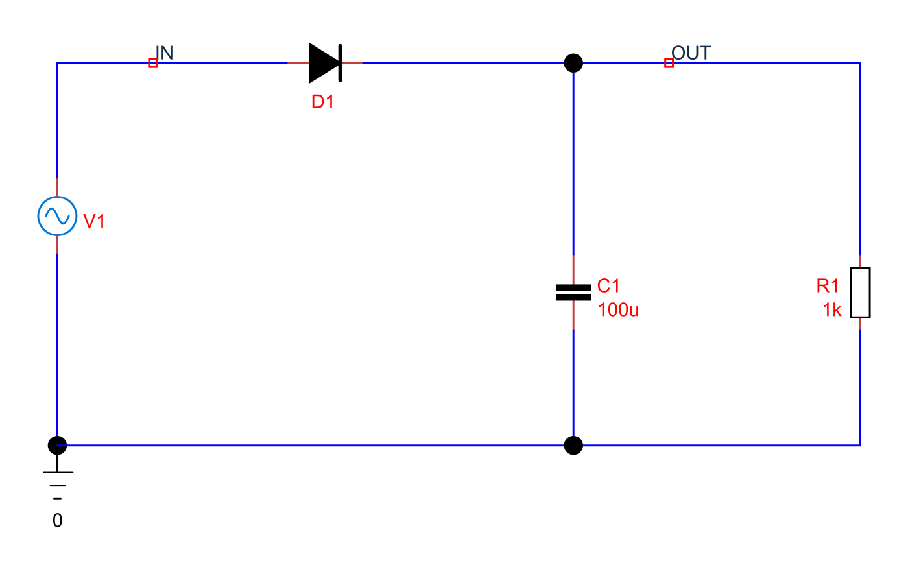
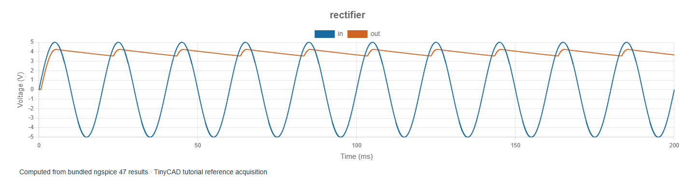

# 6. Diodes, rectification and ripple

[Previous](05-frequency-response.md) · [Contents](../README.md) · [Next](07-amplifier-bias.md)

The examples in this chapter are bundled with TinyCAD. Choose **Open Example → SPICE tutorial**, select the named example, then choose **Open Drawing**. No download is needed.

Open **rectifier**. A 5 V peak, 50 Hz sine drives a
diode, a 100 µF reservoir capacitor and a 1 kΩ load. Run the saved 200 ms
transient and plot IN and OUT.

## Follow the current through a cycle

When the input rises sufficiently above the capacitor voltage, the diode
conducts and replenishes the capacitor's charge. After the input peak, the
diode turns off. The capacitor then supplies the load and its voltage falls
until the next charging interval. Negative input half-cycles do not force the
capacitor negative because the diode blocks reverse conduction at these voltages.

The diode is not an ideal switch with a fixed 0.7 V drop. Its embedded `TC_D`
model includes a nonlinear current/voltage law and series resistance. Forward
drop changes with current, temperature and model parameters. The tutorial uses
a generic model, not a guarantee about a purchased diode.

## Measure a settled window

The first cycles include startup. For a repeatable ripple measurement, use
**From = 160 ms** and **To = 200 ms**. The reference simulation gives:

| Measurement on OUT | Approximate result |
| --- | --- |
| Mean voltage | 3.90 V |
| Minimum | 3.56 V |
| Maximum | 4.24 V |
| Peak-to-peak ripple | 0.684 V |
| Total RMS | 3.908 V |

Mean is the DC level. Total RMS includes that level as well as the ripple.
**Ripple RMS** removes the mean before calculating RMS; it is therefore a
different quantity. A high total RMS does not imply a large AC ripple.

The rough estimate `ΔV ≈ Iload / (f × C)` gives about 0.78 V using 3.9 mA,
50 Hz and 100 µF. Its discrepancy from the simulated 0.684 V is instructive:
it assumes nearly constant load current and instantaneous recharging, whereas
the resistor current changes and the diode conducts for a finite interval.

## Video: measuring settled rectifier ripple

Setting a 160–200 ms measurement window and comparing mean voltage with peak-to-peak ripple. This short recording uses TinyCAD Desktop and the native solver.
Instructions are captioned on screen; there is no audio.

<video controls preload="none" src="videos/rectifier-ripple.mp4" poster="videos/rectifier-ripple.jpg" aria-label="Measuring settled rectifier ripple"></video>

[Watch or download the video](videos/rectifier-ripple.mp4).

## Experiments that reveal the trade-offs

Double C1 to 200 µF. Ripple should decrease, but charging occurs in shorter,
more concentrated bursts. Halve the load resistance to 500 Ω: the load draws
more current, the average voltage falls and ripple grows. To inspect diode
current, request its supported component-current measurement or insert a series
current probe in the diode path. Reduce the maximum timestep to check that
short conduction peaks are resolved.

The source here is ideal. A practical transformer, generator or supply has
impedance that changes charging current and voltage drop. Add a series resistor
to explore that effect. Component power and peak current are useful simulation
outputs, but this simple model does not predict capacitor heating, surge ratings
or diode junction temperature automatically.

## Why AC analysis is not the right first test

The main behaviour is a large nonlinear excursion in which conduction switches
on and off. A small-signal AC analysis around one bias point cannot reproduce
rectification, startup or ripple. Use transient analysis for those questions.
DC sweeps, by contrast, are useful for plotting a diode's static current/voltage
characteristic. Select the analysis according to the physical question rather
than according to which plot is easiest to produce.
