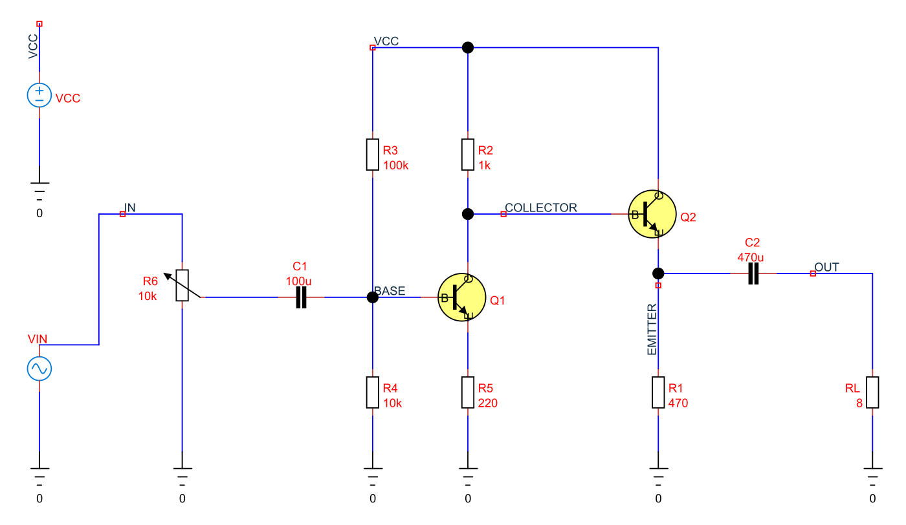

# 7. Rebuilding AMP.DSN and checking its bias

[Previous](06-nonlinear-circuits.md) · [Contents](../README.md) · [Next](08-amplifier-frequency-response.md)

The examples in this chapter are bundled with TinyCAD. Choose **Open Example → SPICE tutorial**, select the named example, then choose **Open Drawing**. No download is needed.

Open **amp-bias**. This rebuilds the topology of
`D:\Projects\TinyCAD\examples\AMP.DSN`, titled **Transistor Amplifier** and
credited in the original to Matt Pyne, 1995. It uses components from TinyCAD's
SPICE essentials library and configurable simulation sources.



## What was preserved, and what was modelled

| Original part | Rebuilt part and role |
| --- | --- |
| R1, 470 Ω, 0.5 W annotation | 470 Ω Q2 emitter resistor; the rating is not a simulated thermal limit |
| R2, 1 kΩ | Q1 collector resistor |
| R3, 100 kΩ; R4, 10 kΩ | Q1 base-bias divider |
| R5, 220 Ω | Q1 emitter degeneration resistor |
| R6, 10 kΩ logarithmic potentiometer | 10 kΩ potentiometer, electrical split `Wiper = 0.5` |
| C1, 100 µF; C2, 470 µF | Ideal input and output coupling capacitors |
| Q1, ZTX650; Q2, BC140 | Both use the embedded generic `TC_NPN` model |
| J1 phono input | Configurable source VIN, referenced to node 0 |
| T1, 8 Ω speaker | RL = 8 Ω, a resistive electrical load |
| 12 V / 0 V rails | Independent 12 V source VCC and SPICE node 0 |

The original logarithmic mechanical taper does not specify a unique resistance
split for every shaft position. Here 0.5 means an **electrical** 5 kΩ/5 kΩ split,
not a claim about the original knob's halfway position. The source resistance
of VIN is ideal. The loudspeaker model omits inductance, resonance and acoustic
efficiency; no sound-pressure prediction follows from it.

Both transistor instances embed the library model:

```spice
.model TC_NPN NPN(Is=1e-14 Bf=200 Vaf=100 Cje=10p Cjc=5p Tf=500p)
```

These are illustrative model parameters, not manufacturer models for ZTX650 or
BC140. Their use is deliberate and visible in the component's SPICE properties.
Exact performance of those original devices would require validated device
models and, for hardware comparison, parasitic and thermal information.

## Understand the two stages

Q1 is a common-emitter stage. Its collector voltage falls when collector current
increases, so it inverts. R5 provides emitter degeneration: negative feedback
reduces gain sensitivity and improves linearity. R2 converts current changes
into collector-voltage changes.

Q2 is an emitter follower. Its collector is connected to VCC and its emitter
drives R1 and, through C2, the speaker load. It provides current drive rather
than another large voltage gain. C1 and C2 isolate DC operating levels between
stages and external connections.

## Run Operating Point before applying a signal

The reference values at 27°C are:

| Quantity | Reference value |
| --- | --- |
| BASE, Q1 base | 1.0235 V |
| Q1 emitter, between Q1 and R5 | 0.3582 V |
| COLLECTOR, Q1 collector / Q2 base | 10.2800 V |
| EMITTER, Q2 emitter | 9.5476 V |
| OUT, after C2 | 0 V |
| Current delivered by VCC | 22.044 mA |
| Supply power | 264.533 mW |

OUT is zero at DC because C2 blocks the emitter's DC voltage and RL returns
the output to ground. A zero output bias therefore does not imply the amplifier
is unpowered. Q1's emitter current is approximately `0.3582 / 220 = 1.628 mA`;
Q2's standing emitter-resistor current is `9.5476 / 470 = 20.31 mA`.

The output-stage bias is high relative to the 12 V rail and the standing current
is modest for 8 Ω. That already suggests asymmetric limits on signal swing.
The next two chapters test the prediction rather than assuming that a circuit
called an amplifier must have high voltage gain or large audio power.
