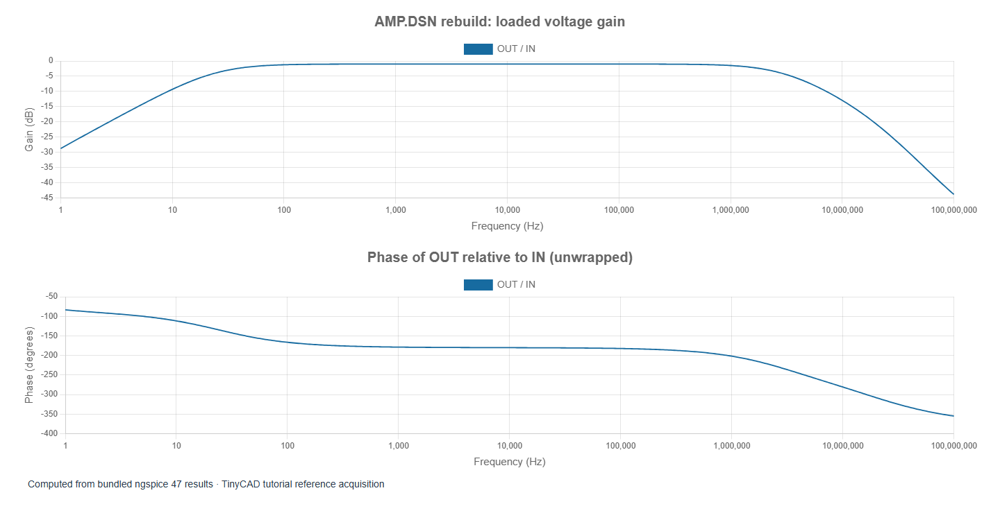

# 8. Measuring amplifier gain and bandwidth

[Previous](07-amplifier-bias.md) · [Contents](../README.md) · [Next](09-amplifier-power.md)

The examples in this chapter are bundled with TinyCAD. Choose **Open Example → SPICE tutorial**, select the named example, then choose **Open Drawing**. No download is needed.

Open **amp-ac**. It is the rebuilt amplifier with AC
amplitude 1 on VIN and an AC sweep from 1 Hz to 100 MHz at 60 points per decade.
The wide upper range makes the generic transistor model's roll-off visible;
it does not establish that the original hardware behaves accurately at RF.

Select **Voltage gain**, the saved OUT/IN derived trace. View magnitude in dB
and phase. Keep node voltages and dimensionless gain distinct in your notes.

## Read the result before explaining it

With RL = 8 Ω and R6's electrical split at 0.5, the reference gain at 1 kHz is
about **0.892 V/V**, or **−0.995 dB**, with approximately inverted phase.
The sampled peak magnitude is also about 0.892. Half-power crossings relative
to that peak lie near **24 Hz** and **2.9 MHz**; these rounded values reflect
the sampled sweep and the chosen generic model.

These are not unity-gain crossings. A −3 dB bandwidth is measured relative to
the amplifier's passband or peak gain, not necessarily relative to 1 V/V. In
TinyCAD's named bandwidth measurement, select OUT and IN, and set the reference
gain to `peak` when investigating this band-pass-shaped response. A bandwidth
measurement needs both crossings inside the acquired frequency range.

## Why the overall voltage gain is below one

VIN is measured before the volume potentiometer. Its wiper voltage is reduced
further by the amplifier's finite input impedance. Q1 then provides an inverting
voltage gain. Q2 drives a very heavy 8 Ω load through C2, and its finite output
impedance causes additional attenuation. The overall ratio includes every stage.

Compare BASE/IN, COLLECTOR/BASE and OUT/COLLECTOR as separate derived ratios.
They answer different questions. A stage can provide voltage gain while the
complete input-to-load path has less than unity gain. An emitter follower can
still provide useful current gain even when its voltage gain is below one.

## Find the causes of the low- and high-frequency limits

C1 and C2 are series coupling capacitors. Their reactance increases at low
frequency, so they attenuate the signal. C2's effective resistance includes
both the load and the stage's output impedance; using only `1/(2π × 8 Ω × C2)`
does not fully describe the loaded circuit. At high frequency, transistor
capacitances and transit time in the model reduce response and change phase.

Try the following controlled changes, restoring the original after each:

1. Change RL from 8 Ω to 80 Ω. Compare passband gain and the lower corner.
2. Double C2. Check whether the lower corner shifts as much as expected if C2
   dominates; C1 and loading may also matter.
3. Change R6's electrical split. Record the gain from IN and the gain from BASE
   separately so volume attenuation is not confused with transistor-stage gain.
4. Increase points per decade near a crossing and check that the reported corner
   has stabilised before quoting more digits.

AC analysis predicts response to a sufficiently small perturbation around the
bias point. It does not limit output amplitude to the available supply swing.
The next chapter uses a finite transient input to find where the small-signal
prediction stops describing the actual waveform.
