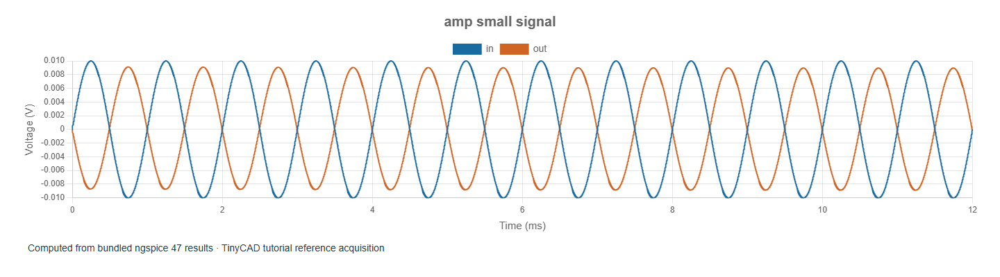
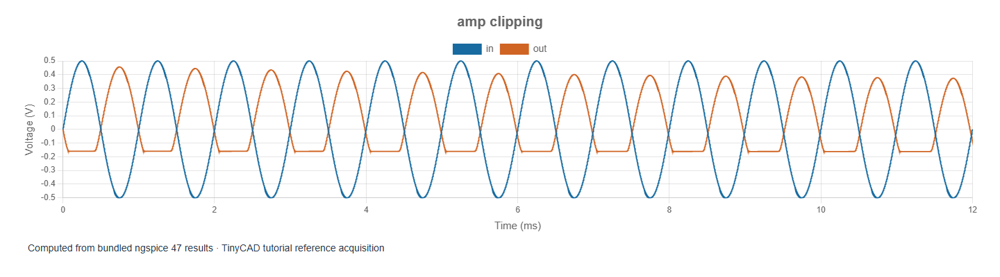

# 9. Amplifier waveform, clipping and power usage

[Previous](08-amplifier-frequency-response.md) · [Contents](../README.md) · [Next](10-design-investigations.md)

The examples in this chapter are bundled with TinyCAD. Choose **Open Example → SPICE tutorial**, select the named example, then choose **Open Drawing**. No download is needed.

Open **amp-small-signal**. VIN supplies a
10 mV peak, 1 kHz sine. The transient lasts 12 ms with a 2 µs maximum step.
Compare IN and OUT, then measure the final four cycles, from 8 ms to 12 ms.

The AC result predicts about 8.92 mV peak at OUT, inverted relative to the input.
The transient gives approximately −8.87 to +8.99 mV over the measurement window,
with **6.304 mV RMS**. The small difference between positive and negative peaks
reflects the nonlinear model and residual transient effects.

## Calculate load power and supply consumption

For the purely resistive RL, instantaneous power is `pL(t) = vOUT(t)² / 8`.
Average load power therefore equals `VOUT,RMS² / 8`, including any DC contribution
over the selected interval. With the small input, this is approximately **4.97 µW**.

Supply power delivered is `−12 × mean(i(VCC))`, approximately **264.61 mW**.
Most power is consumed in the biased circuit even when the audio signal is tiny.
The ratio of load power to supply power is only about **0.00188%** at this input.
This is an electrical efficiency for the chosen boundary and window, not an
acoustic efficiency or a general rating of the circuit.

In TinyCAD, add component power measurements for VCC and RL, then choose **Mean**
with From/To set to 8 ms and 12 ms. A supplying source has negative absorbed
power; take its negative as delivered input power. **Integral** of power gives
energy in joules. A current or power metric unavailable for a model must not be
replaced by a guessed zero.

## Increase input until the linear prediction fails

Open **amp-clipping**. Only VIN amplitude changes,
to 500 mV peak. A linear extrapolation would predict about 446 mV peak at OUT
in both directions. The computed waveform does not do that.

In the same 8–12 ms window the reference output spans approximately
**−0.162 to +0.389 V**, with **0.2126 V RMS**. Supply consumption is approximately
**315.23 mW**; total resistive load power is **5.65 mW**, giving about **1.79%**
electrical efficiency over this window. The output mean is approximately
31 mV in this finite acquisition. For AC-only load power, subtract the mean
before squaring: use ripple RMS, not total RMS.

The emitter follower can actively source current but its pull-down path is
limited by its bias network. The very low load resistance exposes that
asymmetry. Do not call every flat-looking region simply “hitting the supply
rail”: inspect EMITTER, COLLECTOR and device currents to identify the mechanism.

## Make the measurement defensible

Use complete cycles, state the time window and exclude startup if studying
steady operation. Repeat with a longer run to see whether the window's mean
and power stabilise. Reduce maximum step and compare extrema and RMS; solver
samples are not generally equally spaced, so use time-weighted calculations.
An arithmetic average of all sample values can bias the answer towards edges,
where the solver takes more samples.

Distorted waveforms cannot be converted from peak to RMS using `peak/√2`.
That formula applies to a sinusoid. Similarly, transistor electrical power
does not automatically predict temperature: thermal resistance, ambient
conditions and temperature-dependent models are additional information.

Try increasing RL to 80 Ω and compare waveform symmetry, voltage gain and
delivered power. A larger voltage swing does not necessarily mean more power,
because the load resistance also changed.
