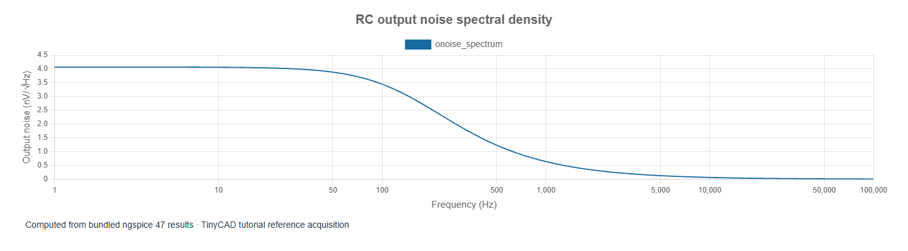

# 10. Design investigations: sweeps, tolerances, noise and diagnosis

[Previous](09-amplifier-power.md) · [Contents](../README.md) · [Next: SPICE in TinyCAD](11-tinycad-spice.md)

The examples in this chapter are bundled with TinyCAD. Choose **Open Example → SPICE tutorial**, select the named example, then choose **Open Drawing**. No download is needed.

A useful simulation report records the question, circuit/model version,
analysis, stimulus, measurement window and acceptance criterion. A convincing
plot without those details is difficult to reproduce.

## Parameter sweeps and tolerances

Return to **rc-ac**. In **Tune / sweep**, run the prepared
R1 values 1 kΩ, 2.2 kΩ and 4.7 kΩ. Their expected cutoffs are 159.15, 72.34 and
33.86 Hz. This is a parameter sweep: it asks how deliberate component choices
affect response. It differs from the **DC sweep** in chapter 2, which changes
an independent source's DC value during one analysis.

For tolerances, use **Analysis lab → Tolerance studies**. Define R1 and C1
bindings, choose a distribution and seed, and add a cutoff requirement. With
independent bounded ±5% values, the extreme RC corners give approximately
144.36–176.35 Hz. A Monte Carlo sample does not necessarily reach either corner.
A normal distribution's standard deviation is not a hard ± limit. Record
which convention you selected and whether variables are correlated.

TinyCAD can retain test-case conditions and measurement/requirement definitions.
Use **Apply** only when you want temporary tuning to become a real schematic
edit. Save a separate circuit revision when changing topology or model text;
an acquisition hash is an identifier, not a recoverable schematic revision.

## Noise: a different kind of output

Open **rc-noise**. It requests output noise at OUT,
referred to independent input source V1, from 1 Hz to 100 kHz at 27°C.
The ideal source is noiseless; R1 contributes thermal noise filtered by C1.

The output-noise total is approximately **64.2 nV RMS** over that band. For an
ideal RC circuit integrated from zero to infinite frequency, the capacitor's
mean-square noise is `kT/C`, giving about 64.4 nV RMS at 300.15 K and 1 µF.
The finite simulation band explains the small difference. Spectral density
has units V/√Hz; its integral is formed from the squared density and frequency
bandwidth, then square-rooted. It is not the arithmetic sum of the displayed
density samples. The input-referred total is a different result.

## Transfer functions and poles

Open **rc-tf**. Its DC small-signal transfer result is
1 V/V, output resistance is 1 kΩ, and input resistance is effectively infinite
because the capacitor is open at DC. A very large printed input resistance
such as `1e20` represents a numerical open-circuit result, not a measured
physical 100 exaohm resistor.

Open **rc-pz**. The pole is approximately **−1000 rad/s**,
matching `s = −1/(RC)`. Divide its magnitude by `2π` to obtain 159.15 Hz. A pole
in the left half of the complex s-plane represents decay in this linear system.
The absence of a finite zero is expected for this first-order low-pass transfer.

These analyses operate on the linearised model. They do not replace transient
testing of clipping, switching or startup. Arbitrary output/input gain is also
not the same thing as feedback-loop gain; stability measurements need a deliberate
loop test configuration.

## A practical measurement menu

| Task | Suitable quantities |
| --- | --- |
| Sensor conditioning | Gain, offset, noise, cutoff, settling time |
| Pulse interface | Rise/fall time, delay, pulse width, duty cycle |
| Amplifier | Bias, gain/phase, bandwidth, RMS output, power, clipping |
| Power stage | Ripple, peak current, mean power, energy, efficiency |
| Component variation | Sweep overlays, worst observed values, requirement results |

TinyCAD also offers a virtual oscilloscope, multimeter, function generator and
current-limited bench supply under **Lab Equipment**. Their impedances and
limits matter: for example, the function generator normally has 50 Ω output
resistance. They provide another workflow for the same electrical questions.

## Diagnose a failed or implausible run

Check ground, unintended shorts and floating nodes first. Confirm component
pin mapping and model names. For AC, verify the independent source's AC amplitude;
for transients, verify duration, maximum step and finite stimulus edges. Read
the solver log and confirm the run reached the requested end time. A partial
waveform is not a completed result.

Try a simpler operating-point or isolated-stage test before changing numerical
settings. Document any added leakage resistance, source resistance or parasitic
capacitance: it changes the circuit as well as helping convergence. Export CSV
when a specialised calculation is needed, and retain units and complex columns.

Further reading: the [ngspice control-language tutorial](https://ngspice.sourceforge.io/ngspice-control-language-tutorial.html)
shows command-line automation. TinyCAD's document model intentionally does not
execute arbitrary `.control` scripts; use its supported analysis and study
controls, or export a netlist for a separate ngspice workflow.
