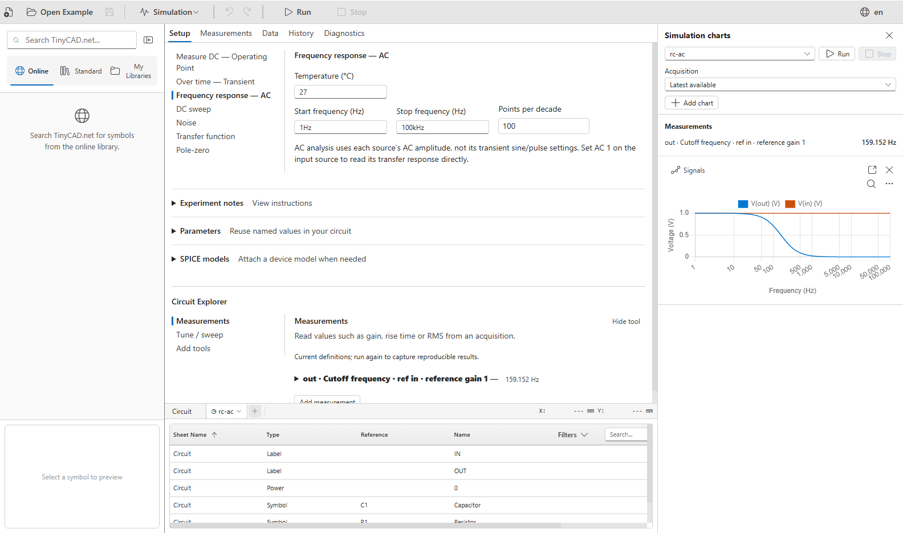
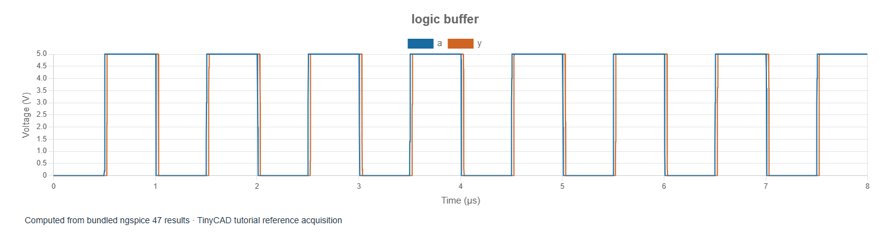

# 11. How TinyCAD implements SPICE

[Previous: design investigations](10-design-investigations.md) · [Contents](../README.md) · [XSPICE course](../xspice/01-overview.md)

TinyCAD provides the schematic editor, simulation settings, instruments, charts
and measurements. **ngspice** is the circuit-solving engine underneath them.
You draw and configure the experiment in TinyCAD; TinyCAD translates it into
SPICE circuit text, runs ngspice and presents the returned results.

The examples in this chapter are bundled with TinyCAD. Choose **Open Example →
SPICE tutorial**, select **divider** or **rc-ac**, then choose **Open Drawing**.
For the digital demonstration, use **Open Example → XSPICE and digital tutorial →
logic-buffer → Open Drawing**. No tutorial or model download is needed.

## SPICE, ngspice and XSPICE

SPICE describes circuits as components, connected nodes and mathematical device
models. An operating-point analysis solves their DC equations. Transient
analysis follows their behaviour through simulated time. AC analysis linearises
the circuit around its bias point to calculate small-signal frequency response.
Selecting the analysis is therefore part of defining the experiment.

ngspice is an open-source mixed-signal circuit simulator descended from Berkeley
SPICE. TinyCAD bundles its engine rather than requiring you to install and run
a separate command-line simulator. The engine used to qualify these tutorials
is **ngspice 47**; a run's **Diagnostics** view identifies its backend and build.
See the [official ngspice overview](https://ngspice.sourceforge.io/presentation.html)
for the upstream project's background.

**XSPICE is an extension integrated into ngspice**, not another application to
launch. It adds code models, including functional analogue blocks and digital
logic whose events are coordinated with the analogue solver. A digital state
change can therefore affect an analogue circuit in the same simulation. The
[official XSPICE introduction](https://ngspice.sourceforge.io/xspice.html)
describes that distinction.

| TinyCAD environment | How the engine runs | Which examples to use |
| --- | --- | --- |
| Desktop | A separate native solver process, with bundled XSPICE code-model libraries | Analogue SPICE and the XSPICE course |
| Browser | ngspice compiled to WebAssembly, running in a separate web worker | Analogue SPICE and compatible analogue behavioural models; this build excludes XSPICE |

TinyCAD chooses the backend for its environment. There is no need to locate an
ngspice executable or select an external simulator for the bundled examples.
An XSPICE drawing can contain its model definitions, but it still needs the
native code-model libraries supplied with Desktop. Copying the drawing to the
browser does not add that engine capability.

## From drawing to result

The main stages are:

1. **Find the electrical connections.** TinyCAD determines which component pins
   share a net from wires, junctions and net labels. A wire crossing is not a
   connection unless the drawing actually joins the nets. Matching net labels
   connect distant points; text drawn near a wire does not.
2. **Expand the component definitions.** Each simulated symbol supplies a SPICE
   template. TinyCAD substitutes its reference, connected node names and values,
   and includes the required device or subcircuit definitions.
3. **Add the experiment.** The Simulation sheet supplies the analysis,
   temperature, parameters, model attachments and requested signals. TinyCAD
   checks for missing models, unresolved pins, duplicate references and other
   detectable setup errors before submitting the circuit.
4. **Run ngspice.** The solver calculates voltages, currents and other requested
   quantities. It returns data and a diagnostic log; TinyCAD collects them into
   an acquisition associated with the run's settings and engine identity.
5. **Inspect and measure.** TinyCAD presents charts, numerical data and calculated
   measurements. For example, a cutoff measurement is derived from the AC data;
   it is not another component inserted into the schematic.

This explains why correct-looking artwork is insufficient: a transistor needs
a model and correct pin mapping, while two wires must be electrically connected
even if their endpoints look close at the current zoom.

## Which symbols should I use?

Open the toolbar's **pulse-shaped icon**. Its hover text is **Simulation**.
In the instructions below, **Simulation → …** means this icon's menu.

| What you need | Where to find it | What to check |
| --- | --- | --- |
| Resistor, capacitor, inductor, diode, LED, NPN/PNP transistor or 741 op-amp | **Simulation → Components**, or the **SPICE essentials** library | Value, polarity, supplies and model assumptions |
| Independent voltage/current stimulus | **Simulation → SPICE → Insert Source** | Source type, signal shape, units and connection direction |
| Reference node | **Simulation → SPICE → Insert Ground** | Connect it electrically; SPICE's reference is node `0` |
| Voltage observation | **Insert Probe** or **Insert Differential Probe** in the SPICE submenu | A single-ended voltage is relative to ground; a differential probe measures between its terminals |
| Branch-current observation | **Simulation → SPICE → Insert Current Probe** | Insert it in series and check the positive direction |
| Dependent source | **Simulation → SPICE → Insert Controlled Source** | Control terminals, output terminals and gain/transconductance |
| Bench-style instruments | **Simulation → Lab Equipment** | Oscilloscope, multimeter, function generator and bench-supply settings; their loading and limits matter |
| Ordinary modelled logic | The **Digital logic** library | These configurable portable SPICE models are distinct from the event-driven XSPICE examples; inspect power pins and model properties |
| Event-driven XSPICE logic | The embedded **XSPICE and digital tutorial** examples | Use Desktop and retain the analogue/digital bridges in the model |

The SPICE essentials library supplies ready-configured examples of common
devices. A generic transistor or a 741-style model is useful for learning, but
its simulated behaviour is not automatically the specification of a particular
manufacturer's part. The amplifier chapters explicitly document the generic
models substituted for the original `AMP.DSN` devices.

A symbol from another library may be drawing-only. Select the placed symbol
and inspect the **SPICE** tab in its properties. It needs a valid SPICE template
and any model definitions that template references. A matching name, package or
picture does not add those definitions. Likewise, a label named `VCC` names a
net; it does not create a supply voltage. Connect an actual source to that net.

## Run an existing experiment

1. Choose **Open Example → SPICE tutorial → divider → Open Drawing**.
2. Select its **Simulation** sheet. Under **Setup**, the saved analysis is
   **Measure DC — Operating Point**. The circuit uses a 5 V source and two
   1 kΩ resistors.
3. Choose **Run**. Use **Simulation → Show charts** if the chart panel is hidden.
4. Inspect `in`, `out` and `v1#branch`. Expect **5 V**, **2.5 V** and
   **−2.5 mA**, respectively. Source current is defined into the positive
   terminal, so a source delivering power has negative current here.
5. Change R2 to `2k` on the circuit sheet and run again. Expect OUT to become
   approximately **3.333 V**. An older retained acquisition still describes
   the earlier circuit; changing a value does not rewrite its results.



This application screenshot shows the **Setup** view for **rc-ac**, another
embedded example. Its 1 kΩ/1 µF filter has a cutoff near **159.15 Hz**. Open it
to compare a frequency-domain experiment with the divider's single DC point.

**Run** starts a finite acquisition with the selected analysis. **Stop** ends
the solver and preserves accepted samples; those samples are a partial result,
not evidence that the requested duration completed. These builds do not expose
pause/resume or an indefinitely live solver. Use **History** to inspect previous
runs and **Diagnostics** to read the solver log.

## Build your own first simulation

Place two resistors from **Simulation → Components**, a source using **Insert Source**
and a ground using **Insert Ground**. Arrange them as a divider: source positive
to R1, R1 to R2, and R2 back to source negative and ground. Give both resistors
`1k`, set the source to 5 V DC, and label the supply `IN` and midpoint `OUT`.
Ensure every component has a unique reference such as R1, R2 and V1.

Choose **Simulation → Simulate** to create a Simulation sheet. Select
**Measure DC — Operating Point** under **Setup**, then **Run**. You should get
the same values as the embedded divider. If it fails, compare the connections,
source settings and SPICE properties with that working example.

For a transient experiment, select **Over time — Transient**, set the duration
and maximum step, and configure a time-varying source. For AC, select
**Frequency response — AC**, set the frequency range and points per decade,
and give the input source a nonzero **AC amplitude**, usually 1 V. Its sine
frequency and transient amplitude do not set the AC sweep. TinyCAD also exposes
DC sweep, noise, transfer-function and pole-zero analyses; the earlier chapters
show when each is useful.

## Inspect the generated SPICE and add models

After running the divider, open **Diagnostics → Generate circuit text**.
The important lines look like this; TinyCAD also adds temperature and saved
signal directives:

```spice
R1 IN OUT 1k
R2 OUT 0 1k
V1 IN 0 DC 5 AC 0 0
.op
.end
```

`R1 IN OUT 1k` means a 1 kΩ resistor between nodes IN and OUT. `0` is the
reference node. This text makes connections and source polarity explicit.
Use **Export circuit** if you need to inspect or run the netlist separately.
TinyCAD's Simulation sheet owns `.op`, `.tran`, `.ac` and the other analysis
commands; do not paste them or `.end` into a component's SPICE properties.

For an additional device model, expand **Setup → SPICE models**. Choose a
`.lib`, `.cir` or `.mod` file, or enter its filename and model text. In either
case, choose **Save model** to attach it. Use a simple filename such as
`device.lib`. Then configure the
symbol's SPICE template to instantiate the appropriate device or `.SUBCKT`,
and include the attachment where needed, for example with `.include device.lib`
in its prologue. Attaching a file alone does not map it onto a symbol.

Check the model's terminal order against the symbol's **pin numbers**, not the
pins' apparent positions on the page. A three-terminal transistor model and a
manufacturer subcircuit may use different node orders. Verify any nested model
references too: included files must also be attached to the Simulation sheet.
The model definitions and attachments travel with the saved drawing.

TinyCAD supports embedded model text, not arbitrary ngspice command scripts or
external executable modules. `.control` blocks, shell commands, external module
loading and file-backed stimuli/models are excluded from this workflow. Use
the supported source controls and analyses, or export the circuit for a
separate command-line ngspice experiment. A vendor model written for another
SPICE dialect may require adaptation before ngspice accepts it.

## How digital simulations fit in

Open **XSPICE and digital tutorial → logic-buffer** on Desktop. Its X1 model
contains an analogue-to-digital bridge, an event-driven buffer and a
digital-to-analogue bridge. The ordinary source drives the analogue input;
the bridges make the logic states accessible as voltages in TinyCAD's charts.



Run the saved transient. Expect 0–5 V pulses with a 1 µs period and an output
transition delayed by approximately 20 ns, with finite edges. Zoom in to inspect
the delay. This figure plots actual solver results from the example.

The model's digital nodes are not ordinary voltage nodes. The bridge thresholds
and its representation of an undefined state are deliberate modelling choices.
A behavioural gate built from analogue SPICE expressions may look similar on a
chart but uses a different simulation method. Continue with the
[XSPICE overview](../xspice/01-overview.md) for bridges, timing, storage and
mixed-signal circuits.

## Save, compare and troubleshoot

Save your experiment with **Save As** to keep an editable copy of the embedded
example. TinyCAD can retain acquisitions with the drawing; **Save without
results** keeps the circuit and setup while omitting those stored results.
Use **Data** exports for CSV, JSON or SPICE raw data when further analysis is
needed. Record which acquisition, model and measurement window you used.

| Symptom | First check |
| --- | --- |
| Missing SPICE information | Use a modelled symbol or configure its SPICE tab |
| Missing model or subcircuit | Model name, attached files, include statement and terminal order |
| Floating circuit or missing ground | A connected SPICE ground and appropriate DC return paths |
| Supply label but no supply voltage | Connect a voltage source or bench supply to the labelled net |
| Empty/zero AC response | Input AC amplitude and the chosen signals |
| XSPICE model unavailable in the browser | Run the example in TinyCAD Desktop |
| Plot does not match edited values | Run again and select the new acquisition |
| Convergence error or incomplete waveform | Read Diagnostics, simplify the circuit and check stimulus edges, timestep and model validity |

The [ngspice manual](https://ngspice.sourceforge.io/docs.html) is the reference
for device and model semantics. TinyCAD's controls determine which of those
capabilities are available through its integrated workflow.
