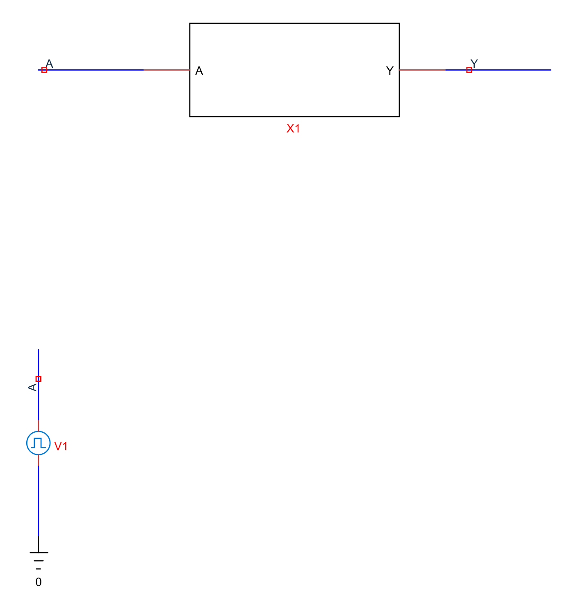
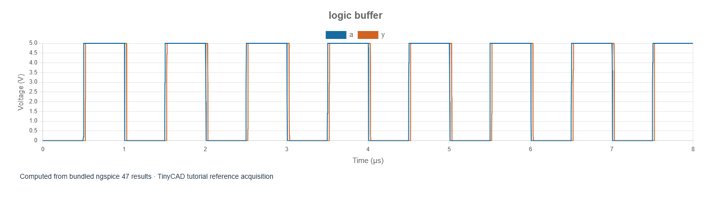

# 1. XSPICE and digital simulation

[How to use the tutorials](../00-how-to-use.md) · [Course contents](../README.md) · [Next: gates](02-gates.md)

The examples in this chapter are bundled with TinyCAD. Choose **Open Example → XSPICE and digital tutorial**, select the named example, then choose **Open Drawing**. No download is needed.

XSPICE extends ngspice with code models and an event-driven simulation system.
An analogue circuit is solved as voltages and currents; an event-driven digital
network propagates logic-state changes through functional models. Mixed-signal
simulation coordinates both. This can make a logic function much simpler to
simulate than a transistor-level implementation, but it does not provide the
same information about supply current, transistor stress or physical timing.

Use **TinyCAD Desktop** for this course. Its bundled native engine includes the
required code models. TinyCAD's browser/WASM engine does not include XSPICE.
The supplied models are embedded in the drawings, but the executable code-model
libraries still come from the native engine installation.

[How TinyCAD implements SPICE](../spice/11-tinycad-spice.md) explains how the
engines, symbol definitions and Simulation sheet fit together.

## First run: an event-driven buffer

Open **logic-buffer**. Run the saved 8 µs transient
and plot A and Y. A is a 0–5 V waveform with a 1 µs period. Y follows it after a
small propagation delay and with finite output edges.




X1 is an embedded subcircuit with three explicit internal stages:

```text
Analogue A → adc_bridge → digital d_buffer → dac_bridge → analogue Y
```

The drawing exposes analogue terminals deliberately: TinyCAD's ordinary chart
system can then plot the input and output as volts. Inside X1, the buffer is a
real XSPICE event-driven model, not a voltage-threshold expression pretending
to be a digital gate. Open X1's SPICE properties to inspect the stages.

## What the bridges mean

The ADC bridge interprets input voltages up to 1 V as low and from 3 V as high.
The interval between them is undefined. This is a logic-domain interface, not
a sampled multi-bit ADC with a clock, resolution and quantisation code.

The DAC bridge maps low to 0 V, high to 5 V and undefined to 2.5 V for observation.
Its rising and falling transition times are 5 ns. A 2.5 V output in this course
can therefore represent an unknown digital state; it is not necessarily a valid
analogue mid-rail signal. These thresholds and voltages are tutorial choices,
not specifications for a particular TTL or CMOS device.

The bridge's ideal output drive has no modelled supply pin. Do not calculate
real logic-chip power consumption from it. To investigate power, use a model
with an explicit supply and appropriate device behaviour.

## A useful division of modelling detail

Use event-driven gates to check truth tables, clock sequences and functional
timing. Use transistor or manufacturer models for electrical loading and device
behaviour when those models support the required effect. Use explicit interfaces
when crossing between analogue and digital domains. A visually similar symbol
does not establish which kind of model it contains.

For a first experiment, change the input period from 1 µs to 2 µs and rerun.
The repetition rate halves; the model's specified propagation delay should
remain essentially unchanged. Period and propagation delay are independent
properties.

References: [XSPICE introduction](https://ngspice.sourceforge.io/xspice.html),
[official XSPICE examples and HOWTO](https://ngspice.sourceforge.io/xspicehowto.html).
