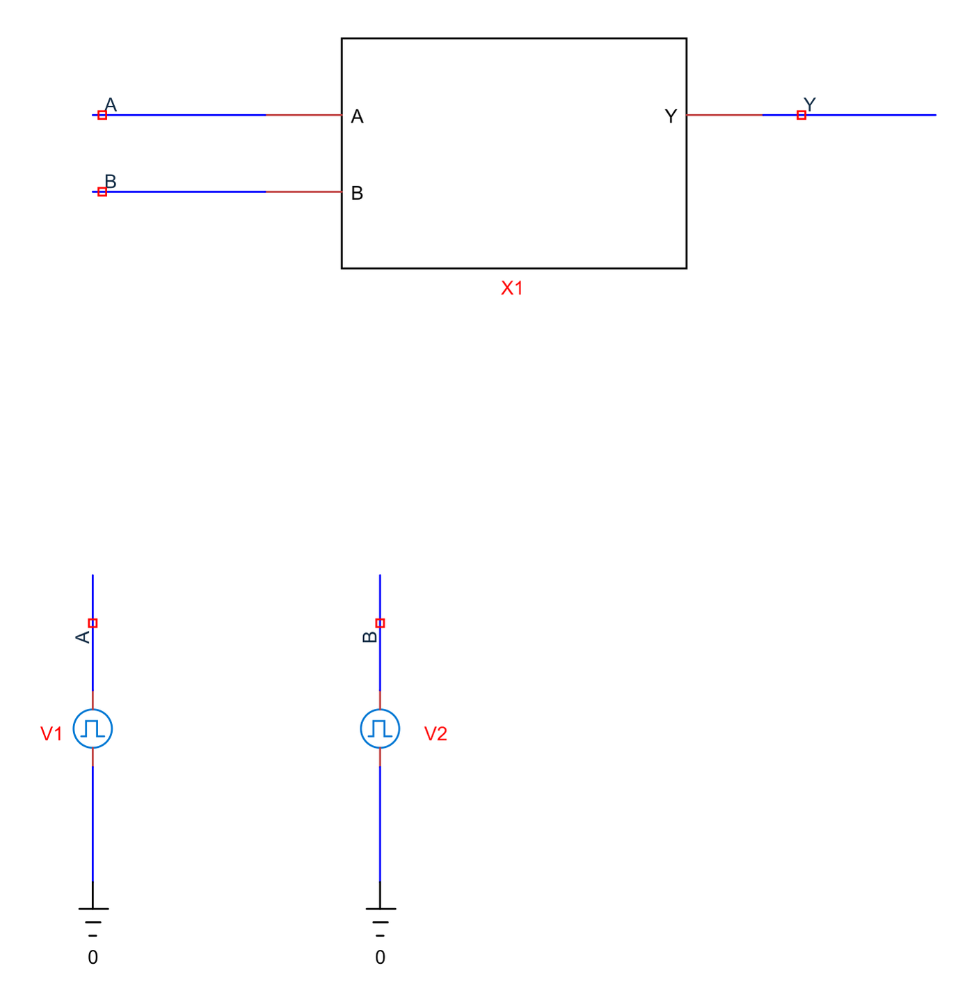
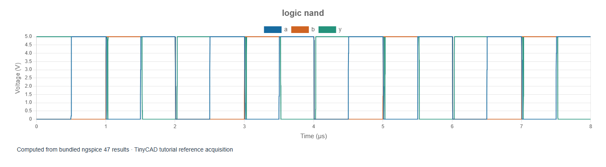
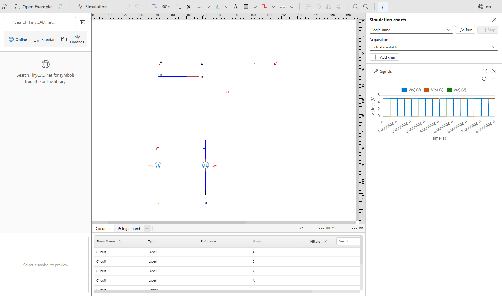

# 2. Gates and truth tables

[Previous](01-overview.md) · [Contents](../README.md) · [Next](03-timing.md)

The examples in this chapter are bundled with TinyCAD. Choose **Open Example → XSPICE and digital tutorial**, select the named example, then choose **Open Drawing**. No download is needed.

Open **logic-nand**. X1 contains ADC bridges, a
two-input XSPICE NAND and a DAC output bridge. Independent pulse sources exercise
A and B at different rates. Run the 8 µs transient and display A, B and Y.






The Boolean function is `Y = NOT(A AND B)`:

| A | B | Settled Y |
| --- | --- | --- |
| 0 | 0 | 1 |
| 0 | 1 | 1 |
| 1 | 0 | 1 |
| 1 | 1 | 0 |

In the plotted analogue representation, zero means approximately 0 V and one
means approximately 5 V. The output becomes low only while both inputs are
high. Observe the middle of each stable interval, not the exact instant when
an input crosses a threshold. The gate has 20 ns rising and falling propagation
delays; the bridges and their finite edges contribute additional timing.

## Run a deliberate truth-table experiment

Use chart cursors to identify a stable interval for each row. Record A, B and Y
after the output has settled. If a very short input combination occurs only
while two inputs change, do not use that transition as evidence for a steady
truth-table row. For an unambiguous manual check, change the two sources to DC
0 V or 5 V, run the transient again, and test the four combinations individually.

In X1's embedded SPICE model, the core statements are:

```spice
Ag [da db] dy ng
.model ng d_nand(rise_delay=20n fall_delay=20n)
```

The square brackets group a vector of input ports. `da`, `db` and `dy` are
internal event-driven nodes. They are not ordinary electrical nets to which a
resistor can be attached directly. The bridges connect these internal nodes
to the analogue terminals visible in the drawing.

To experiment with another function, make a copy of the drawing and change
the model type inside X1's SPICE prolog to a compatible gate such as `d_and`.
Keep the vector/scalar port interface compatible. The AND truth table should
be the inverse of the NAND result after transitions have settled.

## What this example does not establish

The model does not represent a named packaged IC, its ESD diodes, fan-out limits,
supply-current spikes or manufacturer timing versus load. The 20 ns delay is
an input parameter of this experiment. A correct truth table proves functional
logic for the tested states, not electrical compatibility with another chip.

When something is wrong, first inspect the saved source levels, then the bridge
thresholds, then the gate model and port order. An input held at 2 V is undefined
under these bridge settings and cannot be assigned either Boolean value merely
because it is closer to one rail.

Model definitions and port conventions are documented in the XSPICE code-model
chapter of the [ngspice manual](https://ngspice.sourceforge.io/docs.html).
