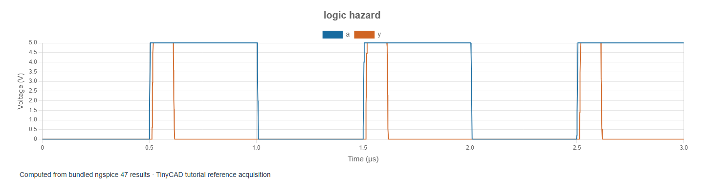

# 3. Propagation delay and logic hazards

[Previous](02-gates.md) · [Contents](../README.md) · [Next](04-flip-flops.md)

The examples in this chapter are bundled with TinyCAD. Choose **Open Example → XSPICE and digital tutorial**, select the named example, then choose **Open Drawing**. No download is needed.

Open **logic-hazard**. Inside X1, one copy of A goes
directly to an AND gate. Another passes through an inverter before reaching the
other AND input. The Boolean expression is `A AND NOT A`, which is always zero
after everything settles. Nevertheless, the transient can contain a pulse.

The inverter has a 100 ns delay and the AND gate has a 10 ns delay. At an input
rising edge, the direct path becomes high while the inverted path remains high
until the inverter responds. For a short interval both AND inputs are high,
so a positive output pulse appears. It is about 100 ns wide in this deliberately
simple model. On the opposite input edge, the two paths pass through a period
in which both AND inputs are low, so the same positive pulse is not produced.

## Measure rather than infer timing from pixels

Run the saved 3 µs transient with maximum step 2 ns. Zoom into a rising edge
near 0.5 µs. Use a 2.5 V threshold to measure the input crossing, output crossing
and output pulse width. TinyCAD's **Delay** measurement uses the output's first
rising crossing minus the reference's first rising crossing in the selected
window. Its **Pulse width** measurement needs a complete pulse in that window.

The total analogue-input-to-analogue-output delay includes threshold crossing,
ADC bridge timing, gate delay and DAC transition time. It is not identical to
the `rise_delay` parameter of one gate. Choose matching thresholds when comparing
measurements and state the interval used.

## Separate three different time quantities

| Quantity | Meaning |
| --- | --- |
| Propagation delay | Time between a triggering input event and the resulting output event |
| Rise/fall time | Time taken by an analogue transition between specified levels |
| Period | Time between repetitions of the waveform |

An ideal event-driven transition can be instantaneous in its digital domain
while the DAC bridge produces a finite analogue slope. A smaller plot timestep
does not reduce the gate's configured propagation delay.

Double the inverter delay to 200 ns in a copy of X1's model and rerun. The pulse
should widen correspondingly. Then increase maximum step substantially and
compare what the plot resolves. The solver may still insert event-related
points, but a coarse setting is not a reliable strategy for measuring short
analogue edges. Restore 2 ns and verify the measured width is stable.

This is a hazard demonstration, not a recommended physical pulse generator.
Real logic delays vary with process, voltage, temperature and loading. A pulse
that appears reliably in a fixed-delay simulation may disappear or change width
in hardware. Use such a test to discover timing sensitivity, then choose a
design with explicit timing requirements and suitable models.
