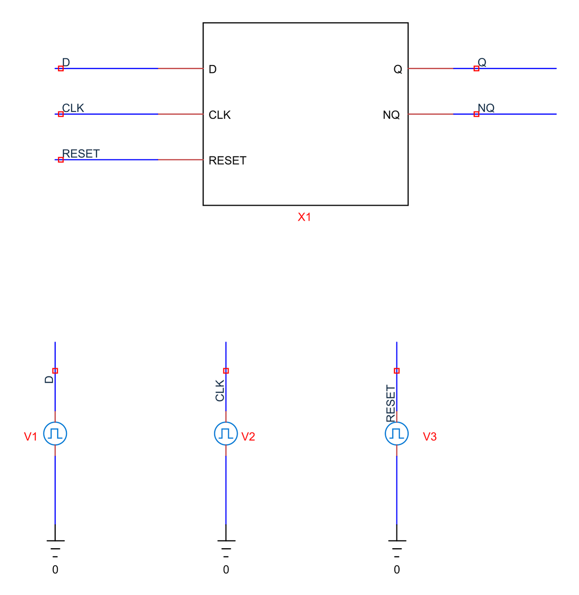
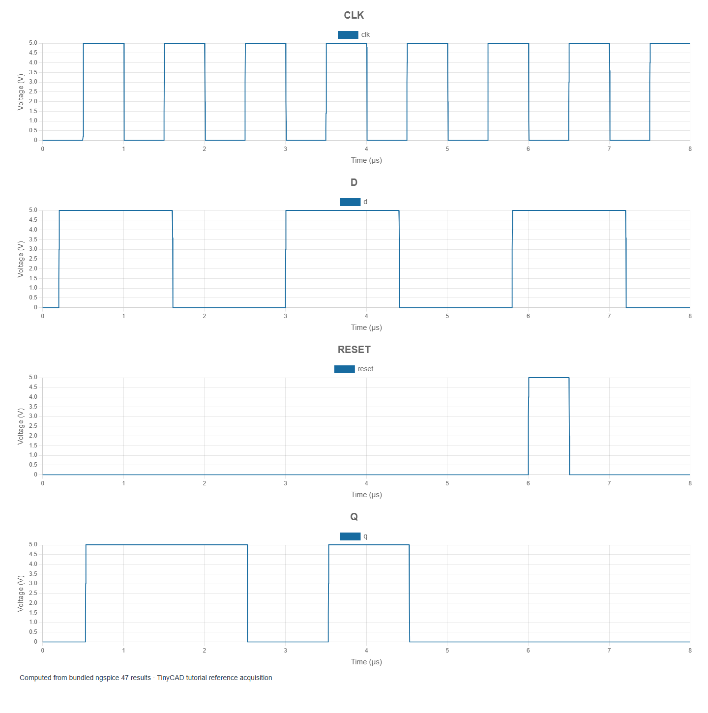

# 4. D flip-flops, clocks and reset

[Previous](03-timing.md) · [Contents](../README.md) · [Next](05-counters.md)

The examples in this chapter are bundled with TinyCAD. Choose **Open Example → XSPICE and digital tutorial**, select the named example, then choose **Open Drawing**. No download is needed.

Open **logic-dff**. It provides separate analogue
stimuli for D, CLK and RESET. Inside X1, bridges feed an XSPICE D flip-flop;
Q and NQ are converted back to analogue outputs for plotting.




Run the 8 µs transient. On each rising clock edge, Q captures D and then holds
that state between edges. NQ is its complement after propagation settles. The
first rising clock edge is near 0.5 µs. D is already high, so Q becomes high
after the model's clock-to-output delay. Falling clock edges do not capture new
data in this positive-edge-triggered example.

## Read the actual model interface

The internal instance is:

```spice
Aff dd dc NULL dr dq dn flip
.model flip d_dff(ic=0 clk_delay=20n reset_delay=20n
+ rise_delay=5n fall_delay=5n)
```

Its ports are data, clock, asynchronous set, asynchronous reset, output and
inverted output. `NULL` leaves the optional set input unused. The initial state
is explicitly zero. Port order is a model contract; the positions of pins on
the visible block do not define it by themselves.

## Test asynchronous reset

RESET goes high near 6 µs for about 0.5 µs. Q clears without waiting for the next
rising clock. While reset is asserted, inspect the output before interpreting
clock behaviour. After reset is released, subsequent clock edges resume data
capture. This example exercises reset independently from the normal D waveform.

Use a short measurement window around the first capture edge to measure
clock-to-Q delay at 2.5 V. The measured analogue delay includes the bridges,
not just `clk_delay`. Use another window around reset to examine asynchronous
clear. Avoid asking a single first-edge measurement to summarise several
different triggering events.

## Initial state and setup/hold assumptions

Setting `ic=0` makes this tutorial repeatable. In a design whose actual power-up
state is unspecified, assuming a convenient initial zero can hide a missing
reset requirement. Try an explicit reset pulse at startup and compare it with
relying on the model's initial-condition setting.

Next move a data transition close to a clock edge. Observe how the functional
model orders events, but do not treat a clean digital result as proof that a
real device meets setup and hold times. This simple functional model is not a
transistor-level metastability model and does not establish a metastability
resolution probability. Manufacturer timing constraints and a suitable device
model remain separate inputs to an electrical timing analysis.

A useful recorded test case contains the data waveform, clock edge convention,
reset polarity and timing, initial-state assumption, expected captured sequence
and measurement threshold. That is more informative than a screenshot of Q alone.
