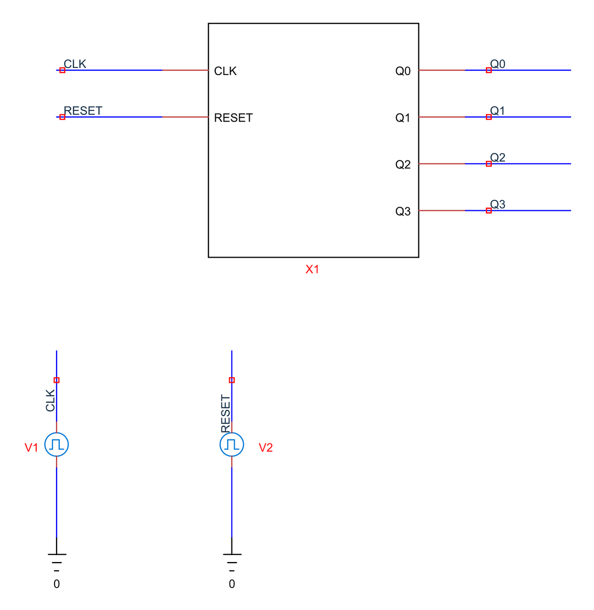
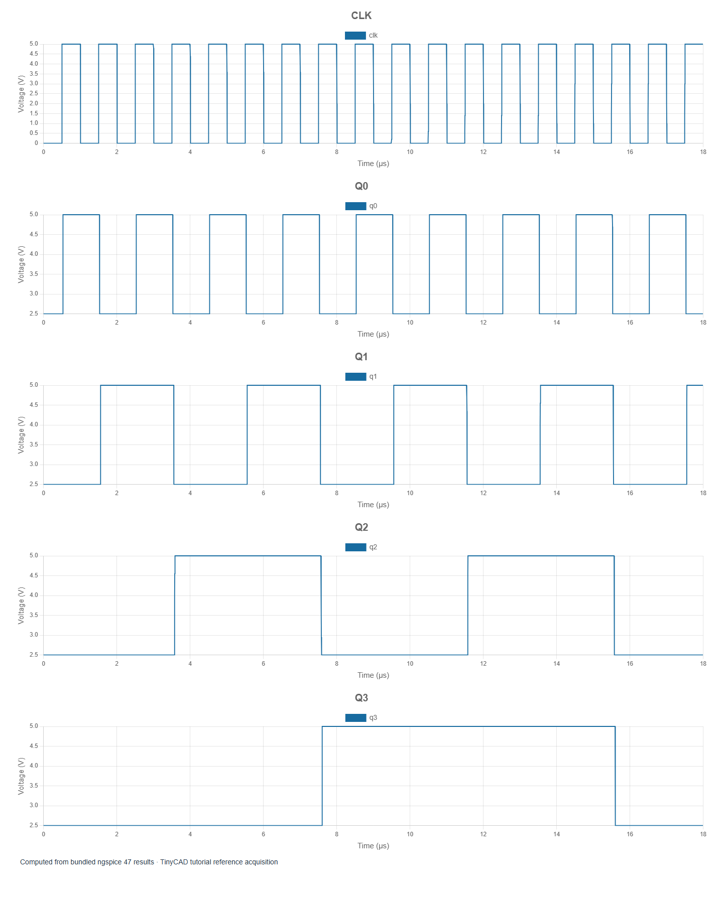

# 5. Counters and divided clocks

[Previous](04-flip-flops.md) · [Contents](../README.md) · [Next](06-mixed-signal.md)

The examples in this chapter are bundled with TinyCAD. Choose **Open Example → XSPICE and digital tutorial**, select the named example, then choose **Open Drawing**. No download is needed.

Open **logic-counter**. X1 contains four D
flip-flops. Each feeds its inverted output back to D so that it toggles when
clocked. The first stage receives CLK; later stages are clocked from the
preceding stage's inverted output. This forms a ripple binary up-counter.




The input period is 1 µs. Reset clears the stages near startup, and the first
counting edge is near 0.5 µs. Run the saved 18 µs transient. Read each value after
the ripple has settled, for example at 0.8 µs, 1.8 µs, 2.8 µs and so on.

The expected decimal sequence is:

```text
1, 2, 3, 4, 5, 6, 7, 8, 9, 10, 11, 12, 13, 14, 15, 0
```

For bit order Q3 Q2 Q1 Q0, the first four values are 0001, 0010, 0011 and 0100.
Convert using `count = Q0 + 2Q1 + 4Q2 + 8Q3`, interpreting a settled voltage above
2.5 V as logic one for this plot.

## Frequency division

Q0 toggles once per input cycle, so its complete period spans two input cycles.
Q1 divides by four, Q2 by eight and Q3 by sixteen.

| Output | Period | Frequency |
| --- | --- | --- |
| Q0 | 2 µs | 500 kHz |
| Q1 | 4 µs | 250 kHz |
| Q2 | 8 µs | 125 kHz |
| Q3 | 16 µs | 62.5 kHz |

The supplied 18 µs acquisition shows rollover, but may not contain two complete
rising edges of Q3 after reset. Extend duration to 35 µs before requesting a
first-complete-cycle frequency measurement for that output. An unavailable
frequency is appropriate when the acquisition does not contain enough evidence.

## Why ripple matters

The bits do not change simultaneously. Each stage responds after the previous
stage's output transition. Zoom into the transition from seven to eight:
temporary intermediate bit combinations appear while the carry propagates.
A combinational decoder connected to those bits could therefore glitch.

This is not the same architecture as a synchronous counter in which all stages
share one clock. A correct settled counting sequence does not make the ripple
counter suitable for every timing-sensitive application. Use this example to
separate functional counting from transition timing.

Try doubling the clock period. The count sequence remains the same but all
output frequencies halve; the configured propagation delays stay fixed. Then
move reset into the middle of the run and check that all bits clear before
normal counting resumes. Record reset timing and allow enough time for the
reset and DAC bridges to settle before sampling a state.

For a design test, define both a functional requirement (correct settled count)
and a timing requirement (maximum allowed settling delay after the clock).
They answer different questions and should be checked independently.
