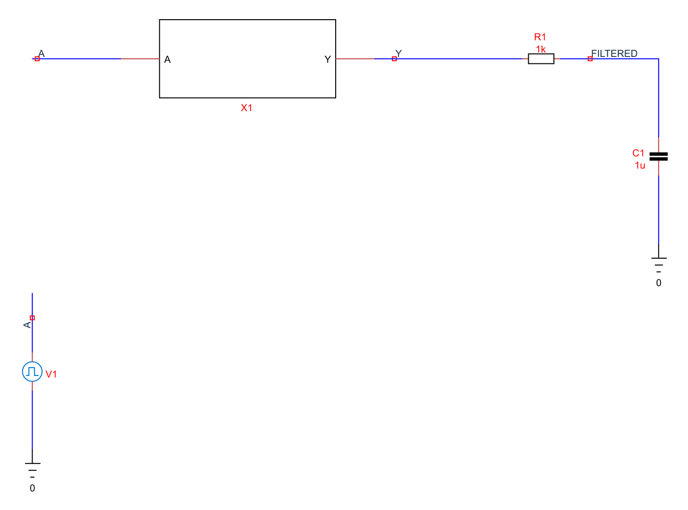
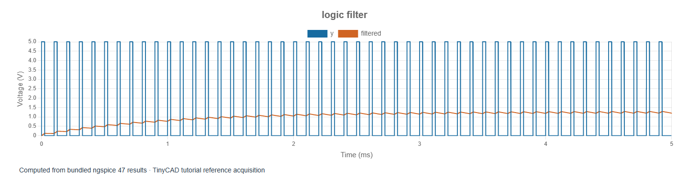
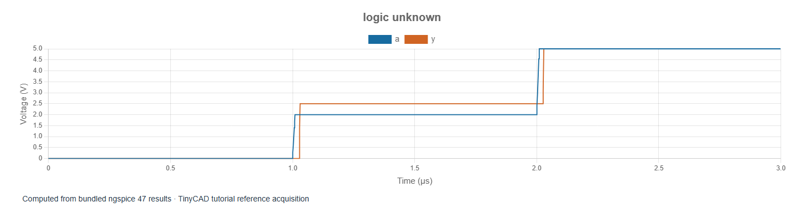

# 6. Mixed-signal filtering and unknown states

[Previous](05-counters.md) · [Course contents](../README.md)

The examples in this chapter are bundled with TinyCAD. Choose **Open Example → XSPICE and digital tutorial**, select the named example, then choose **Open Drawing**. No download is needed.

Open **logic-filter**. A 0–5 V, 10 kHz pulse train
passes through the XSPICE buffer and DAC bridge, then drives a physical SPICE
1 kΩ/1 µF low-pass filter. The high plateau is 25 µs in a 100 µs period, so its
nominal duty cycle is about 25%. Finite input edges make the precise
threshold-defined duty cycle slightly different.

Run the 5 ms transient. Plot A, Y and FILTERED. The digital path preserves the
pulse function; the RC network averages it while retaining some ripple.
The long-term average approaches `5 V × 0.25 ≈ 1.25 V`. Because τ = 1 ms,
startup takes several milliseconds.

## Measure the finite acquisition honestly

In the 4–5 ms window, the reference filtered mean is about **1.242 V**, with
approximately **0.108 V peak-to-peak ripple** (about 1.187–1.295 V). It has not
quite reached the ideal long-term average. Extend duration to 10 ms and compare
the final 1 ms window. A longer filter time constant reduces ripple but increases
settling time, just as in the analogue RC lessons.

This is a useful model for understanding PWM-to-voltage conversion. It is not
a complete microcontroller output model: the DAC bridge has idealised output
drive and no explicit supply-current boundary. Add appropriate driver resistance
or a device model when load current and output-stage losses matter.

## Explore an undefined logic level

Open **logic-unknown**. Its PWL input is held at
0 V, then 2 V, then 5 V. Run 3 µs and inspect the middle plateau.

The ADC bridge's low and high thresholds are 1 V and 3 V. The 2 V plateau lies
between them, so the event-driven input is undefined. That unknown propagates
through the buffer. The DAC bridge maps it to **2.5 V** because its `out_undef`
parameter explicitly requests that display level.

Do not interpret that 2.5 V as a prediction that a physical gate will sit at
mid-rail. It is an encoding chosen to make the unknown state visible on an
analogue chart. The model also does not reproduce noise-induced threshold
chatter or metastability physics. An actual input receiver may require
hysteresis, a specified threshold family and a more detailed electrical model.

## A mixed-signal checklist

Before trusting an experiment, identify which connections carry voltages and
currents and which carry events. Identify every conversion between domains.
Record thresholds, undefined-state mapping, propagation delays, output-edge
times and initial conditions. Check both the settled function and the transition
behaviour. Use an acquisition long enough to contain the cycles or settling
window required by the measurement.

The same approach extends to a comparator feeding digital logic, a divided
clock controlling a switch, or a logic waveform driving an analogue filter.
More complex XSPICE applications, including phase-locked loops and delta-sigma
examples, are linked from the [official XSPICE HOWTO](https://ngspice.sourceforge.io/xspicehowto.html).
Start by validating each domain and interface separately before assembling the
whole system.

You have now used functional gates, hazards, storage, reset, counting and a
mixed analogue/digital path. For electrical power, nonlinear amplifier behaviour
and frequency response, return to the [SPICE course](../spice/01-overview.md).
